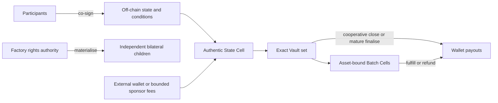
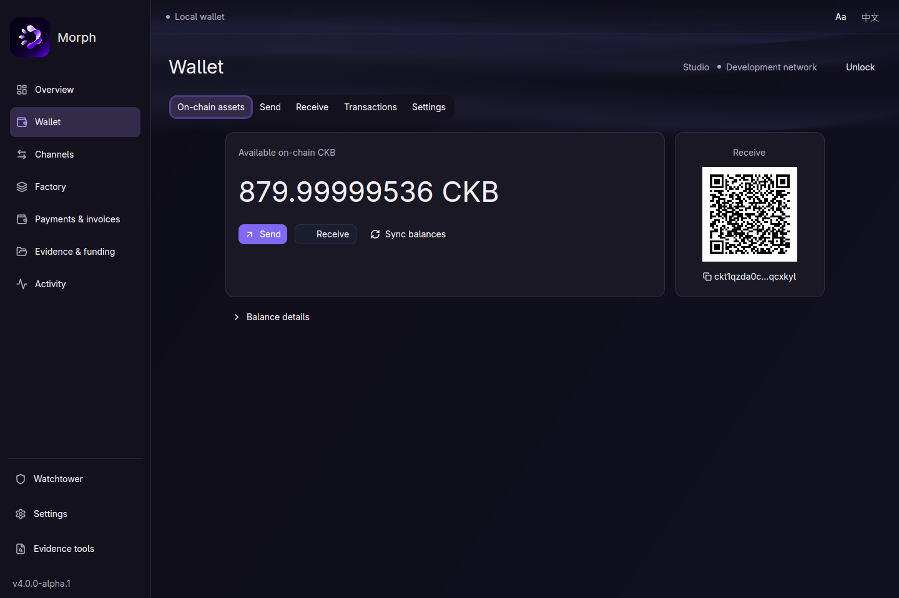

# Morph Channel

Morph separates **off-chain state** from **on-chain custody** on CKB. Two parties
can update balances and conditions without a transaction for every payment; a
Factory can organize shared reserves and create independently recoverable child
channels. CKB scripts enforce signed state, complete custody and exact settlement.

**Version 4.1.0** · tag [`v4.1.0`](https://github.com/Morph-Channel-Network/Morph/releases/tag/v4.1.0)
· [Release highlights](docs/releases/v4.1.0.md)

The current envelope permits controlled devnet use with **no real assets**.
Publishing this version does not widen that deployment policy.

## What 4.1.0 brings

| Area | Current capability |
| --- | --- |
| Channels | One current 318-byte State and 1–8 Vaults for CKB and exact UDT Types; shared update, funding, splice and recovery implementation |
| Conditions | Up to eight asset-bound Batches with eight transfers each; SHA-256/CKB Blake2b fulfill, absolute-block refund and cooperative consolidation |
| Close | Exact-transaction cooperative terminal close, or publish/challenge/finalise without fresh peer signatures |
| Factories | 2–16 members; full-consent custody/materialisation and touched-member reduced rights, deposit, physical release and child creation |
| Hub and wallet | Native GPUI application, local CKB/UDT wallet, bilingual UI, adjustable text, typed Rust SDK and API-only Hub |
| Runtime | SQLite transactions, typed outboxes, protected key files, isolated participant signers, bounded watch/supervision and readiness |
| Fiber | Payment Gateway integration and canonical nonforwarding shadow observations; Morph does not implement routing |
| Resources | Bounded-view caching, compact conditions, Script dictionaries and reduced duplicate verification; [measured costs](docs/model-resource-optimization.md) |

A Factory is a separate rights authority over the same custody foundation, not a
second channel implementation. One asset uses the same code as eight. Unsupported
old wire/package/store formats have no compatibility reader.



CKB reserve, business capacity, each token quantity, the State carrier and fees
are accounted separately. Parent disappearance does not remove a child's saved
bilateral recovery. Reduced operations do not unilaterally retire the Factory's
last retained floor or collective carrier.

## Morph Hub

A native GPUI desktop app for your wallet and channel workspace:

- Create or restore a local CKB/UDT wallet, send and receive assets, and browse
  balances and transaction history.
- Manage channel and Factory records, invoices, recovery documents and activity.
- Review the exact transaction before confirming it.
- Choose public CKB services, a local node, or custom RPC/indexer settings.

Chinese/English switch without clearing drafts. Text scales from 90–150% with
responsive layout. Navigation animation follows measured geometry; restrained
blue-purple motion honors reduced-motion preferences. Network and wallet work
run off the UI thread. The client has no participant signing journal.



This is a captured native development-wallet view, not a live balance or a
product demo-data mode. [Native desktop and Hub guide](docs/native-desktop.md)
· [Local-wallet operations](docs/runbooks/local-wallet.md)

## Start locally

Linux x86-64 is the qualified native platform. Use the pinned Rust **1.95.0**
toolchain and the [native Linux dependencies](docs/native-desktop.md#start).
The wallet works without a Hub: `make desktop`, open **Wallet**, create/restore
and explicitly verify a public, local or custom CKB RPC/indexer connection.

For channel records and operator tasks, start the API:

```sh
cargo run -p morph-cli -- hub serve \
  --listen 127.0.0.1:4617 \
  --pubkey "${MORPH_PUBKEY:?set the compressed secp256k1 public key}" \
  --state-path target/morph-hub/runtime/node.db \
  --ckb-rpc-url "${MORPH_CKB_RPC:-http://127.0.0.1:18114}" \
  --rotate-auth-token-on-restart
```

Then run `make desktop` and connect with the runtime token. Tokens stay in
memory and are cleared on disconnect. The Hub serves `/api` only. A local Hub
record is not proof of funding or canonical settlement; views distinguish those
sources. Readiness, permissions and freshness gate mutations.

**Morph Payment Gateway** is the application-layer gateway for payments, signed
receipts, Biscuit access and paid APIs. Its sole binary/crate is
`morph-payment-gateway`; see [integration](docs/rgbpp-payment-gateway-fiber-integration-plan.md).
Fiber routing and the current nonforwarding Morph shadow hook have different
scopes. No live routed Morph-backed channel is claimed.

## Protocol and operator entry points

```sh
cargo run -p morph-cli -- print-multi-asset-fixture > target/recovery.json
cargo run -p morph-cli -- validate-multi-asset-package target/recovery.json --json
cargo run -p morph-cli --features devnet -- devnet --devnet-only --help
cargo run -p morph-payment-gateway -- --help
```

Use protected key files, independent signer journals and saved complete exits.
Never restore a signer backup to regain old authority. Follow [initial funding](docs/runbooks/initial-funding.md),
[splice](docs/multi-asset-splice.md), [cooperative close](docs/runbooks/cooperative-close.md)
and [watch](docs/runbooks/current-watch-service.md). Native commands use explicit
exact bodies; wallet ownership is not participant/Factory authority.

For a real disposable wallet demonstration:

```sh
CKB_BIN=/absolute/path/to/ckb scripts/native-wallet-showcase.sh
```

The script creates its own development node/wallet and executes real funding
and transfer transactions. It does not inject balances or fake activity into
the normal client.

## Build and evidence

```sh
make build-contracts
make ci
make package-contract-release
make package-desktop
```

`make ci` includes formatting, lint, source/supply-chain hygiene, workspace and
client checks, bounded mutation smoke, fixtures and VM tests. The optional full
candidate workflow is documented in [local qualification](docs/runbooks/local-candidate-qualification.md).
These commands are reproduction instructions, not a claim they ran again for
every documentation/version change. The [release evidence](https://github.com/Morph-Channel-Network/Morph/releases/download/v4.1.0/morph-v4.1.0-evidence.tar.gz)
records the source, builds and performed acceptance.

## Read next

- [Documentation index](docs/README.md) — current guides, architecture, operations and historical evidence.
- [Current model](docs/multi-asset-channels.md), [wire reference](docs/multi-asset-wire.md) and [implementation boundaries](docs/implementation.md).
- [4.1.0 highlights](docs/releases/v4.1.0.md) — Morph Hub, wallet, channels and payments.
- [Resources and Fiber cost comparison](docs/model-resource-optimization.md) — bytes/cycles, returned capacity, fees and dated prices.
- [Deployment envelope](docs/preproduction-envelope.md) and [mainnet readiness](docs/mainnet-readiness.md) — admitted shapes and remaining real-asset gates.
- [Security fixes](SECURITY-FIXES.md) and [contribution/agent guide](AGENTS.md).

Private evidence/rights data, intact signer authority, available publication
fees, timely observation and correctly behaving asset scripts remain necessary.
A test maximum is not universal asset admission. Pooled failover, membership
rotation and live Morph-backed routed/MPP integration remain separate work.
