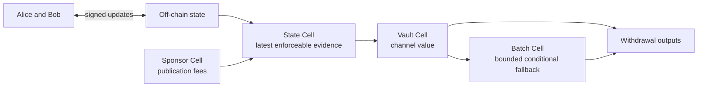
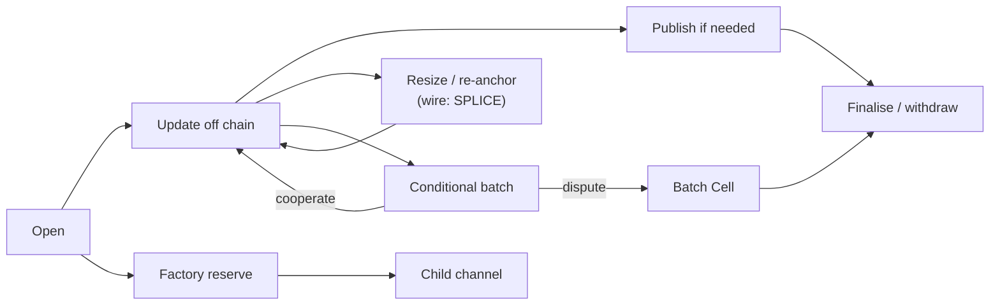

# Morph Channel

Morph Channel is a CKB-native production off-chain channel and factory
implementation. Two participants, or a small factory of participants, move
channel state off chain while CKB keeps the enforceable evidence on chain.

Source version: **v4.0.0-alpha.1**. This controlled-devnet prerelease uses
one current channel implementation and one Factory authority. Recovery and
release evidence are tracked in the [migration ledger](docs/unified-protocol-migration.md).
Mainnet and real assets remain outside the release scope.

The short version is:

- channel value stays in vault cells;
- the latest enforceable state is carried by a state cell;
- publication fees are paid by sponsor cells, not by channel balances;
- newer signed state can replace older settling state before finalisation;
- factories can hold shared reserve rights and materialise child channels;
- one signed state can bind up to eight Vaults, with separate conservation
  for CKB and each xUDT type;
- a signed state can carry up to eight hash/time-locked CKB transfers, with a
  cooperative consolidation path and a script-enforced Batch Cell fallback.

Production engineering is the release bar. Every release carries executable
protocol checks, CKB-VM contract tests, deterministic contract artefacts under
a reviewed data-hash manifest, operator runbooks, and CI provenance. Rollout
proceeds through the documented
[readiness program](docs/mainnet-readiness.md), including independent review
and operational evidence.

## Why This Exists

In many channel systems, the object that holds value and the object that proves
the latest state are tightly coupled. CKB lets Morph separate those jobs.



This separation is the core idea from the paper:

- the vault protects user value;
- the state cell says which state can settle that value;
- sponsor funds pay bounded fees for state publication and supersede;
- factory state tracks shared reserve rights without exposing every unrelated
  participant detail on every local action.

The design tries to make disputes boring. A script should be able to answer
simple questions: who signed this state, is it newer, does it match the current
funding context, do the vault outputs match the descriptor, and did any channel
value leak into fees or sponsor change?

## What Works Today

Implemented locally:

- bilateral CKB channels: open, publish, supersede, finalise, and sponsored
  publication;
- multi-asset settlement: bilateral channels hold up to eight Vaults under
  one signed state with exact whole-set activation/retirement, splices,
  durable signing sessions, CLI/SDK recovery, and durable Hub import/export
  ([wire encoding](docs/multi-asset-wire.md));
- splice-in and splice-out, so a channel can be resized without starting over;
- watchtower-style package publication with cursor persistence, policy checks,
  canonical block-hash reorg recovery, JSONL alerts, and optional webhook alerts;
- current Factory custody: transaction-bound all-member root/metadata approval
  and permissionless complete-set activation (`MORPHFS!`), all-member child
  materialisation (`MORPHFM!`), and localized reduced rights/deposit/release/child
  operations plus funded full-consent changes (`MORPHFR!`);
- one compact Factory rights proof path, with 1–10 metadata rights or up to
  9 physical claims, separate per-Type quantities and global reserve/business
  CKB lanes; see [Factory capabilities](docs/factory-multi-right.md);
- independent durable Factory signer journals, exact wallet-group funding,
  keyless submission, private child-exit delivery and public possession receipts;
- independently enforceable child channels whose fixed originating-Factory
  identity remains through splices;
- a fail-closed operator value-limit policy with a runbook
  (`docs/runbooks/value-limits.md`), checked by `morph-cli value-limit-check`;
- asset-bound CKB/UDT batches (explicit descriptor-7 capability): up to eight
  independent Batches with one to eight transfers each using SHA-256 or CKB Blake2b preimages, canonical absolute-block
  refunds, whole-Vault Batch Cell materialisation, and exact two-party payout;
- a native host lifecycle for arming a batch, recording preimages,
  cooperatively consolidating it, or producing deterministic force-close
  evidence; CLI fixtures and Morph Hub persist the same canonical package;
- two-stage bilateral/Factory Vault activation that binds enforceable state to
  an exact CKB OutPoint and rejects byte-identical clone substitution;
- type-bound FactoryState locking and exact State/Factory carrier-capacity
  conservation, so fee-payer signatures do not become Factory authority;
- devnet smoke and stateful acceptance reports that bind scenarios to real
  transactions, cycle estimates, and expected negative-path failures;
- Morph Payment Gateway for RGB++/x402, native bilateral
  `ChannelBackend`, Factory-right edge registry, and isolated Fiber-hook
  adapter. The gateway x402/credential/fair-exchange flow is exercised over a
  real three-node Fiber devnet route; a real Fiber external-edge hook routing
  a Morph-backed channel is not yet implemented. An opt-in, pinned
  [Fiber shadow patch](integrations/fiber-shadow/README.md) now provides persistent
  diagnostic mirrors and separate RPC permissions, always with forwarding disabled.
  Canonical-chain orchestration and live Morph-backed routing remain separate work.

Production rollout is gated on the qualification program in
[docs/mainnet-readiness.md](docs/mainnet-readiness.md):

- independent external review;
- long-running multi-operator watchtower evidence;
- production fee and reorganisation measurements;
- independent release artefact and supply-chain sign-off;
- the real-asset value envelope.

The `morph-current-custody` profile has a machine-checked no-real-assets
deployment envelope. Current binaries, data-hash manifests, reports and CI
provenance must be refreshed and verified together after consolidation:

```sh
make build-contracts
make release-readiness
make package-contract-release
```

Release mechanics exist; completing the current refresh and the readiness
gates is separate work. Factory membership is bounded to 2–16. The
[current coverage ledger](docs/current-protocol-coverage.md) records accepted
operation limits, safety negatives, proof-data assumptions and local resource measurements.

## Main Business Flows



### Open A Channel

Opening creates a State Cell and a Vault Cell. From the user's point of view,
this is the deposit step: funds move from a normal wallet cell into cells
controlled by channel rules.

### Update Off Chain

Participants exchange signed states. Most updates do not touch CKB. A higher
state number beats a lower one when a dispute reaches the chain.

### Publish If Needed

If cooperation fails, a participant or watchtower can publish a saved package.
The transaction may use sponsor capacity for fees, but sponsor funds do not
become channel value and channel value does not become sponsor change.

### Finalise And Withdraw

After the relative `since` delay, the vault can be spent only against the
current settling State Cell and its settlement descriptor. This is the withdrawal
step.

### Resize / Re-anchor (Wire Name: Splice)

The user-facing operation is a channel resize or funding re-anchor. The current
wire format and CLI retain the historical `SPLICE` name. Resize-in adds value
and resize-out removes value while keeping `channel_id` as the stable logical
identity. Tooling selects the live funding object by its derived
`funding_context_id`; old watch packages must not be reused unless that signed
context still matches the live state track. A resize-out also signs the exact
participant withdrawal lock, and the vault script requires the corresponding
CKB/xUDT output on chain.

### Use A Factory

A Factory groups reserve rights under one Factory State and a complete Vault
set. All-member approval controls arbitrary metadata/custody changes. One
touched member can use a reduced operation only with localized rights proofs,
exact physical accounting and an unchanged retained carrier. Preserve complete
root rights data so every member can refresh their own proof after public updates.

## Repository Layout

```text
crates/morph-core      Protocol objects, signing digests, and invariants.
crates/morph-cli       Fixture tooling, package validators, devnet operations,
                       watchtower commands, and report generation.
contracts/             no-std CKB scripts and shared script parsers.
docs/                  Devnet, implementation, readiness, and tutorial notes.
scripts/               Devnet, smoke, and environment helpers.
crates/morph-packages  Shared canonical package codecs and construction/review.
crates/morph-signer    Bounded participant IPC; CLI key service checks the existing journal.
crates/morph-hub-api   Typed public service contract, without private store state.
crates/morph-sdk       Native Rust protocol and HTTP client.
crates/morph-desktop   Native GPUI wallet and operator console.
crates/morph-wallet    Local encrypted CKB wallet, transfers and bounded observation.
crates/morph-xtask     Rust regression, Fiber/Gateway and hygiene tools.
fixtures/             Current protocol samples, Gateway vector and native scenario data.
```

Important scripts:

- `morph-state-type`: state-cell progression and signed-state checks;
- `morph-state-lock`: state-cell lock boundary;
- `morph-vault-lock`: vault settlement and splice checks;
- `morph-batch-lock`: bounded conditional preimage/absolute-refund settlement;
- `morph-sponsor-lock`: bounded sponsor fee spending;
- `morph-factory-type`: factory state progression, signatures, reduced proofs,
  exits, and envelope dispatch;
- `morph-factory-vault-lock`: factory reserve conservation;
- `morph-devnet-xudt`: local xUDT issuer/conservation script for devnet tests.

## Quick Start

Run the local checks:

```sh
make ci
cargo test --workspace
cargo clippy --workspace --all-targets -- -D warnings
make fixture-checks
make build-contracts
make contract-tests
```

Check the devnet environment:

```sh
scripts/check-devnet-env.sh
```

Run the local operator console:

```sh
cargo run -p morph-cli -- hub serve \
  --listen 127.0.0.1:4617 \
  --pubkey "${MORPH_PUBKEY:?set MORPH_PUBKEY to the local compressed secp256k1 pubkey}" \
  --state-path target/morph-hub/runtime/node.db \
  --ckb-rpc-url "${MORPH_CKB_RPC:-http://127.0.0.1:18114}" \
  --rotate-auth-token-on-restart
```

Set `MORPH_PUBKEY` to the local 33-byte compressed secp256k1 public key as
66 hex characters without `0x`, matching Fiber's RPC-facing node identity
format. Morph derives its internal 32-byte node id from that pubkey. In a second
terminal run `make desktop`, then connect to `http://127.0.0.1:4617` with the
runtime token. The Hub serves `/api` only. The desktop is native GPUI, with no
browser, WebView or JS/TS build. See [native desktop setup](docs/native-desktop.md).

The desktop's **Wallet** works independently of Hub: local creation/import,
encrypted backup/restore, receive addresses and QR codes, CKB/admitted-token
transfers, and transaction history. Keys remain in the local wallet worker.
Channel funding still uses its separate signing and initial-exit ceremony; a Hub
channel record is not a funded channel. See the [wallet runbook](docs/runbooks/local-wallet.md)
for supported assets, bounded transaction policy and current limitations.

When you have a real watchtower JSONL output from a devnet run, add
`--watch-alert-file "$MORPH_WATCH_ALERT_FILE"`. Without that file, Morph Hub
keeps channel, invoice, peer, and factory rows clearly marked as local Hub state
rather than chain evidence.

Morph Hub is token-first. Start with `--auth-token`, `--auth-token-file`,
`--auth-token-stdin`, `--rotate-auth-token-on-restart`, or
`MORPH_HUB_AUTH_TOKEN`; prefer the file, stdin, or rotate-on-restart modes so
the shared secret is not left in shell history, process listings, or environment
dumps. Rotation is restart-based: start the hub with
`--rotate-auth-token-on-restart`, copy the printed `morph_hub_auth_token=...`
value into the native token field, and stop using the old token. Scoped
tokens are supported with
`read,write,restore,sign:<secret>`; omit the prefix only for an all-scope token.
For local development only, `--allow-unauthenticated-loopback` explicitly
restores no-token loopback mode. Direct cross-origin browser access is disabled
unless `--cors-origin` is set to an explicit `http://` or `https://` origin.
Replacing the durable state file through the desktop/API is disabled by default; add
`--allow-state-restore` only when you intentionally need that operator recovery
path. Rows shown in the console are labelled as local Hub state unless future
chain evidence fields prove otherwise.

The console uses bounded authenticated polling while connected. It retains the
token in memory only and clears it on disconnect. It never places credentials in
URLs or persistent preferences. Offline/stale state disables writes, and every
write requires reviewing and confirming the exact request. A lost write response
requires explicit reconciliation, with no automatic retry.

**Morph Payment Gateway** (`morph-payment-gateway`) is the application-layer
payment and access gateway. It processes payments, issues signed receipts and
Biscuit credentials, and controls paid API access. The Rust crate, directory,
and binary all use `morph-payment-gateway`; `morph-sdk` reuses its native Rust
client, payer authorization, receipt validation and fair-exchange decryption.

```sh
cargo run -p morph-payment-gateway -- --help
```

The gateway defaults to a local-only trust boundary.
Plain HTTP is accepted only for loopback payment gateway, Fiber RPC, callback,
and fixed x402 endpoints; remote endpoints must use HTTPS. A non-loopback gateway
listener additionally requires `--api-bearer-token` or
`MORPH_PAYMENT_GATEWAY_API_BEARER_TOKEN` with at least 32 bytes. That token protects
durable challenge/offer creation and the redacted payment index, and is
supported by both native SDKs. Keep Fiber and payment gateway bearer tokens out of URLs,
logs, and shell history.

With a local CKB devnet node running through `scripts/devnet-node.sh`:

```sh
cargo run -p morph-cli --features devnet -- devnet --devnet-only check
cargo run -p morph-cli --features devnet -- devnet --devnet-only mine --blocks 1
cargo run -p morph-cli --features devnet -- devnet --devnet-only deploy-contracts
cargo run -p morph-cli --features devnet -- devnet --devnet-only multi-asset-smoke --asset-count 2 --json
cargo run -p morph-cli --features devnet -- devnet --devnet-only factory --help
make devnet-smoke
make devnet-e2e
make devnet-stateful-e2e
make fiber-morph-devnet-preflight
make fiber-morph-devnet-acceptance
```

Reports are written under `target/devnet-smoke/` and
`target/devnet-stateful-e2e/`. The `latest` symlink points to the newest
successful run when it is safe to refresh.

The Fiber/Morph acceptance path starts Fiber's local CKB devnet stack, runs
Morph's stateful channel/factory matrix against that CKB RPC, and then runs
Fiber channel acceptance on the same devnet. See
[fiber-morph-devnet-acceptance.md](docs/fiber-morph-devnet-acceptance.md) and
[fiber-morph-devnet-runbook.md](docs/fiber-morph-devnet-runbook.md).

## Common CLI Workflows

Review current recovery and Factory requests:

```sh
cargo run -p morph-cli -- print-multi-asset-fixture > target/recovery.json
cargo run -p morph-cli -- validate-multi-asset-package target/recovery.json --json
cargo run -p morph-cli -- inspect-factory-request request.json
cargo run -p morph-cli -- factory-session --session member.json inspect
cargo run -p morph-cli --features devnet -- devnet --devnet-only factory root-prepare --help
cargo run -p morph-cli --features devnet -- devnet --devnet-only factory prepare --help
```

Each Factory member has an independent durable journal. Native preparation
produces a current exact-transaction request; wallet signing and keyless
submission use that same reviewed body. Child initial exits stay private and
must reach both child parties before parent approval. For bilateral funding,
splice and current monitoring, see [initial funding](docs/runbooks/initial-funding.md),
[splice](docs/multi-asset-splice.md) and [the watch service](docs/runbooks/current-watch-service.md).

Run watchtower-style publication:

```sh
cargo run -p morph-cli -- print-watch-policy-fixture > target/watch-policy.json
cargo run -p morph-cli -- validate-watch-policy target/watch-policy.json
cargo run -p morph-cli -- print-watch-config-fixture > target/watch-config.json
cargo run -p morph-cli -- validate-watch-config target/watch-config.json
cargo run -p morph-cli --features devnet -- devnet --devnet-only watch-config-once \
  --config target/watch-config.json \
  --private-key-file target/watchtower-owner.key \
  --json
```

The publication-reliability rehearsal entrypoint is below. Its reports must be
regenerated against the current binaries during consolidation; an older report
does not qualify this release:

```sh
CKB_BIN=../ckb/target/debug/ckb \
  scripts/devnet-publication-reliability.sh
```

This exercises fee-floor rejection, two least-privilege process/key scopes on
one host and one loopback RPC,
cross-operator CKB RBF contention, durable attempt reconciliation, mempool
eviction without a reorg, duplicate rebroadcast, injected delay, and an
IntegrationTest `truncate` reorg. The local report intentionally does not
satisfy the production requirement for 1000 fresh public-network samples.

Compare smoke reports:

```sh
cargo run -p morph-cli -- devnet-smoke-report --dir target/devnet-smoke/latest
cargo run -p morph-cli -- devnet-smoke-compare \
  --baseline target/devnet-smoke/<old-run> \
  --candidate target/devnet-smoke/<new-run> \
  --fail-on-transaction-set-change \
  --fail-on-status-change \
  --max-abs-total-byte-delta 0 \
  --max-abs-tx-byte-delta 0
```

## Reading Guide

- [Devnet guide](docs/devnet.md): local node setup, smoke paths, and reports.
- [Implementation notes](docs/implementation.md): protocol objects, script
  boundaries, and invariant coverage.
- [Roadmap](docs/roadmap.md): milestone status and deferred work.
- [Multi-asset channels](docs/multi-asset-channels.md): the paper-to-code gap
  and proposed multi-Vault settlement path for multiple xUDT types per channel.
- [Factory reduced operations](docs/factory-multi-right.md): compact proofs, current authority,
  host APIs, and security boundaries.
- [Mainnet readiness](docs/mainnet-readiness.md): what remains before any
  production or real-assets claim.
- [Publication reliability hardening](docs/hardening/production-publication-reliability/hardening.md):
  fee pressure, CKB/Fiber comparison, RBF, challenge-window measurement, reorg,
  and dual-operator design and gates.
- [RGB++ / Payment Gateway / Fiber integration plan](docs/rgbpp-payment-gateway-fiber-integration-plan.md):
  the sovereign Factory-to-channel-to-provider-edge design and its release
  gate.
- [2026-08-15 swarm audit](docs/swarm-audit-glm-2026-08-15.md): latest audit
  baseline and findings; [Security fixes](SECURITY-FIXES.md) records the current
  remediation status and negative-path evidence.
- [English tutorial](docs/morph-channel-tutorial.md): a gentler introduction
  with diagrams.
- [Chinese tutorial](docs/morph-channel-tutorial.zh.md): Chinese-language
  walkthrough.

## Production Implementation

Morph Channel is under production development with controlled-devnet evidence.
The current implementation uses one signed State for a bounded Vault set,
separate conservation for CKB and each xUDT Type, and an independent Factory
rights authority. Consolidation, fresh acceptance/release evidence and
independent qualification must be completed before a rollout claim.

The release bar is concrete and stays in force: independent review, repeated
devnet and testnet runs under realistic fees and reorg conditions, CI-backed
release artefacts, operator runbooks, multi-operator watchtower evidence, and
explicit value limits.
