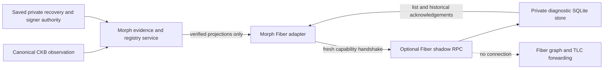

# ADR 004: a pinned, opt-in Fiber shadow hook

Date: 2026-11-10. Scope: W1 #37A and the provider-side persistence needed by
#37B. This decision does not enable routing, qualify a live bridge, or close #37.

## Decision

Carry a small, optional native Fiber RPC patch against
`a5faac7177a2a2ec086a2c6d0da1840ec9fe5703`. Morph owns the patch, shared handler,
qualification and version upgrades until equivalent upstream support is accepted.
The inspected revision has no Morph external-edge hook. `graph_channels` is a
read-only native graph query; external funding creates a native Fiber channel.
Neither operation registers a Morph-backed edge.

The patch adds six RPC methods, explicit configuration, separate Biscuit scopes
and an optional `morph-shadow` build feature. It does **not** change Fiber's graph,
route search, TLC actors, native funding, payment or settlement handlers. The
database and handler come from `morph-fiber-adapter::shadow`; there is no second
wire schema or mirror-state implementation in the patch.

The combined build uses Rust 1.95, the relevant reviewed Morph CKB dependency
patches and rusqlite 0.41.1. Fiber's optional SQLite backend previously selected
rusqlite 0.34. Both versions link the same native library, so they cannot coexist
in one dependency graph. The patch aligns that dependency explicitly; it does
not silently discard the SQLite backend. Changes to that combined lockfile,
patch or Morph source require new qualification.

## Authority and data flow



The canonical observer and durable Morph coordinator library are implemented;
the continuous registry/reconciliation service now has a real Root XUDT checkpoint (see the service section below). See the
[observer checkpoint](../evidence/shadow-observer-2026-11-10/README.md) for exact
checks and initial Root evidence. The subsequent
[origin checkpoint](../evidence/shadow-origins-2026-11-10/README.md) adds three actual
Factory child forms and root-origin splice remove/readmit observations. A saved observation is not a freshness lease.
Provider-side structural validation proves that a descriptor's ID, public keys
and fields agree. It does **not** prove live CKB custody, confirmations, authentic
scripts, freshness, or available liquidity. A provider reply cannot become a
Morph reservation, right, recovery package, signature or payment result.

`forwarding` is always false, including for an `active` mirror. Here active means
visible in the diagnostic registry only. No payment callback is registered or
invoked. Callback addresses are retained as bounded, validated configuration for
future integration, not followed during this phase.

## Contract

The sole profile is `morph.external_edges.shadow.v1`. No previous `enabled`
boolean shape or JSON-number revision fallback is accepted. Public u64 fields
are canonical decimal strings; full-width quantities remain decimal strings;
identifiers are canonical lowercase hex. Unknown fields and omitted required
nullable fields are rejected.

| Method | Authority | Result |
| --- | --- | --- |
| `morph_external_edge_capabilities` | `read("morph_shadow")` | Profile, Fiber commit, patch digest, genesis, capacity, `forwarding=false` |
| `morph_list_external_edges` | `read("morph_shadow")` | Persisted diagnostic mirrors, epochs and revisions |
| `morph_register_external_edge` | `write("morph_shadow")` | Revision 1; explicit prior edge for a successor context |
| `morph_update_external_edge` | `write("morph_shadow")` | Exact expected revision, same derived identity, non-regressing state |
| `morph_drain_external_edge` | `write("morph_shadow")` | New draining revision; never forwarding |
| `morph_disable_external_edge` | `write("morph_shadow")` | New disabled revision; identity and retry history retained |

Every method takes exactly one positional object. The embedding RPC server must
authenticate before dispatch and reject extra arguments. Existing graph/payment
rights do not grant shadow permissions. The optional module requires literal
loopback when no Biscuit public key is configured; network exposure requires
Fiber's authentication. Hosted tenant restrictions remain in force.

Each client operation performs a new capability check. Installed expectations
pin the Fiber commit, SHA-256 patch digest and CKB genesis. The native module also
checks policy against its supported source revision and initialized chain hash.
These are deployment checks, **not cryptographic attestation**: final evidence
must independently hash the actual patch, combined lockfile, Morph source and
Fiber binary. A provider can lie about its metadata.

## Atomicity and recovery

A revision slot is `(edge ID, expected provider revision)`. Its immutable record
contains the complete typed request and original reply. Mirror mutation and that
record commit in the same `morph-runtime-store` transaction. `commit_new` handles
contending connections; the loser may read the same reply, never claim a second
transition. Different contents in the same slot conflict, including a different
operation or callback address.

```mermaid
sequenceDiagram
    participant M as Morph adapter
    participant F as Fiber hook
    participant D as Durable mirror store
    M->>F: Register or expected-revision mutation
    F->>D: Atomic mirror + exact request + original reply
    D-->>F: Durable commit
    Note over M,F: Reply lost; either process can restart
    M->>F: Exact request again
    F->>D: Read immutable revision slot
    D-->>M: Original reply, without reapplying mutation
    M->>F: List current mirrors before reconciliation
```

An old successful acknowledgement remains a historical receipt. Retrying a
registration after a later disable returns the original active receipt while
the current mirror stays disabled. Consumers must reconcile against current
state; a receipt is not a freshness lease.

New funding contexts require all old-context assets to be disabled, including
draining assets. Registration identifies a previously disabled edge. Higher
epochs prevent a stale update from reviving an older context after successor
registration, even if the successor is later disabled. The planner emits unknown
and old-context disables before updates or registrations and carries the prior
edge ID into the registration action. Contradictory identity bindings fail
closed instead of being silently rewritten.

This monotonic diagnostic epoch policy is intentionally conservative. Reorg
reconciliation in #37B must define evidence-driven quarantine/recovery; deleting
the database or replaying an old receipt is not a recovery procedure.

## Limits and private storage

- 128 total edge identities, including disabled entries; no automatic eviction.
- 32 KiB per typed mutation/dispatch argument, 256 bytes per reason.
- Existing shared runtime-store transaction, history and database limits apply.
- Private owner-controlled directory and database, using the Linux store checks.
- No participant keys, recovery signatures or signer-journal snapshots in this
  store. It is not an independent source of rollback freshness.
- No automatic network retry. Unknown outcomes retain the exact request for
  reconciliation. Fixed RPC errors do not return remote bodies or private state.
- Factory reservation ID is transported explicitly because it participates in
  the derived edge ID; omitting it prevents independent identity verification.

Within one channel, XUDT and RGB++ aliases of one physical Type cannot become two
active mirrors. Incremental diagnostic refreshes are not an atomic multi-asset
liquidity snapshot. The Morph service must verify a coherent local batch before
publication; this handler cannot turn partial refreshes into routing authority.

## Acceptance boundary and remaining work

The adapter and persistent handler have targeted protocol, HTTP-response,
concurrency, restart, epoch, alias and capacity tests. The pinned patch must also
pass its own module/authentication tests and combined build. Reproduction and
exact evidence are kept with `integrations/fiber-shadow`.

The canonical observer now checks live State/Vault and historical Factory-source
bytes, with native Root close/reorg/Settling rejection evidence. Still required
for #37: final issue-scope and committed-candidate qualification. The current
service has Root-origin real-chain reorg and both-process recovery evidence;
Factory/splice origin evidence remains separately scoped. Live forwarding belongs to #40 and
depends on independent conditional recovery. Passing these shadow tests does not
satisfy those missing items.

No upstream submission, release or compatibility commitment is implied. Upgrade
by selecting a new exact Fiber commit, reviewing this patch and auth boundaries,
regenerating the combined lockfile, rerunning the declared matrix, then installing
matching policies. A changed policy cannot silently open an old mirror database.


## Current Factory reservation identity

The source right ID and intended physical `target_channel_id` are distinct and
both committed in the reservation ID. Current ReserveClaim labels can be zero;
only the physical target must always be nonzero. Balance labels remain nonzero.
The historical source's access root is checked alongside state root/version,
membership, Type origin and quantity. A valid parent history for another child
cannot prove this child's origin. This replaces the old same-subchannel assumption
in the sole unpublished host format; no missing-field fallback is accepted.

The native observer matrix now exercises reduced, retained full-consent and
terminal full-consent Factory children, plus an initial Root and two successive
root-origin splices. It does not exercise Factory-child splices or external-child
provider reservations. These observations still do not mutate Fiber mirrors.

## Morph coordinator and current-session input

The subsequent [coordinator checkpoint](../evidence/shadow-coordinator-2026-11-10/README.md)
adds a Morph-owned `Family::Edge` snapshot, immutable observation/operation
intents and typed public outbox events in one CAS transaction. It pins the
provider policy, RPC and callback. Its internal Rust observation input is not an
untrusted proof-upload endpoint. Provider lists and acknowledgements never add
local rights, liquidity, recovery or signing authority.

Observations last at most 60 seconds. Each process starts quarantined until a
new canonically verified observation is committed; retrieving an old receipt
does not renew it. Backward observation timestamps are rejected. Detected expiry
or wall-clock rollback invalidates process freshness until another observation.
Handshake completion precedes the final pre-send validity check. Network failure
retains the exact operation. Expired enabling intents are abandoned before
replanning, and unknown/old-context mirrors drain then disable before activation.
A late acknowledgement cannot replace the desired observation.

The read-only session capture obtains the current package, State locator and
confirmed Root/Factory/Splice lineage from the authoritative session. It briefly
takes the stable sidecar lock, releases it before RPC, then verifies the same
file fingerprint afterward. Prepared updates, splices and closes are draining.
Immutable splice ancestry has an explicit 32-record observation bound; exceeding
it quarantines this observer without affecting independent recovery. The session
and private recovery bytes are never copied into the runtime database.

The library has actual HTTP response-loss and four child-process SIGKILL cuts.
These use controlled structural descriptors and the shared provider handler, not
a real Fiber node. Separate real CKB acceptance verifies six current-session
sources and pending-update/change rejection; that run does not mutate provider
mirrors. The combined continuously running service, worker ownership/readiness,
live reorg invalidation and pinned Fiber/CKB restart matrix remain required.
SQLite integrity, CAS and these freshness checks do not detect a complete,
consistent rollback of all authority storage (#55).


## Continuous service checkpoint

`devnet shadow-service` now connects current-session capture to the coordinator.
A stable worker lock, immutable configuration digest and total per-phase budgets
bound ownership and work. Failure of any source invalidates the whole observation
batch. Exact operations survive uncertain HTTP outcomes; no transaction or signer
lock spans network I/O. The final pre-send guard rechecks configuration, journal
fingerprints and the wall/boot lease. Typed invalidation events join the same
transactional outbox. Protected bearer files are optional only for literal
loopback no-value operation.

Readiness reports only `local_registry`, with five fixed metrics. It is bound to
config, store identity/revision, worker state, boot identity and two clocks. A
finite run marks itself stopped; a killed process expires without file edits.
Previous fresh evidence may cover a later probe, but a restarted process must
revalidate. See the [runbook](../runbooks/shadow-service.md).

The [real service matrix](../evidence/shadow-service-2026-11-10/README.md) builds
both binaries, uses two token Vaults, SIGKILLs both actual processes and verifies
provider revision 1 after recovery. Journal contention, an actual orphaned
activation, exact replay and ordinary unilateral closure drive real mirror
transitions; the final disabled revision is 9. Four confirmations and unchanged
backend signing authority are checked after replay. All mirrors remain diagnostic.

This does not claim authenticated remote deployment, all Factory/splice service
combinations, indefinite history capacity or a final release candidate. Config
replacement is not automatic; the shared retained-history limits still apply.
The complete-authority rollback assumption is unchanged. Earlier paragraphs
about library-only evidence describe their historical checkpoint.
