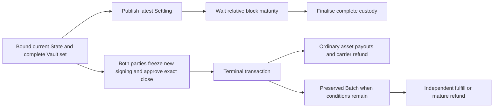
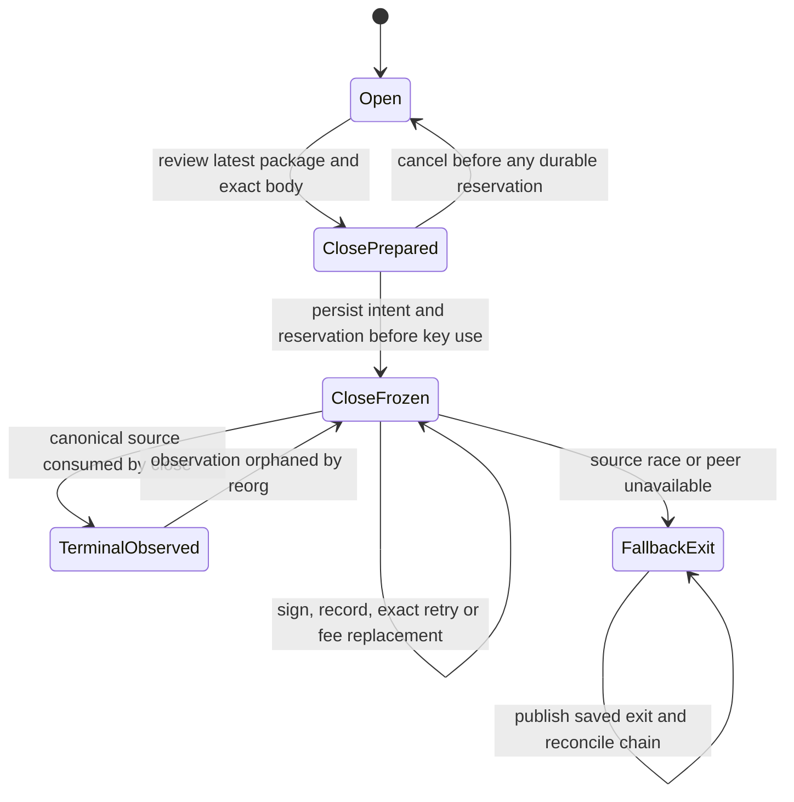

# ADR 005: an explicit bilateral cooperative terminal close

2026-11-11 scope reconciliation: #51 is the accepted design and implemented
native CLI capability. The [W1 acceptance boundary](../w1-acceptance.md) requires
its Core/VM/native lifecycle evidence and final candidate binding. A new Hub/SDK/
desktop close workflow and autonomous scheduling remain separate product work;
the historical staged roadmap below does not add them as issue-closing gates.

Date: 2026-11-10. Scope: W1 #51, with #28/#31/#32/#43/#44 dependencies.

**Decision: select one explicit cooperative terminal-close path for implementation
before the final consensus freeze.** Keep the existing challenge-window exit as
the fallback. Do not implement this as a special splice, waive `since` for ordinary
state signatures, or change Factory authority. This records the engineering
selection under the owner's request to complete W1; it is not release approval
or a claim that the complete product integration is finished. #51 remains open
until the remaining execution and evidence below exist.

**Implementation checkpoint:** the sole `MORPHMC!` frame and shared State/Vault
verifier are now implemented. The first full rebuilt-ELF regression passed 98 VM
tests; targeted maximum-script/unbound/duplicate-source variants also pass.
The subsequent Core checkpoint adds exact-body proposals, required close snapshot
history, irreversible reservations, explicit transaction-hash receipt roles,
bounded replacements retaining old approvals, and a shared host payout builder.
All 100 VM tests, 74 host multi-asset tests and 307 CLI tests pass. The two new
host/VM tests export actual close frames after snapshot roundtrip, including an
independently fulfilled conditional Batch. The following execution checkpoint
adds disk persistence with reserved receipt space, the isolated close signer role,
native construction/fee signing/keyless submission, three SIGKILL cuts and eight
actual I/O faults. Its 313 CLI tests pass; native two/eight-token cases exercise
exact fee replacement, orphan replay and source races with unilateral fallback.
See [execution evidence](../evidence/cooperative-close-execution-2026-11-10/README.md).
The later operation runtime implements durable close attempts and explicit
depth-aware reconciliation. The [2026-11-11 native checkpoint](../evidence/factory-child-close-2026-11-11/README.md)
adds three Factory-origin child closes and independent pending-Batch fulfillment
and refund on controlled forks, retaining unilateral fallback. Autonomous
scheduling, API/SDK/desktop and final qualification remain outstanding. The measurements below are the pre-change baseline;
subsequent verifier and execution measurements are separate evidence sets.

## Why this path

Two willing parties should be able to retire their complete custody without a
new successor or a dispute delay. The current primitives cannot do this: ordinary
state votes remain publishable dispute evidence, conditional consolidation changes
an off-chain allocation, and splice creates another channel. Reusing any of those
signatures as immediate-close authority would change what the signer approved.

The extra authorization has an unavoidable cost: after issuing it, a participant
must never authorize further payments in the same context. Otherwise the peer
could retain the close transaction, accept a later payment, and then settle the
old allocation without giving the later state a challenge window. A fresh domain
alone does not prevent this attack; the durable signing state machine must do so.

## Measured current baseline

[Machine-readable measurements](../evidence/cooperative-close-baseline-2026-11-10/measurements.json)
and the accompanying README identify the actual test binary, lockfile, source
files and all eight existing ELFs. These are current CKB-VM executions, not a
simulation of a proposed verifier. Measurements use the existing simple
always-success participant locks and devnet token fixture. They are **not resource
qualification for real wallet or asset scripts**. Signature-dependent cycles can
vary between fixture runs; these are single samples, not maxima or percentiles.

| Ordinary custody | Publish bytes / cycles | Finalise bytes / cycles | Combined bytes | Final outputs | Final occupied CKB |
| --- | ---: | ---: | ---: | ---: | ---: |
| Plain CKB | 1,843 / 4,809,675 | 1,460 / 545,983 | 3,303 | 3 | 126 |
| One token | 1,932 / 4,811,609 | 1,788 / 579,504 | 3,720 | 3 | 288 |
| Four tokens | 2,889 / 4,928,692 | 4,023 / 1,113,730 | 6,912 | 9 | 1,026 |
| Eight tokens | 4,165 / 5,193,697 | 7,003 / 1,903,054 | 11,168 | 17 | 2,010 |

These begin at an already bound Active State. Funding and activation are outside
the close comparison; there is no third activation transaction hidden in these
numbers. The terminal output count is `2 × asset_count + 1` for this two-sided
ordinary allocation. Zero allocations can omit outputs. External fee inputs and
change must be added to a funded production transaction.

| Other current operation | Bytes | Cycles | Inputs / outputs | Meaning |
| --- | ---: | ---: | ---: | --- |
| Replace-all splice, one token | 3,863 | 20,204,712 | 4 / 4 | Withdraws old token custody while funding a successor |
| Replace-all splice, four tokens | 7,448 | 21,928,525 | 10 / 10 | Same fixture operation at four assets |
| Replace-all splice, eight tokens | 12,228 | 24,972,900 | 18 / 18 | Same fixture operation at eight assets |
| Conditional publication, CKB + one token | 3,026 | 4,996,318 | 1 / 1 | Publish signed pending terms |
| Conditional finalisation | 3,119 | 1,131,456 | 3 / 4 | Creates independent Batch plus token payouts and carrier |
| Batch fulfill | 1,453 | 98,215 | 1 / 2 | Separately resolves the whole CKB Batch |
| Cooperative conditional consolidation | No chain transaction | No VM execution | — | Existing host test commits an ordinary co-signed allocation |

The splice samples replace assets; they are not an optimized all-value withdrawal
or an economically identical terminal close. Their retained successor is why
they cannot satisfy #51. Conditional publication + finalisation + fulfill totals
7,598 serialized bytes and three chain transactions for this fixture. Consolidation
can avoid the later Batch only by first obtaining a new mutually signed ordinary
state; it still does not skip ordinary finalisation's challenge window.

**Capacity:** the fixture signs a 1,000 CKB State carrier, while its actual current
State output occupies 464 CKB. Each fixture Vault carries 500 CKB. Thus the
ordinary examples keep 1,500 / 1,500 / 3,000 / 5,000 CKB in channel custody until
terminal consumption. Occupied capacity is part of capacity, not another fee;
final payout cells still occupy capacity. The carrier is refunded in full; its
occupied minimum is not a universal carrier constant. Real scripts can increase
these minima. The former approximately-0.5-CKB estimate is incorrect.

**Latency:** the fixture uses a six-block relative challenge delay. Ordinary close
requires publication inclusion, maturity from that Settling cell's creation, then
finalisation inclusion/confirmation. Replacing the Settling cell can restart that
clock. The proposed close needs two-party signing plus one inclusion/confirmation,
with no Morph challenge delay; it does not promise instant inclusion or reorg
finality. Production delay must come from its actual policy, not an invented
number of days. The avoided locked-capital exposure is approximately capacity
times the removed waiting interval, not newly created liquidity.

**Fees:** measured ordinary/conditional fixtures pay zero miner fee; splice pays
10,000 shannons from external funding. These are fixture choices, not fee quotes.
At a selected fee rate `r` shannons per 1,000 charged bytes, calculate each funded
transaction separately with the node's charged-size rule and round upward.
The serialized sizes above exclude additional real fee inputs/change/witnesses;
they cannot establish production fee savings. Proposed close bytes/cycles/fees
are **unmeasured**. It removes one intermediate State output/transaction relative
to publish+finalise, while preserving terminal payouts. Two new signatures and
the new frame consume resources. Do not claim a net byte/cycle percentage yet.

## Exact authority and transaction shape

1. Accept only a bound current bilateral State, Active or Settling. Input 0 is
   that exact authentic State OutPoint, followed by the complete committed Vault
   set in manifest order. No unbound Active/0 shortcut, fake State, clone Vault,
   duplicate, partial set or same-Type successor is permitted.
2. Carry the current-format settlement target and its manifest/scripts/outpoints.
   The target is Settling evidence in the same immutable channel/funding context,
   participant commitment, asset set and carrier/refund policy. Progress must not
   regress; equal state number requires the identical State header. The host uses
   its latest fully co-signed saved package, never an arbitrary caller-supplied
   older allocation. Consensus cannot discover a secret later package by itself.
3. Require exactly two distinct, sorted participant signatures in a **new close
   domain** over the target digest and complete raw transaction hash. The raw body
   includes the source OutPoints, output Scripts/data/capacity, fee inputs, cell
   deps and header deps. Verification reconstructs the digest; a claimed digest,
   provider receipt, old state vote, root signature or splice bridge is insufficient.
   The final magic, domain bytes and bounded frame layout must be single-sourced
   in script-common and parity-tested before use; this ADR is not a second codec.
4. Preserve existing canonical per-asset payout positions and exact value checks.
   CKB business/reserve, each token Type and State carrier remain separate lanes.
   Return the entire signed carrier to its committed refund lock. Extra token or
   Vault outputs and payout substitution remain rejected. No rounding or fee
   deduction from channel allocations is allowed.
5. External plain funding pays the complete fee. Its wallet groups require their
   own signatures; both close signers review the exact body, total fee and change.
   A wallet signature is not participant authority. Unrelated typed fee inputs
   and aggregation with other channels are excluded from this first close path.
   The initial builder will use wallet funding, without a sponsor adapter. The
   consensus rule checks plain input geometry and executes its actual lock; it
   does not infer whether an arbitrary independently authorized lock is a sponsor.
6. StateType and every Vault-lock group must authenticate and verify the **same**
   bounded frame. Reuse canonical parsing/conservation helpers; do not add another
   settlement implementation. The existing payout helper derives Batch identity
   from the consumed State header. A cooperative close can target a newer saved
   header, so refactor the shared helper to receive the **validated settlement
   header** explicitly: ordinary finalisation passes its authentic input header;
   cooperative close passes its authenticated target header. Never silently bind
   the Batch to an older input state number. All consumed token Type scripts still execute and
   can refuse consumption. Fresh cooperation cannot bypass an asset's rules.

## Conditions remain claims

Default behavior preserves the latest saved conditional descriptor exactly and
creates the same independent Batch lock, bound to the target channel/funding
context/state number/terms. In the present model the **whole plain-CKB Vault capacity**,
including its reserves and settled balances, is routed through the Batch; it is
not merely a small pending-transfer output. Pending claims still consume only
business value; routing reserves through the Batch does not make them claimable
as payments. Token payouts and carrier are separate. The UI
must say “channel closed; conditional settlement pending” until Batch resolution.

Users who want immediately available ordinary payouts first perform the existing
mutually signed conditional consolidation with explicit resolutions. Only after
that new ordinary package is complete may they reserve close. No expiry, timeout,
missing response or “friendly close” flag silently refunds or forfeits a claim.
Once close is reserved, later preimage knowledge is used by the independent Batch;
it cannot authorize a different close allocation.

## Durable lifecycle and competing transactions

`CloseFrozen` is irreversible signing policy, including when zero local signature
receipts were recorded. A reorg changes observation, not permission to issue new
payments. Keep latest recovery and all close authorizations through observation,
confirmation, restart and archival. A runtime database restore cannot manufacture
signer freshness; ADR 003's intact-authority assumption still applies.

| Race or failure | Required behavior |
| --- | --- |
| Pending update reservation before prepare | Reconcile/commit the exact complete update first; do not abandon issued votes |
| Splice already reserved | Reject close preparation; keep existing irreversible splice lifecycle |
| Update or splice requested after close reservation | Reject new signing in the frozen context |
| Peer withholds close signature | Publish the latest retained unilateral exit; never unfreeze to resume payments |
| Older signed publication consumes source State first | Exact close becomes invalid; use saved latest exit to supersede and finalise |
| Newer State observed than target | Reject close; investigate inconsistent local authority; do not downgrade |
| Two fee replacements compete | Same source and immutable settlement intent, fresh two-party exact-body signatures; first canonical consumption wins |
| Source changed, even within same funding context | No automatic close rebase in the first implementation; reconcile through unilateral recovery |
| Lost reply or crash around key use | Persist reservation before request; verify and persist receipt before release; exact retry only |
| Reorg revives a source | All old exact approvals remain potentially valid; preserve the freeze and evidence |
| Complete authority snapshot rollback | Explicit unsolved storage assumption; neither close nor SQLite solves it |

Fee replacement can change external fee funding, approved change and required
dependencies, while preserving source custody, target package and every custody
payout. Old approvals are not revoked. Dependency/fee changes require fresh
signatures and VM preflight; transport request expiry never revokes an issued
transaction signature. The external signer must enforce the close intent across
replacements, not merely accept a new opaque digest.

## Execution order and acceptance

Core snapshot checkpoint details: `close` is required, including explicit null.
`prepare_close` accepts the latest saved package's exact payouts only; the proposal
retains the packed raw body and source header/OutPoint. `reserve_close_signature`
must be fsynced before key use; `record_close_signature` addresses a specific
transaction hash. All old attempts remain exportable. Up to 32 attempts of at
most 128 KiB raw bytes are allowed in Core; exhaustion leaves the unilateral
package available and never truncates history. These are not RPC admission limits.

The CLI keeps its 512 KiB session ceiling. Every close save bounds the **entire
serialized session**, including lineage and space for both maximum-width receipts
for every attempt, before accepting/signing a replacement. Exhaustion rejects the
new body without truncating old approvals. Core's 32-attempt ceiling does not
promise that 32 maximum-size bodies fit this smaller limit. Source liveness,
canonical source bytes, authentic Vaults, dependencies, header dependencies and
actual external fee inputs are independently reviewed by the isolated signer.
Native fee signing/submission additionally run full VM preflight before writing
an immutable signed transaction. See [the runbook](../runbooks/cooperative-close.md).

The execution checkpoint passes 313 CLI tests and two/eight-token native closure
with explicit fee replacement, signer loss/retry, reorg replay and an ordinary
publication winning source consumption. The saved unilateral exit still settles
the latter branch and both journals remain byte-identical throughout those chain
operations. This is explicit CLI replay, not an autonomous operation reconciler;
other #41 adapters and API/SDK/desktop integration remain outstanding. The later
Factory-child checkpoint supplies native evidence for pending-Batch and
Factory-origin closure; it is still a dirty-worktree controlled-devnet run, not
the final clean candidate qualification.

| Stage | Concrete changes | Completion evidence |
| --- | --- | --- |
| 1. Wire and common verifier | Single close frame/domain, shared target/context and complete-set payout checks; StateType and Vault dispatch | Parser/parity/resource tests and actual VM positives/negatives |
| 2. Monotonic host authority | Explicit close intent/reservation/receipts, immutable replacements, offline saved exit preserved | Core conflict/retry/reorg state-machine tests; no old snapshot reader |
| 3. External signer + native builder | New reviewed close role, private durable caller/service flow, external wallet fees, keyless submit | Actual six existing roles unchanged plus new close-role crash/I/O matrix |
| 4. API, SDK and desktop | Typed idempotent prepare/review/sign/submit/status; infer context and payouts from selected channel | No manual raw digest/frame inputs; real backend integration, pending-Batch status |
| 5. Qualify exact candidate | Rebuild affected ELFs, manifest, intended-script costs, native chain and reorg acceptance | #28 budget/envelope and #43/#44 records bound to the same candidate |

Required negative matrix: missing/extra/duplicate/cloned Vaults; wrong State Type
or lock; stale anchor/epoch/OutPoint; altered payout/refund lock or token amount;
cross-Type arithmetic; carrier/reserve used for fees; missing/duplicate/wrong-role
signatures; changed raw fee/input/output/dependency; equal-number different target;
pending-condition deletion/substitution; refusing Type; source publication race;
reservation/receipt fsync, rename, crash, timeout and replay; reorg after close;
whole-store rollback limitation. Mark each row passed only after its executable
test exists against the new path.

The baseline tests verify current ordinary/conditional/splice geometry and
that even two valid ordinary state signatures cannot remove current `since`.
They do **not** validate the new close boundary; the separate `cooperative_close*`
tests now cover that verifier. Its frame is bounded by `MULTI_ASSET_CLOSE_MAX_LEN` (see ADR 008 for the current compact encoding), with at most
63 transaction inputs/outputs and 64 cell/header dependencies each. These are
parser/scanner ceilings, not admitted experiment sizes. Intended-wallet and
real-asset cycles, full signing lifecycle and final candidate qualification
remain outstanding. Development state is reset after the unpublished format
change; no compatibility parser, alternate protocol, or in-place migration is
introduced. #51 must not close on this ADR alone.
