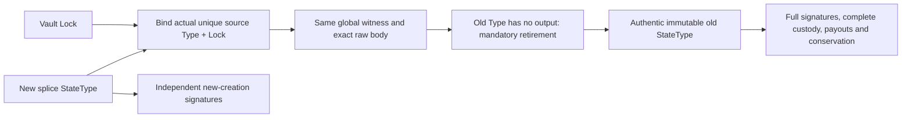

# ADR 008: Bounded parsing, compact evidence and authenticated verification

Status: implemented; 114 VM cases passed, exact-candidate qualification pending. Tracks [#63](https://github.com/Morph-Channel-Network/Morph/issues/63).

The byte/cycle audit of `bc4be3ff` found repeated full conditional parsing,
duplicated close/splice execution, fixed unused conditional slots and repeated
Factory Script bytes. This is an incompatible change to an unpublished protocol.
Recreate development state; do not add migration readers or old signing paths.

## Preserve the model

The 318-byte State, 306-byte Factory State, 256-bit commitments, 2-of-2 bilateral
and N-of-N/reduced-member Factory authorities remain. Every exact token Type,
CKB business/reserve lane, carrier and external fee retains its conservation
predicate. The depth-256 sparse tree and its root algorithm are unchanged.
No routing, alternate signature scheme, short hashes or aggregate Batch claim
path is introduced. Standalone child recovery remains possible after the parent
and coordinator disappear.

## One current encoding

| Object | Current rule |
| --- | --- |
| State descriptor | 7; layout remains 2 |
| Custody manifest, Vault args, `MORPHMA!` witness | Encoding 2 |
| Conditional terms | Version 5, `221 + 92*n` bytes, `1 <= n <= 8` |
| Conditional trailer | Version 3, 40-byte prefix plus actual terms |
| Resolution | Version 3, prefix 4 plus actual terms and exactly n decisions |
| Decision | Fulfill: tag 1 + preimage32; refund: tag 2 only |
| Conditional public package | `morph.conditional_batch_package.v3` |
| `MORPHFM!` | Frame/intent 2; intent prefix 208 |
| `MORPHFR!` | Frame 2; each before/after right shares its identity |

A one-transfer terms body is 313 bytes. Its fulfill witness is 350 bytes and
refund witness 318 bytes. Eight all-refund decisions need 969 bytes rather than
1,225. All integer widths, exact Type identity, application/hash domains,
participant values and absolute refund heights remain committed. Zero token
payouts still undergo future typed-output occupancy checks. Trailing bytes,
missing decisions, invalid references, unused entries and old versions fail
closed. Mature unchanged terms still require the actual co-signed baseline;
only fixed-context updates may retain them.

Script dictionaries contain sorted unique complete Molecule Script bytes:
`count:u16 || reserved:u16=0 || (length:u16 || Script)*count`, bounded to 64
entries and 512 bytes per Script. Role maps use `scope:u8 || count:u8 ||
table_length:u16 || index:u8*count`, followed by the table only for scope 0.
Repeated roles may refer to the same entry. Role order and every owner's hash
commitment are still checked. Scope 1 resolves only against the explicit parent
dictionary; it cannot be parsed as standalone recovery.

The FM intent references its Factory lock, optional refund, exact asset Types
and all child roles through one dictionary. Its bytes 192/196 are dictionary
indices (u32; absent refund is `u32::MAX`), 200 is Type count, 202 reserved zero,
204 dictionary length. Source/points/retained precede the dictionary, then
asset-ordered Type indices and children. Reduced-child frames inherit those
Types instead of serializing a second Type list. Every reduced frame also owns
a canonical table for its Factory lock, own Types and payout locks: prefix
28 is table length (u32), 34 is Factory-lock index (u16), Type references are
u8 and payout bytes 65/67 are Script index/output index (u16 each).
Payout Scripts are stored once even when eight assets pay the same wallet. The complete parent checks
all entries are used. Export reconstructs full scope-0 private child evidence;
no private exit signature is added to the public parent request.

Reduced right pairs serialize the before right (114 bytes) and after quantity
(16), rather than two complete rights. The after identity is exactly the before
identity. Encoders reject different IDs; the leaf hasher concatenates the same
98-byte identity and 16-byte quantity as before, preserving roots and proof
locality. The saved complete rights snapshot remains essential for recovery.

## Validate once, retain bounded views

Parsers validate and cache the at-most-eight complete Batch views and the
at-most-eight resolution decisions. Access remains range checked; no public
unchecked parser is introduced. Script dictionaries cache offsets and resolved
roles. Invariant lock hashes and FullCustody signing digests are computed once
per operation. A static table replaces recomputing the same 257 empty-tree
hashes; a parity test rebuilds every level with the original domains.

## Authenticate delegated execution

Close keeps its full verifier in the authentic source StateType. The Vault gate
requires the unique expected StateType and StateLock, anchor, input zero,
immutable Type code, exact transaction hash, zero source since, matching target
context, bounded body and no output with the source Type. That retirement
forces the complete verifier to execute. Its ECDSA, carrier, exact Vault set,
payout and fee checks are not waived.

Splice keeps full bridge/custody/conservation verification in the retiring old
StateType. New StateType and Vault gates bind actual old/new script identities,
exact source OutPoint, same global frame/body, header transition and mandatory
old-Type retirement. New StateType separately verifies creation signatures and
normal new-custody creation. Recovery/bridge/creation/close roles remain distinct.

Delegation cannot rely on upgradeable code selected by a Type hash. Current
State and Factory authority Types therefore require immutable data hash modes
0/2/4; native deployments use Data1 (2). This restriction applies to authority
Types, not arbitrary wallet or token scripts. An operator must still pin actual
installed code and genesis: a syntactically valid immutable foreign script is
not a trusted Morph deployment. Existing exact source/body/role gates remain.

## Evidence

Cost comparisons must include transaction bytes, total/group cycles, ELF bytes,
fixture geometry and source identity. Smaller cycle counts do not translate to
the same percentage fee savings. Simplified wallet/asset VM fixtures are not
production asset qualification. See [the cost report](../model-resource-optimization.md) and exact-candidate local
qualification when completed; historical reports remain tied to their original
descriptor/artifacts. No release or production admission follows from this ADR.
