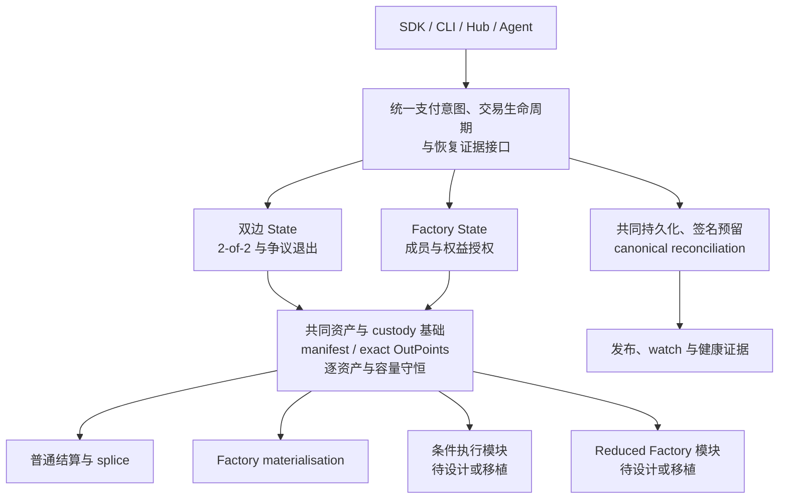

# Morph 架构选择分析：保留两套，还是统一？

日期：2026-11-04
分析基准：[`24484e72a20edf0fbe0344d59afdcd9af1fe9b29`](https://github.com/Morph-Channel-Network/Morph/commit/24484e72a20edf0fbe0344d59afdcd9af1fe9b29)，workspace v4.0.0。
状态：**用户于 2026-11-05 选定方案 C，按保留能力的路线实施。** 前一轮统一改动已回滚；本次按保留能力的路线重新实施，进展与验收见 [迁移记录](unified-protocol-migration.md)。本文保留方案比较依据；选择方案不扩大部署批准范围。

下文的实现对照均指上述历史分析基准；当前代码、格式与已执行验证以[迁移记录](unified-protocol-migration.md)为准。

## 1. 建议先读这一页

**我的建议：长期统一成一个当前协议家族和一套资金／资产／恢复底座，保留双边、Factory 以及不同结算能力的明确分型。不要永久维护当前两条重复的端到端栈，也不要现在直接删掉旧栈后，把消失的功能算作“统一完成”。**

具体含义是：

1. 普通 CKB、单 xUDT、多 xUDT 托管使用共同的资产清单、精确 Vault 来源和逐资产守恒模型。一个资产是同一模型的受限实例，不必再维护另一套普通通道协议。
2. 双边与 Factory 保留不同的 State 类型和授权规则。它们是不同权威对象，不需要压进同一个万能 Header。
3. 条件 Batch、Factory reduced exit 等作为显式能力设计。它们可以有独立 verifier 或执行合约，但必须使用同一代资金／来源／恢复规则，不能回退到另一套旧通道。
4. 先决定首版必须保留的能力。必须保留的，移植并验证后再退役旧实现；允许延期的，明确从产品范围撤下后再删。两种选择都可以，不能混淆。
5. 因为尚未上线，可以重置无价值开发状态，不必提供历史 JSON、旧 witness、旧 signer snapshot 的转换或兼容解析。**无后向兼容需求，消除的是迁移义务；它没有自动消除功能移植义务。**

如果问题必须二选一，我选“统一”。但选择的是**统一基础与当前版本家族**，而不是“所有对象只有一种字节布局”或“本周把旧实现全部直接删除”。

## 2. 先把四个不同问题拆开

| 讨论层次 | 它回答的问题 | 推荐 |
| --- | --- | --- |
| 历史格式兼容 | 是否还要读取旧 JSON、旧 Header、旧 witness、旧快照？ | 不需要；保持当前格式严格解析，设计改变后重置开发状态 |
| 普通资金模型 | CKB、一个 xUDT、多个 xUDT 是否各用一套托管／退出实现？ | 统一资产、Vault 集合、来源与守恒基础 |
| 权威／业务对象 | 双边与 Factory 是否必须有相同 State 和签名门槛？ | 不必；保留明确分型与角色专用授权 |
| 能力与产品范围 | 是否提供条件支付、reduced exit、合作关闭、成员变更？ | 逐项决策并验收；不能靠改版本号或删 parser 自动获得 |

当前 repo 已明确拒绝历史格式和原位迁移，但同时保留两组仍可执行的当前产品路径。两者并不矛盾：**“不兼容过去的格式”与“当前实现了两个不同 profile”是两件事。** [现有重置政策][reset-policy]

因此，“库里只能有一套”最好被定义为：

> 同一个业务事实只有一种规范解释，同一种资金动作只有一套权威的校验与构造流程；不同权限对象和不同操作仍可以有各自清晰的类型、签名域与 verifier。

多个 Rust 模块、多个合约或多个 API endpoint 本身不代表两套实现。反过来，仅用一个 facade 把两套旧 codec、backend 和退出逻辑包起来，也没有完成统一。

## 3. 当前两套究竟差在哪里

以下是代码事实，不是对任何一套的生产认证。已有实现／测试定义与“已通过独立审查、可使用真实资产”需要分开。

| 能力／边界 | 单 Vault 路径 | 多 Vault 路径 | 对决策的影响 |
| --- | --- | --- | --- |
| 普通双边 State 与托管 | 346-byte State，旧 Vault args，descriptor 1/2 | 318-byte State，layout 2，descriptor 4，1–8 Vault 的 manifest | 普通单资产需求可以收敛到集合模型 |
| 多个 xUDT 的物理托管 | 旧物理结算形状不能表示完整的多 Type Vault 集 | 完整集合消费、exact OutPoints、逐 Type 守恒已实现 | 多资产基础更适合作为长期主线 |
| CKB 条件支付 | descriptor 3 与独立 Batch Cell 已实现 preimage/refund | descriptor 4 没有对应条件叶子 | 新栈目前不是条件能力的超集 |
| Factory 授权与局部退出 | `MORPHW!!` kinds 2/3/4/7/8 提供特定单触及者路径 | `MORPHFS!`/`MORPHFM!` 的价值释放依赖完整成员授权；激活不要求新签名 | 删除旧 reduced 不会给新 Factory 补出单侧退出 |
| Factory 终端退休 | 旧 State 没有 input-without-successor 分支 | 全量 materialisation 可退休父 State、退款 carrier，并创建 children | 新旧生命周期有真实差异 |
| 宿主支付接口 | `ChannelBackend` 有 prepare/commit/cancel，返回旧 `StateCell` | `MultiAssetChannelBackend` 是独立的签名状态协商器 | 不能只替换类型名就声称支付能力完成迁移 |
| Provider edge 证据 | `MaterializedChannelEvidence` 是一个 Vault、旧 descriptor 1/2 | 需要把完整 custody、资产和 funding context 接入边证据 | Agent/Fiber 集成是单独的移植工作 |
| 产品入口和发布 | Hub、默认 fixtures、envelope 等仍大量围绕旧路径 | 已有多资产 funding/session/splice/package 与部分 Hub 功能 | 目前是工程与发布边界混用，而非整齐的两个独立产品 |

证据：[State 分派][state-dispatch]、[Vault 分派][vault-dispatch]、[Factory 分派][factory-dispatch]、[当前多资产编码][current-wire]、[Batch 语义][batch-design]、[Factory 已实现与开放范围][factory-scope]、[支付接口][payment-interface]、[新协商 backend][agreement-backend]、[边证据结构][edge-evidence]。

关键判断：

- “旧协议”里既有应退役的编码，也有值得保留的业务语义和证明算法。
- “多资产协议”在托管表达上更通用，但当前没有承接所有旧业务能力。
- 旧路径有更多某些局部能力，不代表其全局生命周期更完备、已生产就绪，或值得永久维护。
- 当前新 profile 也仍有 Factory 单侧退出、签名／交付编排与持续观察等开放项。统一不替代这些工作。

## 4. 四种方案的比较

| 方案 | 主要收益 | 主要代价／风险 | 适用条件 | 判断 |
| --- | --- | --- | --- | --- |
| A. 长期保留当前两条端到端栈 | 立刻保留两边已实现能力，短期移植较少 | 重复维护资金校验、包、backend、watch、SDK、发布和交界面；用户需理解两组保证 | 确有两个不可合并的产品目标，并愿承担独立的验收与发布成本 | 目前证据不足以支持作为默认长期方案 |
| B. 直接删除旧栈，只留当前多资产实现 | 快速缩小可达代码和公开入口，容易明确唯一格式 | 条件 Batch、reduced、部分支付与边接口会先消失；旧能力未被新模型替代 | 团队明确接受一个更窄 MVP，且不会继续宣传被撤下的功能 | 可以选择，但应称“范围收缩后的统一” |
| C. 统一底座，能力模块化并逐项移植／延期 | 消除重复基础语义，同时保留不同授权和结算能力的清晰边界 | 前期需要接口、证明和验收设计；不是机械删除 | 希望长期支持普通通道、Factory 和支付扩展，又不维护两条产品主线 | **推荐长期目标** |
| D. 所有模式强塞进一个 Header／万能 backend | 表面上类型和文件更少 | 可选字段、无效组合、签名角色混淆和通用解释器复杂度上升 | 只有严格的代数类型与形式化约束能够证明收益时才值得研究 | 不作为当前重构目标 |

方案 C 与 A 的区别不能只停在命名：

- A 可以继续让相同的“发布／退出／资金来源”事实被两套协议解释。
- C 要求这些事实有共同规范；差异只留在有业务理由的 authority 和 capability 上。
- C 不要求合约只有一个 ELF，也不要求双边与 Factory 的 Header 长度相同。
- C 的候选新格式仍需明确定版。本文没有承诺现有 318-byte／descriptor 4 以后永远不变，更没有授权在未更新 parser、签名域与部署证据时偷偷扩展其含义。

## 5. 为什么不建议永久保留当前两套

### 5.1 普通单资产不是充分理由

集合模型可以用一个 entry 表达 CKB 或单个 xUDT 配置；“只使用一个资产”不天然要求另一套 State、Vault provenance、签名包和 CLI。[当前集合边界][current-wire]

如果确有单资产快路径需求，应先研究同一规范下的受限优化，并验证它与通用路径等价，而不是直接把已有单 Vault 栈当作永久快路径。

### 5.2 重复的是安全与恢复义务

要维护的不只是两个 parser：

- State 的创建、激活、递增、退休。
- 内容承诺与 exact OutPoint 的对应。
- reserve、business CKB、carrier、fee 和每个 Type 的守恒。
- 创建前退出证据、签名预留、崩溃恢复、重组对账。
- SDK、CLI、Hub 对“已授权／已提交／已确认／可恢复”的统一解释。
- 发布 policy、脚本身份、manifest、默认测试和运营说明。

一次修复可能涉及两组路径及其公共 helpers。当前按长度或 magic 分派两套实现，已经让“源码存在能力”“工具已可操作”“该部署获准使用”很容易混在一起。[分派入口][state-dispatch]、[Hub 当前模型][hub-model]、[现行 envelope][release-policy]

### 5.3 两套仍可能有合理用途，但要证明

如果坚持长期双 profile，至少需要同时回答：

1. 两类目标用户分别需要什么无法由共同底座满足的保证？
2. 为什么能力模块或受限实例不够？
3. 在相同业务工作负载上，专用 profile 的资源收益有多大？
4. 谁承担两个独立 profile 的准入、签名、恢复、审查、部署身份与回归矩阵？
5. 用户如何在签名前辨别退出与失联风险，而不是由工具自动猜测 profile？

如果答案只是“旧代码已经写好了”，它能支持短期参考保留，不能单独支持永久产品分叉。

若将来测量和产品证据确实支持两种有意 profile，应明确命名、绑定部署身份和准入规则。不同 profile 可以是合理产品设计；含糊的 fallback 不能替代这种设计。分开部署可改善边界可见性，但增加构建／发布组合，也需要实测与维护评估，本文不预设它必然更安全。

## 6. 为什么不建议现在直接删完

### 6.1 Reduced Factory 关系到产品保证

旧 reduced 的价值是受限授权、局部性、跨侧定位与逐资产约束。新 Factory 当前没有对应的 reduced physical release。

把旧 `MORPHW!!` parser 删除后，新 Factory 仍然需要完整成员批准；成员失联风险不会自动消失。如果产品承诺“成员只持自己的证据即可退出”，那么 reduced exit 不能以重构为由默默下线。[局部证明规则][reduced-design]、[当前多资产 reduced 缺口][factory-scope]

移植必须覆盖：

- 当前 authentic Factory State 与完整 source Vault 集。
- 触及资产的释放、留存以及未触及 rights/reserve。
- 每个资产和物理容量独立守恒，不能跨 Type 抵销。
- 其他成员推进状态并扣留数据后，诚实成员的当前 proof 如何可用。
- 并发退出、重组、交易费用、最坏输出与执行预算。

复用旧算法和测试思想有价值；直接复用旧 witness 的接受路径不是完成新证明。

### 6.2 Batch 是结算能力，独立合约可以继续存在

旧 descriptor 3 可以把整个 CKB Vault 物化成一个 Batch Cell，之后按 preimage/refund 结算。当前 descriptor 4 没有这套条件语义。[Batch 设计][batch-design]、[旧通道集成][batch-integration]

统一后的合理目标可以是：由共同的资金和 State 规则授权一个受限的条件执行模块，再由独立 Batch 合约解决条件。独立执行器不等于两套普通通道。

但这个目标需要重新定义条件的资产、金额、容量、超时、输出与来源绑定。不能把旧 Batch API 换名后继续走旧 State/Vault，也不能把“未来支持条件”写成当前能力。

### 6.3 支付服务与签名状态引擎不是同一层

旧 `ChannelBackend` 处理 prepare/commit/cancel；新 backend 处理 proposal、签名预留和共签状态。两者不是当前同接口的等价实现。[旧接口][payment-interface]、[旧 descriptor 分派][payment-descriptors]、[新引擎][agreement-backend]

合理统一方式是让支付服务基于唯一的通道状态／恢复引擎工作，同时保留业务意图、幂等、到期和结果证据这些上层职责。没有必要把每个职责塞进一个 Rust struct，但不能保留第二套 State 作为接口桥梁。

Provider edge 也需要明确资产选择、流动性和完整 custody 的对应，不能继续拿单 Vault evidence 代表多 Vault authority。[当前证据][edge-evidence]

### 6.4 公共工具要先提取，不能按文件名删除

例如现代 session 直接使用旧包模块中的文件锁与持久化 helpers。这些函数需要提取到共同基础，不应随旧 package codec 被整块删掉。[实际引用][shared-persistence]

同样，StateLock、Sponsor 的现代路径、签名 witness、成员承诺和时间锁工具不因文件年代较早而成为后向兼容代码。

## 7. 推荐目标架构：共同基础，明确分型

下图是**建议架构**。标明待设计／移植的模块并未因画在图上而实现。

### 7.1 应统一的部分

- 资产身份和 manifest，不维护相互不一致的“资产总额”解释。
- Vault content 与 exact OutPoint 的独立承诺。
- reserve、business value、carrier 和外部费用的分账。
- funding context、完整 custody 的创建／变更／退休规则。
- 当前恢复包的规范字段、验证流程和依赖记录。
- 签名预留与 receipt 的持久化顺序、交易状态和 canonical 对账。
- 公共 API 对已授权、已提交、已确认、可恢复状态的含义。

### 7.2 应保持明确区别的部分

- **双边 State 与 Factory State。** 318 与 306 字节在这里不是同一对象的旧新版本；它们承载不同的 authority。保留两个明确类型与 signing domains 可以属于同一协议家族。[双边字段][bilateral-state]、[Factory 字段][factory-state]
- **签名角色。** 根资金创建、普通投票、splice bridge、子创建、materialisation 和终端关闭不应因统一而共享模糊授权。
- **证明与执行模块。** Full-consent、reduced、条件解决各有独立前提，未知组合仍需拒绝。
- **只读恢复与签名权威。** 观察器、package exporter 和 health 文件不能因为接口统一而变成签名权威。

### 7.3 避免形成另一种“万能协议”负担

能力必须是显式、有限、可枚举、可测试的操作。不能通过大量 optional 字段、未知 proof 的动态解释，或解析失败后换另一种状态类型来决定 authority。

“一套当前版本家族”也不等于所有 JSON 都使用相同 `schema` 字符串。不同角色的包可以有不同明确 schema；需要去掉的是同一业务对象的旧新平行解释与历史 fallback。

后续如果选择扩展 descriptor／witness，应整体更新 host、scripts、SDK、签名域／版本、fixtures、部署 hash 和 release 证据。未上线允许重置，不能据此跳过这些一致性义务。

## 8. 短期先做产品取舍，再决定删除范围

| 能力 | 建议定位 | 删除旧实现前的条件 |
| --- | --- | --- |
| 普通 CKB／xUDT 双边托管 | 统一底座的核心 | 新路径完成等价业务场景、独立资金仪式与恢复工具验收 |
| Native payment prepare/commit/cancel | 如果继续提供支付 API，就需要迁移 | 意图、资产、幂等、到期、共签提交及退款／取消边界被验证 |
| Factory full-consent custody | 可作为有明确 N-of-N 风险的受限能力 | 独立 signer、private exit delivery、真实 native lifecycle 和批准范围齐备 |
| Factory 单侧退出 | 若承诺无合作恢复，则是对应 Factory 准入前置 | 当前资产／proof availability／物理释放义务完成；不能用旧算法存在代替 |
| CKB 条件 Batch | 首版是否必需由支付／路由目标决定 | 必需则移植；非必需则明确延期并撤下相关产品承诺和入口 |
| Morph→Fiber edge | 若继续声明 Morph-backed routing，就要迁移证据 | 完整 custody、每资产流动性、funding context 与 provider-loss 路径通过验收 |
| 合作终端关闭、成员变更 | 独立设计候选 | 可以接受、延期或拒绝；不是统一重构自动必须新增的功能 |

存在两个诚实的实施路线：

- **能力保留路线：** 必需能力先迁移到共同基础，完成验收后一次退役对应旧实现。开发对照代码可以暂存，但应有删除门槛，不能重新成为长期双默认主线。
- **范围收缩路线：** 先明确哪些能力不进入下一版，再删其旧实现和公开承诺，发布更小的当前能力集。保留后续设计议题，不把被删除功能记成已完成移植。

不推荐第三种隐含路线：保留产品名称与宣传，但把缺失能力临时转发到旧 backend，或者用“暂不支持”占位符替换后仍宣称全功能统一。

## 9. 性能与安全比较：现在能知道什么

| 已知事实 | 能支持的结论 | 不能支持的结论 |
| --- | --- | --- |
| 双边 Header 346 → 318 字节 | 当前新 Header 本身更短 | 新模型每种完整交易都更便宜，或旧模型天然轻量 |
| Factory Header 302 → 306 字节 | 两类布局确有不同字段与固定成本 | 任意 Factory 操作一定更贵／更安全 |
| 当前多资产支持受限 Vault 集 | 可以在同一模型表达单资产及多个 Type | 资产数、children 数、成员数可以分别任意增加 |
| 最大 Factory fixture 约 67.5M cycles、75,098 bytes | 特定测试形状有既有 VM 预算证据 | 真实钱包／资产成本、公共网络准入，或新旧公平性能对照已经完成 |
| 删除重复 parser／分派 | 减少一部分需审查的可达状态和代码路径 | 不经验证即可断言系统更安全或活性更强 |

编码常量见[旧 Header][old-constants]、[新双边编码][current-wire]、[Factory 编码][factory-state]；最大 fixture 及 permissive 钱包／资产脚本限制见[已有测量范围][factory-scope]。载体容量必须按真实脚本和 data 的 occupied bytes 计算，不能把 Header 长度或约 0.5 CKB 当总成本。[计算公式][capacity]

决策前的最低对照测量应包括：

1. 对两者都实现的同等业务，比较完整 fund → activate → publish → finalise，以及相同资金变化的 splice。保持资产脚本、钱包、签名人数和 payout 分布一致。
2. 对共有的 CKB、单 xUDT 场景做对照；只有多 Vault 路径支持的两个与八个 Vault，作为新模型自身的扩展曲线，不称为新旧性能对比。Factory 再控制成员数、children 数及 retained/full closure 形状。不要拿旧最小 case 与新最大 case 作结论。
3. 记录完整 bytes、cycles、输入／输出／依赖数、occupied capacity、费用重建空间，以及所用节点入口与 reorg/pool re-entry 行为。
4. 对尚未移植的条件／reduced 能力，先验证语义与完整退出；不能用新模型中的空操作作为性能替代。
5. 为“保留专用 profile”的资源收益设定书面判断标准，再看数据是否达到。本文不虚构收益百分比、工期或生产阈值。

“更少重复代码”是合理工程目标；“更强保证”必须看保留了哪些安全／活性性质，并由证据支持。

## 10. 不论选哪种架构，都不能被重构掩盖的问题

- **多资产 Factory 的无合作退出。** 只保留新 Factory 也仍没有一般 reduced release；proof availability 和其他资产脚本阻塞完整退出的影响仍需明确。
- **初始退出证据。** Active/0 不能直接推出有可用 recovery。Legacy 继续获准新资金时，要解决初始退出与 exact-body authorisation；新模型则要保留其强制 ceremony。
- **Splice 丢最后 bridge 回执。** 完整新 recovery 已持久化，却可能被当前导出／确认对本地完整桥回执的依赖阻断。需要离线独立 export 和规范链 exact-TX 对账；它是当前新路径的恢复工具问题。[退出前置][exit-prerequisite]、[导出耦合][export-coupling]
- **日志完整回滚。** 正常重启持久性不等于 full-store freshness，内部哈希链不能单独证明新鲜度。
- **争议窗响应。** Watch、费用、重组和数据保留属于安全前提；合并代码不会让它们自动持续可用。
- **发布批准。** 当前 envelope 仍是较窄范围。改 profile 名称、合并源码或通过一组测试，都不等于扩大真实资产准入。[现行批准范围][release-policy]、[readiness][readiness]

当前旧 Factory State 无退休能力也需要明确处置：若继续支持它，评估终端退休／carrier；若最终验证退役，则不必再为该旧 profile 新增分支。[旧分派][legacy-retirement]

## 11. 建议的决策与实施门槛

这些是实施前的门槛，不是已经选定或已完成的计划。

| 阶段 | 交付物 | 通过条件 |
| --- | --- | --- |
| 0. 产品范围 | 首版能力矩阵 | 每项标为必需、明确延期或不提供，能解释对 Agent/Fiber/Factory 用户的影响 |
| 1. 架构决策 | 当前协议家族、authority 类型与模块边界 | 解释哪些语义统一、哪些差异保留；若长期双 profile，提供必要性和成本证据 |
| 2. 可执行设计 | 类型／授权／恢复与能力组合规范 | 每个准入状态都有符合其承诺的退出；不同角色不因复用而混淆 |
| 3. 能力替代或范围收缩 | 当前实现、迁移测试、撤下的接口清单 | 必需功能通过验收；延期功能不再通过旧路径继续对外工作 |
| 4. 旧实现退役 | 源码／入口／构建／发布清单 | 旧路径确实不可创建、解析或花费；没有改名、feature-hidden 或 facade 下的第二实现 |
| 5. 新基线验证 | manifest、envelope、默认 fixtures、CI 与 operator evidence | 证据覆盖所选能力组合；文档与批准范围一致 |

退役验收至少检查：

- 合约中旧长度／magic／args 分派及旧花费授权已删除，或被唯一当前 parser 明确拒绝。
- Core 不再保留同一业务的两套 State／backend／退出解释。
- CLI、SDK、Hub、watch、policy 不接受被退役的 schema、命令或状态文件；不自动转换或填旧字段。
- 公共密码学、锁、fsync、RPC 与资源检查已提取，不能为删除旧模块而削弱它们。
- 默认 fixture、smoke、VM 和发布 gate 已转换；保留旧格式应被拒绝的负向测试不属于后向支持。
- 所有受影响 ELF／hash、打包 subject 与 release policy 重新生成并核对。
- 丢回执、崩溃、重组、peer loss、旧有效快照和资产脚本拒绝等关键场景按各自威胁模型验证。
- 未上线开发状态按既定 reset 规则重建；不为无价值旧状态构建恢复／迁移产品。

如果决定长期保留两种有意 profile，则阶段 4 应替换为“两种 profile 的独立身份、准入、能力承诺与全生命周期矩阵验收”。这是另一份明确产品决策，不能继续借用“兼容历史”作为默认理由。

## 12. 已有 issues 怎样随决策调整

截至本次核对，下列条目均开放。这里提出处置建议，**本次没有修改它们**。

| Issue | 架构选择之外仍需承担的工作 | 最后方案决定什么 |
| --- | --- | --- |
| [#17](https://github.com/Morph-Channel-Network/Morph/issues/17)、[#41](https://github.com/Morph-Channel-Network/Morph/issues/41) | 当前 splice 的独立 recovery export、丢回执 canonical reconciliation 和 same-path handoff | 模块位置可以变化，恢复保证不能消失 |
| [#19](https://github.com/Morph-Channel-Network/Morph/issues/19)、[#20](https://github.com/Morph-Channel-Network/Morph/issues/20) | 保留 Factory 时需要独立 signer、private exit delivery 和 native lifecycle | 依附共同基础还是独立产品，不改变这些前置义务 |
| [#21](https://github.com/Morph-Channel-Network/Morph/issues/21)、[#23](https://github.com/Morph-Channel-Network/Morph/issues/23) | 真实批准范围、入场检查与准确文档 | 一套基线或两个有意 profile，都必须明确，不自动扩大批准 |
| [#28](https://github.com/Morph-Channel-Network/Morph/issues/28) | 联合资源预算与可执行退出 | 新布局／组合需要重新比较，不能直接继承旧测量结论 |
| [#38](https://github.com/Morph-Channel-Network/Morph/issues/38)、[#39](https://github.com/Morph-Channel-Network/Morph/issues/39) | 若产品保留条件支付，需要可独立执行的 fulfillment/refund | 保留旧产品、移植统一基础，或明确延期；不能默默删除功能 |
| [#48](https://github.com/Morph-Channel-Network/Morph/issues/48)、[#51](https://github.com/Morph-Channel-Network/Morph/issues/51) | 成员变更、合作终端关闭都是独立设计决策 | 可接受／延期／拒绝；旧 Factory 退休子项仅在继续支持旧 profile 时有实施意义 |
| [#53](https://github.com/Morph-Channel-Network/Morph/issues/53)、[#55](https://github.com/Morph-Channel-Network/Morph/issues/55) | 退出前提、watch、proof availability、日志回滚等证据边界 | 退役可缩小当前范围，不构成对新路径的全面认证 |
| [#56](https://github.com/Morph-Channel-Network/Morph/issues/56) | Legacy 初始退出／资金准入需要明确结果 | 它已包含排除、补 ceremony、研究新 fallback 三选项；决策前不必强制关闭，验证退役后可由退役证据替代旧 ceremony 工作 |

“旧实现会被删掉”在完成验收之前只能是计划，不能作为关闭相关问题的证据。反过来，如果最终确认整个旧 profile 退役，也不应继续投入为其补新功能。

## 13. 什么情况会改变我的推荐

我会支持长期保留两种发布 profile，如果后续同时给出：

- 不能由共同底座的受限实例／明确模块满足的产品差异；
- 对等实测的、足以抵偿第二套审查和运营成本的收益；
- 明确不同的用户保证、脚本身份、能力组合和批准范围；
- 团队持续承担双份完整退出与故障验证的资源。

我会支持立即只留新模型的精简版本，如果团队明确决定：

- 第一版不提供尚未承接的 Batch／reduced／相关支付或路由能力；
- 所有对外入口、文档与验收同步收缩；
- 新模型自身的资金仪式、退出、发布和已知恢复缺口仍按目标范围解决；
- 这种选择被记录为产品范围决策，而非功能等价升级。

在没有上述新证据或明确产品取舍时，我的推荐保持为：

> **长期统一资金与恢复基础，按权威和能力分型；短期先做能力取舍与可执行设计，再退役旧实现。**

## 14. 本文的证据限制

本文使用当前源码、既有测试定义／记录和 GitHub issue 正文。没有重新运行 VM、devnet、性能对照或生产运行实验；没有证明任一候选新架构安全、活性完备或更快。

文档中的架构图、模块名和阶段门槛是建议，不是已实现 API。部分现有参考文档存在版本／状态漂移，因此具体当前接口和分派以本次源码基准为准。

[state-dispatch]: https://github.com/Morph-Channel-Network/Morph/blob/24484e72a20edf0fbe0344d59afdcd9af1fe9b29/contracts/morph-state-type/src/main.rs#L53-L109
[vault-dispatch]: https://github.com/Morph-Channel-Network/Morph/blob/24484e72a20edf0fbe0344d59afdcd9af1fe9b29/contracts/morph-vault-lock/src/main.rs#L56-L76
[factory-dispatch]: https://github.com/Morph-Channel-Network/Morph/blob/24484e72a20edf0fbe0344d59afdcd9af1fe9b29/contracts/morph-factory-type/src/main.rs#L55-L80
[old-constants]: https://github.com/Morph-Channel-Network/Morph/blob/24484e72a20edf0fbe0344d59afdcd9af1fe9b29/contracts/morph-script-common/src/lib.rs#L22-L50
[current-wire]: https://github.com/Morph-Channel-Network/Morph/blob/24484e72a20edf0fbe0344d59afdcd9af1fe9b29/contracts/morph-script-common/src/multi_asset.rs#L11-L41
[bilateral-state]: https://github.com/Morph-Channel-Network/Morph/blob/24484e72a20edf0fbe0344d59afdcd9af1fe9b29/crates/morph-core/src/multi_asset.rs#L286-L313
[factory-state]: https://github.com/Morph-Channel-Network/Morph/blob/24484e72a20edf0fbe0344d59afdcd9af1fe9b29/contracts/morph-script-common/src/factory_multi_asset/state.rs#L9-L38
[factory-scope]: https://github.com/Morph-Channel-Network/Morph/blob/24484e72a20edf0fbe0344d59afdcd9af1fe9b29/docs/multi-asset-channels.md#L109-L159
[batch-design]: https://github.com/Morph-Channel-Network/Morph/blob/24484e72a20edf0fbe0344d59afdcd9af1fe9b29/docs/conditional-batches.md#L3-L45
[batch-integration]: https://github.com/Morph-Channel-Network/Morph/blob/24484e72a20edf0fbe0344d59afdcd9af1fe9b29/contracts/morph-vault-lock/src/main.rs#L116-L169
[reduced-design]: https://github.com/Morph-Channel-Network/Morph/blob/24484e72a20edf0fbe0344d59afdcd9af1fe9b29/docs/factory-multi-right.md#L32-L96
[payment-interface]: https://github.com/Morph-Channel-Network/Morph/blob/24484e72a20edf0fbe0344d59afdcd9af1fe9b29/crates/morph-core/src/backend.rs#L83-L140
[payment-descriptors]: https://github.com/Morph-Channel-Network/Morph/blob/24484e72a20edf0fbe0344d59afdcd9af1fe9b29/crates/morph-core/src/backend.rs#L770-L788
[agreement-backend]: https://github.com/Morph-Channel-Network/Morph/blob/24484e72a20edf0fbe0344d59afdcd9af1fe9b29/crates/morph-core/src/multi_asset_backend.rs#L46-L115
[edge-evidence]: https://github.com/Morph-Channel-Network/Morph/blob/24484e72a20edf0fbe0344d59afdcd9af1fe9b29/crates/morph-core/src/bridge.rs#L202-L244
[shared-persistence]: https://github.com/Morph-Channel-Network/Morph/blob/24484e72a20edf0fbe0344d59afdcd9af1fe9b29/crates/morph-cli/src/multi_asset_session.rs#L1-L24
[hub-model]: https://github.com/Morph-Channel-Network/Morph/blob/24484e72a20edf0fbe0344d59afdcd9af1fe9b29/crates/morph-cli/src/hub.rs#L607-L622
[release-policy]: https://github.com/Morph-Channel-Network/Morph/blob/24484e72a20edf0fbe0344d59afdcd9af1fe9b29/release/factory-preproduction/envelope.json#L1-L51
[reset-policy]: https://github.com/Morph-Channel-Network/Morph/blob/24484e72a20edf0fbe0344d59afdcd9af1fe9b29/docs/runbooks/upgrade-and-migration.md#L1-L38
[readiness]: https://github.com/Morph-Channel-Network/Morph/blob/24484e72a20edf0fbe0344d59afdcd9af1fe9b29/docs/mainnet-readiness.md#L23-L44
[exit-prerequisite]: https://github.com/Morph-Channel-Network/Morph/blob/24484e72a20edf0fbe0344d59afdcd9af1fe9b29/crates/morph-core/src/multi_asset_splice.rs#L97-L102
[export-coupling]: https://github.com/Morph-Channel-Network/Morph/blob/24484e72a20edf0fbe0344d59afdcd9af1fe9b29/crates/morph-cli/src/multi_asset_session.rs#L702-L720
[legacy-retirement]: https://github.com/Morph-Channel-Network/Morph/blob/24484e72a20edf0fbe0344d59afdcd9af1fe9b29/contracts/morph-factory-type/src/main.rs#L67-L80
[capacity]: https://github.com/Morph-Channel-Network/Morph/blob/24484e72a20edf0fbe0344d59afdcd9af1fe9b29/contracts/morph-script-common/src/multi_asset.rs#L680-L710
