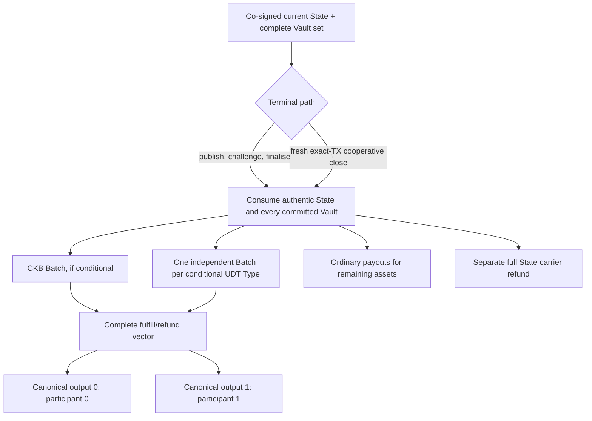

# Asset-bound conditional settlement

Status: current unpublished implementation, 2026-11-11. See [ADR 007](adr/007-typed-conditional-settlement.md). Qualification belongs to an exact source/artifact candidate; earlier W1 reports cover the earlier encoding.

All ten `current-local-no-value` executions returned exit 0 on signed implementation `bc4be3ff`. See [the exact-candidate record and descriptor-label erratum](evidence/typed-conditions-bc4be3ff/README.md), which distinguish that execution from later reporting corrections.

## One State, separate asset lanes

A 318-byte layout-2 State commits descriptor **6**. Capability `Ordinary` has no pending conditions. Capability `Conditional` pins one Batch executor and **1–8 asset-sorted Batches**, with one Batch per selected manifest asset and **1–8 transfers per Batch**. CKB, one UDT and several UDTs share this sole custody, signing and recovery implementation. There is no old CKB-only reader or executor.

Each Batch binds its exact asset, both participant locks, settled CKB capacities, settled token quantities and ordered conditions. Each condition binds its transfer ID, payer, algorithm, payment hash, positive u128 quantity and absolute block refund height. Quantities of different Types are never added together. The same preimage may intentionally link payments in different Batches; it cannot alter their signed quantities or asset identities.

| Lane | Pending quantity consumes | Settlement effect | Preserved independently |
| --- | --- | --- | --- |
| Plain CKB | That Vault's business CKB; quantity must fit u64 | Moves CKB capacity between participants | Signed reserves, tokens, full State carrier, external fees |
| Exact UDT Type | That Type's u128 token quantity | Moves tokens between participants | Both signed capacities, other Types, full carrier, external fees |

A typed Vault may contain both reserve and business CKB. Conditional **token** resolution preserves their signed capacity sum for each participant; it does not require business CKB to be zero. Before accepting funding/recovery evidence, validation checks occupied capacity of the Batch cell and both possible token payout cells, including a participant whose currently settled token amount is zero.

Complete-set terminal settlement is atomic. Subsequent Batches are independently spendable; one asset's resolution does not require the other Batches to be consumed. An asset script that refuses the complete-set terminal transaction can still block it. This is not a per-asset escape from a malicious Type.

## Exact execution and recovery

After terminal settlement, each Batch contains the exact asset and total amount committed by the State. The 104-byte lock args bind channel, exact funding context, positive state number and complete asset-bearing terms commitment.

The Batch must be transaction **input 0**, and its lock group must have exactly one input. Outputs **0 and 1** are its exact participant payouts. A UDT output has the original Type and canonical 16-byte u128 amount; a zero-token payout is plain CKB. All other inputs/outputs must be plain, empty-data CKB. Separate wallet inputs fund fees. Their change may use a participant's address without becoming a second channel payout. Another Batch cannot reuse the payout positions because it would also have to occupy input 0.

A resolution covers every signed transfer exactly once. Fulfill verifies a 32-byte preimage using CKB-personalized Blake2b-256 or SHA-256. Refund returns value to the payer and requires mature canonical **absolute block** `since`; relative, timestamp and epoch clocks are rejected. Checked arithmetic enforces both capacities and per-Type u128 quantities.

The current `morph.conditional_batch_package.v3` contains:

- the complete authenticated signed `source_package` and explicit selected `batch_id`;
- ordered decisions, resolution witness and canonical decimal `input_since`;
- both resolved values as separate decimal-string `capacity` and `amount` fields.

The package cannot supply alternative authoritative asset/amount/recipient metadata. Validation reconstructs it from the source. Public summaries display each exact Type, pending base units, capacities, hashes and refund heights. CLI, Rust SDK and GPUI consume the same `morph-packages` codecs; inspection is stateless and is not canonical chain evidence. A private package with preimages must remain private.

## Native operator

`devnet conditional-batch` provides the same three-step flow used by native acceptance:

| Command | Input and result |
| --- | --- |
| `prepare` | Authenticate a saved resolution package; select the exact live Batch and an independently owned plain fee input; reconstruct the entire body and save an immutable draft. |
| `wallet-sign` | Reconstruct/recheck that body, asset and live inputs; sign only the fee wallet group; full node VM preflight before saving exact signed bytes. Participant keys are never requested. |
| `submit` | Keyless exact-body verification, VM preflight for new operations, immutable persistence and existing operation tracking. Reconcile canonical depth; an exact confirmed retry does not rebroadcast. |

Every command takes `--package`, `--contracts-dir`, `--max-fee` and `--min-confirmations`. `prepare` additionally takes `--batch-out-point`, `--fee-out-point`, `--fee-pubkey`, `--fee`, `--output`. `wallet-sign` takes `--draft`, protected `--private-key-file`, `--output`. `submit` takes `--draft`, `--transaction`, `--store-dir`, `--operation-store` and optionally bounded `--mine-blocks`/`--dry-run`. Commands require the `devnet` feature and `devnet --devnet-only` namespace.

A rejection, timeout or reorg never revokes existing signatures. Exact replay retains the same inputs and bytes. If an orphaned fee source no longer exists, construct and review a new fee-funded transaction rather than silently replacing inputs. Neither execution nor reorg reconciliation changes the participants' signing journals.

## Retained conditions and new signing deadlines

New or edited Batches must have refund heights strictly after the fresh canonical
tip and within the admitted horizon. Initial funding and new funding contexts
apply that rule to every Batch. For a fixed-context update, an exactly unchanged
Batch in the authenticated current co-signed package is retained authority: it
can remain while another asset is cooperatively consolidated, even after its
refund height. This does not edit or extend its deadline. The comparison includes
asset, identity, application context, both settled capacities/amounts, all
transfers and the executor pin. Altering any of them removes the exception.
Local signing and the independent signer both enforce this policy against the
journal's actual current package; a caller cannot provide an arbitrary baseline.

## Wire boundaries

| Object | Sole current encoding |
| --- | --- |
| State | 318 bytes, layout 2, descriptor 7 |
| Conditional trailer | Version 3; 40-byte prefix plus actual Batch terms, maximum 7,696 |
| Per-asset Batch terms | Version 5; `221 + 92*n` bytes for 1–8 transfers (313–957); asset ID 33 bytes; two lock/capacity/u128 participants; no unused slots |
| Transfer | 92 bytes; amount u128; canonical absolute-block refund since |
| Batch lock args | 104 bytes: channel 32 + funding context 32 + state number 8 + terms commitment 32 |
| Resolution | Version 3; 4-byte prefix + exact terms + one decision per transfer: fulfill `1 + preimage32`, refund `2` only. No padding or omitted decisions |
| Batch ID derivation | `CKB_MORPH_CONDITIONAL_BATCH_ID_V2`, including exact asset |

These are incompatible unpublished development changes. Recreate disposable chains, fixtures and sessions. There is no in-place conversion or old-schema fallback.

## Fiber boundary

The hash meanings align with Fiber's `HashAlgorithm::{CkbHash = 0, Sha256 = 1}`. Token quantities remain u128 base units and assets must match the exact CKB genesis and Type Script hash. Provider-edge liquidity excludes pending amounts of that Type, so the same tokens cannot be advertised again as free routing balance.

**The clocks are different.** Fiber TLC expiry is an absolute timestamp in milliseconds; Morph refund here is an absolute CKB block. Never copy a Fiber timestamp into `refund_after_block`, or claim a deterministic wall-clock conversion from average block time. A future live bridge must persist an explicit reviewed timing policy, direction-specific timeout margin, chain observations and recovery obligations. This implementation supplies Type-bound settlement; it does not enable the current nonforwarding Fiber shadow hook or implement routed/MPP/provider-loss automation (#38/#40).

## Verification and admission

The local profile admits only CKB and exact manifest-pinned **devnet** xUDT Types. Real assets and release remain prohibited. Factory pilot admission remains its separately bounded plain-CKB experiment; enabling channel UDT conditions does not widen that Factory policy.

VM coverage includes UDT conditions at initial funding/activation and exact initial exit, splice creation/recovery/activation and terminal claims, mixed CKB/UDT terminal settlement, typed cooperative close, fulfillment/refund/mixed decisions, quantities above u64, wrong Type/data/recipient, cross-Batch witness replay, early refund, incomplete custody, future payout occupancy and 8-asset/64-condition bounds. Maximum-script fixtures measure verifier costs; simplified fixture wallets are not production wallet qualification.

The additional `typed-conditions` qualification gate uses a fresh real node, actual secp wallet and devnet xUDT scripts. Eight independent Batches each contain eight conditions and both hash algorithms. It verifies eight fulfillments, a controlled rollback that removes their confirmation credit, then eight refund/mixed resolutions on the replacement branch. Pre-fork independent fee inputs keep exact orphaned operations replayable. All payout cells are checked, exact confirmed retries do not rebroadcast, participant journals stay byte-identical, and no provider RPC is involved. The existing five-case ordinary custody matrix is retained separately.

`current-local-no-value` qualifies only a clean source commit, exact rebuilt ELFs, schemas, manifest, envelope and client artifacts. Passing historical reports cannot be promoted to this candidate by relabeling them.
