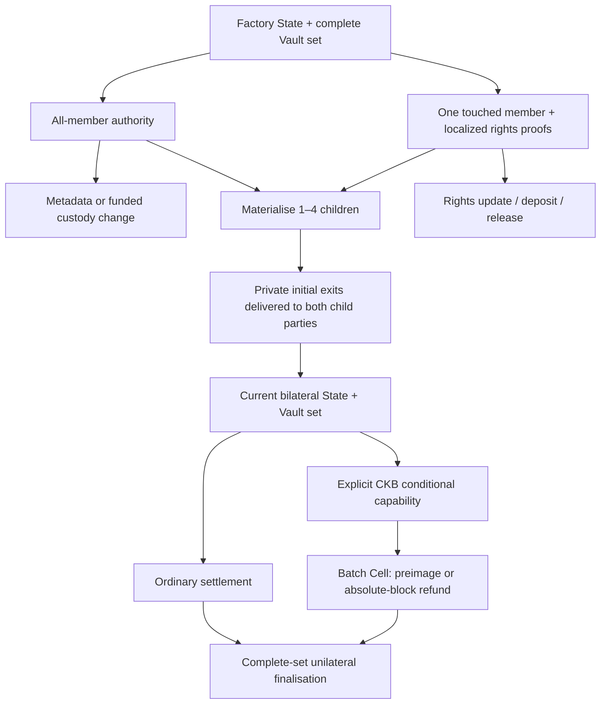

# Current protocol capabilities and verification

Status: local implementation evidence, 2026-11-05. This is a migration and
coverage ledger, not a new independent audit or release approval. Full CI,
release/report refresh, independent review and real-asset qualification remain
separate gates in [mainnet readiness](mainnet-readiness.md).

## One custody model, explicit capabilities

Morph now has one current channel State/Vault-set implementation. Plain CKB,
one token and several tokens use the same 318-byte State and descriptor 5.
Conditional CKB is an explicit capability of that descriptor. A Factory is a
different authority object: a 306-byte Factory State controls shared custody
and rights, then creates independently enforceable bilateral children.



The former 346-byte channel, 302-byte Factory, single-Vault descriptors,
485/469-byte splice and `MORPHW!!` kinds 1–8 codecs and contract dispatch have
been removed. Unsupported bytes are rejected; development state must be reset
as described in [the upgrade runbook](runbooks/upgrade-and-migration.md).
The shared 828-byte Batch terms, signature primitives and compact Merkle
algorithms remain because the current capabilities use them.

## Operation mapping

| Earlier capability | Current operation and authority |
| --- | --- |
| Plain CKB or single-xUDT channel | Same current State/Vault-set lifecycle as several assets. |
| Channel resize/re-anchor | One 200-byte exact-transaction splice bridge, new creation and initial recovery authorizations. |
| CKB conditional batch | Descriptor-5 capability tag 1; Batch args bind channel, funding context, state number and complete terms. |
| Factory root and custody activation | `MORPHFS!` format 2: transaction-bound root approval; activation is permissionless and value-neutral. |
| Full-consent Factory metadata | Sole `MORPHFS!` UPDATE path; a distinct update domain signs header commitment and exact raw transaction hash. |
| Flat ten-right, sparse one-right and compact multi-right updates | Sole `MORPHFR!` `ReducedRights` operation, with 1–10 compact before/after proof pairs. |
| Reduced withdrawal | `ReducedRelease`: one touched member, exact payouts and complete retained custody. |
| Reduced child exit | `ReducedChild`: same localized right predicate plus canonical child materialisation and private exit delivery. |
| Reduced Factory splice-in/out | `ReducedDeposit` / `ReducedRelease`, with actual external funding and custody equations. |
| Full-consent funded Factory change | `FullCustody`, signing the exact transaction with all members. |
| Full-consent child creation | Sole `MORPHFM!` materialisation path, with 1–4 children and optional retained custody. |

There is no separate full-metadata operation hidden in the transition frame.
There is no N-of-N substitute for a reduced operation. Inner N-of-N signature
encoding is shared by current root, update and materialisation capabilities;
it does not enable a removed State format.

## Safety boundaries and current evidence

The current contract harness contains **89 registered CKB-VM tests**, including
parameterized negative matrices: 77 at checkpoint `9202e341`, five earlier
closeout regressions, two alpha Factory authority/overflow negatives and five
Factory delegated-authority regressions.
These are registered test functions; matrix branches are additional
assertions, not a conversion from 67 functions into 77 cases. The removed harness encoded the retired physical model;
its security properties are mapped below to current transactions. Historical
audit test names remain historical evidence rather than claims that those
obsolete constructors still run.

| Boundary / former test family | Current executable coverage |
| --- | --- |
| State monotonicity, signed context, bad signatures, output lock and carrier drift | `current_state_supersede_preserves_carrier_context_lock_and_signature_authority` (11 mutations); current header digest/context properties in `tests/multi_asset.rs`. |
| Canonical since; dirty, typed or split CKB outputs; standalone retirement | `current_finalise_rejects_absolute_since_dirty_typed_split_and_standalone_retirement` (6 mutations). |
| Authentic StateType + StateLock, unique State authority | `multi_asset_rejects_fake_state_authority`; `current_vault_authority_checks_state_lock_identity_and_unique_authentic_state`. |
| Complete Vault set and exact provenance | `multi_asset_rejects_partial_set_retirement`, `multi_asset_rejects_extra_vault_input`, `multi_asset_rejects_byte_identical_vault_substitution`; Factory cloned-State/missing-source negatives. |
| Sponsor fee, budget overflow, clean change, diversion and authentic publication | `current_sponsor_bounds_fee_budget_change_attribution_and_authentic_publication` (valid baseline + 9 mutations). |
| Exact splice body, source/target sets, signed withdrawal, carrier and authorization roles | `multi_asset_splice_rejects_body_changes_clone_partial_sets_withdrawal_and_carrier_substitution`; permissive-Type mint, lane reclassification and signature-role negatives. |
| Factory physical custody cannot be changed by signing a dishonest description | `factory_multi_asset_rejects_physical_changes_even_with_fresh_all_member_approval`; reduced payout/token/child redistribution negatives with fresh approvals. |
| Per-Type funding, peer CKB and fee isolation | `factory_multi_asset_transition_rejects_external_token_underfunding_with_permissive_asset`; full-consent Type replacement, peer-reserve, one-shannon underfunding and custody-fee diversion negatives. |
| Unlisted right changes, foreign owner, nonvalue kinds, identity/order, malformed proofs and per-asset overflow | Current `multi_right.rs` has 17 tests including random-tree proofs; its update tests invoke the production `MORPHFR!` parser/validator. Current reduced/proof-refresh tests add 11 cases. |
| Reduced source freshness, occupied reserve floor and per-asset claim/physical deltas | `factory_multi_asset_reduced_release_rejects_replayed_frame_and_stale_before_header` (fresh locator and stale-header variants, code 69); `factory_multi_asset_reduced_release_rejects_retained_reserve_one_below_occupied_floor` and `factory_multi_asset_reduced_release_rejects_token_claim_burn_for_extra_ckb_payout` (code 39). Each has a valid baseline and independently verified fresh signatures. |
| Private child recovery and independent child authority after parent retirement | `factory_multi_asset_child_uses_private_exit_after_parent_retirement`; reduced-child private-exit and host-signing-prerequisite tests; core Factory delivery/journal tests. |
| Outside child recipients remain distinct from parent authorizers | Full-consent and reduced outsider-child VM positives complete private unilateral exits; an outside child key signing the Factory digest is rejected. |
| Whole-token exit leaves peer CKB in a plain retained Vault | `factory_multi_asset_transition_entire_type_exit_preserves_peer_ckb_in_plain_retained_vault`; matching peer-CKB negative. |
| Token-only/dust withdrawal uses actual outside CKB | Token-only and suboccupied-claim merged-output positives; external-payout top-up underfunding/peer-reserve negatives. |
| Conditional fulfill/refund exclusivity, preimages, maturity and independent token/carrier lanes | Canonical Batch executor tests plus six current conditional CKB-VM lifecycle/negative tests. New matrices bind finalisation to the exact state/channel/funding-context Batch lock (code 65), and reject capacity, Type, data, wrong-lock, missing and independently funded duplicate payouts (code 56). The existing entry-point capacity mismatch test now asserts code 56 after a valid baseline. |
| Removed formats cannot remain alternate entrypoints | `current_contracts_reject_retired_state_vault_and_factory_shapes`; current descriptor/version, Batch-namespace and witness-magic negatives. |

Batch identity is checked when the settling State creates the output lock. A
preimage can legitimately satisfy identical hash conditions in more than one
valid Batch; the namespace regressions change the created lock identity rather
than introducing a global preimage-reuse prohibition.

Generic partition accounting remains independently tested: 18 host invariants
cover reserve, business CKB, per-Type quantity/overflow, carrier, Sponsor and
unrelated-cell classification. Current hash parity tests compare domains and
host compact proofs with the script's localized-proof primitive. No duplicate
legacy physical validator is retained to keep those tests passing.

## Rights data and withdrawal accounting

A root is a commitment, not a source of recovery data. Each member must retain
complete initial rights data and their authoritative journal. The host
`FactoryRightsSnapshot` can apply a publicly revealed localized transition and
regenerate an untouched member's proof without contacting the withdrawing
member. Arbitrary all-member root replacement requires delivery and retention
of a complete replacement rights snapshot; the new root alone cannot recreate
missing leaves or proofs. Canonical inclusion and signing authority are checked
by the surrounding journal/transaction workflow, not by this data helper.

All fungible right kinds are counted together per asset when checking initial
backing; they are not independently spendable overlapping claims on the same
funds. CKB backing aggregates reserve and business CKB across all Vaults and
excludes the State carrier. Token quantities remain separate for every Type.
Value-limit policy and asset admission must review every accepted asset.

Reduced physical operations debit the touched member's `ReserveClaim` rights.
Reserve and business CKB are conserved as separate global physical lanes;
token quantities are conserved per Type. Removing the last token of one Type
can therefore retain unrelated members' CKB in a plain Vault. A wallet payout
may merge actual outside CKB with a small withdrawal to meet occupied capacity;
the actual external input/change equations must fund that addition. The
payout size is not automatically the amount debited from Factory rights.

A retained Factory successor and its unchanged carrier are required for reduced
operations. The last occupied Vault floor and collective carrier cannot be
retired unilaterally. Do not advertise unconditional withdrawal of every last
shannon. Full-consent materialisation can retire the parent while creating
children and refunding its carrier.

## Measured dimensional limits

Local CKB-VM fixtures rebuilt after runtime retirement produced:

The following measurements use the combined first-batch Factory/RustCrypto/CKB
candidate, rebuilt with Rust 1.95.0. The published alpha.1 values remain
historical; [the migration comparison](rustcrypto-upgrade.md#integrated-vm-and-elf-measurements)
records both. These are VM fixtures, not joint-maximum native admission.

| Current fixture | Cycles | Transaction bytes | Test ceiling |
| --- | ---: | ---: | ---: |
| Full-consent materialisation: 8 assets, 4 children, 16 members, maximum-length scripts | 51,988,923 | 75,098 | 70,000,000 |
| Reduced child: same dimensions, 9 physical claims | 61,243,393 | 85,535 | 70,000,000 |
| Reduced release: 8 assets, 16 members, 9 physical claims | 48,121,086 | 32,985 | 70,000,000 |
| Reduced rights: 10 changed rights, 8 assets, 16 members, maximum-length scripts | 48,698,490 | 14,600 | 70,000,000 |

Each compact proof carries at most 64 strictly descending sibling pairs over
a depth-256 tree. Reduced physical paths admit at most 9 changed claims;
metadata-only reduced updates admit 10. Custody has at most 8 Vaults; the
source/successor Type evidence union is bounded to 16 types. Factory members
are bounded to 2–16, children to 1–4 and encoded Scripts to 512 bytes.

These are measured accepted dimensional fixtures with test asset/wallet code,
not universal upper bounds over arbitrary Type scripts, all proof topologies,
real mempool fees or adversarial propagation. Signature-dependent cycle counts
can vary. Deployment-specific transaction bytes, cycles, witness limits, fees,
fee-bump headroom and asset behavior still need qualification.

## Reproduce

```sh
make build-contracts
cargo test -p morph-script-common
cargo test -p morph-core --tests
cargo test -p morph-core --test contract_scripts -- --ignored --test-threads=1
cargo clippy -p morph-core -p morph-script-common --all-features --all-targets -- -D warnings
```

The current Rust CKB-VM corpus exports public exact-transaction fixtures to the
shared Rust SDK. Private child exit signatures are excluded. If ELFs or wire
bytes change, regenerate both the transition corpus and its derived public
child fixture; do not reuse earlier deployment-hash or acceptance reports as
current release evidence.

## Actual-node and remaining integration evidence

`target/factory-native-transitions/acceptance-4.json` records committed root
funding/activation, canonical replay, same-path journal handoff, reduced escape
from withheld full consent, untouched-peer proof refresh, reduced and terminal
child finalisation, and retained-parent retirement. The separate current
publication-reliability run records real fee/RBF/reconciliation/reorg and
service-health behavior; see [its runbook](runbooks/current-publication-reliability.md).

The original checkpoint passed full repository CI with 77 VM cases. Current
closeout coverage raises the registered VM count to 82; PR checks evaluate that
new head separately, without relabelling the original evidence. The expanded
historical five-case native matrix and its nine-scenario, 65-assertion evidence ledger also
completed on a development node; source freshness and budget qualification are
recorded separately by the candidate runner. See the [migration record](unified-protocol-migration.md)
for exact results and clean-candidate acceptance. Updated Fiber scripts require
that same current matrix on the actual shared RPC and
retain real Rust scenario/Payment Gateway receipts. A complete fresh Fiber run was not executed
in this update. An external-party Factory child is valid custody; admission
through a provider's parent-right reservation still has separate owner and
liquidity requirements.

The alpha matrix extends that source-bound runner with actual root orphan/replay
and withheld creation-receipt recovery, full-consent Factory metadata, native
1/4/10-right updates with public proof refresh, retained full-consent
materialisation and Factory operation orphan/replay. It derives ten current
stateful scenarios; the exact assertion count and resource totals are recorded
by each fresh run. The alpha issue/acceptance map is
[the release record](releases/v4.0.0-alpha.1.md). Historical reports above are not
silently upgraded to those new scenarios.

The first alpha ten-right native update measured 48,264,869 cycles, 7,488 fully
signed transaction bytes and 78 aggregate proof siblings. It correctly failed
the previous uniform 40M smoke ceiling. The qualified current profile records
one/four/ten-right named ceilings of 15M/30M/55M; other native cases retain 40M,
and the ten-right proof shape is also bounded by witness/aggregate-sibling/byte
limits. See [the measured alpha scope](releases/v4.0.0-alpha.1.md#measured-reduced-right-budgets).
The larger cap is not a protocol-wide or production admission claim.

## Independent release bundle verification

At the historical pre-alpha checkpoint, two consecutive
`make package-contract-release` runs produced byte-identical
`target/morph-current-custody.tar.gz` archives with SHA-256:

```text
4847c23e5c2ecd481e50e7fac7e800bfaed1ddc87d04d550daade62841ae0b8b
```

The first archive was extracted independently into
`target/current-bundle-verification.9pdxK6ta/morph-current-custody/`.
From that bundle directory, verification accepted all 14 `SHA256SUMS` entries,
the reviewed manifest against all eight captured contract ELFs, the no-real-assets
envelope, the strict current watch policy/config, and the config's bundled
relative `publication-profile.json`. The machine-readable record is
`target/current-bundle-verification.9pdxK6ta/verification.json`; individual
manifest/envelope/watch results are beside the extracted files.

This proves local packaging completeness, relative-path portability and
reproducibility for those exact bytes. It is development evidence, not an
independent security review, a mainnet approval, a production availability
measurement or an assertion that an arbitrary node runs those scripts. Any
subsequent ELF or release-file change requires a fresh archive and verification.
The alpha release README changes the bundle bytes; its fresh archive digest and
verification belong to the alpha release evidence, not the historical hash above.

| Entry boundary | Current implementation and retirement check |
| --- | --- |
| Consensus wire decoding | Shared `multi_asset` and `factory_multi_asset` parsers accept current State/Vault-set and explicit operation frames only; contract dispatch has no old State/Factory/splice fallback. |
| Retired formats | Old wire lengths, descriptor shapes and public package schemas have rejection coverage. A negative fixture is not an alternate production decoder. |
| CLI and node acceptance | Native funding, wallet signing, independent sessions, keyless submission, child delivery and watch service use the current model. `devnet-current-e2e.sh` records the five current bilateral/shared, splice, Factory, watch/reorg and eight-asset cases; expanded-run qualification is tracked above. |
| SDK/UI | Current public request, signature, recovery, conditional and transition inspectors use the shared SDK wire helpers. They inspect exact public evidence; they do not replace canonical RPC, dependency approval, VM or durable signing checks. Hub local Factory projections are explicitly separate from on-chain authority. |
| Host transaction serialization | Core current transaction/request views use the shared host Molecule boundary and canonical common wire parser; native CLI builders delegate exact-body validation instead of retaining old physical transaction validators. Host serialization does not introduce a second consensus lifecycle or RPC/VM authority. |
