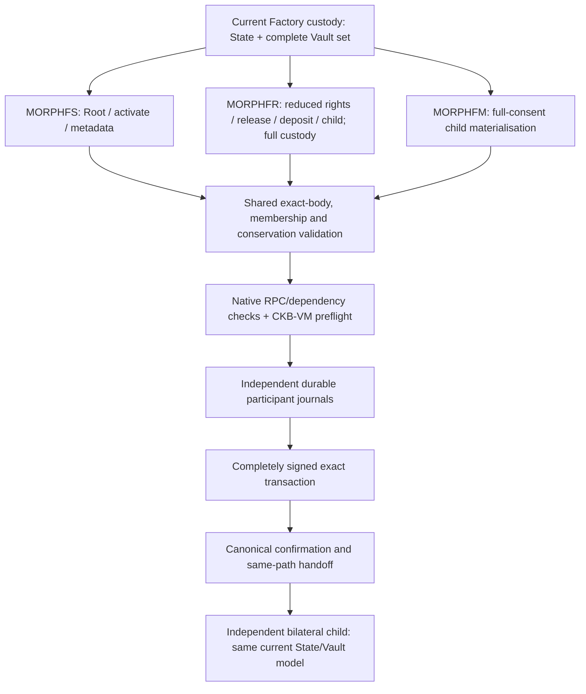

# Current devnet guide

Morph's controlled devnet connects the current host constructors, CKB scripts,
independent signer journals, native wallet builders, watch service and offline
reports. All custody uses the current Vault-set model: bilateral State headers
are 318 bytes with explicit descriptor-6 settlement capability; Factory State
headers are 306 bytes. A single asset uses a one-entry manifest.

Devnet evidence does not approve mainnet deployment or real assets. The release
conditions are in [mainnet readiness](mainnet-readiness.md), and the current
capability/evidence ledger is [current protocol coverage](current-protocol-coverage.md).
Reset development state after incompatible changes; follow the
[reset runbook](runbooks/upgrade-and-migration.md).

## Prerequisites

Install the pinned Rust toolchain and `riscv64imac-unknown-none-elf`, an executable
CKB node, `jq`, Python 3, `curl` and `make`:

```sh
CKB_BIN=/path/to/ckb scripts/check-devnet-env.sh
make fixture-checks
```

`fixture-checks` needs no running CKB node. It validates current bilateral and
conditional recovery packages, current Factory Root/child requests, all five
current signed Factory transition variants, value policies, and watch
config/profile files. Its JSON outputs are under `target/fixture-checks/`.
Contract execution is a separate gate:

```sh
make build-contracts
make contract-tests
```

The CKB-VM suite covers consensus negatives and resource bounds. A passing
report parser or public SDK inspection does not replace that suite.

## Run the five-case matrix

Start with a fresh output directory:

```sh
CKB_BIN=/path/to/ckb \
  OUT_DIR=target/current-devnet/rehearsal \
  scripts/devnet-current-e2e.sh
```

The runner builds the current CLI and contracts, freezes those ELFs into the
run, starts an isolated node with IntegrationTest RPC, deploys the scripts and
executes these cases:

| Case name | Strict kind | Required lifecycle evidence |
| --- | --- | --- |
| `bilateral_shared` | `bilateral_shared` | Independent funding wallets, activation and unilateral finalisation. |
| `bilateral_splice` | `splice` | Remove then admit an asset, independent journals, withheld bridge receipt recovery, publish and finalise. |
| `factory_custody_and_children` | `factory` | Native Root funding, independent member journals, reduced escape/deposit, private child delivery, reduced and full-consent child materialisation, child handoff and finalisation, terminal Factory retirement. |
| `watch_service_reorg` | `watch_service` | Passive Active observation, conflict rejection, configured service health, automatic bounded Sponsor funding, publication, canonical reorg recovery and finalisation. |
| `maximum_asset_lifecycle` | `bilateral_max_assets` | Eight asset identities with independent funding wallets, activation and complete finalisation. |

The default node ports are RPC `19124` and P2P `19125`. Override `RPC_PORT` and
`P2P_PORT` for parallel runs. `RUN_ID` names the default directory under
`target/current-protocol-e2e/`; `OUT_DIR` selects an explicit fresh directory.
`EXTERNAL_RPC_URL` can use an existing disposable dev chain. Reorg/truncate cases
change that chain, so reserve it for one acceptance run.

The runner reads disposable development keys from
`../fiber/tests/nodes/{deployer,1,2}/ckb/plain_key`. Override their paths with
`MORPH_E2E_DEPLOYER_KEY_FILE`, `MORPH_E2E_ALICE_KEY_FILE` and
`MORPH_E2E_BOB_KEY_FILE`. These fixture files are copied to a temporary private
0700 directory with 0600 key files outside the public evidence tree, and removed
on exit. For independently provisioned keys, use `MORPH_DEVNET_PRIVATE_KEY_FILE`,
`MORPH_ALICE_PRIVATE_KEY_FILE` and `MORPH_BOB_PRIVATE_KEY_FILE`; these paths are
passed unchanged to the [protected file loader](runbooks/key-input.md), which
rejects unsafe permissions. Old raw-key environment inputs are rejected. The
runner does not print key material, and its isolated node stops on exit.

The report directory for the command above is:

```text
target/current-devnet/rehearsal/
  morph-cli                            # immutable executable used by the run
  source-provenance.json
  evidence.json
  genesis.json
  node-info.json
  logs/
  scenarios/smoke/
    matrix.json
    contracts.json
    contracts/                         # exact frozen ELF bytes
    deployment.json
    shared-acceptance.json
    acceptance.json                    # splice admission/removal
    factory-acceptance.json
    watch-service-acceptance.json
    eight-asset-acceptance.json
    *-packages/                        # requests, journals, transactions, logs
```

After all cases complete, the runner writes smoke/stateful `summary.json` and
`summary-check.json`, enforces the strict budget/audit/freshness gates, and
updates the single successful-run link `target/current-protocol-e2e/latest`.
The default report commands read that current link.

Keep the complete run directory. Public packages are portable recovery evidence;
private signer journals remain monotonic authority and must not be cloned or
restored to an earlier snapshot.

## One custody boundary, explicit operations



A parent request carries public child terms and possession attestations. Complete
private child exit packages are delivered and persisted separately before a
parent signer is allowed to approve the request. Factory reduced operations
have an explicit authorization matrix; they do not silently turn into an
all-member path when a member is absent.

Public and native entry points have distinct jobs:

| Entry point | Purpose |
| --- | --- |
| `inspect-factory-request`, `inspect-factory-custody`, `inspect-factory-transition` | Offline canonical decoding and signed term/proof inspection. |
| `factory-child-delivery receive\|attach` | Persist private child recovery before issuing an attestation; attach verified public receipts. |
| `factory-session` | Review, reserve, sign and retain exact current requests through one durable participant authority. |
| `devnet factory root-prepare\|root-wallet-sign` | Construct current Root funding and sign declared external wallet groups. |
| `devnet factory prepare\|wallet-sign\|submit\|activate` | Construct typed current operations, wallet-sign exact bodies, submit keylessly with preflight, and bind newly created Vault sets. |
| `multi-asset-funding-session`, `multi-asset-session` | Independent bilateral funding, updates, splice recovery and same-path journal handoff. |

Use each command's `--help` and the [operator runbooks](runbooks/README.md) for
required files and signing roles. Current SDK/UI inspections are public term
review; canonical source/dependency/VM checks and durable signing reservations
remain native requirements. The Hub's local Factory projection is separate
from these on-chain custody requests.

## Manual node work

For individual operations, start a disposable node in another shell:

```sh
CKB_BIN=/path/to/ckb scripts/devnet-node.sh
```

That helper defaults to RPC `18114`, P2P `18115` and
`target/devnet/node`. Set `CKB_DIR`, `RPC_PORT` and `P2P_PORT` for a separate node.
Fund its assembler wallet using only disposable development keys. With the
funding/participant environment configured:

```sh
cargo run -p morph-cli --features devnet -- devnet --devnet-only check --json
cargo run -p morph-cli --features devnet -- devnet --devnet-only mine --blocks 6 --json
cargo run -p morph-cli --features devnet -- devnet --devnet-only deploy-contracts --json
cargo run -p morph-cli --features devnet -- devnet --devnet-only multi-asset-smoke \
  --shared-funding --store-dir target/manual-current/packages --json
cargo run -p morph-cli --features devnet -- devnet --devnet-only factory smoke \
  --store-dir target/manual-current/factory-packages
```

`MORPH_CKB_RPC` selects the RPC URL; an explicit `--rpc-url` on the `devnet`
command overrides it. Devnet commands require `--features devnet` and the
explicit `--devnet-only` guard.

## Strict offline reports and budgets

The matrix schema is `morph.current_acceptance_matrix.v1` with required
`cases: [{name, kind, report_path}]`. Case reports, packed transactions, logs,
Factory packets, deployment records and frozen ELFs must remain inside the run
directory. Unknown matrix fields/kinds, escaping paths, symlinks, retired wire
artifacts, missing lifecycle evidence and mismatched script hashes fail closed.

Regenerate a report without replaying the node:

```sh
cargo run -p morph-cli -- devnet-smoke-report \
  --dir target/current-devnet/rehearsal/scenarios/smoke
cargo run -p morph-cli -- devnet-smoke-report \
  --dir target/current-devnet/rehearsal/scenarios/smoke --json
cargo run -p morph-cli -- devnet-smoke-assert \
  --dir target/current-devnet/rehearsal/scenarios/smoke \
  --contracts-dir target/current-devnet/rehearsal/scenarios/smoke/contracts \
  --budget-profile docs/devnet-smoke-budget.example.json
```

The report preserves every measured transaction/status observation, while totals
count each raw transaction hash once. It reports per-case and aggregate
cycles/bytes, current Factory member/signature/proof/witness counts, deployed
OutPoints and data hashes, script failures, publication attempts and
reconciliation, service/health records, reorg alerts and current Sponsor bounds.
A Factory transaction is reported as authorized only after the shared Core
verifier accepts its exact public request or signed frame. Unsigned drafts with
the same raw transaction hash do not supply authorization evidence.

Budgets use `morph.current_acceptance_budget.v1`: an explicit measurement
`basis`, global caps, named `cases`, named transaction paths, and current Factory
`proof_profiles` keyed by operation. Missing budgeted evidence fails. The
report adds a separate `deployment` resource group to the five native matrix
cases. Case totals use `max_cycles`/`max_bytes`; case transaction peaks use
required nullable `max_tx_cycles`/`max_tx_bytes` fields. The example permits
300k-byte deployment transactions while keeping each native case capped at
100k bytes per transaction; aggregate deployment allowance cannot bypass a
native case's smaller limit. The
70-million-cycle joint-resource CKB-VM fixture cap is separate from measured
native-operation budgets. Inspect regressions before changing a ceiling.

```sh
cargo run -p morph-cli -- devnet-smoke-compare \
  --baseline target/current-devnet/baseline/scenarios/smoke \
  --candidate target/current-devnet/candidate/scenarios/smoke \
  --fail-on-transaction-set-change --fail-on-status-change \
  --max-abs-total-byte-delta 0 --max-abs-tx-byte-delta 0
```

Stateful acceptance adds typed scenario assertions, risk-family coverage,
expected failures and artifact freshness over the same current matrix and
budget parser:

```sh
OUT_DIR=target/current-devnet/stateful make devnet-stateful-e2e
cargo run -p morph-cli -- devnet-stateful-report \
  --dir target/current-devnet/stateful/scenarios \
  --audit-profile docs/devnet-audit-profile.example.json
cargo run -p morph-cli -- devnet-stateful-assert \
  --dir target/current-devnet/stateful/scenarios \
  --contracts-dir target/current-devnet/stateful/scenarios/smoke/contracts \
  --audit-profile docs/devnet-audit-profile.example.json \
  --budget-profile docs/devnet-stateful-budget.example.json
```

`devnet-smoke.sh`, `devnet-e2e.sh`, `devnet-stateful-scenarios.sh` and
`devnet-stateful-e2e.sh` all invoke the same current runner. They do not retain
separate transaction constructors or historical scenario readers.

## Configured watch service and publication reliability

The current `morph.watchtower_config.v1` is shared by `watch-config-once`,
`watch-config-loop` and `watch-config-service`. Config paths are relative to the
config file; the default recovery directory is `packages/` beside it. Every
channel requires an explicit bounded publication profile, durable attempt log,
scan origin and matching operator identity. Generate all three supporting files:

```sh
cargo run -p morph-cli -- print-watch-policy-fixture > target/watch-policy.json
cargo run -p morph-cli --features devnet -- devnet --devnet-only \
  publication-profile-fixture --json > target/publication-profile.json
cargo run -p morph-cli -- print-watch-config-fixture > target/watch-config.json
cargo run -p morph-cli -- validate-watch-config target/watch-config.json
```

Replace the sample channel id and retain its complete signed current recovery
packages under the configured store before running a pass. `from_block` must
be no later than creation. An Active channel is observed passively. Service
reload revalidates configuration/policy and preserves operator identity;
stop-file, bounded errors/backoff, health output and optional authenticated alert
webhooks remain available:

```sh
cargo run -p morph-cli --features devnet -- devnet --devnet-only watch-config-service \
  --config target/watch-config.json --private-key-file /path/to/devnet/sponsor.key \
  --health-file target/watchtower-health.json --stop-file target/watchtower.stop --json
```

The wallet key funds a separate bounded Sponsor cell when configured. Publishing
from it uses public Sponsor authorization, with no participant signing key.
Config and health files never serve as signer authority. Preserve cursors,
packages and attempt logs across restart and reorg recovery.

For the separate fee-floor/RBF/failover/delay/reorg rehearsal:

```sh
CKB_BIN=/path/to/ckb scripts/devnet-publication-reliability.sh
```

Its evidence is under `target/devnet-publication-reliability/<run>/`. Local
challenge-window datasets exercise the calculator; production assessment needs
fresh independent public-network evidence. Trusted collection-receipt
verification is still an open gate, so local `--production` assessment remains
fail-closed. See [publication reliability](runbooks/current-publication-reliability.md)
and [mainnet readiness](mainnet-readiness.md).

## Troubleshooting

| Symptom | Action |
| --- | --- |
| RPC unavailable | Check the node/port and `MORPH_CKB_RPC`; each isolated runner has its own RPC URL. |
| Config profile missing | Keep profile/policy files beside the config or use explicit absolute paths; relative paths resolve from the config directory. |
| Script hash mismatch | Compare the frozen run ELFs with deployment records; rebuild and start a fresh run after a wire/code change. |
| Spent or stale funding context | Use the retained package for that exact context and canonical same-path handoff. Never restore an old signer journal to resume signing. |
| Budget or coverage assertion fails | Inspect the current JSON/Markdown measurements and missing evidence; fix the operation or collection path before revising a cap. |
