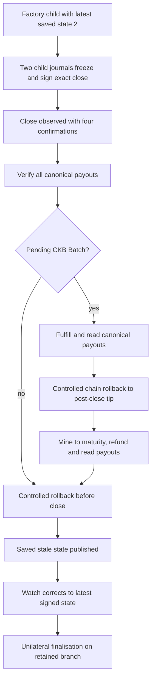

# Factory-origin and conditional cooperative-close checkpoint

This #51 checkpoint executes the ordinary bilateral close path for three actual
Factory-created children. It uses one fresh, owned CKB development node, separate
participant signer processes, existing manifest-matched ELFs and no real assets.
The native command exited 0. Source was dirty but unchanged throughout that run;
subsequent report/ledger edits are identified separately in `verification.json`.
This is not full CI, a fresh contract build or final candidate qualification.

| Child origin | Close depth | Dry-run cycles | Signed transaction bytes | Later unilateral fallback |
| --- | ---: | ---: | ---: | --- |
| Reduced child | 4 | 11,788,922 | 2,646 | Committed |
| Full consent with retained parent | 4 | 11,853,862 | 2,646 | Committed |
| Full consent retiring parent, pending CKB Batch | 4 | 12,699,544 | 3,485 | Committed |

Each close pays 100,000 shannons from a separate ordinary wallet input. The
child State and entire Vault set use zero `since`. Every output and its data are
read back from the canonical chain and compared to the signed body. All three
cases use two independent child journals; closing never needs a new parent vote.
The terminal-parent case demonstrates this after the parent has already retired.

## Branches, claims and signing authority



These are mutually exclusive controlled forks, **not two canonical spends of the
same Batch**. Fulfillment costs 1,716,783 cycles / 2,033 bytes; mature refund costs
1,723,640 cycles / 2,033 bytes. Both actual payout vectors are checked. The final
retained branch is unilateral fallback, and the terminal child's pending claim
remains independently executable in its Batch there. We do not claim that claim
has been cashed out on the final branch.

Node truncation never restores signer files. Parent and child journals remain
byte-identical across close/rollback. Already issued close approvals remain
authority for their exact live source; the experiment does not revoke them or
permit new payment signing. Whole-store rollback protection is not claimed.

## Isolated signer faults and regression integration

Six completed close-role attempts use 18 separate service processes, 12
key-using processes and 12 verified fresh caller processes. The existing harness
checks unavailable service, expired request, lost signed response, restart, exact
retry and cached retry without releasing the journal reservation.

The sole current Factory acceptance runner now always executes these branches.
The stateful ledger requires **27** new facts across the three children, including
depth, payout checks and explicit orphan-branch labels. All 27 assertions and
their public projections were replayed against this retained actual native report.
Malformed/failed/shallow/mislabelled outcomes are rejected by scoped tests.

The report collector previously recognized only `tx_hash` transaction reports;
the close operation uses `transaction_hash` and a structured canonical status.
The collector now explicitly recognizes child close submissions, checks matching
operation identity/status/preflight metrics, and includes their costs. This keeps
new close transactions inside existing finite budgets. It does not raise budgets
or manufacture a new native execution after that reporting edit.

| Scoped verification after implementation | Result |
| --- | --- |
| Existing close tests | 14 passed |
| Smoke-report tests, including close cost/receipt negatives | 11 passed |
| Python evidence tooling tests | 43 passed |
| CLI devnet Clippy, warnings denied | Passed |
| Actual report → new ledger → public projection | 27 assertions passed |

## Reproduction and evidence handling

```sh
SCENARIO=factory-close CKB_BIN=/path/to/ckb \
  OUT_DIR=/private/owner-controlled/fresh-run \
  bash scripts/devnet-external-signer-e2e.sh
```

Use a fresh private directory with trusted ancestors. Early attempts exposed a
world-writable repository ancestor and insufficient mining for four confirmations.
The successful run used a private temporary root and eight mining blocks per
close, keeping the required depth at four. Store permission checks were not relaxed
and user directory permissions were not changed. Those failed attempts are not
included in the success count.

`native-results.json` is a fixed-field public projection; `native-verification.json`
binds actual CLI, ELF manifest, deployment, source inventories and private source
report hashes. `verification.json` records scoped tests and subsequent reporting
source hashes. Raw reports, signed exits, journal files, service paths and operation
databases remain private. Do not upload the whole native run.

API/SDK/desktop integration, complete intended-script resource qualification and
the final clean candidate remain open. Other #41 adapters and autonomous scheduling
are separate work. No commit, push, issue closure or release is claimed here.
