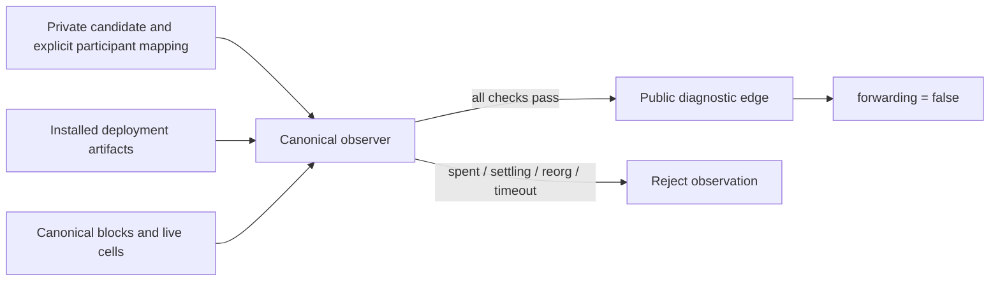

# Canonical diagnostic edge observer — first #37B checkpoint

`devnet shadow-observe` checks live channel custody before returning a public
`morph.shadow_observation.v1` projection. It performs no provider mutation, signs
nothing, and always returns `forwarding: false`. This is a bounded single check,
not the durable Morph registry/reconciliation service and not a freshness lease.

The command consumes a private `morph.shadow_candidate.v1` file containing a
saved recovery package, current State OutPoint, explicit participant-to-payout
mapping, selected asset, required nullable reservation, and tagged Root, Factory
or Splice provenance. Keep this file private: it contains recovery signatures.
The public output uses the shared Fiber edge codec and decimal-string heights;
it does not return recovery signatures, transaction bodies or private journals.
Participant-to-payout ownership is operator configuration; an arbitrary payout
script does not prove which channel signer owns its key.

## Verification boundary

- Pin signed genesis to the configured RPC; derive expected deployment identities
  from installed artifacts, never from a candidate's claimed script hashes.
- Reuse current root/child/splice confirmation validators and live dependency
  checks. Fetch full canonical block transactions at the required depth.
- Require actual State and every Vault to remain live and byte-identical to their
  canonical block outputs. Reject unbound or Settling State cells explicitly.
- For Factory history, verify the authorized exact parent transaction and actual
  historical source State/Vaults against installed Factory scripts. Spent parent
  custody is valid history; it must not be mistaken for current child custody.
- For splice, verify the exact signed transition and actual historical old
  State/Vaults. Origin-specific proof and reservation checks remain enforced by
  the Core registry model; a temporary registry only validates this observation.
- Recheck tip identity at completion and respect one total RPC deadline. A moving
  tip, timeout, missing cell or failed proof yields no successful projection.

The configured CKB RPC and installed artifacts remain trust inputs. This is not
an independent PoW light client, asset allowlist, liquidity reservation service,
or proof that a supplied co-signed state is the latest state known to its owners.
The durable service must bind candidates to its authoritative local lifecycle and
invalidate stale observations; no provider reply can supply that freshness.



## Executed evidence

Full CLI all-features tests: **333 passed, 0 failed**. All-features/all-targets
Clippy, default-feature/all-targets Clippy and formatting passed. These are scoped host checks, not full CI.

Five targeted tests passed: historical spent versus live custody, exact live
bytes, orphaned/forged inclusion, script identity/hash type, and strict origin
parsing. The first run caught Serde's unit-variant unknown-field behavior; changing
Root to an empty struct variant preserved JSON shape and made the rejection test
pass. No compatibility alias or permissive fallback was added.

The actual no-value node runner passed for two and eight devnet token Types.
Each shape selects one token edge while verifying its entire Vault set:

| Observation | Actual result |
| --- | --- |
| Bound Active custody, depth four | Public diagnostic edge, forwarding false |
| Cooperative close consumes source | Saved candidate rejected |
| Controlled rollback restores source | Same edge recovered by fresh chain checks |
| New live Settling State after ordinary publication | Rejected specifically by phase guard |
| Final branch | Ordinary unilateral finalisation after three controlled rollbacks |

All 4,128 source entries were unchanged throughout the native run. The eight
prebuilt ELFs match the manifest; they were not rebuilt by this host change.
Existing isolated signer/close checks also passed: 16 role attempts, 48 service
processes and 32 caller processes. Those counts are not transaction counts.
Raw originals remain private under the path recorded in `verification.json`;
`native-results.json` is an allowlisted public projection.

Reproduce:

```sh
cargo test --locked -p morph-cli --all-features shadow_observer
SCENARIO=close CKB_BIN=/path/to/ckb bash scripts/devnet-external-signer-e2e.sh
```

Factory and splice branches compile and reuse established validators, but this
checkpoint does not claim their independent native acceptance. Durable Morph
registration, outbox, expiry/reorg invalidation, provider response loss and
both-side restart reconciliation remain open under #37. RGB++ is rejected until
its separate two-chain admission exists. No issue was closed or release made.
