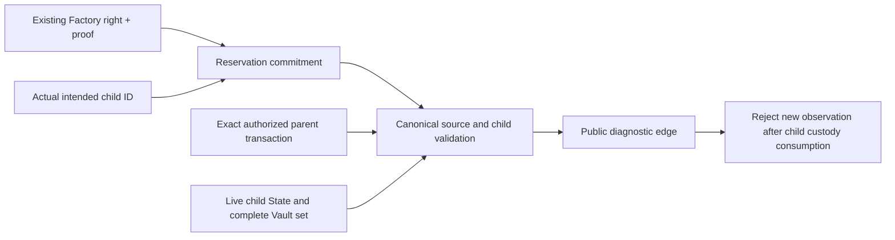

# Canonical Factory and splice observation

This #37B checkpoint extends the earlier Root observer with actual current
Factory and splice evidence. It does not implement the persistent Morph service,
mutate a provider, enable forwarding, or close #37.

## Corrected host model

A Factory right's `subchannel` is its existing bookkeeping label. A newly
materialized physical channel ID is derived from its actual creation anchor.
Treating those two fields as equal made the old bridge model unsuitable for
current physical materialization. Current ReserveClaims can also legitimately
use a zero label; rejecting every zero label rejected real custody rights.

The sole unpublished reservation shape now requires `target_channel_id`, distinct
from the proved right ID. Both are committed into the reservation ID. The target
must be nonzero and equal the actual child's channel ID. A zero source label is
accepted only for ReserveClaim; Balance still needs a nonzero label. Missing old
fields receive no default or compatibility interpretation. Existing unpublished
reservation artifacts must be regenerated.

The reservation's access root must now equal the actual historical source header,
alongside its already checked Factory ID, version, state root, member, selected
asset, proof and quantity. A valid historical parent transaction for another
child of the same Factory is rejected by explicit child identity, including when
that history is supplied to the splice observer.

No chain encoding, contract, participant signing domain or ELF changed. These are
host-side admission/model changes; the reservation commitment is intentionally
changed within the sole unpublished format.

## Actual node matrix

| Positive observation | Confirmation depth | Additional checks |
| --- | ---: | --- |
| Reduced child, one touched parent signer | 4 | Actual spent parent source; child later finalises and is rejected |
| Full-consent child with retained custody | 4 | Another valid child's history explicitly rejected; later spent child rejected |
| Full-consent child consuming all parent custody | 4 | No live parent required; another child's history and spent child rejected |
| Root before splice | 4 | Actual starting edge retained for subsequent rejection checks |
| Remove one of two token Types | 4 | Root context rejected; new edge ID |
| Readmit the removed Type | 4 | Both earlier contexts rejected; new edge ID |

All six projections explicitly report `forwarding: false`. Each selected asset
is checked against the complete actual Vault set. Factory cases are CKB children;
root-origin splice cases change two development token Types to one and back to
two. All saved splice candidates are rejected after finalisation. Factory-child
splices and external-child provider reservations are not exercised here.

The Factory harness creates and persists each reservation before parent
consumption, using the actual source snapshot/proof and known child target.
Reservation quantity is bounded by both the proved right and the owner's child
business allocation. No fabricated right root or altered chain proof is used.



## Verification and limits

- CLI all-features binary: **333 passed**.
- Core multi-asset test target: **75 passed**, including the new target/access-root
  regression. It covers a zero-label ReserveClaim, ID tampering, a recomputed
  reservation aimed at the wrong child and mismatched source access root.
- Fiber adapter: **23 passed**.
- Core/CLI/adapter all-features/all-targets Clippy passed; default CLI Clippy passed.
- Native matrix: six positive observations, cross-child and spent-context
  negatives; **4,134 source entries unchanged** during execution.
- Eight prebuilt ELFs match the manifest. This was not a contract rebuild, full CI
  run, independent audit or release approval.

Earlier attempts exposed the invalid zero-ReserveClaim assumption, an activation
harness that had not yet waited for four confirmations, and runtime-store refusal
of this machine's shared-writable project ancestor. The final run used a fresh
private `/tmp` directory and waited for actual depth; no production permission or
confirmation requirement was relaxed. An earlier full CLI run had a transient
`Busy` during sequential lock reopen under concurrent process-fault tests. That
specific test now retries only Busy for at most two seconds; live-owner rejection,
policy errors and production nonblocking locks are unchanged. The final full
CLI run passed all 333.

Reproduce:

```sh
cargo test --locked -p morph-core --test multi_asset
cargo test --locked -p morph-cli --all-features --bin morph-cli
cargo test --locked -p morph-fiber-adapter
CKB_BIN=/path/to/ckb bash scripts/devnet-shadow-observer-e2e.sh
```

The runner defaults to a fresh private directory under `/tmp`. Custom output
paths must satisfy runtime-store private directory and ancestor requirements.
Raw signed recovery, transactions, private databases and signer files remain
private; `public-observations.json` contains only allowlisted public projections.
`native-verification.json` binds raw evidence by digest; `verification.json` binds
source, binary and the published checkpoint files. Documentation follows the run.

Remaining #37 work is the durable Morph registry/outbox, authoritative candidate
refresh, expiry/reorg invalidation, provider response-loss handling and both-side
restart reconciliation. Successful observations are not cached freshness leases.
Live routing remains a separate #40 gate. No issue was closed or code published.
