# Canonical shadow service: real Fiber + CKB checkpoint

2026-11-10, W1 #37/#35/#43. The persistent coordinator is now invoked by an actual
long-running CLI worker using current authoritative sessions and fresh canonical
CKB observations. All mirrors remain non-forwarding. This is a dirty-worktree
checkpoint, not final candidate qualification or issue closure.

## Actual behavior and evidence

| Check | Result / scope |
| --- | --- |
| CLI all-features unit binary | 338 passed |
| Packages/events/API/SDK/Fiber adapter | 82 passed, including 37 adapter tests |
| Pinned Fiber RPC and Biscuit-scope tests | 2 passed; 1,416 other tests intentionally filtered |
| All-target scoped Clippy, default CLI Clippy, fmt/diff | Passed |
| Real CKB + patched Fiber + separate Morph CLI worker | Passed |
| Morph source bracket during final native run | 4,157 file entries unchanged |
| Fiber source bracket | 1,183 entries unchanged at pinned `a5faac7177a2a2ec086a2c6d0da1840ec9fe5703` |
| Eight prebuilt contract ELFs | Manifest matched; no contract change/rebuild |
| Runtime database validation after run | Revision 29; 29 immutable intents; 27 events/attempts; valid |

The 420 Morph tests and two Fiber tests are separate suites. The final native
run additionally exercises the subsequently added reorg harness; that helper is
covered by actual node execution and a separate final Clippy run. The only code
edit after native qualification is the command's help description, corrected to
say that the service mutates diagnostic mirrors. Do not treat these checkpoints
as one clean final release source identity.

`native-verification.json` binds the actual Morph/Fiber executable hashes,
combined source brackets, contract manifest, genesis/deployment and native report.
The private deployment/transaction files and original filenames referenced there
remain under `/tmp/morph-shadow-service-native-20261110-reorg/`. Public copies
with renamed source/verification files retain identical bytes. Private keys,
recovery packages, journals and database bodies are not published.

### Real lifecycle

1. Register one XUDT diagnostic edge from a Root-origin channel with two token
   Vaults. Full custody and depth are verified by the service.
2. SIGKILL the Morph worker and the actual Fiber process. The harness records
   the replacement Fiber PID and fresh capability response.
3. Let the worker's saved lease expire without editing it, then restart Morph.
   Provider revision remains **1**: registration did not execute twice.
4. Hold the real signer sidecar lock. The worker cannot read authority, invalidates
   its observation, drains/disables the mirror and reports unready.
5. Release the lock; fresh observation reactivates the same edge.
6. Truncate the isolated CKB chain before activation. The actual activation is
   no longer committed; the running worker disables the mirror.
7. Replay the exact activation transaction, obtain four confirmations and refresh
   only the two journals' chain evidence. Backend authority remains byte-equivalent
   as parsed JSON. The edge identity is unchanged and the mirror reactivates.
8. Continue ordinary unilateral publication/finalisation. Spent custody disables
   the mirror; the final provider revision is **9** and forwarding is false.

`public-summary.json` records the real first and replayed inclusion: one exact
transaction hash, two different block hashes/heights. `worker-*.log` are strictly
allowlisted JSON cycle fields. `public-events.json` contains 27 typed Edge events
read after the canonical runtime validator passed; no private bodies are exported.

```mermaid
stateDiagram-v2
    [*] --> Active: Verified Root custody / revision 1
    Active --> Active: Both processes restart / still revision 1
    Active --> Disabled: Journal busy / drain then disable
    Disabled --> Active: Current authority readable again
    Active --> Disabled: Activation orphaned by real CKB truncate
    Disabled --> Active: Exact replay plus fresh canonical evidence
    Active --> Disabled: Unilateral publication and finalisation
    note right of Disabled: Final revision 9; every state has forwarding=false
```

## Diagnosis, boundaries and next checks

The first harness attempt timed out while Fiber was initializing encrypted keys;
there was no healthy hook yet. The bounded startup allowance was extended to
120 seconds, without increasing the service's operational RPC budget. The first
successful matrix covered restart/busy/close; the final run adds actual orphan
and replay. Earlier private runs are retained, not counted as final passes.

[Issue #37](https://github.com/Morph-Channel-Network/Morph/issues/37) requires a
canonical diagnostic service, not live routing. Its registration, expected
revision, unknown-mirror, conflict, response-loss and late-lease boundaries also
have the shared coordinator/adapter tests. Actual Factory-child and splice
origin evidence is in the earlier observer matrix. This combined service run
uses a Root XUDT source; it does not claim native service coverage of every
Factory/splice combination or authenticated remote transport.

The installed service configuration is immutable, observations last at most 60
seconds, a failed source quarantines the whole batch, and storage history is
bounded. Long-duration producer-history capacity, broader resource/fault evidence
and final committed W1 candidate qualification remain follow-up work. No hidden
forwarding or payment callback is enabled; the canceled independent audit is not
reintroduced. No commit, push, release or issue closure accompanies this record.

Reproduction and operational bounds: [shadow service runbook](../../runbooks/shadow-service.md).
