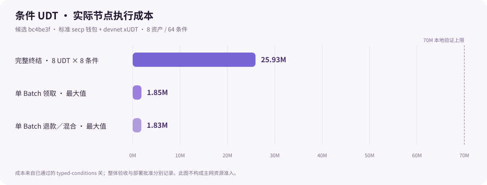

# Typed conditional settlement: exact-candidate qualification — 2026-11-11

All ten required executions returned exit 0 on GPG-signed implementation commit [`bc4be3ff03cb4448f8e16dc95a832e4d6922ce71`](https://github.com/Morph-Channel-Network/Morph/commit/bc4be3ff03cb4448f8e16dc95a832e4d6922ce71). The later commit adding this record also corrects reporting metadata and strengthens its checks; it is not another fully executed code candidate. See the descriptor-label erratum below.

The original `current-local-no-value` receipt records `full_w1_qualified=true` and `conditional_udt_qualified=true`, clean unchanged source and matching contracts/client artifacts. This is controlled-devnet/no-real-assets evidence, subject to the reporting erratum; it does not authorize release or deployment.

## Descriptor-label erratum and follow-up

Final publication review found that `native/checkpoint.json` says `descriptor_version: 5`: the ordinary native runner had hardcoded this label. The executed verifier implements descriptor **6**, as confirmed by the signed source and all five decoded State observations in the original ordinary acceptance reports. The actual descriptor parsers, typed transactions and 110 VM tests used descriptor 6. The original files and checksums below are retained byte-for-byte; the mistaken label is not silently rewritten.

The follow-up corrects current runner, publication-reliability and Fiber acceptance/audit labels, and updates the bundle README. Export and local qualification now compare the reported descriptor with the constant in the exact source commit, rejecting a stale/malformed label. The stricter check would reject the original mislabeled report. All **46 evidence-tool tests** pass, including the new rejection case; source hygiene and the copied-evidence checksum checks also pass. These reporting changes do not alter Rust protocol code, wire formats, ELF identities or clients. No full ten-gate run is attributed to the follow-up commit.

## Implemented boundary

Descriptor 6 supports 1–8 asset-sorted Batches, each with 1–8 conditions. Each Batch commits plain CKB or one exact UDT Type, u128 quantities, both participants and refund heights. Current State/Vault custody, initial recovery, splice, unilateral finalisation and explicit cooperative close use the same interpretation. UDT claims preserve both signed CKB capacities, other Types and the full separate carrier; fees use independent plain CKB. Unsupported prior encodings are rejected.

The native operator provides exact `prepare`, `wallet-sign` and keyless `submit`, with VM preflight, immutable signed bytes and canonical operation tracking. New/edited conditions need fresh bounded horizons; an identical already co-signed Batch may remain while another asset consolidates after maturity. Source authentication and the independent signer enforce the same rule.

## Executed results

- Full CI: **110 CKB-VM tests**, **363 CLI unit tests**, **45 Python evidence-tool tests**, workspace/client checks, fixtures, dependency checks and source hygiene.

- Ordinary native matrix retained: **5 cases / 10 stateful scenarios / 145 assertions / 11 audit families**, with 88 unique transactions and 98 observations. Deployment accounts for 8 transactions.

- Typed native campaign: **8 UDT Types × 8 conditions**, using both hash algorithms. Eight complete fulfillments reached four confirmations; rollback removed all eight confirmation credits; the replacement branch confirmed four all-refund Batches and four mixed Batches (three fulfillments/five refunds each). All exact payout cells and confirmed retry behavior were checked. Participant journals remained byte-identical; provider RPC was unused.

- An independent arithmetic oracle recomputed the complete per-Type payouts from authenticated public terms; unchanged aggregate totals cannot hide a wrong participant allocation.

- Participant fault campaigns: lifecycle 22 role attempts/66 service processes; cooperative close 16/48; typed conditions 6/18. Each includes unavailable service, expired request, lost signed response, fresh caller and cached retry checks.

- Three fixed seeds (1, 17, 332043276360), 26 targets and 10,000 inputs per target: **780,000 mutation inputs**. Typed full-u128 resolution and public package seeds are included. This is bounded deterministic mutation testing, not exhaustive or coverage-guided verification.

- Pinned Fiber hook/auth and SQLite checks plus real Fiber/CKB/Morph shadow recovery passed. Registration, process restart, busy-journal disable/re-enable, spent-custody disable, orphaned activation and exact replay were checked; **forwarding=false** throughout.

- Conditional initial funding/activation/original initial exit and splice creation/recovery/activation/terminal claims are direct VM tests, alongside mixed assets, cooperative close, above-u64 amounts, wrong Type/data/recipient, maturity/context replay, complete custody, future payout occupancy and maximum-script 8-asset/64-condition bounds.

## Actual typed execution costs

| Transaction | Cycles | Bytes |
| --- | ---: | ---: |
| Complete terminal transaction: 8 Types / 64 conditions | 25,928,800 | 14,455 |
| One Batch fulfillment, maximum | 1,854,210 | 2,253 |
| One Batch refund/mixed resolution, maximum | 1,827,117 | 2,253 |

These use the actual development-node secp wallet and devnet xUDT scripts. The selected 70M local test ceiling and these admitted shapes do not qualify arbitrary asset programs or mainnet combinations.



## Executed gate timeline

Times below use **Asia/Shanghai (UTC+08:00)**. Machine receipts retain Unix timestamps.

| Gate | Started | Finished | Exit |
| --- | --- | --- | ---: |
| ci | 2026-11-11 19:46:15 | 2026-11-11 19:52:01 | 0 |
| native | 2026-11-11 19:52:02 | 2026-11-11 19:59:57 | 0 |
| signer-lifecycle | 2026-11-11 19:59:58 | 2026-11-11 20:02:13 | 0 |
| cooperative-close | 2026-11-11 20:02:14 | 2026-11-11 20:04:20 | 0 |
| typed-conditions | 2026-11-11 20:04:21 | 2026-11-11 20:05:51 | 0 |
| fuzz | 2026-11-11 20:05:51 | 2026-11-11 20:23:39 | 0 |
| shadow-service | 2026-11-11 20:23:40 | 2026-11-11 20:29:44 | 0 |
| contracts-package | 2026-11-11 20:29:45 | 2026-11-11 20:29:52 | 0 |
| desktop-package | 2026-11-11 20:29:52 | 2026-11-11 20:32:57 | 0 |
| qualification | 2026-11-11 20:32:58 | 2026-11-11 20:32:59 | 0 |

## Exact identities

| Identity | Value |
| --- | --- |
| Executed code commit | `bc4be3ff03cb4448f8e16dc95a832e4d6922ce71` |
| Git tree | `1635d59424df2a1d271594fc04db4fef9b76b80f` |
| Source SHA-256 | `9dd11c8abc8fbe6701e1e8c88a0cf97a4a710b47861d4a23a807037fb0bd82ba` |
| Cargo.lock SHA-256 | `179b0b9c561f4074efd1e157e261275291cc7e067f038f328c35f922cdf77d02` |
| Deployment manifest SHA-256 | `c5acb0da313892c828361e4915e5aa278ee07eb588582096659250e00a92e196` |
| Contract bundle SHA-256 | `43ff1f79979486107ce15d344a600d58b43461708abfd84ab1ea9500a028efa4` |
| Desktop binary SHA-256 | `364eaf5adeb15df4c1d5a9115f4273b3c74202bb1749e3373a5d17e162f17f00` |
| Desktop bundle SHA-256 | `eddf03b6c95a375060091037a08e076285d0724053825adf4324ea46a34e5efc` |
| Public integration archive SHA-256 | `1e1007fd81102dd1541e19719877e720bd13abb5788feb98afd20a59c498a299` |

| Script | Bytes | CKB data hash |
| --- | ---: | --- |
| morph-state-lock | 12960 | `0xec66a96655a9bda524e2a55a6da2b90e9982f3b57088186134438a20a2ae45b4` |
| morph-state-type | 199248 | `0xeb84b1d0300db7811e4d7b065526b391bc06ee75b2ec6cf7c3b696405a863c00` |
| morph-factory-type | 231352 | `0xe175e3303ca7759eabb51e06c717658dec412bade1ff9e9cbbbaa7b881114edb` |
| morph-factory-vault-lock | 102008 | `0xd1a1d446f6e6eaa01d7a9b960a16148ece23ba088db67bdbb6b2660d44f9c2d4` |
| morph-vault-lock | 180744 | `0x64c851805c675887861dcf9f50469b88cde0c85dd45fdde6e5225450afba69dd` |
| morph-batch-lock | 51104 | `0x226a10aed756fe2789ca0a25485607080a8ce68aae81c0be3ce0a43941b4fda2` |
| morph-sponsor-lock | 16592 | `0x04f79cd59c288dc531a0a65376a426ca913cdcff07e461acf30abc323fae36b8` |
| morph-devnet-xudt | 13584 | `0x0aa0aefe66ef0eda5121d7c12b0856d0bff08fc204a8119c0afb192a3416cc05` |

The optimized contract and desktop bundles remain local. No release, tag or main merge was performed. [Integration index](integration/index.json), [runtime outcomes](integration/runtime-results.json), [artifact results](integration/artifact-results.json), and [native checkpoint](native/checkpoint.json) retain fixed, checksummed public projections. Raw logs, journals, key files, preimages, exact private recovery packages and arbitrary report paths are omitted.

## Reproduce

From a clean checkout of `bc4be3ff03cb4448f8e16dc95a832e4d6922ce71` in an owner-only directory, with the pinned Rust/Linux dependencies and development CKB/Fiber source available:

```bash
CKB_BIN=/absolute/path/to/ckb \
  FIBER_SOURCE=/absolute/path/to/fiber \
  FIBER_DIR=/absolute/path/to/fiber \
  OUT_DIR=.local-evidence/fresh-typed \
  make qualify-local-candidate
```

Use a fresh output directory. The runner freezes one source/artifact identity, executes all ten gates and rejects changed source, partial coverage or altered artifacts/reports. Private runtime files require owner-only storage.

## Remaining integration boundary

CKB Blake2b/SHA-256, exact Type identity and u128 base-unit quantities are aligned for the bridge foundation. **Fiber TLC expiry is milliseconds; this Morph refund is absolute blocks.** Live routing needs an explicit timing/margin policy; direct copying or a deterministic average-block-time conversion is unsupported. The current hook remains a nonforwarding shadow. Autonomous provider-loss enforcement, live Morph-backed routing and MPP remain #38/#40 work. The Factory pilot remains its separate plain-CKB bounded admission.

Independent review and public-network measurements retain the owner's explicit local-scope exclusions, never a passed attestation. Whole consistent signer-store rollback/clone still requires external freshness. Asset-script approval, production operating evidence and real-asset deployment remain separate decisions.
