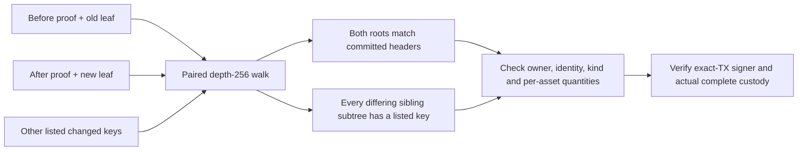

# Current Factory reduced rights and custody transitions

Status: current unpublished capability, 2026-11-05. All reduced operations use
one `MORPHFR!` frame over the current Factory State and complete multi-Vault
custody. The old kind-8 envelope, fixed-slot proofs and separate flat/sparse
wire implementations are removed. This page describes the surviving compact
proof algorithm and its current authority boundaries.

## What one member may authorize

| Operation | Signers | Rights / physical effect |
| --- | --- | --- |
| `ReducedRights` | Exactly the touched member | 1–10 localized value rights; per-asset total cannot increase; custody stays bound and unchanged. |
| `ReducedRelease` | Exactly the touched member | Up to 9 localized reserve claims; exact wallet payouts and retained custody. |
| `ReducedDeposit` | Exactly the touched member | Up to 9 localized reserve claims; actual outside funding increases retained custody. |
| `ReducedChild` | Exactly the touched member | Up to 9 localized reserve claims; canonical 1–4 child materialisation plus retained custody. |
| `FullCustody` | All 2–16 members | Explicit funded custody change, exact transaction and target rights data. |

Pure full-consent metadata has one separate role: `MORPHFS!` UPDATE, using the
transaction-bound update domain. There is no second full-metadata branch in
`MORPHFR!`.

`FullCustody` allows all members to approve a redistribution without applying
the single-touched-member claim-delta predicate. Actual custody conservation
is still enforced: source/retained Vaults, each token Type, global CKB lanes,
occupied capacity, carrier and outside funding/fees must match the transaction.
All-member consent is not an exception to those physical checks.

The sole parser and operation tags are in
[`factory_multi_asset/reduced.rs`](../contracts/morph-script-common/src/factory_multi_asset/reduced.rs).
A frame commits both complete headers, the exact source State OutPoint,
transaction hash, member identities, source custody/OutPoints, retained custody,
Type scripts, payouts, and changed rights/proofs. Reduced child creation embeds
the canonical materialisation intent and public child keys. The actual-cell
checks live in
[`factory_multi_asset_runtime.rs`](../contracts/morph-script-common/src/factory_multi_asset_runtime.rs).
An offline parsed proof alone does not authenticate a live State or transaction.

## Why compact before/after proofs are necessary

A right identifies `(participant, subchannel, kind, asset)`. Its sparse-Merkle
key is domain-separated from its leaf value. A compact proof carries only
non-empty `(depth, hash)` sibling pairs, strictly descending from depth 255
and bounded to 64 pairs. Omitted siblings reconstruct from the canonical
`FACTORY_RIGHT_EMPTY_DOMAIN` chain. Omitting a real sibling fails root equality.
A tree requiring more carried siblings is outside this bounded proof shape.

With several changed leaves, another listed right can live inside a sibling
subtree whose hash legitimately changes. Inclusion proofs on both sides alone
would also permit hidden changes inside that subtree. The verifier therefore
walks each pair in lockstep: any differing sibling subtree must contain another
listed changed key. A difference with no listed key is an unlisted mutation
and fails closed.

Every listed right has the same before/after identity, belongs to the one
touched member, and appears in strict raw-right-ID order. `ReducedRights`
allows `Balance`, `ReserveClaim` and `SponsorBudgetClaim`; membership and
exit-path rights are excluded. At least one value changes. Checked sums enforce
`sum(after) <= sum(before)` independently for CKB and each token Type. Value
can rebalance between value-right kinds within one asset; burning another Type
cannot authorize minting.

Physical reduced operations instead consume/increase `ReserveClaim` rights
according to actual source, retained and released quantities. Complete source
State/StateLock identity and exact OutPoints are authenticated. Every retained
Vault and payout is checked against the transaction; outside fees and funding
cannot be charged to an untouched member or the collective carrier.

## Capacity and data availability

CKB reserve and business value are independent global physical lanes across
Factory Vaults. Token quantities remain independent per Type. A whole-token
withdrawal may leave peer CKB in a plain retained Vault. Actual external CKB
can supplement a token-only or dust payout; rights are debited for the Factory
withdrawal, not for that external contribution.

Reduced paths retain a successor and its carrier. They cannot unilaterally
retire the last occupied Vault floor or collective State carrier. Child
recipients may be outside the parent roster; only parent members can authorize
the Factory. Private initial child exits must be delivered to both child
parties before the parent signer reserves authorization; public possession
attestations do not publish those exit signatures.

The former all-member-only exit restriction is resolved for admitted reduced
operations. A member's executable exit still requires precommitted
`ReserveClaim` leaves, permitted proof shapes, sufficient external fees,
admitted asset behavior and a payout/retained-floor geometry that can be
constructed. Aggregate backing alone does not prove every allocation can exit
or that every last shannon can be withdrawn without the other members.

Members must retain complete initial root rights data. Given that saved
snapshot, `FactoryRightsSnapshot` applies public localized transitions and
regenerates untouched members' proofs without peer cooperation. An arbitrary
N-of-N root replacement needs a delivered complete new snapshot. Chain data
and a root commitment alone cannot recreate missing leaves or proofs.

## Host and public workflow

`morph-core::FactoryMultiAssetReducedRelease` constructs all transition variants
using the sole shared encoder/parser. `FactorySigningRequest` and independent
durable Factory journals enforce exact-body signing roles and current custody.
Public request/custody and exact transaction packages are reviewed by the CLI
and SDK. `factory-session` controls each member's journal; `devnet factory`
provides current preparation, wallet signing, keyless submission and activation.
Required fields have no aliases or missing-field migration.

Compact proof generation/verification, full sparse root data and generic
per-Type conservation remain reusable primitives. The removed host
`FactoryMultiRightMerkleUpdate` authorization mirror and old package commands
are not retained as a second implementation.

See [current protocol coverage](current-protocol-coverage.md) for operation
parity, named safety negatives, measured resource ceilings and reproduction
commands. These local tests do not satisfy independent review or real-asset
release gates.
