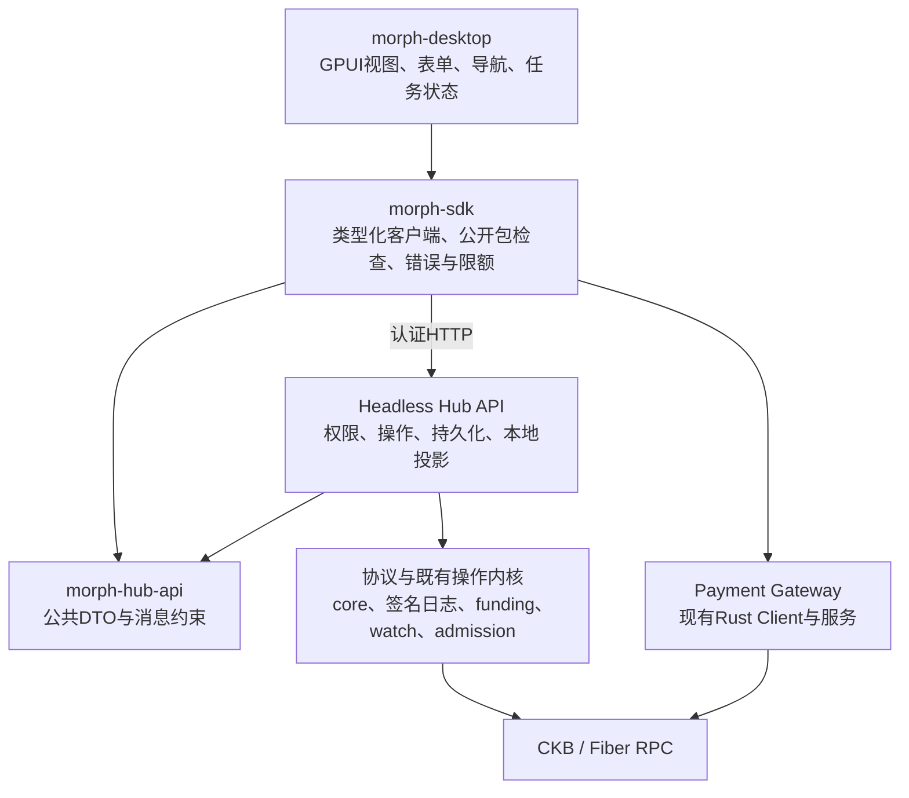
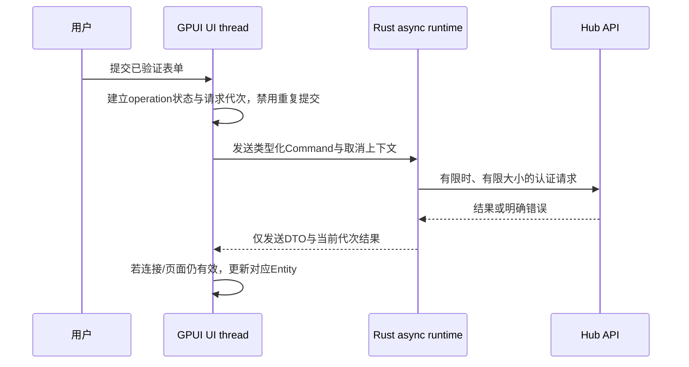
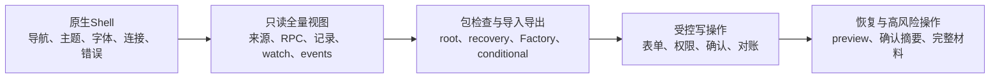
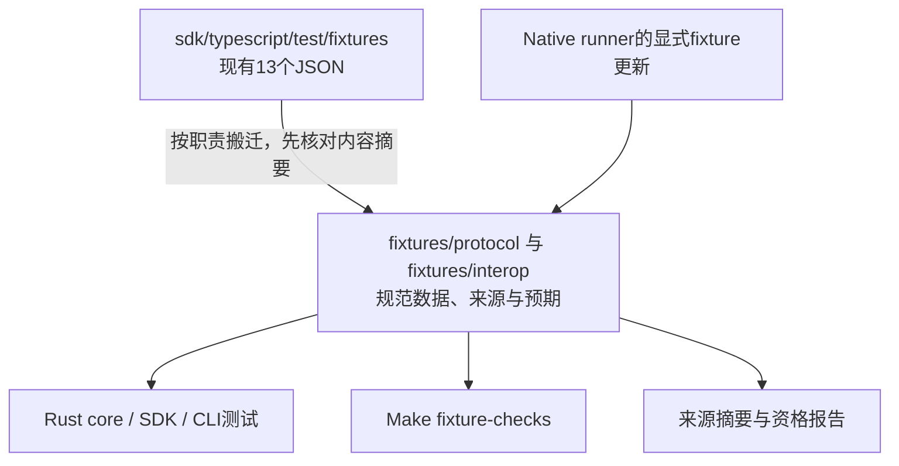
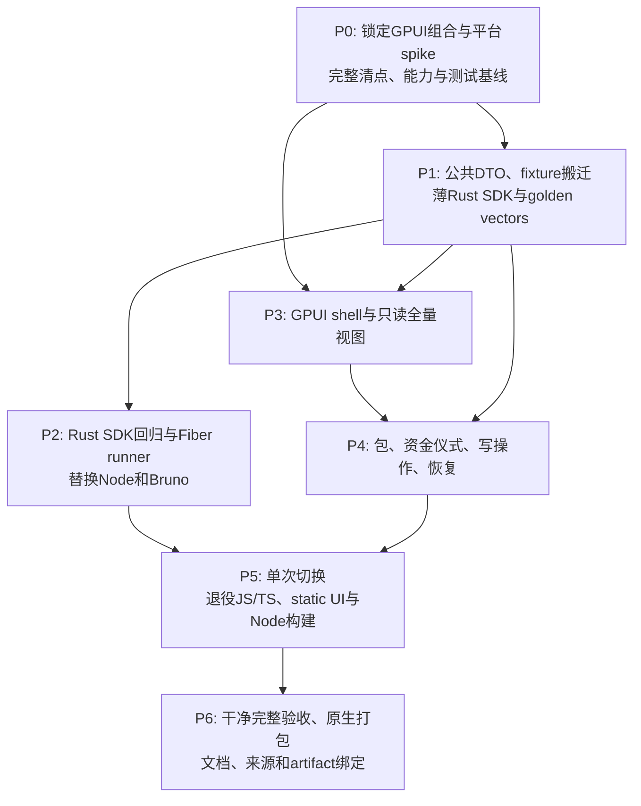
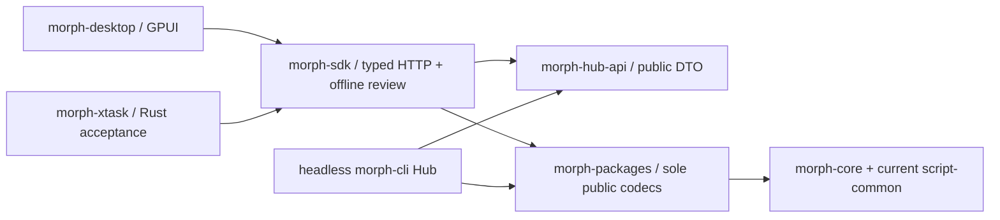

# Morph 全 Rust 迁移规划：GPUI 桌面、SDK 与验收工具

## 1. 决策与最终形态

**可以迁移，建议把 Morph Hub 做成原生 GPUI 桌面应用，同时将 TypeScript SDK 和 Node/Fiber 测试工具迁到 Rust。** 目标不是给现有网页套一个窗口，而是最终只有一套 Rust 前端、一套公共 Rust 客户端和一套协议验证实现。

维护者已明确选择：**前端、内置客户端和原 JS/TS 测试工具均迁到 Rust，移除仓库内 JS/TS。** 不保留 React/WebView 备用界面，不保留旧 npm SDK 兼容入口。迁移期间旧树只作为待接替的基线，不进行双版本产品发布；最后按能力清单一次切换并退役。

建议保留产品名 **Morph Hub**，新增原生 binary / crate `morph-desktop`。`Morph Payment Gateway` 的产品名和职责不变。headless Hub、CLI、signer、watch 和 Gateway 继续可以不依赖图形环境运行。

```text
原生窗口：       morph-desktop（GPUI）
公共客户端：     morph-sdk（Rust，复用 morph-core / 现有 Gateway Client）
公共应用 DTO：   morph-hub-api（Rust，无 GPUI、无签名者存储权威）
应用服务：       morph-cli hub serve（API-only，唯一 Hub 写入入口）
协议与验证：     morph-core / morph-script-common / 现有 CKB scripts
迁移后的工具：   morph-xtask（Rust SDK/场景/fixture 验收入口）
```

本文是规划；未新增 GPUI 依赖、构建桌面程序、删除旧实现或执行迁移。调查基线为 `e6469c3`。本轮不重新创建此前已清理的 `target/`。

## 2. 范围：哪些迁，哪些职责继续存在

| 对象 | 最终处理 |
| --- | --- |
| `ui/morph-hub` 的 React、Vite、TSX、CSS 页面 | 用 GPUI 原生页面接替，整棵旧前端退役 |
| `sdk/typescript/src` | 能力并入薄的 Rust SDK；不重写另一套协议 parser |
| `sdk/typescript/test/*.mjs` | 迁为 Rust 回归和真实场景 runner，旧脚本删除 |
| SDK 目录下 JSON fixtures | 搬到语言无关的 `fixtures/`，保留内容和来源；不是随 SDK 一起删除 |
| npm / Node / Bruno 调用、lockfiles 和对应 CI | 替换、删除全部生产与测试调用；不能藏在可选 wrapper 后面 |
| Hub HTTP API | 保留为桌面和 headless 集成边界；不因取消网页而删除 |
| Rust CLI、Gateway、signer 与 watch | 继续承担原职责，桌面通过受控入口操作 |
| 既有 Shell/Python 编排、证据校验 | 本轮保留职责并更新接线；本轮 Rust 化对象是原 JS/TS 客户端与 runner，不把整个仓库每种脚本顺便重写 |
| CCC / Fiber 等外部项目自己的语言 | 不修改其他仓库；Morph 构建、运行和验收不能因此再要求 Node |
| 既有技术报告与历史证据中的 TS 文字 | 标为历史，保留真实来源；不能把可执行旧实现藏成 active example |

“移除 JS/TS”以仓库内可执行源码、第一方依赖清单、构建/测试命令和产品运行图为验收对象。JSON、SVG、字体及必要许可证可以保留。GitHub 官方 Actions 内部使用何种运行时不是 Morph 自建 Node 工具链，但我们的步骤不再安装 Node 或调用 npm。

浏览器直接访问 Hub 页面会退出产品范围，远程管理改成原生客户端连接 API；移动端和浏览器版不在本次承诺中。

## 3. 当前清点：迁移量比换页面大

按基线 tracked files 检查：

| 区域 | 观测 | 需要迁移的实际行为 |
| --- | --- | --- |
| Web UI | 19 个 TS/TSX/入口/样式文件，约 8,516 行 | 页面、表单、筛选、状态更新、恢复、包检查、确认交互 |
| SDK 源码与 Node 测试 | 8 个 TS/MJS 文件，约 2,882 行 | HTTP 客户端、密码学验证、wire 检查、测试与真实付款场景 |
| 全仓库 JS/TS tracked 源码 | 25 个文件 | 包含配置与 `.d.ts`；不能只删 `.tsx` |
| SDK JSON fixtures | 13 个 | Makefile、Rust 测试及 native 更新流程也引用它们 |
| UI 测试 | 当前 13 项，5 个测试文件 | 应映射行为边界，不能只追求相同测试数量 |

行数只用于盘点，不构成工期或难度估算。代码入口包括 [App](https://github.com/Morph-Channel-Network/Morph/blob/e6469c3b4736d8ab4f62469f054f79aef71610f9/ui/morph-hub/src/App.tsx)、[actions](https://github.com/Morph-Channel-Network/Morph/blob/e6469c3b4736d8ab4f62469f054f79aef71610f9/ui/morph-hub/src/actions.tsx)、[records](https://github.com/Morph-Channel-Network/Morph/blob/e6469c3b4736d8ab4f62469f054f79aef71610f9/ui/morph-hub/src/records.tsx)、[API](https://github.com/Morph-Channel-Network/Morph/blob/e6469c3b4736d8ab4f62469f054f79aef71610f9/ui/morph-hub/src/api.ts) 和 [SDK](https://github.com/Morph-Channel-Network/Morph/blob/e6469c3b4736d8ab4f62469f054f79aef71610f9/sdk/typescript/src/index.ts)。这些链接描述迁移前基线；目录退役后以本节和 Git 历史追溯。

### 3.1 当前能力接替表

| 当前功能 | Rust / GPUI 接替 | 验收要点 |
| --- | --- | --- |
| 节点身份、RPC、模型/安全边界 | Overview / Model 面板 | 显示真实能力与数据来源，不硬编码“在线” |
| peers | Peers 页面与表单 | 33-byte 公钥、别名、权限、错误保留 |
| 通道登记、splice/publish/finalise 操作入口 | Channels 页面及确认流程 | 保留 API 真实语义；本地登记不冒充链上交易 |
| 发票创建、解码、支付状态与取消 | Invoices 页面 | 过期、金额、网络、支付结果与重复请求 |
| Factory 登记、更新和子通道入口 | Factories 页面 | 双边与工厂权限、已有子通道和本地/链上来源 |
| Factory packet 检查 | 原生 Package Inspector | 显示签署角色、摘要、精确 body 和验证范围 |
| root funding 请求、签名回执、导出 | Funding Ceremony 页面 | exit-before-funding、完整包、显式签名目标 |
| recovery / conditional package 导入导出 | Recovery 页面 | 调用唯一 parser；包身份、上下文和完整性 |
| 状态恢复 preview / confirmation | Restore 对话框 | 仍要求服务端允许、restore scope 和确切确认摘要 |
| watch alerts / events / 搜索 / 排序 | Watch 与 Activity 页面 | 数据缺失、陈旧、事件窗口缺口和重组能看见 |
| Gateway HTTP、x402、Biscuit、fair exchange | Rust SDK 与原生验收 | 不用“后台已有 Rust”代替客户端能力核对 |

### 3.2 当前 Hub 的真实边界必须保留

`hub.rs` 的模型声明为 `local_operator_projection`，`chain_actions_enabled=false`；许多记录带 `not_chain_verified`。原生迁移不能自行打开上链、Factory rights、provider edges、RGB++ 或 Gateway receipts 的未开放能力。

UI 必须区分：**本地记录、已保存签名证据、已提交交易、链确认、watch 观测、未知/陈旧状态**。这是功能接替的一部分，不是样式细节。依据见 [基线 Hub model](https://github.com/Morph-Channel-Network/Morph/blob/e6469c3b4736d8ab4f62469f054f79aef71610f9/crates/morph-cli/src/hub.rs)。

## 4. GPUI 选型与首先要验证的事

### 4.1 已核对的事实

官方 GPUI 提供 GPU 原生 UI、Entity、Render、Actions、异步执行与测试上下文；仍处于 pre-1.0，API 会变化。[官方 README](https://github.com/zed-industries/zed/blob/main/crates/gpui/README.md)

公开 `gpui 0.2.2` 文档与当前 Zed 主线存在差异：发布文档主要描述 macOS/Linux，主线已拆分 `gpui_platform` 等组件。不能把两套示例拼接后假定能构建。[发布版文档](https://docs.rs/gpui/0.2.2/gpui/)

GPUI crate 的 manifest 标为 Apache-2.0；不能由此假定 Zed 整个编辑器及所有内部 crate 都是相同许可。只取必要依赖并检查实际 resolved graph，不复制整个编辑器 UI。[GPUI manifest](https://github.com/zed-industries/zed/blob/main/crates/gpui/Cargo.toml)

### 4.2 推荐候选：GPUI 原生引擎配 Rust 组件层

为避免自行重做输入、表格、焦点和弹层，优先验证 **GPUI Kit 的 Rust 原生组件层**。调查时上游主线 manifest 为 0.9.0，配套 `gpui-pre-* =0.3.11`；这是候选源树信息，尚未验证在 Morph 的 Rust 1.95.0 上可构建或已完成依赖审查。[组件层 manifest](https://github.com/longbridge/gpui-kit/blob/main/Cargo.toml)

选择原则：

- 全应用只解析一套兼容的 GPUI 类型与 renderer；不要混入另一个直接依赖的官方 0.2.2。
- 固定精确版本／完整 commit 与 Cargo.lock，不跟随 `main`、`*` 或自动更新。
- 只启用 native component / assets 与必要平台 feature。
- **不使用 `gpui-shell` 的 JS 扩展、WebView、WASM 前端，也不启用第二套 `gpui-fast` 引擎。** 该组件生态确实提供这些可选能力，不能按名称就认定全是 Rust 原生。[上游组件说明](https://github.com/longbridge/gpui-kit)
- M0 若发现该组合无法满足 MSRV、依赖或关键输入行为，选定官方 GPUI 的一个可构建 revision，加最小 Rust 控件层；在 M0 结束前二选一冻结，不在产品里保留两套引擎切换。

### 4.3 平台策略

| 平台 | 首轮目标 | 不能直接推定的能力 |
| --- | --- | --- |
| Linux x86_64 | 首发全验收；Wayland 与 X11 分别验证 | GPU/驱动、文件对话框、中文输入法与系统依赖 |
| macOS | 后续验证桌面客户端及连接 Linux 服务 | 当前 private-key loader 不支持本地加载；不能关闭安全检查来“兼容” |
| Windows | 后续用同一锁定版本验证客户端 | Zed 有 Windows 版本不等于任意 GPUI revision 即可运行 Morph |
| headless Linux | API、CLI、watch、Gateway、Rust 验收继续独立运行 | 无 GPU/显示器也不能影响资金恢复与观察服务 |

GPUI 官方资料列出 Metal 与平台后端要求；Zed 的 Linux/Windows 文档也显示 GPU/驱动限制。具体系统要求以最终选中 revision 的实际验收记录为准，不能照抄 Zed 的发行承诺。[GPUI 平台说明](https://github.com/zed-industries/zed/blob/main/crates/gpui/README.md)、[Linux](https://zed.dev/docs/linux)、[Windows](https://zed.dev/docs/windows)

原生客户端能连接远端 Linux 服务，不等于要在 macOS/Windows 本地加载私钥。UI 平台与签名平台分别验收。

### 4.4 M0 结束必须交出的最小实验

一个真正打开的窗口：中文/英文输入、IME 组合、复制粘贴、金额字段、虚拟列表、后台 RPC、取消任务、文件选择、错误提示与键盘焦点都可用。记录 OS、GPU、后端、Rust/GPUI 版本与许可证图。

只编译 hello-world 不算通过；headless TestAppContext 通过也不能替代原生输入与渲染验证。M0 未通过前先不迁全部页面。

## 5. 目标架构：原生 UI 不直接成为签名权威



### 5.1 先保留服务边界，不同时重写 Hub 后端

GPUI 经 Rust SDK 调用现有 Hub API。桌面不直接写 Hub state file、不调用另一套资产状态机、不为了方便绕过角色检查打开 signer snapshot。

第一阶段不必把 5,000 多行 `hub.rs` 全部搬到新服务框架：先抽出公共 DTO 与无 transport 的纯验证，再保留一个 HTTP 应用服务入口。后续拆模块应有独立行为测试，不与 UI 重写混成一次不可定位的改动。

取消网页后，Hub 的 static file serving、`ui_dir`、`--ui-dir` 和 Vite 相关默认值退役；API 继续。根路径可以返回版本/用途的 JSON 或 404，不再回落到 HTML。CORS 也不再是桌面安全边界，最终只在有明确外部消费者需求时保留配置，否则退役；HTTP 认证和限额不能删除。

### 5.2 四个新 crate 的责任

| crate | 放什么 | 不放什么 |
| --- | --- | --- |
| `morph-hub-api` | Hub request/response、能力、来源、错误 DTO | GPUI、RPC实现、私有journal、签名密钥 |
| `morph-sdk` | 类型化 Hub Client、公开检查门面、Gateway Client 复用、离线工具接口 | 第二套wire、Molecule、hash或ECDSA实现 |
| `morph-desktop` | 窗口、页面、可见状态、UI task桥接、本地偏好 | 权威资金状态、独立投票计数器、后台签名者备份 |
| `morph-xtask` | 原Node回归与真实Fiber场景、fixture/来源校验、语言退役检查 | 另一套付款／结算业务实现 |

Gateway 已有 [PaymentGatewayClient](https://github.com/Morph-Channel-Network/Morph/blob/e6469c3b4736d8ab4f62469f054f79aef71610f9/crates/morph-payment-gateway/src/client.rs)。应扩充/复用缺口，不复制 TS 的 HTTP class 来创建第二个 Rust Gateway client。客户端所需公共类型若仍困在 CLI 私有模块，先按真实职责上提；不让 SDK 依赖 CLI binary 或把私有 journal 变成公共 schema。

### 5.3 一个 workspace，桌面依赖不流入合约

默认优先保留同一个 Rust workspace 和受审查 Cargo.lock；GPUI 只由桌面 crate 引入。`morph-core` 不依赖 GPUI/平台窗口库，合约不引入 UI、Tokio 或宿主客户端。

如果候选 GPUI 要求更高 compiler，先换一个符合约束的 revision；不能为 UI 默默升级共识 compiler。确需提高版本时，作为单独的工具链变更重建并资格验证全部 ELF。M0 如必须提出独立 desktop workspace，应记录依赖与锁文件代价后再决议，不把双锁图当成默认捷径。

## 6. 原生状态与异步设计

### 6.1 状态分层

| 层 | 例子 | 权威来源 |
| --- | --- | --- |
| View state | 当前tab、搜索词、弹窗、焦点、正在输入的金额 | GPUI Entity，可丢弃 |
| Connection state | endpoint、认证状态、请求代次、超时、快照陈旧 | Rust客户端与当前服务响应 |
| Read model | peers/channels/invoices/factories/watch及来源标签 | Hub返回，客户端不独自修改余额 |
| Durable authority | signer reservations、完整退出、admission、链上来源 | 现有服务与协议内核 |

删除 React 的 `useState` 不意味着每一份业务数据都变成全局 GPUI Entity。页面可拥有模型与持久控件状态，但资金和签名权威只留一份。

### 6.2 UI thread 只处理 UI



采用一个明确拥有生命周期的后台 runtime/工作队列桥接 GPUI 与 Tokio，不在每次 render 创建 runtime。blocking RPC、文件读取、包解析、密码学检查和大列表排序都不占 UI thread。

跨线程传 DTO、Command、Result，不把 GPUI Context 或非 Send Entity 扔进 Tokio。持久控件 Entity、订阅和任务由所属页面/窗口持有；窗口销毁、切换节点或令牌变更时取消旧任务。

### 6.3 防旧响应覆盖新状态

连接代次、请求序号与操作状态显式建模。切到节点 B 后，节点 A 的晚到响应不能刷新当前页面。timeout 或用户取消不自动撤销服务端已执行的操作。

链重组造成的观测变化要显示为重组/重新确认，不能简单把较小 state number、链高或余额都当成旧响应丢弃。请求先后与协议状态先后是不同问题。

### 6.4 刷新从认证 polling 起步

先复用当前 token 模式的短轮询，在后台调度并合并刷新。原生端虽然可以带 Authorization 建立 SSE，也不能绕过服务端现有 `/api/events` 规则；认证 SSE 是可单独验收的后续优化，不是迁移先决条件。

保留请求超时、错误 code/request-id/retry-after、连接/流并发和有界响应。事件窗口当前有大小上限，出现 ID 缺口时重新获取快照并显示缺口，不声称拥有完整历史。

### 6.5 写操作结果未知时不自动重试

`Submitting → Accepted / Rejected / OutcomeUnknown → Reconciled` 分开。连接丢失可能发生在服务端落盘之后；不能因为没有 HTTP 响应就再次创建发票、资金请求或提现。

有稳定请求 ID 且内核保证幂等的操作可以按原规则对账。没有该保证的操作先刷新/查询，不用桌面“禁用按钮”冒充全局 exactly-once。

## 7. SDK 迁移：复用一个内核，保存独立预期

### 7.1 能力映射

| TypeScript能力 | Rust落点与要求 |
| --- | --- |
| `MorphHubClient` | `morph-sdk::HubClient`，完整typed DTO、scope与包身份复核 |
| `MorphPaymentGatewayClient` | 复用已有Rust Client；补x402 convenience、receipt与fair-exchange缺口 |
| `protocol-wire.ts` | 删除手写第二份parser；调用现有core/CKB canonical packed解析 |
| multi-asset package/proposal/signature/root inspection | 公共纯Rust检查函数；不预留journal、不授予签名权限 |
| Factory request/signature/transition inspection | 复用当前Factory验证，保留角色、成员、摘要与验证范围 |
| conditional package创建与检查 | 复用当前Batch模型，保留完整来源和preimage/refund检查 |
| 付款签名、公钥与账户身份、x402 header | 对齐现有Rust域与编码；golden vectors验证字节，不自行改签名语义 |
| AES-GCM fair-exchange解密 | 复用/抽取已有Rust crypto；nonce/tag/AAD/明文验证完整 |

### 7.2 删除独立语言实现前先冻结 vectors

同一Rust函数编码再交给自身解码，不足以替代现有跨语言回归。迁移前保存已审查版本的**独立预期结果**：有效字节、摘要、签名、输出值、非法样本及预期拒绝边界，带源commit和来源说明。

最终只保留数据与Rust测试，不保留生成这些数据的旧 JS 程序作为兼容层。旧TS如发现与当前共识修复冲突，应先辨明正确预期，不能把旧接受行为永久固化成golden。

### 7.3 数字与公开格式

金额、token quantity、状态号和epoch使用对应的 `u64/u128` 或严格十进制字符串，禁止浮点中转。公开协议消息继续保持当前规范hex/字符串；Hub已有整数DTO按完整范围解析，不因退出浏览器而顺便改协议。

本地用户输入的金额按资产decimals精确转换并检查溢出、负数和小数位。UI格式化不是共识parser。私有backend snapshot仍不是公开SDK格式。

## 8. 页面与交互实施顺序



沿用当前运营台的信息结构，不先重做一套装饰性首页。金额、公钥、context、状态号、签名角色和错误来源必须能复制、完整展开和审阅。

需要原生实现的交互包括：文本选择、中文IME、Tab顺序、Enter/Escape、焦点返回、文件选择与原子保存、剪贴板反馈、长列表虚拟化、暗/亮主题、缩放与高DPI。不能直接把CSS类名映射成 `div()` 后认为行为已完成。

IME组合中的Enter不得触发签名或发送；确认按钮显示的是实际选中对象与准确效果，不只显示“确认”。屏幕上的敏感摘要不能因省略号或排序变化指向另一条记录。

首轮不新增已规划但尚未部署的 Spore/RNA 操作按钮。可以预留模块边界，能力仍由真实内核与API声明决定。

## 9. 密钥、令牌与恢复边界

### 9.1 原生窗口不接收裸私钥文本

继续使用 `morph-key-input` 的受保护文件路径。桌面允许选择受保护文件或交给现有签名服务，但不把私钥内容放进文本框、clipboard、配置、日志、进程argv/env或UI实体树。

GPUI控件或SharedString可能产生副本，不承诺“换Rust后所有秘密自动清零”。身份、公钥和公开签名回执可以展示；API token默认仅会话保存并遮蔽。持久token需要经过平台验证的secret store，不用普通JSON存储；token不是签名私钥，其授权范围也不同。

Linux-only key loader保持当前约束。macOS/Windows客户端可以向经过认证的Linux服务发请求，不因此获得本地私钥加载能力。平台keychain与私钥输入扩展若要做，另设实现和测试，不降低权限检查。

### 9.2 桌面权限不能超过服务端

保留 `read/write/restore/sign`、state-restore开关、访问限额和每操作校验。按钮隐藏只是交互提示，服务端仍拒绝无权请求。账户、网络和资金上下文变化后清空或重新验证待确认操作。

恢复只走原有preview、确认摘要与服务端允许的流程；不能把导入文件直接写进正在工作的签名者路径。持有recovery包不是允许恢复旧signer快照的依据。

### 9.3 网络与本地连接

Rust SDK保留非loopback HTTPS、受限响应、总超时、错误分类和无自动跨域带凭证重定向。连接表单不提供“忽略TLS校验”作为常用开关。HTTP服务名含localhost也不能代替实际URL/目标校验。

当前Hub本身是普通HTTP listener，不会因为客户端迁到Rust就自动有TLS。远程部署通过明确配置的TLS入口，或经过验证的隧道连接本地端点；不以允许远端明文HTTP来解决连接问题。

首个原生切片显式连接已经启动的Hub。最终可以支持同一安装包启动受管理的API-only Hub：使用结构化 `Command` 参数、受保护token交付和清楚的实例身份，不把shell字符串当启动接口。检测到已有服务/状态锁时附着或拒绝，不再开一个同时写同一状态文件的进程。

关闭GUI只终止GUI订阅与请求，不自动停止独立watch/signer，也不取消已经发出的有效授权。若提供“停止本地服务”，应作为明确服务操作验收，不能绑定窗口close回调。

## 10. Node/Fiber测试工具迁到Rust

### 10.1 替换Gateway真实三节点场景

当前 `scripts/morph-payment-gateway-fiber-devnet-e2e.sh` 构建TS SDK并执行 `fiber-devnet.mjs`。新runner由Rust SDK驱动同一真实服务，至少保留：

- 支付者在读取RPC配置前就经共享受保护文件loader校验；坏文件不阻塞、不泄漏。
- Gateway能力、收款人、网络和资产检查。
- 付款前settle应失败；真实付款完成后才成功。
- 完整付款路由确认为预期 **node1 → node2 → node3**，不能只检查服务返回success。
- receipt与requirement、payment hash、payer、终态一致。
- Biscuit credential实际通过授权端验证。
- fair-exchange取回密钥后解密得到准确明文，不只检查密文长度。
- incoming/outgoing付款索引、费用、重试与对账保留。

输出采用有来源的Rust runner报告，记录二进制/源码和服务身份，不再记录 `sdk_index_sha256` 指向已删除的JS。历史Node报告保留原身份，不改名冒充Rust通过。

### 10.2 Bruno调用也必须退出Morph验收链

`fiber-morph-devnet-acceptance.sh` 目前通过npm运行Bruno；只删除 `.mjs` 仍会保留Node依赖。迁移要求Rust场景覆盖当前实际选中的业务，而非用一个万能 `.bru` 解释器把JS断言重新藏起来。

| 场景族 | 需要保留的观测 |
| --- | --- |
| open/use/close、external funding | 真实交易、签名/提交、关闭及链上shutdown结果 |
| 三节点/router payment | 完整路由、收款终态、费用与资产 |
| restart/reestablish | 重启前后通道、付款与持久化事实 |
| force shutdown、hold/cancel/expiry | 状态、期限、终态及恢复；不只HTTP成功 |
| xUDT与其路由 | 准确Type/amount/通道边界 |
| watchtower force-close组合 | 当前场景要求的链上最终输出与观察证据 |
| Gateway x402/fair exchange | 与上一节同一真实三节点闭环 |

逐项核对现有suite清单及其前置条件，再实现同名业务意义的Rust case。旧Bruno的特定日志grep和临时失败豁免不能原样搬进新报告；新断言应直接检查事实。

完成后删除 `BRUNO_CLI_SPEC`、npm执行分支、旧runner专属配置和报告解析。更新acceptance/audit报告消费者，不把缺少新runner结果标成skip后总览仍通过。

### 10.3 CLI与测试不用另写一份业务实现

Rust runner调用真实SDK/API及现有公开构造/签名路径。外部进程仅传受保护路径和公开参数，使用独立临时目录；服务启动/停止/超时归runner明确管理。

Mock用于超时、错序、无权限和超大响应等边界；真实付款、三节点路由、交易终态和重启恢复仍跑真实进程。测试driver是Rust，不等于可以把系统测试改成纯函数测试。

## 11. Fixtures、CI、资格工具与删除清单

### 11.1 先迁数据位置，再删SDK目录



当前Makefile直接读取Factory JSON，native脚本的 `MORPH_UPDATE_FIXTURES` 也写回SDK路径。两处及全部Rust include路径都要更新。搬迁不应偷偷重算历史摘要；新生成数据要附本次来源，保留旧数据的历史身份。

### 11.2 构建与测试分层

建议新增 `sdk-check` 的Rust实际内容、`desktop-check`、`desktop-native-acceptance`、`rust-fiber-acceptance`、`no-js-check` 等Make目标。最终删除 `hub-ui-check` 的npm实现和旧Node目标；目标名是否保留由当前命令文档统一决定，不保留指向旧实现的alias。

| Gate | 负责什么 | 不能替代什么 |
| --- | --- | --- |
| headless Rust检查 | 服务、SDK、协议、loader、runner测试 | GPUI原生控件/GPU/IME |
| desktop compile/lint/test | 选中版本的桌面编译及交互模型回归 | 真窗口视觉与平台行为 |
| native UI acceptance | 原生输入、焦点、文件、显示缩放与后台响应 | 链上脚本和真实付款 |
| current native CKB / Fiber矩阵 | 真实协议、交易、支付与恢复 | 客户端安全交互 |
| no-js-check | 文件与活动调用图的退役 | 功能已经接替 |

`make ci`仍是完整聚合门，不通过只删SDK/UI检查让它“变绿”。可以为无图形部署提供 `ci-headless`，但不能把其结果写成完整桌面通过。GUI依赖不能使普通headless服务构建、运行或恢复需要GPU。

GPUI专属测试放在有系统库的job。软件Vulkan、虚拟显示或框架headless backend只有经过M0验证才进入固定CI镜像，并记录环境；不能设置成失败即skip。实际硬件性能和中文输入仍有对应原生验收记录。

headless命令需要明确package集合，或 `--workspace --exclude morph-desktop` 等经检查的选择；仅设置default-members挡不住显式 `--workspace --all-features`。桌面专属依赖不能经公共DTO/SDK回流到headless图。完整CI仍另外明确覆盖desktop，不通过exclude使它漏测。

### 11.3 清理CI与依赖

删除项目步骤中的setup-node、npm缓存、npm audit、tsc/Vite/Vitest、JS SDK build和Bruno；增加相应Rust测试、桌面系统依赖与打包。锁定Actions版本、Rust、GPUI及构建镜像。

GPUI可能引入较大依赖图；audit/deny、许可证与来源检查覆盖桌面依赖，不把整个GUI树豁免。避免为了UI恢复此前已移除的RustCrypto/Biscuit waiver。

### 11.4 资格与ELF隔离

前端迁移没有理由改变链上wire、签名域和脚本语义。保持Rust 1.95.0及合约flags，比较合约normal/build依赖图与实际ELF；如字节变化，调查原因并刷新对应manifest和证据，不能直接宣称“只是UI所以忽略”。

更新source-provenance、exporter、qualifier与runbook：source覆盖新crate和fixture目录，CI receipt反映实际Rust gate，桌面包有自己的artifact身份。CKB bundle与桌面安装包分开，不能把桌面hash当成合约发布证明。

### 11.5 最终零JS/TS验收

至少核对以下项：

- tracked及待加入的第一方 `.js/.jsx/.ts/.tsx/.mjs/.cjs/.mts/.cts` 源文件为0，包括 `.d.ts` 和旧配置。
- 旧React/Vite目录、TS SDK、package.json/lockfiles、tsconfig、旧HTML入口/CSS前端实现退役。
- 仓库活动脚本、CI、Make、运行时不再调用node/npm/npx/Bruno。
- `ui_dir`、static fallback、VITE环境变量、浏览器token storage、dist发布路径无活动消费者。
- 原生依赖与产物不启用JS shell、WebView、WASM UI或第二GUI引擎。
- 历史文档明确标注历史；用户未跟踪资料不通过通配清理意外删除。

检查不能只搜词 `node`，它也是Fiber节点术语。应按实际可执行调用、依赖和文件类型判断。尽可能在没有Node/npm的干净构建/运行环境执行完整第一方流程，验证没有隐藏运行依赖。

同样，Cargo.lock列出某个可选或其他target的wasm相关包，不自动表示原生产品使用JS。按最终native target的normal/build依赖、实际feature和产物核对，不能用字符串搜索替代依赖分析。

## 12. 持久数据、启动与桌面分发

### 12.1 build cache 与用户权威分离

```text
target/                         纯构建缓存，随时可删除
应用data目录                    Hub持久状态、已确认包、必要用户数据
原有signer权威路径              不随GUI重建/切换而复制或回滚
应用config目录                  endpoint、主题、布局等非秘密偏好
受保护secret位置                密钥文件／已验证的平台凭证存储
临时测试目录                    测试fixture与测试进程数据，独立清理
```

默认路径按平台目录规范选择并记录。Linux敏感目录/文件权限继续明确检查。GUI初始化不能为了方便把活跃signer复制到自己的目录，不能自动恢复一个旧journal。

现有文档用 `target/morph-hub/node-state.json` 启动本地demo；迁移后的正式桌面默认值应离开target。数据目录迁移由明确的当前predeployment策略处理，先核对原文件身份和锁；不要把开发状态重置规则扩大成任意签名权威重置。

### 12.2 分发方式

先交付Linux可运行包，包含必要Rust binaries、资源、许可证和hash，不要求用户安装Node。macOS签名/notarization、Windows签名与安装器在对应平台验证后提供，不因可交叉编译就宣称平台完成。

MVP不增加自动更新服务。以后更新须验证签名、来源与允许版本，不应回滚签名者数据；协议/schema迁移和界面安装升级仍分别决策。

无GPU/窗口启动失败时给明确诊断，headless CLI/API继续可用；不启动隐藏浏览器备用前端。

## 13. 与Spore/RNA计划的衔接

本次迁移不实现Spore合约，但会改变此前计划的客户端落点：

- Morph内置Spore/RNA builder、检查器和测试使用Rust/CKB canonical types及Rust SDK。
- CCC #623仍是外部生态的互通参考，不成为Morph内部Node运行时。
- 外部CCC构造的已审查交易可以作为数据fixture进入Rust精确重放；Morph核心验收不再执行TS来得到通过结果。
- 未来钱包连接若依赖浏览器/Passkey流程，要另立可验证的原生/外部钱包接口，不能为此悄悄嵌回WebView。
- 原生Spore与RNA支持的能力、链上接受、恢复和准入Gate不因GUI迁移改变。

对应Spore方案需要同步这个决定，避免两份计划一份说全Rust，一份要求内置CCC/Node构造。

## 14. 分阶段执行与依赖



| 阶段 | 可交付物 | 退出标准 |
| --- | --- | --- |
| P0 | 本文决议、baseline清单、一个真原生实验、固定版本/许可/平台记录 | 中文输入/焦点/后台任务/文件/虚拟列表可用，工具链可接受 |
| P1 | morph-hub-api、morph-sdk、语言无关fixtures与独立预期 | 当前包/根资金/Factory/conditional/Gateway能力逐项有Rust对应；旧消费者路径可定位 |
| P2 | Rust回归和真实Fiber场景、typed事实报告与消费者 | 三节点、x402、Biscuit、fair-exchange及现有被选suite族均有真实等价验收 |
| P3 | Morph Hub原生shell、连接、只读记录、watch/events | 来源标签、权限、离线、错序、IME和可访问交互通过 |
| P4 | 操作表单、包导入导出、root ceremony、restore流程 | 不绕过现有guard；取消/超时/未知结果/错误状态完整处理 |
| P5 | JS/TS及Node依赖退役，API-only Hub，命令与CI切换 | 无活动双栈；零JS/TS清单通过，全部原能力已接替 |
| P6 | 干净CI、真实GUI、CKB/Fiber矩阵、桌面包和报告 | 记录准确source/toolchain/artifact；headless可独立运行，原生交互未被skip |

P2与P3可以在P1接口稳定后分别推进，但P5必须同时等待它们。没有迁完测试，不允许先删除旧树来宣布“全Rust完成”。

维护一张 `旧能力 → Rust实现 → 核心断言 → 实际结果 → 退役commit` 台账。过渡改动只进入迁移工作，不发布两个受支持前端。P5之后不留feature flag复活React或旧TS SDK。

本轮先给工作包与依赖，不凭行数承诺工期。P0实测通过后，再以输入控件、依赖图和现有场景移植结果估算；优先级是协议/证据接替和完整纵向切片，之后才是视觉打磨。

## 15. 必须有的负向与原生验收

| 类别 | 核心场景 |
| --- | --- |
| 连接身份 | 错网络、错误节点、token过期、scope不足、切换endpoint后旧响应晚到 |
| 任务生命周期 | 窗口关闭、页面切换、取消、超时、突发刷新、无效weak entity |
| 写入结果 | 重复点击、服务执行后断连、未知结果对账；不得自动生成重复操作 |
| 公共格式 | 大整数、数量溢出、非法hex/pubkey、错包ID、角色/摘要/精确TX不匹配 |
| 包与恢复 | 损坏/超大/截断文件、缺必要退出、旧context、restore预览摘要过时 |
| 权限/秘密 | 只读UI不能经其他入口写；日志/进程/clipboard/配置不暴露私钥或令牌 |
| 原生输入 | 中文IME Enter、组合取消、粘贴、Tab/Escape、弹层焦点返回、只读字段选择 |
| 视觉/可访问性 | 长公钥与大数完整展示、缩放、高DPI、暗亮主题、空态/加载/错误区别、可访问名称与键盘路径 |
| 资源 | 大列表虚拟化、有限任务/响应/文件/事件队列；RPC阻塞时UI仍响应 |
| 事实语义 | local-only不显示为链确认；重组不被旧响应过滤误吞；watch陈旧有提示 |
| 真实服务 | Rust驱动CKB/Fiber/Gateway，路由/交易/凭证/解密事实完整 |
| 删除边界 | 无Node环境运行，active JS/TS和旧静态服务为0，旧测试能力没有消失 |

设计目标应先测基线再冻结：如典型列表滚动与输入的帧耗时、后台请求时的交互延迟、峰值内存、启动与大包检查耗时。不给未经运行的“120 FPS”或固定内存节省保证；GPU库的宣传不等于Morph的测量。

## 16. 风险与控制点

| 风险 | 决策/控制 |
| --- | --- |
| GPUI/Kit API变化 | 精确锁定同一套版本，先做P0，不从多个时期示例拼装 |
| UI依赖迫使全仓工具链变化 | 先选兼容revision；共识compiler变化独立资格验证 |
| 扩大宿主依赖导致ELF变化 | 宿主/合约图隔离、完整重建与实际hash核对 |
| SDK重写丢失严格检查 | 复用唯一Rust内核；保存独立golden与负向向量 |
| 去Node顺带删除真正集成测试 | Rust runner先完成事实等价，再退役Bruno/Node |
| 桌面直接写journal绕过Hub | SDK/API唯一写入口，协议内核继续掌权 |
| 浏览器退出造成远程使用损失 | 原生远程客户端与headless API明确接替，不保留Web UI暗线 |
| OS/GPU/IME与无障碍差异 | 平台分开验收，先Linux；不能用编译通过替代可用性 |
| 持久数据被清target误删 | 数据/权威路径离开build cache，迁移时保留锁与来源 |
| 引入JS扩展或WebView回流 | feature、依赖图、打包产物和无Node流程共同检查 |

## 17. 本次已决定与P0待冻结项

**已决定：** 全Rust产品前端/客户端/原JS测试工具；GPUI桌面；不留React、TS SDK或Node验收；同一协议内核；headless服务保留；从Linux开始；新UI不扩大当前链上权限。

**推荐起点：** GPUI Kit原生组件及其同一配套GPUI snapshot，禁用JS shell/WebView/wasm/第二renderer；Rust 1.95优先；共享workspace；typed HTTP SDK；先显式连接Hub，再验收受管理启动。

**P0需要实测冻结：** 最终GPUI/Kit版本和feature集、OS/GPU/系统库、MSRV、输入/表格组件、Tokio桥接、包大小/任务预算、CI原生测试环境、安装资源与证据格式。它们是工程验证项，不是再次询问是否迁移。

## 18. 来源与规划状态

- Morph源码基线：[`e6469c3`](https://github.com/Morph-Channel-Network/Morph/tree/e6469c3b4736d8ab4f62469f054f79aef71610f9)。这是规划盘点基线；随后的实施进度见第19节与执行台账。
- [GPUI官方README](https://github.com/zed-industries/zed/blob/main/crates/gpui/README.md)、[manifest](https://github.com/zed-industries/zed/blob/main/crates/gpui/Cargo.toml)：核对平台、API阶段、组件拆分和许可标记；主线观察点 `96508041c7dbd7a302d2bf754ade77c3af107e8f`，不是Morph已选依赖。
- [GPUI 0.2.2发布文档](https://docs.rs/gpui/0.2.2/gpui/)：与主线分开阅读，未假设API一致。
- [GPUI Kit](https://github.com/longbridge/gpui-kit)、[Kit crate](https://github.com/longbridge/gpui-kit/blob/main/crates/kit/Cargo.toml)、[安装/开始指南](https://gpui-kit.com/docs/getting-started/)：核对native组件、snapshot配套及可选JS功能；规划时没有将主线观察等同于已选组合；实际冻结组合见第19节。
- [Zed Linux](https://zed.dev/docs/linux)、[Windows](https://zed.dev/docs/windows)：仅作为平台约束参考，不当作Morph已获平台支持的证据。

本文是唯一当前迁移方案，Vault内保存阅读副本。代码实施从P0开始；完成的判断依据是**旧功能、验证与恢复都被Rust接替，而且旧JS/TS实现和运行依赖已经退役**，不是窗口已经换成GPUI。


## 19. 实施检查点与新增边界（2026-11-09）

当前实施结果以 [执行记录](gpui-migration-status.md) 为准；构建通过、单元测试通过、原生平台验收通过、供应链通过和旧实现退役是分别判定的门槛。当前不宣告迁移完成。

实际抽取增加了 `morph-packages`：它接收原 CLI 中现有的公开包 codec、回执验证和共用持久化实现，CLI 仅重导出，SDK/桌面直接复用。这样无需让 SDK 依赖 CLI 二进制，也无需建立第二套线格式解析器。原 CLI 的测试仍在原命名空间执行。



现阶段已保存 29 个初始互操作向量及旧 smoke 中 202 次公共协议调用的独立结果，Rust 已核对正负行为；公开付款签名另与 Noble 产生的规范测试向量逐字核对。SDK 动态 state-file JSON 采用 arbitrary_precision 保留 u128，避免经 Value 转换时变成浮点数。

固定组合为 GPUI Kit **0.9.0** / GPUI **0.3.11** 的原生后端。原依赖带来的 8 条未维护警告已通过计时、宏、SVG/字体与 D-Bus 迁移消除，没有新增 advisory ignore。`make supply-chain` 通过；26 个精确消费方源码都有完整来源、校验和及可读 patch，均通过上游 archive 重建。MPL 仅对 option-ext 0.2.0 与构建用 cbindgen 0.28.0 设置精确例外；原始源码 archive、许可及桌面包分发义务一并落库，未全局放开 MPL。

真实 X11 core-key 事件、中文系统剪贴板、窗口内审阅/确认、实际 Hub 写入和系统文件选择器取消已通过。用户已在打开的 GPUI 原生窗口实测中文输入法、Enter 确认与 Esc 取消组合，并回复“正常”；这份人工结果独立于 headless 测试记录。真实 Fiber router-pay、外部资金、节点重启、开通/关闭、手动三节点转发、断线恢复与强制关闭已在 Rust 下逐组通过；其余场景继续验收。旧 SDK/React/Node 树及静态服务已切换退役，源码门禁报告零 JS/TS；最终退出判定仍等待完整矩阵和干净 source/artifact 资格验证，不把树删除本身当完成证据。

独立 `desktop` 宿主构建 profile 产出约 36 MiB Linux 二进制，不改合约 release 标志。桌面本地包已验证携带依赖来源、许可和 MPL 源码；当前开发包标明 tracked_clean:false，尚未发布。完整 workspace/clippy/供应链与 91 个 CKB-VM 用例已通过，最后仍需绑定干净提交与精确产物。
