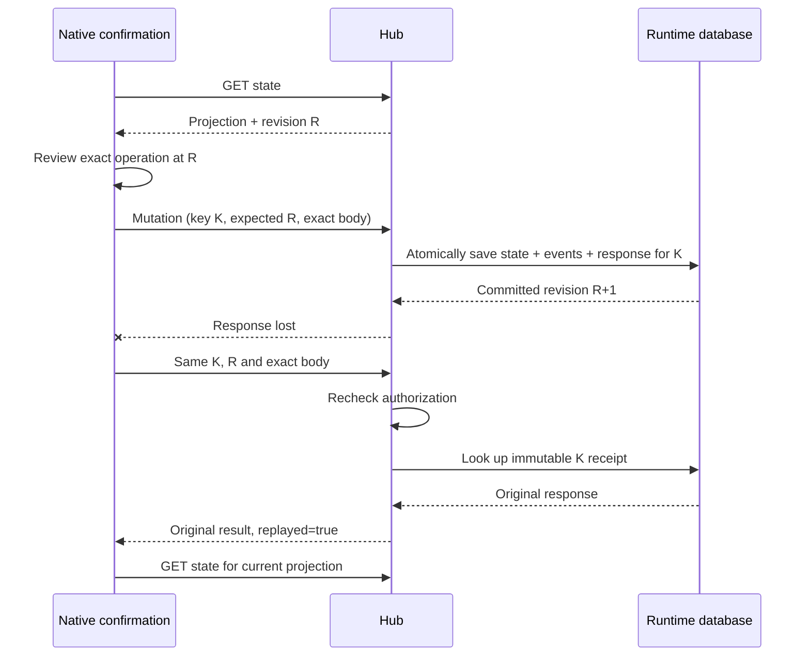

# Hub API v1: revisions and durable retry

This is the sole current unpublished Hub HTTP contract. It changes the native
Rust client and server together. Reset development state when changing the
runtime format; there are no missing-header or old-format compatibility paths.
This contract covers Hub coordination, not a new channel signing authority or
an automatic chain transaction executor. Gateway contracts remain separate.

## Preparing and confirming a request

`GET /api/state` returns a `HubView` with a required `revision`, encoded as a
canonical decimal string. Review that projection and retain its revision. The
native desktop pins it when presenting confirmation, invalidates the review on
a changed revision and sends that exact revision with the confirmed operation.
It must not fetch a newer revision at confirmation to conceal a conflict.

`GET /api/meta` returns `api_version` (`"1"`) and `revision` (decimal string).
This endpoint is subject to the same read authentication as the state endpoint.
HTTP responses, including SSE headers, advertise `X-Morph-Api-Version: 1`.

Every state-changing POST/PUT requires these headers:

| Header | Exact encoding | Meaning |
| --- | --- | --- |
| `X-Morph-Api-Version` | `1` | Current API contract |
| `Idempotency-Key` | 32 lowercase hexadecimal characters | Public, random 128-bit identity for one request |
| `X-Morph-Expected-Revision` | Canonical decimal u64, below `i64::MAX` | Durable projection revision reviewed by the caller |

The read-only `POST /api/state-file/preview` does not require a mutation context.
All current authentication, restore-disabled, concurrency, size, timeout and
rate limits still apply. A retry still requires appropriate authorization.

For a new request, the server checks the expected revision before running the
operation. Its one transaction saves the projection, generated events and the
original public response. Raw request bodies are **not** saved as API receipts:
they may contain a payment preimage. A domain-separated fingerprint binds the
method, exact path, version, expected revision and exact request body bytes.
JSON reordered or reformatted by a different caller is different request data.

## Retry rules

| Situation | Result | Caller action |
| --- | --- | --- |
| New key, matching revision, valid operation | Commit once; `X-Morph-Replayed: false` | Keep result |
| Existing key, identical fingerprint | Original response; `X-Morph-Replayed: true` | Refresh separately for latest state |
| Existing key, different fingerprint | 409 `idempotency_conflict` | Do not reuse that key |
| New key, stale revision | 409 `revision_conflict`, no mutation | Refresh and review; use a new context only after review |
| Missing/malformed context or API version | 400 stable typed code | Correct request; no compatibility fallback |
| Commit acknowledgement uncertain | 503 `commit_outcome_unknown` | Retry exact original request/context or reconcile |
| Transport break or untyped intermediary error after sending | SDK `OutcomeUnknown { mutation }` | Preserve context; do not blindly create another operation |

`X-Morph-Committed-Revision` identifies the original commit, even when a replay
happens after later commits. A replay does not execute business logic, re-sign,
restore state, emit another event or increment the revision. The saved response
is historical: its RPC/security/watch observations are not a current health or
permission check. Current auth is evaluated before returning it.

The Hub also reconciles its ordinary in-memory projection from the database
before serving store-dependent routes. This handles a commit surviving its
in-memory update or a newer trusted writer. A backwards revision or changed
node/network identity is rejected. This is not external freshness attestation:
a consistent whole-database rollback before restart remains the #55 boundary.

## Rust client

For reviewed operations, bind the client's clone with
`with_expected_revision(reviewed_state.revision)` before sending. This generates
one new public key for the operation. For a retry, clone the client and use
`with_mutation(original_context)`, with the **same operation, route and body**.
Do not use that clone for an unrelated second operation.

The basic convenience methods fetch `/api/meta` when no context was supplied.
They provide CAS against concurrent requests during submission, but do not bind
a prior human review; interactive clients must supply the reviewed revision.
No mutation is retried automatically. `OutcomeUnknown` retains the context so
callers can perform an explicit identical retry. The desktop currently retains
its refresh/reconcile UX; it does not expose an automatic retry button.

`ApiErrorCode` in `morph-hub-api` is the current machine-readable code set.
Clients must branch on it, not on the localized or human-readable `error` text.
The SDK carries `None` for an unrecognized read-side error envelope; an untyped
mutation error is treated as an unknown outcome. Request IDs aid diagnosis and
are not idempotency keys. Neither an error nor a retry authorizes cancellation,
a signer journal reset, or replacement of an exact signed transaction.

## Input boundaries and remaining #32 work

Current request DTOs reject unknown fields. Hub identifiers use canonical
lowercase hex (33-byte compressed pubkeys without `0x`; 32-byte IDs with `0x`).
Amount strings reject whitespace, signs, leading zeroes, fractions and overflow.
Revision strings never round through floating-point JSON numbers. Invoice
`receive` uses an empty JSON object and rejects additional fields; channel
`finalise` requires an empty body. Limits still apply before mutation.

This implementation does not complete #32 by itself. Public type schemas and drift checks now live in `docs/api/hub-types`, and
all u64 fields owned by `morph-hub-api` use decimal strings. Full endpoint
bindings, public state-export contracts and the Gateway error/API contract still
require work. There is no TypeScript generation: the repository's accepted direction is
native Rust clients and no JS/TS. The eventual machine-readable schema must be
generated from authoritative DTOs, not a separately maintained handwritten copy.
