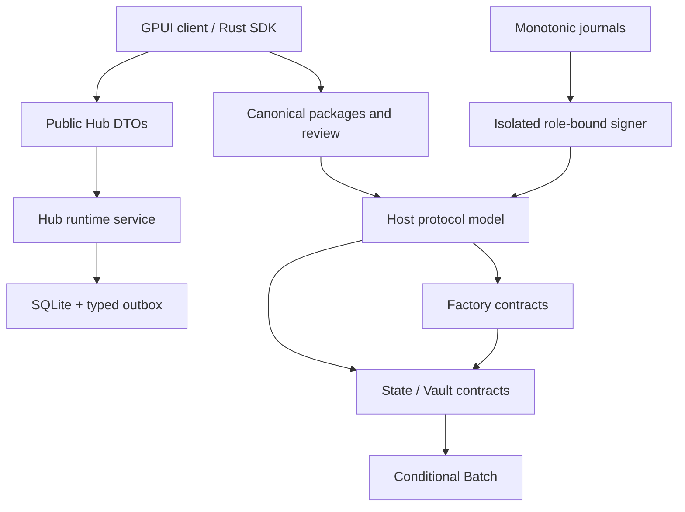
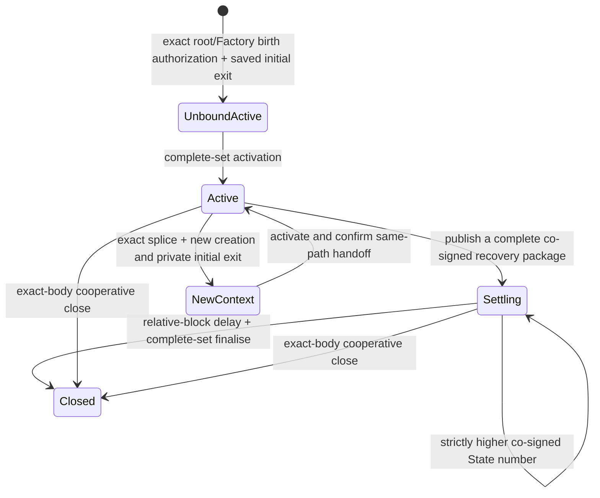

# Current implementation boundaries — 4.1.0

Morph has one channel custody implementation, a separate Factory rights authority
on the same foundation, and explicit ordinary/conditional/close/splice capabilities.
The executable wire definition is `morph-script-common`; host semantics are in
`morph-core`. This document replaces obsolete descriptions of single-Vault
materialisation fields, envelope-kind dispatch and parallel channel modes.

## Code and authority map

| Boundary | Owner | Authority |
| --- | --- | --- |
| Bilateral allocation/progress | Two participant keys | Current signed State and descriptor in an exact funding context |
| Factory rights | All members, or exactly the touched member for reduced operations | Authorized root/custody/rights change; recipient keys are not parent authority |
| Physical custody | Authentic State/Factory and Vault scripts | Complete-set input provenance, per-Type/CKB conservation and exact payouts |
| Fees | External wallet / bounded sponsor | Fee inputs and clean change; never participant allocation or Factory rights |
| Local wallet | Separate encrypted wallet worker | Its own chain payments, not channel state signatures |
| Runtime/API | Typed requests, revisions, transactional stores/outbox | Business records/recovery intent, not a fresh signing authority |
| Observer/provider | Canonical observations and pinned diagnostic hook | Readiness/mirror state only; no new rights or terminal allocation |

## State and Vault lifecycle

The channel header is **318 bytes, layout 2, descriptor 7**. It binds chain,
channel, participants, allocation, funding epoch/anchor and the content plus exact
OutPoint commitments of 1–8 Vaults. A plain CKB Vault and each typed Vault have
independent values. Direct StateType args are `anchor32 || since8`; a Factory
child additionally commits its originating Factory Type hash. Vault args are
116 bytes and bind the anchor, clock and authentic StateType/StateLock.

Creation collects complete exact-future-OutPoint Settling/1 recovery **before
funding**. Bound Active/0 is not a blanket on-chain timeout-refund branch; recovery
depends on the delivered signed package. Permissionless activation binds the
funding outputs. Ordinary updates keep the funding context and require 2-of-2;
published state numbers must strictly increase. A saved latest package can be
published without opening the signing journal. Mature finalise requires no fresh
peer signature and consumes the complete authentic State/Vault set.

The State carrier returns separately. CKB reserves/business capacity, each exact
Type’s u128 amount, carrier and outside fees are checked in independent lanes.
A clone with identical bytes is not the committed OutPoint. Finalise/splice retire
cannot leave an unconsumed committed Vault behind. Native authority code is pinned
by immutable Data1; upgradeable Type-hash authority selection is rejected.

## Conditions, close and splice

Descriptor 7 explicitly selects ordinary or conditional capability. One pinned
executor supports 1–8 asset-sorted Batches, each with 1–8 transfers. CKB pending
value comes from business capacity; token pending value comes from its exact
Type only. Both token-side signed capacities remain conserved. Future payout
occupancy is checked even when a current settled token amount is zero.

Terms version 5 uses `221 + 92*n` bytes. Trailer/resolution are version 3;
Batch args are 104 bytes. Terminal settlement emits independent asset Batches.
A Batch spends at input 0 and pays exact outputs 0/1; every transfer resolves
exactly once by SHA-256/CKB Blake2b preimage or mature absolute-block refund.
Separate external inputs pay fees. One Batch cannot reuse another’s payout slots.
See [conditions](conditional-batches.md).

Cooperative close uses `MORPHMC!`, with a dedicated digest over the target State
and exact raw transaction. Ordinary votes are not close approval. Up to 32 exact
attempts survive in durable close history; replacement does not revoke an older
signature. Reservations block conflicting updates/splice, and canonical source
consumption identifies the winner. The CLI tracks intent before RPC and can
reconcile orphaned/replaced operations without resetting journals. See
[close](runbooks/cooperative-close.md) and [ADR 006](adr/006-exact-ckb-operations.md).

Splice signs a 200-byte bridge plus bounded sorted per-asset flows, complete raw
body and new creation/recovery evidence. Old authority is irreversibly reserved
before invoking a signer. Canonical confirmation switches the same active session
path and retains sealed old evidence. Withheld-receipt/offline recovery does not
create another journal. See [splice](multi-asset-splice.md).

## Factory authority and child independence

Factory State is **306 bytes**, layout 2; Type args 44 bytes and reserve-lock args
64 bytes. `MORPHFS!` handles root, permissionless activation and exact metadata;
`MORPHFM!` handles full-consent materialisation; `MORPHFR!` handles reduced
release/rights/deposit, full custody and reduced child. FM/FR frames are version 2.
There is no envelope-kind compatibility dispatcher.

All-member operations require 2–16 sorted N-of-N signatures. Reduced transitions
carry exactly the touched member’s signature and complete membership commitment.
Up to ten metadata rights or nine physical claims use compact 256-depth proofs;
public before/after localization forbids unlisted changes. Token quantities never
sum across Types, while CKB reserve/business lanes are global across Vaults.

Physical exits/deposits/children consume precommitted `ReserveClaim` rights and
match actual value movement. Full-consent FullCustody can redistribute rights,
but still checks physical custody/conservation. Arbitrary allocation backing is
not a universal withdrawability proof. The retained floor and last collective
carrier require full consent.

Child parties may be outside the roster. Both persist complete private initial
exits before public possession receipts permit parent approval. A child then has
ordinary 2-of-2 recovery, while its originating Factory identity remains fixed.
Parent survival and continued cooperation are unnecessary for that child exit.
Members retain complete initial rights data; a public root cannot reconstruct
lost leaves. Full-consent replacement requires a newly delivered complete snapshot.

## Persistence, signing and external effects

Runtime SQLite transactions atomically commit public revisions, exact intent and
typed outbox references. Process death before/after commit has defined recovery;
external effects are never inferred merely from a missing response. Public API
archives are explicit DTOs and cannot restore arbitrary private state.

Participant signing uses `reserve → fsync → isolated signer → verify/record →
fsync → release receipt`. Stable locks, original paths, exact roles and lineage
prevent ordinary crash replay from creating a second vote. Missing signatures
are not proof signing did not occur. Whole-store rollback/clone freshness needs
an independent trusted boundary; a local hash chain does not supply it.

Wallet, channel, Factory and release-signing keys remain distinct. Protected key
files replace argv/raw-secret environment inputs. The native desktop never opens
the participant journal as a signer. See [runtime store](runbooks/runtime-store.md)
and [signer boundary](adr/003-participant-signer-boundary.md).

Watch cursors retain creation-era `from_block` and canonical hashes; a mismatch
resets orphanable observations and rescans. The same current observer/publisher
serves finite and continuous operation. Readiness/metrics are bounded and scoped;
watch availability is also a stale-state safety assumption. Fiber shadow mirrors
are diagnostic/nonforwarding. Their acknowledgements are not signer authority,
liquidity or canonical settlement.

## Evidence and current limits

The signed `991f7e3` implementation passed 114 VM cases and the ten local W1/typed
qualification gates. [The release record](releases/v4.1.0.md) separately records
the owner’s decision to skip repeated acceptance for the version/documentation
publication. Old evidence retains its exact source; release builds have their own
artifact/source manifest. Do not relabel a parser maximum, simplified VM fixture,
shadow observation or historical checkpoint as real-asset approval.

Use [wire](multi-asset-wire.md), [coverage](current-protocol-coverage.md),
[resource measurements](model-resource-optimization.md), [ADRs](adr/008-bounded-cost-and-current-encoding.md)
and [the documentation index](README.md) for detailed current boundaries.
