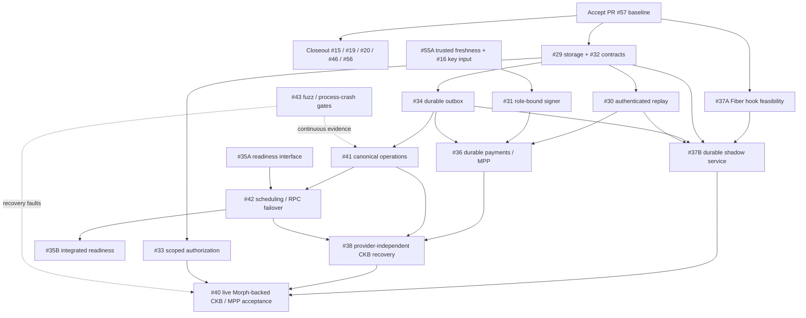
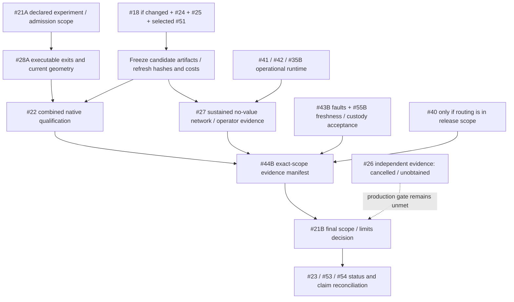

# Morph issue execution order — 2026-11-05

## Current closing scope — 2026-11-11

The owner confirmed the whole unfinished W1 set. The authoritative closing
matrix is now [W1 acceptance](w1-acceptance.md): #28/#35/#55 qualify current
admitted geometry, implemented observation scopes and explicit intact-authority
assumptions. #29/#31/#32/#37/#43 do not wait for future endpoints, HSM vendors,
new GUI workflows or routed #40 payments. #51's native close evidence is in the
sole native matrix. The #44 profile now requires independent signer lifecycle,
two/eight-Type close, three fixed long fuzz seeds and actual pinned Fiber shadow
in addition to CI/native/packages. Final candidate execution and publication
must pass before advancing `dev`, pushing or closing issues. Release stays separate.

The dated checkpoints and original ordering below remain historical progress,
not additional issue-closing prerequisites.

Latest #51 native checkpoint (2026-11-11): reduced, retained-full-consent and
terminal-parent children all close through independent bilateral authority at
four confirmations, then preserve watch correction and unilateral fallback on a
controlled rollback branch. The terminal child preserves a CKB Batch whose
fulfillment and mature refund both have actual-node payout readbacks on separate
forks. Six isolated signer attempts pass; 14 close tests, 11 report tests and
43 Python tests pass. The ledger adds 27 verified facts and cost reporting now
includes structured close receipts. See [evidence](evidence/factory-child-close-2026-11-11/README.md).
This is a dirty but source-stable native checkpoint, not final candidate approval.
API/SDK/desktop close integration and #28/#35/#55 convergence into #44 remain;
no W1 issue was closed.

Latest #44 wiring checkpoint: the existing local candidate pipeline now runs its
CI/native/package/qualification gates through candidate-bound execution receipts,
then emits an allowlisted deterministic public integration archive. Default runs
stay outside Cargo's cache. Manual CI gains an opt-in baseline path; no remote run
is claimed. 42 Python tests, shell/YAML checks and an actual dirty-candidate refusal
pass. The profile explicitly records `full_w1_qualified=false`; final shadow,
conditional-close and other W1 gates remain. See
[checkpoint evidence](evidence/integration-wiring-2026-11-10/README.md).

Latest #43/#44 checkpoint: Factory Type argument mutation coverage and 11 real-VM
inline Factory/Batch argument negatives now close the named args inventory gap.
The initial integration plan/candidate/index validator and actual execution-receipt
runner are implemented, with 33 Python tests plus two scoped Rust test entries
passing and a 10,000-input args campaign. Final W1 plan/report/export integration
and clean candidate execution remain open; no issue closure is claimed. See
[integration evidence runbook](runbooks/integration-evidence.md) and
[checkpoint evidence](evidence/integration-index-2026-11-10/README.md).

## Status reconciliation — 2026-11-10

Latest #43 private-record checkpoint: 31 actual consumer-codec reopen negatives
exposed and fixed inconsistent zero-cursor/job-source acceptance and missing
persisted-operation preflight checks. Registration/reopen/metrics now share the
preflight validator. Event and operation scopes pass 46 tests plus scoped Clippy;
source/consumer/record revisions and bytes stay unchanged on rejection. See
[record evidence](evidence/private-records-2026-11-10/README.md).
These are recovery consistency fixes, not whole-authority rollback protection or
fresh VM evidence. Script-argument inventory and final qualification remain open.

Latest #43 Gateway API checkpoint: 27 raw JSON/query seeds cover every registered
Gateway root plus errors; a separate receipt target checks actual signer/intent/
outer-field binding. Nine encrypted projection-codec negatives reject malformed,
missing, unknown and future data without reinitialization. 82 tests, scoped Clippy,
26,000 full-smoke and 20,000 scoped-long inputs pass. See
[Gateway API evidence](evidence/gateway-api-fuzz-2026-11-10/README.md).
Other private record/script-argument boundaries and final candidate qualification
remain; no W1 issue closure is claimed.

Latest #43 Hub checkpoint: 31 raw-JSON corpus inputs cover all registered Hub
JSON/SSE root DTOs plus public errors. Strict duplicates/fields/decimal checks,
readiness and page consistency supplement stable typed roundtrips. Full smoke
passes 24,000 inputs; the new Hub target alone passes 10,000 long inputs; 25 tests
and scoped Clippy pass. See [Hub evidence](evidence/hub-api-fuzz-2026-11-10/README.md).
Structural archive decoding is not restore authorization. Gateway DTO/private
record coverage and final candidate qualification remain open.

Latest #43 signer checkpoint: three bounded request/rehashed-review/response
mutation targets now cover all seven external participant roles, with policy and
controlled input resolution fixed outside mutated data. The 23-target short and
long campaigns pass 23,000/230,000 inputs; 15 tool tests and scoped Clippy pass.
See [signer evidence](evidence/signer-fuzz-2026-11-10/README.md). This complements
actual IPC/process faults; remaining HTTP DTO/private-record and final-candidate
work is still open. No issue closure or whole-authority freshness claim is made.

Latest #43 Gateway checkpoint: six actual HTTP-service SIGKILL/restart scenarios
cover committed reservation, accepted send with a lost/received RPC reply, and
persisted successful/failed results before HTTP delivery. Exact retries preserve
0/1 sends, immutable submission and terminal outcomes; conflicting terms remain
409. Scoped Gateway tests (64 harness entries), Clippy and formatting pass.
Controlled Fiber RPC and test entry point are explicit limits. See
[process-kill evidence](evidence/gateway-process-kill-2026-11-10/README.md).
Signer/API DTO and private-record coverage plus final candidate qualification
remain; no W1 issue closure is claimed.

Latest #43 binary checkpoint: signed splice frames, independent flow tables,
conditional Batch resolution and current State/Vault/Sponsor args now have four
additional bounded targets. Twenty targets pass 20,000 short / 200,000 long
inputs; 14 tool tests and Clippy pass. Splice bridge authority and independent
Batch payout accounting are checked, with explicit VM/live-cell exclusions.
See [binary evidence](evidence/wire-boundary-fuzz-2026-11-10/README.md).
The boundary matrix retains signer/API/private-record and real service-kill gaps;
this checkpoint changes no production contract, wire or release permission.

Latest #43 decoder checkpoint: two new SDK document/receipt targets bring the
campaign to sixteen targets. All ten current document review schemas have 22
canonical samples; four detached receipts exercise proposal/Factory roles.
Typed canonical roundtrip must preserve SDK review. Short/long campaigns pass
16,000 / 160,000 inputs; SDK/tool suites pass 23 tests. See
[SDK decoder evidence](evidence/sdk-document-fuzz-2026-11-10/README.md) and the
[new boundary matrix](verification-boundary-matrix.md). The matrix distinguishes
binary/API/signer mutation gaps from scenario and real-process evidence; it does
not claim those missing rows passed or change the W1 scope.

Latest #43 lifecycle checkpoint: payment-attempt, outbox-delivery and exact-operation
models now complement runtime replay and edge revisions. Three fixed seeds run
1,440 main-loop steps through real persistence (controlled RPC for operations).
The payment model found a permanent reused-requirement conflict mislabeled Busy;
CAS recovery now preserves Conflict without creating another send grant. The
minimal regression and 106 scoped tests pass, with scoped Clippy and stable
source hashes. Scheduled CI includes Gateway tests. See
[lifecycle model evidence](evidence/lifecycle-models-2026-11-10/README.md).
The current decoder/fault-family inventory and final W1 qualification remain;
none of these models substitutes for whole-authority freshness or native evidence.

Latest #43 model checkpoint: an independent sequential reference ledger now checks
real SQLite after every bounded write/delete/retry/conflict step, including
immutable outbox/attempt collisions and pagination. Fourteen targets pass 14,000
short and 140,000 longer inputs. A separate persistent edge model runs three
fixed seeds × 128 commands, database reopen and reverse historical replay.
Tool/adapter suites pass 49 tests; scoped source hashes are stable around the
campaigns/final adapter verification. See
[runtime and edge model evidence](evidence/runtime-replay-model-2026-11-10/README.md).
Payment/operation/outbox models and the current decoder inventory remain; no
full W1 qualification or issue closure is claimed.

Latest #35 watch-margin checkpoint: public assessment v3 adds twelve fixed
per-resource diagnoses and numerical full-fee/time margins (26 fixed series).
Partial quote coverage stays explicit; missing margins are NaN. Remaining time
conservatively includes boot elapsed time and quote age at capture, so a slow
wall clock cannot restore execution budget. Twenty-three watch tests, both CLI
Clippy builds and actual stopped-service readback pass. See
[watch margin evidence](evidence/watch-margins-2026-11-10/README.md).
No new native-chain or final W1 qualification is claimed.

Latest #35 Gateway checkpoint: four durable business counters now derive from
non-evicting outgoing/receipt records, with a gauge for unresolved payments beyond
their recorded waiting budget. The existing authenticated exporter has 147 fixed
series; exact retries and display eviction do not inflate/reset counts. Controlled
HTTP concurrency, restart and invalid terminal evidence are covered in 84 scoped
passing tests. Canonical API generation also repaired stale event schema artifacts
for #32. See [Gateway business evidence](evidence/gateway-business-metrics-2026-11-10/README.md).
No native-chain or final-candidate qualification/issue closure is claimed.

Latest #35 operation checkpoint: the current exact-operation record is v2 with
required lifecycle counters committed atomically with status/intent/outbox.
Read-only `operation-observability` exports 225 fixed historical series; unavailable
data is NaN, not zero activity. Duplicate polls/depth changes, failed CAS, restart,
RPC failure/reorg and independent read-only process behavior have targeted tests.
This is saved history, not current canonical or mutation readiness; only the
existing cooperative-close adapter is claimed. Final verification/evidence is
recorded in [operation metrics evidence](evidence/operation-metrics-2026-11-10/README.md).

Latest #35 signer checkpoint: the actual private signing listener now supports a
separate bounded read-only policy probe. Fresh challenge/config binding, current
loaded policy comparison and a two-second wall/boot horizon prevent busy, stopped
or stale services from appearing policy-ready. No journal mutation, RPC or trial
signature is used. CLI 346 unit + four integration tests and transport 13 tests
pass, including actual busy-queue recovery, policy drift, SIGKILL and restart.
See [signer readiness evidence](evidence/signer-readiness-2026-11-10/README.md).
This reports `key_process_policy`, not aggregate channel-signing authority;
remaining business metrics/alerts and final W1 qualification are still open.

Latest #35 budget checkpoint: the real publication dry-run now supplies exact-source
Sponsor/fee/change-floor and remaining challenge-execution quotes. Passive scanning
consumes the same builder without submitting. Publication readiness requires full
configured fee headroom and fresh (at most 30-second) budget evidence; automatic
funding not yet performed is explicitly not prepared. Native CKB verifies full
headroom, initial-fee-only rejection and passive quotation. CLI 344 unit + three
integration tests pass; final watch subset 20 passes. See
[budget evidence](evidence/watch-budget-2026-11-10/README.md). This supersedes the
earlier scan-only placeholder; business metrics/alerts and final W1 qualification
remain open.

Latest #35 watch checkpoint: per-resource failures no longer abort later scans;
busy cursors fail promptly, each channel has a total RPC budget, and current v2
health binds scan observations to configuration/policy/location and boot/wall
expiry. A keyless probe exports eight bounded gauges. Native CKB verifies a failed
first source followed by genuine sponsored canonical correction. `protection_ready`
remains false until live funding/publication budget is actually checked; scan
coverage is not protection. CLI 343 unit and three integration tests passed;
final watch subset 19 and scoped/default Clippy passed. See
[watch evidence](evidence/watch-readiness-2026-11-10/README.md). No issue is closed.

Latest #43 checkpoint: current FS root/activate/update and FM retained/terminal
frames now join the bounded mutation campaign. Thirteen targets pass 13,000 smoke
and 130,000 longer-run inputs; 76 Core, 10 tool, 15 operation and 37 adapter tests
pass. Scheduled CI now includes operation and shadow fault regressions; GitHub has
not executed these unpushed changes. See [Factory fuzz evidence](evidence/factory-fuzz-2026-11-10/README.md).
Next dependency work is #35 watcher/publication readiness and the remaining #43
DTO/record/state-machine scope, followed by exact-candidate #28/#44/#55 evidence.
Producer-history segmentation is a capacity concern, not a new prerequisite for
every independent #29 or #37 acceptance item. All W1 issues remain open.

The current #51 worktree implements the distinct `MORPHMC!` bilateral terminal
close, shared consensus verifier, Core/journal lifecycle and seventh isolated
signer role. Its first #41 adapter now preserves exact transactions, pre-send
intent, depth/reorg observations, independent subscribers, offline export and
transactional outbox. Explicit fee-version links preserve older approvals;
`replaced` requires fresh canonical proof and never credits a competitor's depth
to the losing body. The latest CLI run passes **328 tests**. Two/eight-token native
runs exercise newer-wins, orphan replay, older-wins and ordinary unilateral fallback
across three controlled rollbacks. See [replacement evidence](evidence/operation-replacements-2026-11-10/README.md),
[ADR 005](adr/005-bilateral-cooperative-terminal-close.md) and [ADR 006](adr/006-exact-ckb-operations.md).

Earlier 100-VM/74-host evidence belongs to the verifier/Core checkpoint; it is not
rerun by this host-only change. Native conditional/Factory-child close cases,
other runtime adapters, service/UI integration and final candidate qualification
remain open. W1 closure must use each issue's actual acceptance scope: the #29
storage boundary does not require every future consumer to be finished; #32 covers
exposed contracts without inventing new endpoints as prerequisites; #37 requires
canonical **non-forwarding shadow** acceptance, while live routing remains separately
gated. The next substantial W1 integration is the canonical Morph-side #37 service,
followed by its readiness/fault evidence and the final #28/#43/#44/#55 join.
Neither #41 nor #51 nor the full W1 set is closed by this checkpoint.

The next #37B checkpoint now adds `devnet shadow-observe`: canonical live
State/Vault validation, installed script identities, historical Factory/splice
source checks, strict provenance and a total RPC deadline. Root observations pass
actual two/eight-token close, rollback and live-Settling rejection scenarios;
**333 CLI tests pass**. It emits public diagnostic edges only, never forwarding.
Factory/splice native qualification, durable Morph registry/outbox and both-side
reconciliation remain open. See [observer evidence](evidence/shadow-observer-2026-11-10/README.md).

The subsequent #37B origin checkpoint now passes native reduced/retained/terminal
Factory children and Root → remove-asset splice → readmit-asset splice: six
non-forwarding observations, spent-context and cross-child-history rejection.
The host reservation now commits the physical child target separately from its
source right label and verifies the source access root. CLI 333, Core multi-asset
75 and adapter 23 tests pass; the final native run holds 4,134 source entries fixed.
Durable Morph registration/outbox and both-side restart reconciliation remain the
next #37 dependency join. See [origin evidence](evidence/shadow-origins-2026-11-10/README.md).

The subsequent #37B coordinator checkpoint adds a durable Morph observation /
exact-operation / typed-outbox library and read-only authoritative-session input.
CLI 333 and shared 80 tests pass; final adapter 36 supersedes the shared adapter
35 (414 distinct tests). Actual HTTP success-response loss, delayed handshake
expiry, four SIGKILL cuts and six native current-session sources are covered.
The native source run holds 4,143 entries fixed; its executable does not call
the coordinator and predates final adapter timing hardening. Continuous worker /
readiness / reorg integration and real pinned Fiber + CKB joint restart acceptance
remain open. See [coordinator evidence](evidence/shadow-coordinator-2026-11-10/README.md).

The subsequent #37 service checkpoint now runs a single-owner canonical worker
with immutable config binding, total observation/reconciliation budgets, prompt
invalidations and boot/config/database-bound diagnostic readiness. A real pinned
Fiber + CKB matrix passes both-process SIGKILL, exact revision recovery, journal
busy/release, actual activation orphan/replay and unilateral-close disable.
Final provider revision is 9; forwarding stays false. Morph 420 tests and two
Fiber hook/auth tests pass; final native sources hold 4,157 Morph / 1,183 Fiber
entries fixed. Root XUDT is the combined service source; Factory/splice origin
evidence remains separately scoped. Long-duration history/resource qualification
and final committed W1 evidence remain open. See [service evidence](evidence/shadow-service-2026-11-10/README.md).

The sections below are the **November 5 planning snapshot**, not a current status report. A fresh GitHub inventory on November 10 found **33 open issues**. The originally requested first batch, **#16, #18, #21, #24 and #25**, was completed and closed on November 6 against signed candidate `8a2ed07b70da98e1c110529819bfc40dbbf8651c`; their issue bodies link the local and GitHub verification records. Those earlier SDK/UI results describe that candidate, not the later native desktop worktree.

The broader W1 table still contains ten open issues: **#28, #29, #31, #32, #35, #37, #43, #44, #51 and #55**. “Original first batch” and “all W1 foundations” are different scopes. An open issue is not evidence that none of its implementation has landed: for example, the native migration already added `morph-hub-api` and the Rust SDK, while the full #32 schema/idempotency acceptance still needs reconciliation.

Current corrections to apply when executing the historical plan:

- #25 explicitly retains the narrow `RUSTSEC-2026-0097` rand 0.7.3 upstream exception. Its closure does not mean that this advisory was patched. Removing it requires a separate compatible migration of all three incoming dependency roots, with the existing public RNG behavior preserved.
- #21 was closed for the owner-approved, locally qualified no-value scope. Independent/public-network evidence was removed from that local closeout requirement; #27/#44 external evidence was not marked passed. Do not reinstate the cancelled prerequisite through the older dependency diagram.
- The sole application frontend, built-in client and test tooling are Rust. #32's historical TypeScript generation language is superseded by the native/Rust decision; do not reintroduce JavaScript or TypeScript to satisfy an obsolete checklist.
- #26 independent audit remains cancelled. No new release, production approval or independent audit follows from this status reconciliation.

Sources: [#16](https://github.com/Morph-Channel-Network/Morph/issues/16), [#18](https://github.com/Morph-Channel-Network/Morph/issues/18), [#21](https://github.com/Morph-Channel-Network/Morph/issues/21), [#24](https://github.com/Morph-Channel-Network/Morph/issues/24), [#25](https://github.com/Morph-Channel-Network/Morph/issues/25), and the repository's open-issue inventory. This is a status refresh, not a new test run or acceptance of the remaining W1 issues.

The continuing W1 worktree now includes the #29 transaction boundary, #32 Hub/Gateway contracts, and the #31/#55 request/IPC/freshness checkpoint described in [the progress ledger](w1-progress-2026-11-10.md). These are partial implementations; all ten W1 issues above remain open. The Gateway checkpoint now adds durable outgoing payment identity, single new-commit send authorization and exact-request reconciliation; full provider-neutral/MPP attempts remain #36. The signer checkpoint now includes six-role native acceptance with independent key/caller processes, expiry rejection, lost-response recovery and cached retry. The six-role combined authority-advance/host-crash/bad-response matrix is now complete for seven application-level fault families (42 scenarios); final candidate qualification and the broader #43 runtime/fuzz campaign remain outstanding. See ADR 003 and the progress ledger.

The #37 checkpoint now carries an optional diagnostic RPC patch pinned to Fiber
`a5faac7177a2a2ec086a2c6d0da1840ec9fe5703`, a shared persistent mirror handler,
strict capability checks and targeted patch/adapter tests. Canonical observation now has a Root native checkpoint; durable
reconciliation/outbox and Factory/splice no-value acceptance remain #37B; forwarding stays disabled. See [ADR 004](adr/004-fiber-shadow-hook.md)
and the progress ledger. This does not close #37 or widen #21's scope.

The #35A checkpoint now integrates shared scoped observations and bounded metrics
into the actual Hub HTTP server and Rust SDK: liveness, 200/503 readiness, and
131 fixed Prometheus series. Store checks are asynchronous, revision-bound and
expire from probe start. Actual Gateway/signer/watch/outbox integration, resource
coverage and business metrics remain #35B. See the
[service readiness runbook](runbooks/service-readiness.md). The 78 targeted tests
and scoped Clippy results are worktree evidence, not final candidate qualification.

The #34 dependency checkpoint now delivers typed Hub events atomically with local
projections, durable source-bound pagination and a separate authenticated webhook
consumer. Claim/retry/ack/dead-letter state is durable without advancing producer
business revisions. 172 targeted tests include actual Hub/consumer HTTP and four
process-kill boundaries. Watch/Gateway production, safe retention/archival and
integrated backlog readiness remain incomplete. See the
[event delivery runbook](runbooks/event-delivery.md); this does not close #34 or W1.

The next #34 checkpoint integrates Gateway projection schema 3, explicit redacted
mutation events, operator-authenticated durable pagination, and encrypted source
input to the same independent consumer. Duplicate terminal observations emit no
new event. 176 scoped tests include actual encrypted-source CLI/webhook delivery;
1519 source/generated files were unchanged across the verification run. Watch
producer migration, archival/capacity recovery and integrated readiness remain
unfinished. Schema 2/generic event fallback is not supported.

The watch #34 dependency checkpoint now atomically commits cursor, private alert,
public outbox and source egress policy. Synchronous watch HTTP is removed; local
JSONL is a recoverable multi-channel display. 390 scoped tests (including explicit
native-event readback), scoped Clippy and a private CKB fee/RBF/reorg run passed.
Native evidence has its own source/binary binding; this is not final release
qualification. History archival/capacity recovery and integrated #35 readiness
remain outstanding. See the progress ledger and event-delivery runbook.

Consumer capacity recovery now has a resumable generation handoff: prepare a
successor, CAS-seal the old consumer, copy exact unresolved jobs in bounded chunks,
and activate only after validation. The old database remains the archive; no
attempt/ack/history deletion or retry-budget reset occurs. Four process-kill
boundaries, 1024-job recovery, the 8000-revision seal reserve and actual CLI
archive/successor behavior passed within 395 scoped tests. Producer-history
segmentation and #35 integration remain open; this does not close #34/W1.

The consumer #35 checkpoint now adds read-only, revision-consistent dispatch
readiness and 17 fixed metrics. It checks backlog/dead letters, archive state,
source egress policy and an actual worker lease bound to source/subscription/store
generation. Wall time, Linux boot time and boot identity bound lease freshness;
a real CLI worker-kill test observes expiry without modifying heartbeat files.
405 scoped tests and scoped Clippy passed with 3897 source/config/generated entries
unchanged. The shared scope addition makes current Hub metrics 132 series; the
131-series count above is historical. Gateway/signer/watch/operation integration,
producer-history retention and final W1 qualification remain outstanding.

The next #35 checkpoint integrates the actual Gateway router, encrypted store
and Rust SDK with operator-protected `/ready` and `/metrics`. Optional paired
Fiber pubkey/chain-hash pins compare read-only `node_info`; missing pins never
produce a verified provider scope. Independent read-only store probes, fixed
141-series metrics and a single retained permit bound slow/cancelled work.
411 scoped tests and scoped Clippy passed with 3900 source/config/generated
entries unchanged. Controlled HTTP peers test wire shape and timeout behavior;
this is not new native Fiber/CKB qualification or proof of route liquidity.
Signer/watch/publication/payment-coordination observations and final W1
qualification remain outstanding. See the service-readiness runbook and ledger.

Signer-supervisor #35 observations now use sole-current v2 snapshots with
cycle-start wall/boot expiry and boot identity. The redacted CLI reports only
`authority_supervision`, explicitly not key-process liveness or signing authority;
eight bounded metrics omit paths/keys/errors. Actual process termination tests
observe saved-evidence expiry without rewriting it. 414 scoped tests and scoped
Clippy passed with 3903 source/config/generated entries unchanged. Generic Hub
and Gateway exporters now have 133/142 series after the shared scope addition.
External-key-process, watcher/publication and final W1 acceptance remain open;
boot-bound observation freshness does not solve #55 whole-authority rollback.

The #31/#43 root combination checkpoint now covers 14 fault scenarios across
RootExit and RootCreation: host SIGKILL after reservation/receipt/record,
malformed/oversized/cross-role replies, and legitimate peer-receipt authority
advancement after review but before key use. Fresh host recovery preserves the
same reservation; cached retrieval needs no key service. Controlled RPC fixtures
are explicit, not native chain evidence. 432 scoped tests and Clippy passed with
3904 source/config/generated entries unchanged; ordinary CLI binaries contain no
test fault controls. The later checkpoint below adds Update/Splice combined cuts;
the broader #43 runtime/fuzz reconciliation remains open. See ADR 003 and the progress ledger; this does not close #31/#43/#55.

## Snapshot and working scope

All **42 open issues, #15–#56**, were read, including the two comments on #28. There are no closed issues in the current issue inventory. The GitHub blocked-by API reports no recorded blockers for any of the 42 issues. The dependencies below are technical conclusions from their bodies and the current implementation; GitHub does not currently enforce this order.

The implementation baseline is [draft PR #57](https://github.com/Morph-Channel-Network/Morph/pull/57), head [`89f88eb2da4aca65f759e6967910f274c044c8e2`](https://github.com/Morph-Channel-Network/Morph/commit/89f88eb2da4aca65f759e6967910f274c044c8e2). Both [standard CI](https://github.com/Morph-Channel-Network/Morph/actions/runs/41950770656) and [native acceptance](https://github.com/Morph-Channel-Network/Morph/actions/runs/41950770807) passed. The current suite has 82 registered VM tests. The native evidence has five cases, nine scenarios, 65 assertions and 11 audit families. The original 77-test checkpoint remains historical. Public `main` is still `24484e72a20edf0fbe0344d59afdcd9af1fe9b29`; branch implementation and merged delivery are distinct statuses.

Working product scope: **one current custody/signing/recovery foundation, native channels and Factories, then a bounded CKB-only Morph-backed Fiber route with provider-independent recovery**. Conditional token routing, RGB++, automatic liquidity management and browser signing authority are separate extensions. No old parser, old funding path or second physical implementation is introduced by this plan.

The user cancelled independent audit arrangements. **#26 is outside the active execution queue**, and its required independent evidence remains unobtained. That cancellation does not cancel runtime recovery without a routing provider, or the operational measurements in #27. The current controlled-devnet envelope continues to prohibit real assets.

## Execution policy

1. Accept the existing PR baseline and reconcile delivered work against its acceptance criteria before allocating another implementation project to it.
2. Fix protected key input and private recovery handling immediately. Start shared storage and API contracts, signer-freshness design, and Fiber hook feasibility in parallel.
3. Build recoverable operations before enabling routed payments. Continuous watching already exists; extend its scheduling and failover rather than creating another watcher.
4. Make dependency/toolchain and any selected consensus changes before freezing the final ELF/manifest/cost candidate. Re-run affected evidence after changes.
5. Finish exact-candidate integration and operational qualification. Admission approval consumes that evidence; an implementation maximum is not an approved operating shape.

“After” in the tables is a completion dependency unless explicitly called a hard prerequisite. Interface design, harnesses and independent components can start earlier. A/B/C are phases of the same issue, not proposed new issues.

The latest #31/#43 checkpoint completes the four Update/Splice role matrices in addition to Root: 28 new scenarios, three canonical guard negatives, and a mapping of all eight #31 checklist items to code/tests. Scoped verification passed 438 tests, Clippy, formatting and ordinary CLI build with 3906 unchanged source/config entries. Evidence: `target/session-signer-fault-evidence/2026-11-10/verification.json`. This is controlled-RPC process evidence, not a new native/ELF qualification or issue closure. Next verification work is the remaining #43 bounded fuzz/CI and runtime fault families, followed by final candidate identity binding for #31/#44/#55.

The next #43 checkpoint adds a bounded Linux mutation runner (`morph-xtask --bin morph-fuzz`) for manifest, settlement, State/witness, recovery JSON/SDK, Factory FR frame/proofs and public events. PR/local CI now includes `make fuzz-smoke`; a new scheduled workflow runs three fixed seeds and existing signer/runtime crash tests. Local 6000-input smoke and 60000-input long campaigns, nine tool tests and Clippy/hygiene passed with 3939 unchanged source/config/corpus entries. See `docs/runbooks/verification-campaigns.md` and `target/bounded-fuzz-evidence/2026-11-10/verification.json`. These are mutation campaigns, not coverage-guided or VM evidence; remaining API/callback/store codecs, FS/FM and runtime-state-machine/I/O fault work keep #43 open. The GitHub workflows have not yet run against these unpushed changes.

The following #43 checkpoint expands the campaign to ten targets with Hub mutation-context, Gateway payer authorization, callback HMAC and actual in-memory SQLite commit/replay invariants. The six signer roles also gained 48 targeted syscall I/O-failure cases (two persistence stages × four failures per role), supplementing the earlier 42 process/protocol cases. Existing runtime-store EIO/ENOSPC tests are reused. Final scoped verification passed 449 tests, 10000 smoke inputs and 100000 long-campaign inputs, Clippy/hygiene and ordinary CLI build with 3940 unchanged source/config/corpus entries. Evidence: `target/auth-store-io-evidence/2026-11-10/verification.json`. Remaining full DTO/record, FS/FM and payment/edge/operation/re-establishment coverage still keeps #43 open; these injected syscall failures are not kernel power-loss or whole-authority rollback evidence.

## Full inventory and disposition

### W0 — establish the baseline and finish small acceptance tails

| Issue | Current disposition | Processing order and remaining completion condition |
| --- | --- | --- |
| [#54](https://github.com/Morph-Channel-Network/Morph/issues/54) Execution index | Administrative umbrella | Maintain this queue and link evidence as work lands. It is not a runtime prerequisite and does not require optional features to be implemented. |
| [#15](https://github.com/Morph-Channel-Network/Morph/issues/15) Public intent/private child recovery | Core split delivered; small acceptance tail | Verify private-directory policy and handling guidance with #19. New private files use 0600, while directory creation still inherits umask rather than explicitly guaranteeing 0700. Resolve that stated permission requirement before treating the issue as fully accepted. |
| [#19](https://github.com/Morph-Channel-Network/Morph/issues/19) Independent Factory signers/private delivery | Acceptance/closure candidate in #57 | Map existing N=2/3/16, failed/partial delivery, reserve/sign/record and stale-snapshot cases to the checklist. Finish the #15 privacy boundary. Reuse the delivered journals and ceremony; whole-store rollback remains under #55. |
| [#56](https://github.com/Morph-Channel-Network/Morph/issues/56) Sole funding path/initial exit | Acceptance/closure candidate in #57 | Check removed formats/commands, complete exact-TX exit before publication and same-path handoff negatives. Preserve current recovery; no compatibility branch is required. |
| [#20](https://github.com/Morph-Channel-Network/Morph/issues/20) Native Factory lifecycle | Acceptance/closure candidate in #57 | With #19/#56, map root/activation/update/materialisation/retained custody, exact replay, restart and reorg evidence. The common long-running operation runtime belongs to #41. |
| [#46](https://github.com/Morph-Channel-Network/Morph/issues/46) Current reduced-right publication | Acceptance/closure candidate in #57 | With #20, map admitted 1/4/10-right cases, actual publication, fresh proofs, source replacement, fees/reorg/replay and complete initial rights data. Preserve full new snapshots for arbitrary all-member root replacement. Do not rebuild retired kind-8 tooling. |
| [#23](https://github.com/Morph-Channel-Network/Morph/issues/23) Current documentation | Continuous closeout | Profile drift is fixed. Reconcile CLI help, examples, paths, current-versus-historical results and remaining integration-plan drift. Continue after each protocol/runtime milestone and perform a final candidate consistency pass. |

These are closure candidates, not automatic closures. Accept #57 into the chosen shared baseline, resolve any actual checklist tails and attach the evidence before changing their completion state.

### W1 — scope, safety boundaries and parallel foundations

| Issue | Current disposition | Dependencies and next step |
| --- | --- | --- |
| [#16](https://github.com/Morph-Channel-Network/Morph/issues/16) Protected signing input | Immediate implementation | Remove raw private keys from argv across bilateral, Factory, child and delivery commands. Define protected FD/stdin/file input, permission/format/size bounds and secret-safe errors. **Does not wait for #31.** |
| [#18](https://github.com/Morph-Channel-Network/Morph/issues/18) Delegated contract verification | Small boundary review/test task | Verify authentic input-0 Type, the same frame in global witness-0 and mandatory execution of that Type. Evaluate the cheap exact-TX assertion and complete named negatives/docs. A confirmed authorization bypass is not established by this issue. Any changed contract must precede the final artifact freeze. |
| [#21](https://github.com/Morph-Channel-Network/Morph/issues/21) Admission envelope | Split A/B | **A now:** declare admitted experiment shapes, asset scripts, lifetime child-count authority and feasible exits. **B late:** approve the exact envelope using #22/#28/#27/#44 and applicable release gates. Existing single-profile validation alone does not implement lifetime admission accounting. |
| [#24](https://github.com/Morph-Channel-Network/Morph/issues/24) RustCrypto supply chain | Early parallel migration | Select compatible fixed crypto/shared consumers; verify host/no_std signatures, remove the waiver and regenerate affected ELF/manifest/cost evidence. Coordinate integration with #25; neither investigation requires the other to finish. |
| [#25](https://github.com/Morph-Channel-Network/Morph/issues/25) CKB/toolchain supply chain | Early parallel migration | Select compatible CKB/ckb-std/testtool/toolchain versions and remove reachable/removable waivers with explicit remaining rationale. Synchronize build/CI and all affected artifacts. A relink does not by itself imply a wire-format change. |
| [#28](https://github.com/Morph-Channel-Network/Morph/issues/28) Exit geometry/joint bounds | Split current qualification from expansion | **A now:** prove provisioning, ReserveClaims, payout reserve, retained floor/carrier, proof data and concurrent exits for admitted shapes from #21A. Use intended Scripts and matched comparison conditions. **B later:** counts expansion, compact State and deferred-capacity research. Do not expand bounds before current exits are qualified. |
| [#29](https://github.com/Morph-Channel-Network/Morph/issues/29) Transactional runtime store | First large runtime task | Agree ownership/transaction contracts with #32/#34; implement CAS, state+intent+outbox atomicity and crash/I/O recovery. Keep monotonic signer authority separately durable; restoring a general database must not restore signing permission. |
| [#31](https://github.com/Morph-Channel-Network/Morph/issues/31) External signer | Parallel foundation | Agree role/domain/context/digest-bound requests with #16/#32 and #55A; build an isolated implementation preserving durable reservations after timeout/disconnect. **Does not require completing #29** and does not automatically solve rollback freshness. |
| [#32](https://github.com/Morph-Channel-Network/Morph/issues/32) Public API/schema/client | Parallel foundation | Extract authoritative current DTO/error/event types and schema/client drift checks first. Integrate durable idempotency with #29. Avoid waiting for every endpoint to be extracted before publishing the contracts needed by other work. |
| [#35](https://github.com/Morph-Channel-Network/Morph/issues/35) Metrics/readiness | Split A/B | **A now:** bounded metric labels and readiness interface. **B after #34/#41/#42:** test stale store, outbox, supervision, signer and network scopes; derive operational thresholds from #27. This split breaks the #35/#42 completion cycle. |
| [#37](https://github.com/Morph-Channel-Network/Morph/issues/37) Fiber external edge | Split A/B/C | **A now:** verify a supported pinned Fiber hook and choose upstream support or a maintained patch. Read-only graph RPC/native external funding cannot substitute for it. **B:** durable shadow service using #29/#30/#32/#34 and payment identities. **C:** forwarding only through #40 after #36/#38/#41/#42. |
| [#43](https://github.com/Morph-Channel-Network/Morph/issues/43) Fuzz/process-crash CI | Start now; finish by milestone | **A:** bounded parser/parity/resource fuzz and real child-process kill harnesses. **B:** add crash/replay/reorg cases as #29/#30/#31/#34/#41/#42 land. Current proptest/82 VM tests do not close the scheduled fuzz/process-crash requirement. |
| [#44](https://github.com/Morph-Channel-Network/Morph/issues/44) Integrated evidence manifest | Split A/B | **A:** define schema/validator and explicit pass/fail/skip/deferred states using existing public export tooling. **B:** aggregate exact source/toolchain/lockfile/ELFs/deployments, API/events/runtime/signer/Fiber identities and #22/#40/#43/#27 results. Final evidence follows the final candidate, not the other way around. |
| [#51](https://github.com/Morph-Channel-Network/Morph/issues/51) Cooperative terminal close | Early accept/defer design decision | Decide before final consensus scope freezes. If selected, implement fresh two-party exact-body close, all asset/reserve/carrier outputs, pending-condition treatment and conflicts with update/splice/old approvals inside the current model. If deferred, ordinary challenge-window close remains the declared behavior. Neither existing splice nor Factory retirement completes this bilateral feature. |
| [#55](https://github.com/Morph-Channel-Network/Morph/issues/55) Double-spend/freshness umbrella | Split A/B | **A now:** choose the trusted freshness boundary for #29/#31, or retain an explicit bounded assumption. An internal hash chain and a separate signer process cannot detect rollback of the entire consistent authority history by themselves. **B:** verify current custody/replay/clone and whole-store rollback cases with #43. This umbrella does not block its own implementation tasks from starting. |

### W2 — recoverable runtime and shared operation execution

| Issue | Current disposition | Dependencies and completion gate |
| --- | --- | --- |
| [#30](https://github.com/Morph-Channel-Network/Morph/issues/30) Authenticated re-establishment/replay | Remaining engineering | #29 plus current public message/identity contracts. Persist exact bytes before send and authenticated acknowledgements before success; reject same-ID/different-content. Integrate #31 without making its finished transport a prerequisite to replay design. Test two-party restart/reorder/context isolation with #43. |
| [#33](https://github.com/Morph-Channel-Network/Morph/issues/33) Resource/action/value authorization | Remaining engineering | Initial #32 contracts and #31 purpose definitions; durable accounting uses #29. Implement an explicit fail-closed method registry, resource/role/amount/fee/expiry bounds and retry-safe cumulative limits. Complete before enabling affected live mutations. |
| [#34](https://github.com/Morph-Channel-Network/Morph/issues/34) Event envelope/durable outbox | Remaining engineering | #29 atomic boundary + initial #32 event contracts. Implement stable event IDs, atomic intent/event records, bounded backlog, retry/ack state and crash tests. Promise at-least-once delivery with deduplication, not exactly-once HTTP. |
| [#41](https://github.com/Morph-Channel-Network/Morph/issues/41) Common CKB operation lifecycle | Partial foundation; substantial integration | **A:** operation identity/signing/replacement/event contract after #29 and event-schema agreement. **B:** common durable intent, broadcast, canonical input/depth/reorg reconciliation; integrate #30/#31. Keyless publication reconciliation need not wait for a finished peer protocol or participant external signer. Reuse current exact-body and missing-bridge-receipt recovery. |
| [#17](https://github.com/Morph-Channel-Network/Morph/issues/17) Splice terminal recovery | Partial; major receipt gap already fixed | Coordinate terminal status/evidence and guard-failure recovery with #29/#41; extend #43 process-crash evidence. Preserve old-context irreversible reservations and complete retained recovery. Do not add an unfreeze path based only on absence of a local signature. |
| [#36](https://github.com/Morph-Channel-Network/Morph/issues/36) Durable payments/retries/MPP | Remaining engineering | #29/#30/#31 public identities and #32/#34 contracts; #33 constrains live mutations. Define aggregate sessions, attempt amounts, retries, expiry reconciliation and MPP accounting. Implement alongside #37B and #41 rather than serializing their entire projects. |
| [#42](https://github.com/Morph-Channel-Network/Morph/issues/42) Watch scheduling/RPC failover | Continuous service exists; resilience unfinished | Shared durable fee/Sponsor assignment and scheduling use #29/#41; consume #35A metrics/readiness. Add chain-identity-checked failover, contention/starvation/handoff cases and bounded evidence. Watch publication stays participant-key-free. #27 owns independent-host/public-network qualification. |

### W3/W4 — recovery integration and exact-candidate qualification

| Issue | Current disposition | Dependencies and completion gate |
| --- | --- | --- |
| [#38](https://github.com/Morph-Channel-Network/Morph/issues/38) Provider-loss CKB enforcement | Contracts delivered; automatic orchestration missing | #36 recovery records + #41 canonical operations + #42 publication; integrate #29/#30/#31 and #43 faults. Complete durable State → Vault → Batch → canonical fulfill/refund without Fiber/provider cooperation. This is a hard gate for live Morph-backed forwarding. |
| [#40](https://github.com/Morph-Channel-Network/Morph/issues/40) Live Morph-backed Fiber/MPP acceptance | Unexecuted product gate | #36 + actual #37 hook/shadow + #38 + #41/#42, scoped authorization and fault evidence. Use #19/#20 for Factory-backed cases. Harness scaffolding can start early; forwarding enablement waits for recovery. #39/#45/#49 are not prerequisites to CKB-only acceptance. |
| [#22](https://github.com/Morph-Channel-Network/Morph/issues/22) Native combined acceptance/costs | Evidence exists; original joint matrix not complete | #20/#46 + #21A/#28A, then re-run the final candidate after #18/#24/#25 and any selected #51 change. Current Factory native evidence is two members/one child; the eight-asset native case is bilateral, while 16-member/four-child cases are VM fixtures. Add intended N=3/16/four-child/joint-Script cases, or narrow #21 admission to evidenced shapes. Do not equate these evidence classes. |
| [#27](https://github.com/Morph-Channel-Network/Morph/issues/27) Public-network windows/fees/operators | Later operational qualification | Predeclare experiment scope with #21A/#28A; execute sustained no-value measurements once #41/#42/#35B operate. Record independent hosts/RPC/admins, sufficient fresh samples, failures, fees/reorgs/sponsor exhaustion and statistically justified windows/budgets. Final conclusions must bind the relevant candidate identities. |
| [#53](https://github.com/Morph-Channel-Network/Morph/issues/53) Liveness umbrella | Cross-cutting acceptance ledger | Track #15/#19/#56/#17 recovery data; #21/#28 rights, payout, retained-floor/carrier, Type and fee preconditions; #41/#42/#27 operational availability. Close only the claims actually established. Arbitrary backed allocations and collective last-carrier redemption are not unconditional single-member guarantees. |

Finish #35B, #43B, #55B, then #44B, #21B and the #23/#54 evidence/status pass for the declared scope. This is a join of parallel evidence tracks, not a rule that native #22 must wait for routed #40: they qualify different capabilities and can finish independently. If the release includes routing, #44 must require #40; if routing is excluded, it must record that exclusion explicitly.

### D — separate extensions and deferred design choices

| Issue | Recommended placement | Prerequisites if selected |
| --- | --- | --- |
| [#39](https://github.com/Morph-Channel-Network/Morph/issues/39) Conditional tokens/multi-asset | After proven CKB recovery; specification can run separately | #38 recovery model + current custody + #28 combined geometry + separate #21 asset/Script admission. Ordinary token custody does not imply conditional token routing. |
| [#45](https://github.com/Morph-Channel-Network/Morph/issues/45) RGB++ proof/leap/two-chain rollback | Separate product lane | #29/#34/#41/#42; #37 for mirrored routed-edge quarantine. Routed RGB++ additionally needs #39 and an extended #40 matrix. A non-routing admission prototype can be scoped separately. |
| [#47](https://github.com/Morph-Channel-Network/Morph/issues/47) Threshold Factory authority | Recommend defer with revisit trigger | Use #19/#28/#53 evidence to decide whether a new threat/authority model is justified. It is not a prerequisite for existing reduced exits or routing. |
| [#48](https://github.com/Morph-Channel-Network/Morph/issues/48) Factory membership changes | Recommend defer with operational requirement | #19/#20 handoff/custody semantics + #28 budgets. Compare fresh Factory replacement and retained independent rights. #47 is a dependency only if the chosen design actually uses threshold authority. |
| [#49](https://github.com/Morph-Channel-Network/Morph/issues/49) Multiple-provider selection | After one real provider works | #29/#30/#33/#36/#37 + useful #40 behavior/cost evidence. Basic replaceable adapters and one Fiber provider do not require a marketplace. |
| [#50](https://github.com/Morph-Channel-Network/Morph/issues/50) Automated rebalancing | After durable payments and recovery | #29/#30/#31/#33/#36/#38; #17 for splice and #19/#20 for Factory actions. A read-only planner is a separately bounded experiment. |
| [#52](https://github.com/Morph-Channel-Network/Morph/issues/52) Browser/WASM roles | Defer native-authority replacement; bound any client-only task | Read-only verification: #32/fixtures. Signing authority: #29/#30/#31/#43 plus a trusted freshness design. Watch authority: #42 availability. WASM compilation alone establishes none of these authority guarantees. |

### X — cancelled execution

| Issue | Disposition | Consequence |
| --- | --- | --- |
| [#26](https://github.com/Morph-Channel-Network/Morph/issues/26) Independent audit/rebuild/sign-off | User cancelled audit arrangements; exclude from the active development queue | Do not schedule reviewers or mark independent evidence as obtained. The repository's production review/rebuild gate remains unmet unless its governing policy is explicitly changed in a separate scope decision. Development and no-value acceptance proceed. |

## Dependency diagrams

The first diagram shows the core engineering joins. Optional features are absent because they do not block CKB-only routing.

The second diagram distinguishes early scope from final admission. Optional #51 implementation joins the contract-change lane only after an explicit accept decision.

## Ordering traps resolved

- **#21 ↔ #22/#28:** choose experiment scope first; final admission follows evidence. Do not require final approval to collect the evidence needed for approval.
- **#35 ↔ #42:** publish the interface first; integrate actual watch readiness after the watcher work. A finished watch-ready service is not the input to implementing that same service.
- **#30 ↔ #41:** agree operation identity/canonical contracts early, then develop replay and CKB reconciliation in parallel. Keyless publication does not require peer reconnection or a participant signer.
- **#29 ↔ #34:** agree the outbox record contract together, implement transaction atomicity, then implement delivery. Outbox delivery is not needed to define the atomic record.
- **#43/#44:** start harness/schema early; finish their evidence after actual implementations. They are not end-only paperwork.
- **#53/#55:** use them as property/assumption ledgers with assigned implementation owners, rather than prerequisite umbrellas that depend on the work they block.
- **#39/#45/#49:** none blocks the first CKB-only route. The integration plan's old blanket phase order and “Batch absent” wording require correction under #23.
- **Artifact changes:** #24/#25 and any changed contracts invalidate affected ELF/cost/candidate evidence. An unchanged wire layout does not preserve binary identity. Collect final qualification against the resulting candidate.
- **Evidence shape:** bilateral eight-asset node acceptance, Factory 16-member/four-child VM fixtures and Factory two-member/one-child native acceptance establish different facts.
- **Signer freshness:** fsync, hashes, encryption and process isolation do not establish freshness after rollback of the entire consistent signer authority. Preserve that distinction in #29/#31/#43/#55.

## Recommended next work packages

1. **Baseline/closeout:** accept #57 into the shared baseline; reconcile #19/#20/#46/#56 and finish #15's private-directory/handling tail. Keep #23/#54 current.
2. **Immediate input protection:** implement #16 without waiting for a remote signer.
3. **Parallel foundation contracts:** #29 + #32 + #55A/#31; #37A hook feasibility; #35A/#43A/#44A scaffolds. Agree these small interfaces before broad API/runtime rewrites.
4. **Parallel artifact lane:** evaluate #18, migrate #24/#25, declare #21A/#28A and decide #51 accept/defer before the final consensus scope freezes.
5. **Runtime lane:** #30/#33/#34 → #41 integration, with #17 recovery and #36 payments alongside #37B shadow; extend #42 and finish #35B.
6. **First routed milestone:** #38 automatic provider-loss recovery → #40 bounded CKB forwarding/MPP acceptance.
7. **Qualification join:** refreshed #22 + sustained #27 + completed #43/#55 → #44B → scoped #21B and status reconciliation. Keep #26's missing gate explicit.

With one engineering lane, prioritize #16, the #15 tail, #29 and initial #32 contracts; time-box #37A/#55A decisions before large dependent implementations. With several lanes, parallelize disjoint input protection, dependency compatibility, runtime storage/contracts and hook feasibility; serialize shared lockfile/manifest integration and exact-candidate freezes.

## Evidence anchors for the prioritization

- Current complete capability/evidence scope: [migration ledger](https://github.com/Morph-Channel-Network/Morph/blob/89f88eb2da4aca65f759e6967910f274c044c8e2/docs/unified-protocol-migration.md), [coverage](https://github.com/Morph-Channel-Network/Morph/blob/89f88eb2da4aca65f759e6967910f274c044c8e2/docs/current-protocol-coverage.md).
- Private file/parent handling: `crates/morph-cli/src/persistence.rs:50`, `:176`; `crates/morph-cli/src/multi_asset_packages.rs:380`.
- Current argv inputs: `multi_asset_session.rs:49`, `factory_session.rs:65`, `factory_child_session.rs:37`, `factory_delivery.rs:32` under `crates/morph-cli/src/`.
- Current continuous service: `crates/morph-cli/src/watch_config.rs:495`; existing publication/reconciliation: `crates/morph-cli/src/publication.rs:480`, `:523`.
- Existing withheld bridge-receipt recovery test: `crates/morph-cli/src/multi_asset_session.rs:1442`.
- Fiber hook limitation: `crates/morph-fiber-adapter/src/lib.rs:3`; integration-plan drift: `docs/rgbpp-agent-fiber-integration-plan.md:355`.
- Native Factory scenario dimensions: `crates/morph-cli/src/devnet/factory_acceptance.rs:59`, `factory_child_acceptance.rs:163`.
- Dependency migration conditions: `Makefile:5`; release boundaries: `docs/mainnet-readiness.md`.

This is an issue/evidence triage snapshot. Implementation changes, new test runs or subsequent issue edits can change the queue. Closure requires acceptance reconciliation for the declared scope, not the presence of a test name or a green unrelated workflow.

## 2026-11-11 W1 completion checkpoint

The signed code candidate `1003299952a1ef0d3fba1f3900b49e2104c6623e` passed all nine required `w1-local-no-value` gates with unchanged source. The current completion scope supersedes this document's historical W1 prerequisites: see [W1 acceptance](w1-acceptance.md), [completion report](w1-completion-2026-11-11.md) and [machine-checked evidence](evidence/w1-local-10032999/README.md). #28/#29/#31/#32/#35/#37/#43/#44/#51/#55 are complete for that scope and are being reconciled with this result. Forwarding/provider-loss, future clients/HSM, public-network and independent-review records are not silently counted as passed. The later evidence-only commit is distinct from the executed code identity. Release remains separate.
