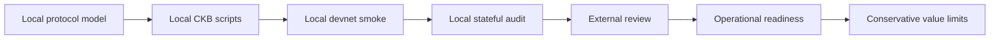
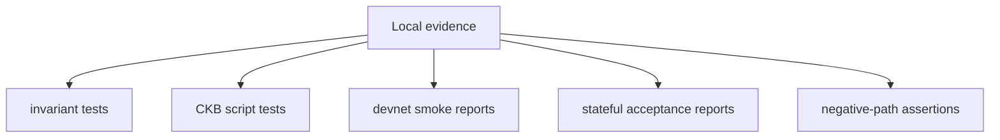
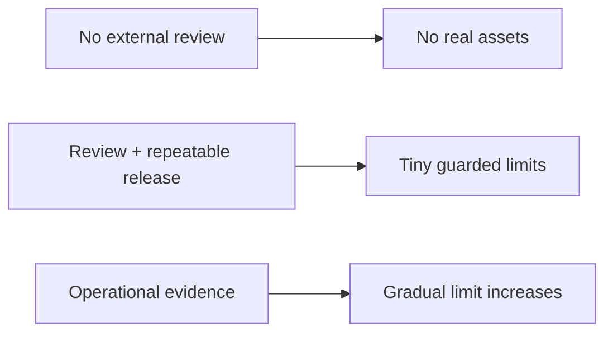

# Mainnet Readiness

Morph Channel is being developed for production deployment. This document
tracks the evidence required to authorise a mainnet or real-asset release;
the current release remains approved only for controlled devnet use.

## Current Position

The repository currently has local executable evidence through `morph-core`
tests, CKB script tests, smoke reports, and stateful acceptance reports. That
is necessary evidence, but it is not enough for mainnet.

## Readiness Gates

| Gate | Required evidence | Current status |
| --- | --- | --- |
| Independent protocol review | External review of state, vault, sponsor, splice, and factory rules. | Open. |
| Independent script review | Review of no-std CKB parsing, cell selection, since handling, and error paths. | Open. |
| Current channel / Factory capabilities | One State/Vault-set lifecycle, independent Type accounting, complete recovery, localized Factory operations and private child delivery. | Current channel layout 2 / descriptor 6 and Factory layout 2 have host, CLI/SDK and local CKB-VM evidence. Native funding/splice, independent journals, exact-body Factory requests, private child delivery, keyless submission and current watcher service are implemented. Current actual-node acceptance includes root/activation, metadata and custody changes, reduced escape/proof refresh, private child exits and parent retirement. Updated full CI, the expanded five-case matrix and release artifacts must still be evaluated together. Independent review, pooled publication/failover, terminal abort tracking and production operational qualification remain open. See [coverage](current-protocol-coverage.md), [migration status](unified-protocol-migration.md), [wire](multi-asset-wire.md) and [watch service](runbooks/current-watch-service.md). |
| Exact Vault provenance | Activation/rotation binds every bilateral and Factory Vault to its exact CKB OutPoint; clone/substitution negatives pass. | Implemented and locally verified; independent review remains open. |
| Factory state sovereignty | FactoryState uses the type-bound Morph StateLock; participant/reduced proofs, rather than a fee payer's secp lock, authorise state transitions. | Implemented for the sole unpublished Factory shape; independent review remains open. |
| Factory child provenance | A current Factory child StateType commits and verifies the exact input FactoryType script hash that authorises materialisation. | Implemented with a CKB-VM negative test; independent review remains open. |
| State-carrier conservation | Current channel and Factory updates/activation preserve carrier capacity exactly. Fees are external; reduced Factory successors retain the collective carrier and full parent materialisation retirement refunds it explicitly. | Implemented and covered by CKB-VM negative tests; independent review remains open. |
| Payment intent expiry and recovery | Preparation and new local signing reservations reject expired intents. Already issued valid state signatures remain enforceable; the exact co-signed proposal can be committed/reconciled after expiry without inventing cancellation or refund authority. | Implemented in the current payment lifecycle, including late-commit and interrupted-metadata recovery tests. Asset-bound CKB/UDT batches enforce preimages, exact Type/u128 quantities and absolute-block refunds. Current candidate qualification and live provider-loss automation remain separate; see [conditional settlement](conditional-batches.md). |
| Morph-backed routed edge | A provider-neutral edge and minimal Fiber hook prove real routed/MPP traffic against live Morph materialisation and failure callbacks. | Open; current real Fiber route is not Morph-backed. |
| RGB++ proof and reorg pipeline | Bitcoin proof, CKB binding/leap, confirmation, quarantine, and rollback evidence for admitted RGB++ assets. | Open. |
| Reproducible release artefacts | CI-built script ELFs, data hashes, signed release manifests, and clean rebuild instructions. | Release tooling, data-hash manifests and provenance checks exist. The current consolidation changes binaries and requires fresh complete CI/report/manifest evidence. An independent external rebuild and release-owner sign-off remain open. |
| Supply-chain warning closure | Remove or formally review current upstream warnings. | The current graph removes the vulnerable faster-hex, old memmap2, old lru and paste paths through audited exact upstream consumer patches. Only the explicitly scoped rand 0.7 advisory remains; its public RNG/code-generation migration is separate from this compatibility-preserving closeout. No waived warning is reported as patched. |
| Candidate dependency migration | Close fresh dependency advisories without expanding the waiver list. | TLS/QUIC/root-certificate and Tokio dependencies have been patched in the candidate lockfile. The candidate locks `crypto-bigint` 0.7.10 / k256 and p256 0.14 with the official Biscuit revision, removing the `RUSTSEC-2026-0387` and now-absent `RUSTSEC-2026-0173` waivers; see [RustCrypto migration](rustcrypto-upgrade.md). Published CKB dependencies and the pinned compiler move together to Rust 1.95.0 with explicit atomic lowering. All seven affected hex consumers now use patched faster-hex 0.10.1; maintained pastey 0.2.3 replaces paste, memmap2 is 0.9.12 and lru is 0.18.2. Eleven exact published consumer copies retain their upstream identities with minimal verified deltas; `make vendor-check` checks the complete source inventory. See [CKB migration and the remaining rand removal condition](ckb-toolchain-upgrade.md). Exact local qualification must bind the resulting source, ELFs, resource measurements and actual-node evidence; the sole remaining rand waiver is explicitly unresolved. |
| Mainnet-like fee evidence | Repeated runs under realistic fee pressure and transaction-size budgets. | Historical local evidence includes a gate that reads the CKB estimator/pool floor, rejects below-floor submissions, and proves bounded RBF. Repeated public-network measurements remain open. |
| Reorg and delay evidence | Watchtower and publication behaviour under delayed observations and chain reorg scenarios. | Canonical cursor reset/rescan plus injected delay and IntegrationTest truncate/alternate-chain recovery now pass locally. Repeated public-network evidence remains open. |
| Multi-operator watchtower evidence | At least two independent operators following documented procedures. | Historical local evidence has two least-privilege operators with distinct keys, SponsorCells, stores, cursors, profiles, and attempt logs pass the deterministic contention gate. Independent hosts, RPC providers, and administrators remain open. |
| Operational runbooks | Key handling, package retention, alert response, rollback, incident response, and upgrade procedures. | Implemented for the controlled-devnet candidate with a repository-side rehearsal; independent operator rehearsal remains open. |
| Value-limit policy | Explicit caps tied to evidence level and operator readiness. | Implemented as a machine-checked, dated, no-real-assets devnet envelope. Any public testnet/mainnet or real-asset policy remains open. |

## What Local Evidence Already Covers

Local evidence covers:

- participant signatures over current state;
- monotonic State Cell progression;
- authentic State Cell requirements for vault finalisation;
- per-cell sponsor budget, exact fee attribution, and clean-change boundaries;
- one current descriptor with ordinary and bounded CKB-conditional capabilities;
- splice funding-anchor and vault-set transitions;
- factory full-participant signatures;
- exact bilateral/Factory Vault content commitments plus canonical OutPoint
  activation, preservation, rotation, and clone-substitution negatives;
- one compact localized-rights proof path over current Factory custody, with
  reduced rights, deposits, releases and child materialisation;
- type-bound FactoryState locking, with fee signatures isolated to independent
  fee inputs and one touched member authorizing reduced paths without another member key;
- current Factory child State creation bound to the exact authorising FactoryType
  input identity;
- exact State/Factory carrier preservation/refund across updates, activation,
  splice and materialisation, with external fee/funding isolation;
- expected failure paths for malformed or attack-shaped transactions.
- node-informed publication fees, durable attempt reconciliation, and successful
  CKB RBF after learning an unknown competing transaction's replacement floor;
- deterministic two-operator failover and canonical-cursor recovery after a
  locally induced chain reorganisation.

## What Local Evidence Does Not Prove

The former all-member-only Factory exit restriction is resolved for admitted
single-member reduced operations. That does not establish an unconditional
exit for every backed allocation. An executable release still requires the
member's precommitted `ReserveClaim`, usable rights/proof data, admitted asset
behavior, fee capacity, a feasible payout and retained occupied-floor/carrier
geometry. Proof refresh uses a saved complete initial rights snapshot plus
public localized changes; chain commitments alone cannot recover lost data.
An arbitrary all-member replacement root requires delivery of its complete new
snapshot. These conditions remain part of liveness qualification.

Local devnet evidence does not prove:

- real network fee behaviour;
- mempool and propagation behaviour under adversarial timing;
- long-running watchtower operations;
- operational safety of key custody;
- reproducibility of release artefacts in a separate independent environment;
- correctness under independent review;
- independent validation of the implemented exact-OutPoint activation profile;
- real Morph-backed external-edge operation inside a routing provider;
- production RGB++ SPV/leap/reorg handling;
- safe value limits for real users.

## Minimum Production Checklist

Before any production or real-assets claim, the project needs:

1. a reviewed release candidate commit;
2. reproducible CKB script binaries and script hash manifest;
3. clean CI results for Rust tests, contract tests, smoke assertions, stateful
   assertions, clippy, and formatting;
4. external review notes with all critical findings closed;
5. repeated devnet/testnet runs with fee and delay profiles;
6. watchtower runbooks and at least one independent operator rehearsal;
7. documented incident response and emergency stop procedure;
8. value caps that match the evidence level;
9. clear user-facing risk disclosure.

## Value-Limit Posture

The correct default is no real asset exposure. Value limits should increase
only when evidence improves, and every increase should be tied to a dated
release, review record, operator procedure, and observed run history.

For #21, the owner removed independent-operator/public-network measurement and
external-record prerequisites on 2026-11-06 and selected exact local controlled-
devnet qualification. That is a scope decision, not a claim those external
experiments passed, and does not itself change this production checklist. No
release or tag is created by the local qualification workflow.

The current bounded policy is
[`preproduction-envelope.md`](preproduction-envelope.md), backed by the
machine-checked JSON envelope and exact contract manifest under
`release/factory-preproduction/`. It permits only controlled devnet and
prohibits real assets.

## Go / No-Go Summary

| Question | Go condition |
| --- | --- |
| Can the current repo be used for production implementation work? | Yes; release approval follows the gates above. |
| Can it be used for devnet evidence generation? | Yes. |
| Can it be used for mainnet real assets today? | No. |
| What is the next readiness step? | External review, independent-host/operator rehearsal, at least 1000 fresh public-network latency samples, and repeated public-network reorg/fee evidence. |
