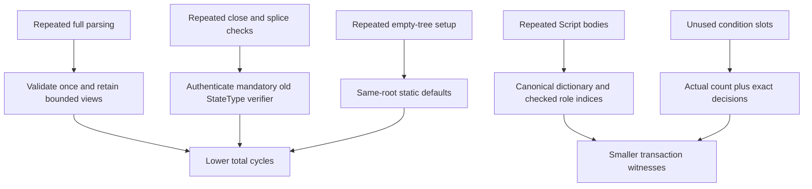
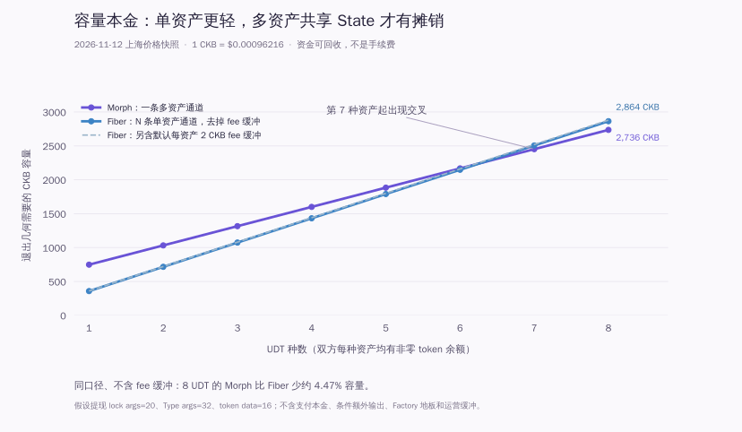

# Current model resource optimization

Tracks [#63](https://github.com/Morph-Channel-Network/Morph/issues/63) and [ADR 008](adr/008-bounded-cost-and-current-encoding.md).

The principal cycle savings come from caching validated conditional views and authenticating one complete close/splice verifier. The principal transaction-byte savings come from Script dictionaries and counted conditions. The custody, signature roles, per-Type accounting, complete independent recovery and sparse-root algorithm are preserved.

## Comparable VM measurements

The baseline is `bc4be3ff` (reported in `360eb168`). Each row selects the largest serialized transaction in its named baseline suite and the same ordinal current transaction. Both probes make 162 successful observations across 11 suites; all 628 per-group sums equal their normal complete verification totals. Fixture OutPoints/signatures vary and helpers now use immutable Data1, matching native deployments. These are measurements of fixture shapes, not production wallet/asset qualification. Exact records, group costs and source/ELF identities are in [comparison.json](evidence/model-cost-2026-11-11/comparison.json).

| Shape | Before cycles | Current cycles | Before bytes | Current bytes | Cycle change | Byte change |
| --- | ---: | ---: | ---: | ---: | ---: | ---: |
| Maximum ordinary cooperative close | 12,183,088 | 6,661,313 | 16,727 | 16,207 | -45.32% | -3.11% |
| Eight-token splice replacement | 25,004,007 | 14,538,493 | 12,228 | 12,166 | -41.86% | -0.51% |
| One pending CKB Batch finalise | 2,023,047 | 1,228,816 | 3,252 | 2,553 | -39.26% | -21.49% |
| Full Factory: 8 assets / 4 children / 16 members | 52,221,221 | 51,068,016 | 75,098 | 53,472 | -2.21% | -28.80% |
| Reduced release: 8 Types / 16 members | 48,060,344 | 46,051,979 | 32,985 | 28,519 | -4.18% | -13.54% |
| Small FullCustody with funded replacement | 7,996,575 | 8,107,961 | 3,307 | 3,312 | +1.39% | +0.15% |
| Small FullCustody | 8,082,168 | 8,181,201 | 3,790 | 3,743 | +1.23% | -1.24% |
| Reduced child: 8 assets / 4 children / 16 members | 61,262,071 | 57,592,493 | 85,535 | 58,905 | -5.99% | -31.13% |
| Ten-right metadata / maximum Scripts | 48,705,242 | 46,917,748 | 14,600 | 13,618 | -3.67% | -6.73% |
| Eight-token ordinary finalise | 2,159,123 | 1,980,088 | 7,003 | 6,941 | -8.29% | -0.89% |
| Eight-token / 64-condition terminal | 24,396,623 | 7,398,369 | 15,827 | 15,307 | -69.67% | -3.29% |

Small full-consent paths can become slightly more expensive: the Factory Type loads additional dictionary/default-table code even when a path does not traverse sparse proofs. This tradeoff is visible above; admission ceilings were not raised. Its ELF grows while the complete eight-ELF set shrinks. Measurements must include that cost rather than reporting only favorable rows.

## What changed and why

- Conditional terms use `221 + 92*n` bytes (313 for one transfer, 957 for eight); resolutions contain exactly the actual decisions. Refunds carry no zero preimage. Sparse and full VM controls cover one/four/eight transfers over one/eight assets, including cooperative and unilateral terminal settlement.
- Standalone custody owns a complete Script dictionary. FM shares one dictionary across children; FR shares Factory/Type/payout Scripts within its physical operation. Every role remains checked against its committed owner. Export reconstructs complete independent private child evidence. The reduced-child outer Factory lock remains repeated once across its locality body and the separately bound child intent (117 bytes); these two commitments have different construction stages.
- Before/after reduced rights share the exact 98-byte identity and carry separate 16-byte quantities. ID substitution cannot be serialized; unchanged hash concatenation preserves sparse roots. Default hashes are precomputed and tested against all 257 original levels.
- Close and splice full authorization, complete custody, payouts and conservation stay in the authentic immutable source StateType. Dependent groups bind the same actual source, global witness, raw body and mandatory retirement; new splice creation signatures are still checked independently. Upgradeable Type-hash authority code selection is rejected. Arbitrary wallet/token Script hash modes are separate.
- Script offsets, parsed Batch/resolution views and invariant lock hashes/digests are cached locally. Checks are not replaced by public unchecked accessors.

## Regression bounds

| Fixture | Cycle ceiling | Byte ceiling |
| --- | ---: | ---: |
| Maximum typed terminal | 9,000,000 | 15,400 |
| Maximum ordinary cooperative close | 7,200,000 | 16,400 |
| Maximum splice | 16,500,000 | 24,600 |
| Maximum full Factory | 53,000,000 | 54,000 |
| Maximum reduced child | 60,000,000 | 60,000 |
| Maximum reduced release | 48,000,000 | 29,000 |
| Ten-right metadata | 48,500,000 | 13,800 |

These test ceilings are separate from admission rules and do not qualify arbitrary combinations. A later change must explain a regression, not raise production caps to make the fixture pass. Run `make build-contracts` and `make contract-tests`; use `cargo test -p morph-core --test contract_scripts -- --ignored --test-threads=1 --nocapture` for the measurement lines (`COUNTED_COST`, `CLOSE_COST`, Factory/typed/splice rows). The group probe independently verifies every script group and asserts the total; it is an audit instrument rather than a second production verifier.

## Bytes, capacity, computation and fees

The eight ELFs total 807,592 → 742,920 bytes. This is shared deployed code storage, not a per-channel saving. State remains 318 bytes, Factory State 306, and minimum occupied cell geometry is unchanged. Transaction bytes affect publication and fee weight; lower cycles primarily improve execution/block computation headroom when bytes dominate. Do not advertise a 70% fee reduction from the typed-terminal cycle improvement.

The remaining long sparse paths, mandatory independent signatures, full-u128 values, 256-bit commitments and occupied payouts are material protocol costs. Changing the root algorithm, signature scheme, hash width or aggregate Batch spending requires a separate design. Smaller opportunities such as common OutPoint transaction hashes and per-Vault lock-hash transport remain secondary; they are not silently removed from provenance commitments.

## Qualification status

Signed implementation `991f7e3` passed all ten clean-candidate controlled-devnet
gates with unchanged source. VM: **114/0**; independent Python tool checks:
**46/0**. The native matrix exports **88 unique transactions, 10 stateful
scenarios, 145 assertions and 11 audit families**. Three fixed seeds exercised
780,000 bounded host/parser/SDK/store mutations; they are not VM executions or
a coverage-guided proof. Private initial exits, signer faults, conditional
fulfill/refund/reorg and nonforwarding shadow service are included.

The real-wallet eight-asset / 64-condition native preflight reports **8,911,564
cycles / 14,449 bytes** for terminal settlement, versus the earlier checkpoint's
roughly **25.92M / 14,455**. Claim preflight maxima across sixteen outcomes are
**1,831,294 cycles / 2,253 bytes**. All payouts and canonical retry/reorg behavior
were checked, participant journals stayed unchanged and no provider RPC was
used. This shape saves mainly computation, with only six terminal bytes saved.

See the [exact source/artifact qualification record](evidence/model-cost-991f7e3/README.md).
The later reporting commit is documentation/evidence only, not another qualified
candidate. Research boundaries and real-asset restrictions remain. No release,
tag or main merge was performed.

## Dated Fiber and fiat-cost comparison (2026-11-12)

At **2026-11-12 01:14:21 Asia/Shanghai**, the [CoinGecko API](https://api.coingecko.com/api/v3/simple/price?ids=nervos-network&vs_currencies=usd,cny&include_last_updated_at=true) returned **CKB/USD 0.00096216, CKB/CNY 0.00641942**. The provider timestamp is 2026-11-11T17:14:17+00:00. This is an intraday observation, not a daily close. See the [saved response, calculations, source identities and sizing probe](evidence/fiber-cost-2026-11-12/README.md).

The comparison values Morph implementation `991f7e3` and integration-pinned Fiber `a5faac7177a2a2ec086a2c6d0da1840ec9fe5703` at that spot price; it does not label the Fiber pin today's latest release. Morph cycles are native RPC preflight observations or separately labelled stress fixtures. Fiber sizes are source-derived and reconstructed with Rust's canonical CKB transaction builder; **Fiber VM cycles, full forced-close totals and matched conditional exit costs were not measured**. These are accounting estimates, not an end-to-end performance contest.

### Fees and returned capital

Capacity is recoverable capital, not a burnt transaction fee. Off-chain direct payments have no incremental on-chain fee in either design, while liquidity, signing, backups and operations still cost resources. Our fee scenario uses **1,000 shannons/kB**, the Fiber default; it is **not today's measured public mempool rate**. Rates 10,000 and 100,000 multiply scenario fees by ten and one hundred without multiplying occupied capacity.

Normalize size first: Morph evidence reports raw bytes; CKB block size and Fiber's helper add a **4-byte offset per transaction**. The pinned CKB source [checks the initial minimum fee by size](https://github.com/nervosnetwork/ckb/blob/d40e4722525d45d5ce7a8ae29a1dc6d18d2f747f/tx-pool/src/util.rs), and [ranks by max(size, floor(cycles × 0.0001705714))](https://github.com/nervosnetwork/ckb/blob/d40e4722525d45d5ce7a8ae29a1dc6d18d2f747f/util/types/src/core/tx_pool.rs). This is not a consensus gas tariff. Most listed Morph examples are byte-dominated. The native ten-right metadata row is an exception: 6,518 block bytes and 45,055,584 cycles give weight 7,685. Its size-floor estimate is 0.00006518 CKB, while a matched weight-rate target would require 0.00007685 CKB. Fiber weight remains unknown without cycles.

At this price, a configured 100,000-shannon fee (0.001 CKB) is **0.9622 µUSD**; the 200k replacement fee is **1.9243 µUSD**. One µUSD is one millionth of a US dollar. Native configured fees must not be compared with Fiber's smallest size-based estimate as if both used the same fee policy.

### Ordinary channel capacity scenario

Assume two payout locks with 20-byte args, a token Type with 32-byte args, 16-byte token data, and a nonzero token payout for **both** parties in every asset. Morph's root State occupies 464 CKB and a token Vault occupies 238, but two future token payouts need 284. Its ordinary exit geometry is **464 + 284N CKB**. Fiber's funding Cell occupies 142, but each side reserves its 179-CKB commitment geometry plus a 1-CKB shutdown buffer: **360N CKB**, across N independent channels. See [Fiber reserved capacity](https://github.com/nervosnetwork/fiber/blob/a5faac7177a2a2ec086a2c6d0da1840ec9fe5703/crates/fiber-lib/src/fiber/channel.rs) and [buffers](https://github.com/nervosnetwork/fiber/blob/a5faac7177a2a2ec086a2c6d0da1840ec9fe5703/crates/fiber-lib/src/fiber/config.rs).

| UDT count | Morph CKB | Fiber CKB | Morph USD | Fiber USD |
| --- | ---: | ---: | ---: | ---: |
| 1 | 748 | 360 | $0.719696 | $0.346378 |
| 2 | 1,032 | 720 | $0.992949 | $0.692755 |
| 4 | 1,600 | 1,440 | $1.539456 | $1.385510 |
| 6 | 2,168 | 2,160 | $2.085963 | $2.078266 |
| 7 | 2,452 | 2,520 | $2.359216 | $2.424643 |
| 8 | 2,736 | 2,880 | $2.632470 | $2.771021 |

For plain CKB the corresponding figures are Morph 621 CKB ($0.597501) and Fiber 198 ($0.190508). In this particular ordinary-token configuration the crossover appears at seven assets. The table includes Fiber's 2-CKB-per-asset default fee buffer, unlike Morph's pure exit geometry. Removing that buffer gives Fiber **358N**: 2,864 CKB for eight assets versus Morph 2,736, a **4.47%** reduction at the same no-fee-buffer scope, rather than 5%. The figure shows both Fiber scopes. These are **not universal minima**: conditional output geometry, zero-token sides, different scripts, configured carrier reserves and Factory floors change the result. A Factory-origin child State adds 32 CKB. Native acceptance uses larger funded reserves. Excludes spendable liquidity and operating buffers. A hypothetical opportunity cost is principal × chosen annual rate × days/365; no market yield is assumed.

### Lifecycle and function costs

| Function | Morph | Fiber at the pin |
| --- | --- | --- |
| Opening | Funding + separate permissionless activation, normally two on-chain transactions | Funding plus off-chain channel-ready messages; no matching activation transaction |
| Direct off-chain CKB/UDT payment | State co-signing, zero incremental chain fee | TLC/commitment updates, zero incremental chain fee |
| Multiple assets | One State, up to eight Vaults, common terminal state | One optional UDT Type per channel; N token Types need N channels |
| Cooperative close | One exact-body 2-of-2 close consumes State/full Vault set; pending terms can become Batches | One funding-cell shutdown per channel; pending TLCs constrain cooperative shutdown |
| Unilateral close | Publish if Active, wait signed block delay, finalise; extra Batch claims if pending | Commitment, epoch delay, settlement; unresolved TLCs and disputes may need more transactions |
| Conditions | Up to eight asset Batches, each atomically resolves up to eight transfers | TLC preimage/timeout settlement; no matched measured total in this report |
| Splice | Atomic old/new context followed by activation | No equivalent native channel RPC found in the inspected pin; close/reopen changes semantics |
| Factory / reduced release, deposit, child | Shared custody, all-member or touched-member authority and independent child recovery | No like-for-like shared Factory primitive |
| Routing | Not implemented | Supported; quote and forwarding fees apply |
| Wallet / signer / observer service | Not costed on matched hardware | Not costed on matched hardware |

Selected native Morph operations at a common 1,000-shannon/kB size scenario:

| Operation | Raw bytes | Cycles | Scenario CKB | Scenario µUSD |
| --- | ---: | ---: | ---: | ---: |
| Two-token funding | 3,241 | 6,792,792 | 0.00003245 | 0.0312 |
| Two-token activation | 2,537 | 1,977,241 | 0.00002541 | 0.0244 |
| Two-token cooperative close | 3,548 | 7,094,982 | 0.00003552 | 0.0342 |
| Eight-token funding | 7,081 | 7,257,489 | 0.00007085 | 0.0682 |
| Eight-token activation | 4,667 | 2,270,656 | 0.00004671 | 0.0449 |
| Eight-token cooperative close | 8,288 | 8,174,324 | 0.00008292 | 0.0798 |
| Eight-token ordinary publish/replace | 4,573 | 6,846,824 | 0.00004577 | 0.0440 |
| Eight-token ordinary finalise | 7,724 | 3,636,474 | 0.00007728 | 0.0744 |
| Eight-token / 64-condition terminal | 14,449 | 8,911,564 | 0.00014453 | 0.1391 |
| One-token / eight-transfer fulfill claim | 2,253 | 1,825,264 | 0.00002257 | 0.0217 |

Two-token funding plus activation totals 5,786 block bytes; eight-token totals 11,756. Both acceptance paths configure 0.002 CKB combined, excluding artificial devnet issuance and faucet transactions.

Using the [Fiber sizing constructor](https://github.com/nervosnetwork/fiber/blob/a5faac7177a2a2ec086a2c6d0da1840ec9fe5703/crates/fiber-lib/src/fiber/fee.rs) with two funding/auth deps (three with UDT), 20-byte payout args, 32-byte token args and a 112-byte funding witness gives commitment sizes **456 / 594 block bytes** (CKB / UDT), and shutdown sizes **528 / 767**. These are canonical serialization results, not VM runs. Commitment deducts one size-based fee; [shutdown deducts one whole size-based fee from each side](https://github.com/nervosnetwork/fiber/blob/a5faac7177a2a2ec086a2c6d0da1840ec9fe5703/crates/fiber-lib/src/fiber/channel.rs#L10992). At equal default rates shutdown therefore deducts 1,056 / 1,534 shannons total, rather than the 528 / 767-shannon single-size reference. This is the pinned builder policy, not a chain requirement.

For an eight-token cooperative liquidation, Morph has **8,292 block bytes in one transaction**, versus Fiber **6,136 across eight**: Morph is about **35.14% larger**. Normalized size fees are 0.00008292 vs 0.00006136 CKB; Fiber's two-sided builder deduction totals 0.00012272. Morph's accepted close configures 0.001 CKB initially, 0.002 on fee replacement. Only the winning spend consumes a given canonical source; do not add competing approvals as simultaneous spends.

Starting from an already Settling eight-token / 64-condition state, Morph terminal plus eight all-fulfill claims totals **nine transactions, 32,509 block bytes and 23,375,201 preflight cycles**. Scenario fee is 0.00032509 CKB (0.3128 µUSD), versus configured 0.009 CKB (8.6594 µUSD). An Active source also needs publication. Orphaned fulfill and canonical refund/mixed branches are mutually exclusive, not combined payment costs. Both models' delay costs depend on actual chain policy: Fiber release config targets roughly four hours/epoch, while its debug epoch is two seconds; do not transplant debug timing or convert TLC milliseconds directly into Morph block deadlines.

Two-token native splice and its activation total **6,937 block bytes**, reference **0.00006937 CKB**. Native Factory release is **3,318 raw / 8,894,016 cycles**; retained child **4,454 / 7,558,743**; reduced child **5,789 / 9,700,448**. Maximum-script Factory fixtures remain separate: full 8-asset/4-child/16-member **53,472 raw / 51,068,016 cycles**; reduced child **58,905 / 57,592,493**; reduced release **28,519 / 46,051,979**. Their size-reference fees are 0.00053476, 0.00058909 and 0.00028523 CKB. No Fiber equivalent price is invented. Child activation, child occupancy and eventual exit still cost resources; the last shared reserve/carrier has all-member authority.

### Routing, shared deployment and missing costs

Fiber [defaults to 1,000 ppm](https://github.com/nervosnetwork/fiber/blob/a5faac7177a2a2ec086a2c6d0da1840ec9fe5703/crates/fiber-lib/src/fiber/config.rs) forwarding fee, [ceil(amount × ppm / 1,000,000)](https://github.com/nervosnetwork/fiber/blob/a5faac7177a2a2ec086a2c6d0da1840ec9fe5703/crates/fiber-lib/src/fiber/fee.rs), with no additional fixed base in that function. A 1,000-CKB payment through one default-rate forwarding node costs about 1 CKB ($0.000962); two default-rate forwarders cost about 2.001 CKB via backward compounding, subject to integer rounding. This is **not charged for every direct payment**, and operators may quote different rates. UDT forwarding fees are in the UDT, requiring its own valuation. Morph currently has no routing substitute; the shadow observer is nonforwarding. Future combined operation must include Fiber service/liquidity pricing.

Shared code-data occupancy is **742,920 CKB / $714.807907** for Morph's eight ELFs (729,336 excluding devnet UDT), versus **337,584 / $324.809821** for the pinned Fiber funding/commitment/auth binaries. These have different capability coverage, exclude deployment-cell overhead/fees and public wallet/asset code, and are reused across channels. Fiber auth may already be deployed. The optimization's 64,672-byte code reduction removes about **$62.224812** of shared code-data capacity at this snapshot, not a per-channel burnt fee.

Matched CPU/RAM, storage growth, third-party RPC/watchtower pricing, operational failures, business liquidity and opportunity cost are **unpriced**, not zero. The practical priority is to expose actual fee, recoverable capacity and payment liquidity separately, select fees from actual transaction geometry, then measure matched Fiber full lifecycles. This dated appendix changes no implementation or qualified artifact identity and does not claim a new ten-gate run.
