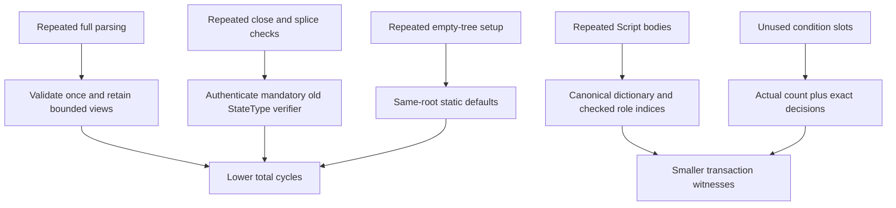

# Current model resource optimization

Tracks [#63](https://github.com/Morph-Channel-Network/Morph/issues/63) and [ADR 008](adr/008-bounded-cost-and-current-encoding.md).

The principal cycle savings come from caching validated conditional views and authenticating one complete close/splice verifier. The principal transaction-byte savings come from Script dictionaries and counted conditions. The custody, signature roles, per-Type accounting, complete independent recovery and sparse-root algorithm are preserved.

## Comparable VM measurements

The baseline is `bc4be3ff` (reported in `360eb168`). Each row selects the largest serialized transaction in its named baseline suite and the same ordinal current transaction. Both probes make 162 successful observations across 11 suites; all 628 per-group sums equal their normal complete verification totals. Fixture OutPoints/signatures vary and helpers now use immutable Data1, matching native deployments. These are measurements of fixture shapes, not production wallet/asset qualification. Exact records, group costs and source/ELF identities are in [comparison.json](evidence/model-cost-2026-11-11/comparison.json).

| Shape | Before cycles | Current cycles | Before bytes | Current bytes | Cycle change | Byte change |
| --- | ---: | ---: | ---: | ---: | ---: | ---: |
| Maximum ordinary cooperative close | 12,183,088 | 6,661,313 | 16,727 | 16,207 | -45.32% | -3.11% |
| Eight-token splice replacement | 25,004,007 | 14,538,493 | 12,228 | 12,166 | -41.86% | -0.51% |
| One pending CKB Batch finalise | 2,023,047 | 1,228,816 | 3,252 | 2,553 | -39.26% | -21.49% |
| Full Factory: 8 assets / 4 children / 16 members | 52,221,221 | 51,068,016 | 75,098 | 53,472 | -2.21% | -28.80% |
| Reduced release: 8 Types / 16 members | 48,060,344 | 46,051,979 | 32,985 | 28,519 | -4.18% | -13.54% |
| Small FullCustody with funded replacement | 7,996,575 | 8,107,961 | 3,307 | 3,312 | +1.39% | +0.15% |
| Small FullCustody | 8,082,168 | 8,181,201 | 3,790 | 3,743 | +1.23% | -1.24% |
| Reduced child: 8 assets / 4 children / 16 members | 61,262,071 | 57,592,493 | 85,535 | 58,905 | -5.99% | -31.13% |
| Ten-right metadata / maximum Scripts | 48,705,242 | 46,917,748 | 14,600 | 13,618 | -3.67% | -6.73% |
| Eight-token ordinary finalise | 2,159,123 | 1,980,088 | 7,003 | 6,941 | -8.29% | -0.89% |
| Eight-token / 64-condition terminal | 24,396,623 | 7,398,369 | 15,827 | 15,307 | -69.67% | -3.29% |

Small full-consent paths can become slightly more expensive: the Factory Type loads additional dictionary/default-table code even when a path does not traverse sparse proofs. This tradeoff is visible above; admission ceilings were not raised. Its ELF grows while the complete eight-ELF set shrinks. Measurements must include that cost rather than reporting only favorable rows.

## What changed and why

- Conditional terms use `221 + 92*n` bytes (313 for one transfer, 957 for eight); resolutions contain exactly the actual decisions. Refunds carry no zero preimage. Sparse and full VM controls cover one/four/eight transfers over one/eight assets, including cooperative and unilateral terminal settlement.
- Standalone custody owns a complete Script dictionary. FM shares one dictionary across children; FR shares Factory/Type/payout Scripts within its physical operation. Every role remains checked against its committed owner. Export reconstructs complete independent private child evidence. The reduced-child outer Factory lock remains repeated once across its locality body and the separately bound child intent (117 bytes); these two commitments have different construction stages.
- Before/after reduced rights share the exact 98-byte identity and carry separate 16-byte quantities. ID substitution cannot be serialized; unchanged hash concatenation preserves sparse roots. Default hashes are precomputed and tested against all 257 original levels.
- Close and splice full authorization, complete custody, payouts and conservation stay in the authentic immutable source StateType. Dependent groups bind the same actual source, global witness, raw body and mandatory retirement; new splice creation signatures are still checked independently. Upgradeable Type-hash authority code selection is rejected. Arbitrary wallet/token Script hash modes are separate.
- Script offsets, parsed Batch/resolution views and invariant lock hashes/digests are cached locally. Checks are not replaced by public unchecked accessors.

## Regression bounds

| Fixture | Cycle ceiling | Byte ceiling |
| --- | ---: | ---: |
| Maximum typed terminal | 9,000,000 | 15,400 |
| Maximum ordinary cooperative close | 7,200,000 | 16,400 |
| Maximum splice | 16,500,000 | 24,600 |
| Maximum full Factory | 53,000,000 | 54,000 |
| Maximum reduced child | 60,000,000 | 60,000 |
| Maximum reduced release | 48,000,000 | 29,000 |
| Ten-right metadata | 48,500,000 | 13,800 |

These test ceilings are separate from admission rules and do not qualify arbitrary combinations. A later change must explain a regression, not raise production caps to make the fixture pass. Run `make build-contracts` and `make contract-tests`; use `cargo test -p morph-core --test contract_scripts -- --ignored --test-threads=1 --nocapture` for the measurement lines (`COUNTED_COST`, `CLOSE_COST`, Factory/typed/splice rows). The group probe independently verifies every script group and asserts the total; it is an audit instrument rather than a second production verifier.

## Bytes, capacity, computation and fees

The eight ELFs total 807,592 → 742,920 bytes. This is shared deployed code storage, not a per-channel saving. State remains 318 bytes, Factory State 306, and minimum occupied cell geometry is unchanged. Transaction bytes affect publication and fee weight; lower cycles primarily improve execution/block computation headroom when bytes dominate. Do not advertise a 70% fee reduction from the typed-terminal cycle improvement.

The remaining long sparse paths, mandatory independent signatures, full-u128 values, 256-bit commitments and occupied payouts are material protocol costs. Changing the root algorithm, signature scheme, hash width or aggregate Batch spending requires a separate design. Smaller opportunities such as common OutPoint transaction hashes and per-Vault lock-hash transport remain secondary; they are not silently removed from provenance commitments.

## Qualification status

Implementation VM matrix: 114 passed, including mandatory-verifier/global-witness controls and mutable authority rejection. Host tests cover canonical dictionaries, out-of-range/unused/order/truncation/scope errors, exact assets and shared identity. An actual-node lifecycle preflight passed all six participant signing roles and fault recovery; its descriptor-7 public splice trace is the current parser vector. It is not final candidate qualification. Full `make ci` passed (114 VM cases), as did all 46 Python tool tests and eight-ELF release-readiness verification. The same-source ten-gate controlled-devnet qualification must still be recorded before closing #63. No release or main merge is requested.
