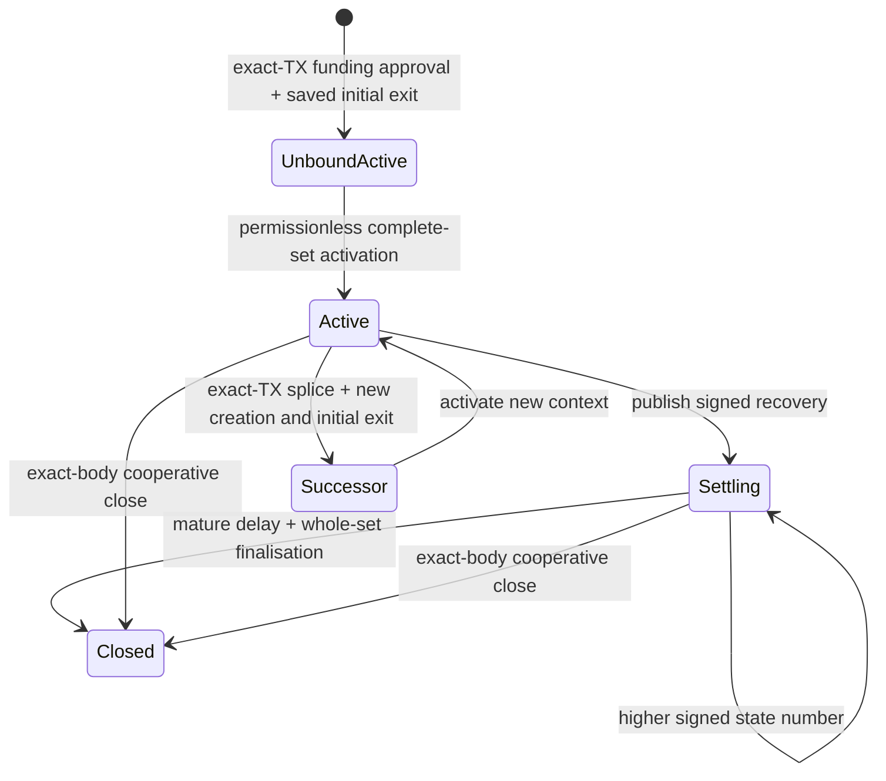

# Current channels and Factory custody

Status: **4.1.0**, controlled devnet with no real assets. Plain CKB, one xUDT
and multiple xUDT Types share one State/Vault-set lifecycle. Factory uses the
same custody primitives under its distinct rights authority. The existing
`991f7e3` implementation qualification is preserved; repeated acceptance for the
version/documentation publication was skipped at the owner’s request. See the
[release record](releases/v4.1.0.md), [wire](multi-asset-wire.md) and
[deployment gates](mainnet-readiness.md).

## What is shared

A channel has one authentic State Cell and 1–8 physical Vaults. Each admitted
xUDT Type occupies a separate typed Vault; an optional plain Vault holds CKB.
A signed descriptor commits participant payouts, occupied-capacity reserves,
business CKB and a separate State carrier refund. Token amounts are never
summed across Type identities.

Content and provenance are different commitments. Root creation signs an
unbound content manifest and the exact raw transaction. Before broadcasting,
both participants retain a complete signed bound Settling/1 exit for its future
Vault OutPoints. Permissionless activation binds those exact sibling Vaults in
canonical dependency order and preserves the carrier. Updates preserve the
funding context and require both signatures. Finalisation consumes the complete
Vault set after canonical relative-block since and needs no fresh peer signature.

The sole channel header is 318 bytes, State layout 2, descriptor 7. Direct
StateType args are `anchor || since` (40 bytes); Factory child args are
`anchor || FactoryTypeHash || since` (72 bytes). One shared parser validates
both shapes and the canonical relative clock. Unsupported historical headers,
descriptors and argument orderings are rejected; development state is reset.

Conditional CKB and UDT use the same descriptor capability. Each selected asset
has an independently conserved Batch: CKB consumes business capacity; UDT
consumes only that Type's u128 quantity and preserves signed capacities.
Terminal settlement atomically consumes all Vaults, materialises each signed
Batch and refunds the full carrier. Each Batch then resolves independently.
See [conditional batches](conditional-batches.md). This does not enable live
Fiber forwarding or translate Fiber timestamp expiries into block heights.

## Explicit changes of funded context

Channel splice uses one 200-byte bridge and up to 16 per-asset flows. It signs
the complete raw transaction, exact withdrawal identities and both old/new
contexts. New creation and complete initial recovery authorizations precede
old-context bridge signing. Reservation irreversibly seals the old signer
context; confirmed switching uses the same journal path and retains retired
evidence. Native construction, exact replay and canonical handoff are described
in [splice](multi-asset-splice.md) and [initial funding](runbooks/initial-funding.md).

Factory custody changes reuse complete manifests, exact OutPoints, Type evidence,
occupied capacity and actual external-funding equations. Factory reserve and
business CKB conserve as separate global lanes across Vault Types; token
quantities conserve separately for each Type. This permits an entire token
withdrawal to leave peer CKB in plain retained custody. No Type can be minted
by burning another or by describing an unfunded outside contribution.

## Factory permissions

The current Factory header is 306 bytes, layout 2. Type args are 44 bytes,
`MORPHFT!` format 1 plus the Factory identity. Membership is a complete sorted
2–16 member commitment. It cannot be silently changed by a reduced operation.

| Capability | Authority | Custody behavior |
| --- | --- | --- |
| `MORPHFS!` format-2 root | All members, exact transaction | Create unbound complete custody. |
| `MORPHFS!` activation | Permissionless | Bind exact sibling Vaults; preserve carrier/value. |
| `MORPHFS!` UPDATE | All members, dedicated exact-TX update domain | Metadata/rights-root change, unchanged bound custody. |
| `MORPHFR!` `ReducedRights` | One touched member | Change 1–10 localized value rights; per-asset total cannot increase. |
| `ReducedDeposit` / `ReducedRelease` | One touched member | Actual funded increase or exact release of own reserve claims. |
| `ReducedChild` | One touched member | Canonical child materialisation plus retained custody. |
| `FullCustody` | All members, exact transaction | Funded custody changes and withdrawals. |
| `MORPHFM!` materialisation | All members, exact transaction | 1–4 children; optional retained custody or full parent retirement. |

Physical reduced operations carry at most 9 changed claims and prove every
changed right against both roots. Paired compact proofs prevent unlisted
rights changing inside sibling subtrees. Runtime checks authenticate the actual
StateType/StateLock and compare both headers, every source Vault, retained
Vault, payout, source OutPoint and raw transaction. An offline proof verifier
is not a replacement for those checks.

Reduced operations require a retained successor and unchanged collective carrier.
They do not unilaterally retire the last occupied Vault floor. Wallet outputs
can merge actual outside CKB with a token-only or dust withdrawal without
charging that addition to peers. Full-consent materialisation can retire the
parent and refund its carrier. See [reduced operations](factory-multi-right.md).

## Child recovery and proof availability

A Factory child is an ordinary current bilateral channel after creation. Its
72-byte StateType args preserve the originating Factory identity across splices.
The authentic Factory at input zero authorizes birth; its continued existence
is not required for subsequent child updates or a saved unilateral exit.
Child parties may be outside the Factory roster. Their two keys are fixed by
the signed child header and their private initial exits; being a recipient
does not grant parent Factory signing authority. Provider routing admission
that reserves a parent member's rights still requires its own owner/liquidity
proof and does not automatically apply to an entirely external child.

Private complete initial exits must reach both child parties before parent
signers reserve approval. Independent child sessions and public possession
attestations enforce the delivery ceremony. The on-chain intent contains public
keys and Factory approval, never child exit signatures. Publishing those exit
signatures would expose the ability to initiate a unilateral close.

Each member also retains complete initial Factory rights data. Public localized
transitions let an untouched member refresh their own proof without peer help.
An arbitrary all-member replacement root requires delivery of the complete new
rights snapshot. A root commitment alone cannot restore missing recovery data.

## Tooling and qualification

Current Factory requests are prepared from current custody evidence, reviewed
and signed through independent durable `factory-session` journals. `devnet
factory` provides root/transition preparation, wallet-group signing, keyless
submission and custody activation. Private child delivery and confirmed child
handoff use the same current packages. Old Factory package commands and private
plan-as-public interfaces are removed; required fields have no migration aliases.

Current payment and provider adapters use the same channel backend. CLI, SDK and
Hub retain complete signed recovery packages. Continuous configured watch service
uses the same canonical watcher as bounded passes; independent hosts/RPCs,
pooled publication, terminal abort tracking and production resilience still
require evidence. See the [watch service runbook](runbooks/current-watch-service.md).

Actual-node Factory acceptance verifies reduced escape, public proof refresh,
independent child exits and parent retirement. The [coverage ledger](current-protocol-coverage.md)
and [source-bound evidence](evidence/model-cost-991f7e3/README.md) record 114 VM
cases and the local native/fault matrix. Eight-asset/four-child/sixteen-member
fixture measurements are not universal asset or fee guarantees. Exact-body
cooperative close and typed conditional execution are implemented; member
rotation, live routing, independent/public-network evidence and real-asset
admission remain separate. See [the roadmap](roadmap.md).
