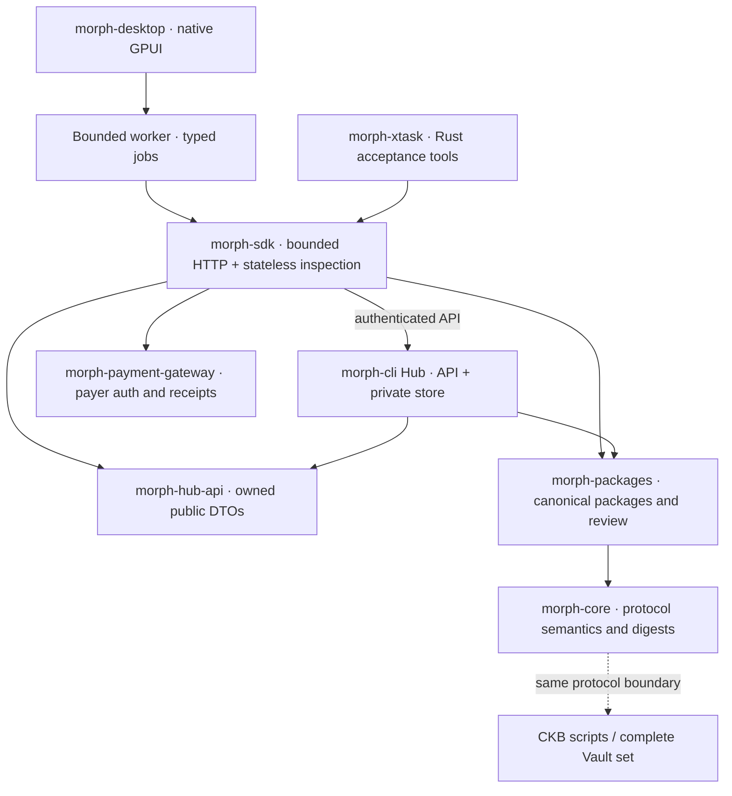
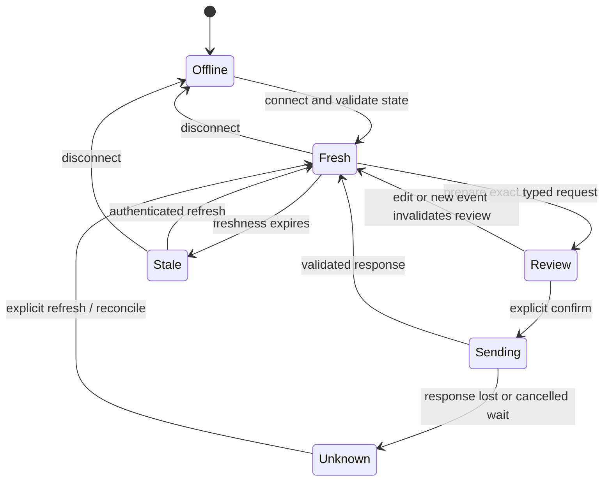

# Native Morph desktop and Rust clients

Morph uses one native GPUI operator application (`morph-desktop`). The repository
has no browser frontend, embedded web runtime, JavaScript/TypeScript SDK, Node
runner or frontend dependency manifest. The Hub is a separate Rust API service.
Protocol signing, funding and canonical chain checks stay in the existing
operator ceremony.

## Start

The currently qualified build target is Linux x86-64 with Rust 1.95.0. Install
`pkg-config`, a C/C++ compiler, Fontconfig/Freetype, xkbcommon/xkbcommon-X11,
Wayland/X11 development libraries and a working Vulkan driver. On Ubuntu 24.04:

```sh
sudo apt-get install pkg-config clang cmake libfontconfig-dev libfreetype-dev \
  libxkbcommon-x11-dev libxcb-xinput-dev libxcb-cursor-dev libx11-xcb-dev \
  libssl-dev libwayland-dev libvulkan-dev mesa-vulkan-drivers
make desktop-check
```

`scripts/prepare-native-desktop.sh` checks the native inputs. On a workstation
with the compatible xkbcommon-X11 runtime but no development linker name, it
creates a local linker shim under `target/native-libs`; it never changes system
libraries. `make` supplies that directory to the linker. Distribution packages
should depend on the normal system runtime packages.

Start the Hub in one terminal:

```sh
cargo run -p morph-cli -- hub serve \
  --listen 127.0.0.1:4617 \
  --pubkey "${MORPH_PUBKEY:?set the 66-character compressed public key}" \
  --state-path target/morph-hub/node-state.json \
  --rotate-auth-token-on-restart
```

Then run `make desktop` in another terminal. Enter the endpoint and runtime
token, and connect. The token stays in memory and is cleared on disconnect.
The Hub serves `/api` only; `/` and arbitrary file paths return JSON 404 errors.
There is no static asset directory flag or development proxy.

The desktop defaults to the platform's native display backend. Explicit
unauthenticated loopback Hub mode remains a development option; remote plaintext
HTTP, URL credentials, redirects, unbounded payloads and bearer tokens in URLs
are rejected by the Rust Hub client. Explicit CORS admission remains available
for separately maintained external browser clients, without shipping one here.

## One implementation per boundary



| Component | Responsibility | Authority it does not acquire |
| --- | --- | --- |
| `morph-hub-api` | Public requests, records, model/security/provenance and watch views | Private persisted store or signer snapshots |
| `morph-packages` | Sole public codec, exact-body construction, signatures, summaries, private immutable artifact writes | A second signer journal or implicit chain trust |
| `morph-sdk` | Typed API operations, canonical package validation, payer authorization and receipt verification | State-number reservations or automatic write retry |
| `morph-desktop` | Read views, search, 23 workflows, file review/export and explicit confirmation | Funding wallet selection, channel keys, chain publication |
| `morph-xtask` | Protocol vectors, native Fiber/Gateway scenarios and source retirement checks | Production admission or release approval |

CLI modules re-export the shared packages rather than maintaining a parallel
parser. Protocol amounts remain decimal strings and canonical hex. Dynamic
state-file exports preserve Rust u128 integers through `serde_json`
`arbitrary_precision`; converting those values to f64 is not supported.

## Operator workflows

Read pages cover overview, channels, factories, invoices, peers, recovery/root
funding, watch alerts, events and model/permissions. Lists are virtualized;
search covers the full record, including exact quantities. Details retain their
provenance: a local Hub projection or saved signed package is not represented as
a confirmed chain action.

The native operation forms cover peer connection; invoice create/decode/receive/
settle; channel recording/splice/publish/finalise; Factory recording/advancement/
child; recovery and Batch import/export; root collection review and explicit
exit/creation signature receipt collection; and bootstrap state export/preview/
restore. Restore is still subject to the service's explicit restore flag and
its operational-history protection.



Freshness and scope gates apply to writes. The reviewed request is bound to the
current event id. The worker owns a bounded queue and performs HTTP/file work
away from the UI thread. Late results from an older connection generation are
ignored. Stopping a wait does not cancel a server-side effect; ambiguous writes
remain unresolved until explicit reconciliation and are never retried silently.

File reads are bounded to 4 MiB and reject non-regular files. Export uses the
shared immutable, owner-only persistence path; it does not overwrite an older
artifact. Public offline inspection never reserves a signature and does not
repair a missing monotonic journal.

## Rust tools and preserved regression evidence

```sh
make rust-client-check
make source-hygiene
cargo run -p morph-xtask -- inspect fixtures/protocol/multi-asset.json
```

`fixtures/interop` preserves 29 independent public vectors and 202 calls captured
while the retiring SDK's complete protocol assertions passed. Normal tests read
those expected results as data; they do not run retired code. Canonical payer
signatures are also compared with independent Noble-produced public vectors,
without storing their private key. The older noncanonical synthetic requirement
identifier remains a rejection vector, never a compatibility exception.

`fixtures/fiber` contains 268 source-bound requests in 15 scenario families.
`morph-xtask fiber-scenario` executes a closed Rust vocabulary of typed captures,
conditions and checks: no script interpreter, dynamic evaluation or Node tools.
All per-step results are checked against their exact request/assertion corpus.
Only read methods can poll. Explicit development block production is the sole
repeated mutation. External funding keys enter through protected files; restart
acts only on an exact executable in the owned test process tree.

See [Fiber acceptance](fiber-morph-devnet-acceptance.md) for real stack commands.
The `scenario` mode supports iterative development and intentionally cannot
satisfy clean-source final acceptance. Full/coexistence qualification keeps its
committed-source, artifact and economic evidence requirements.

## Qualification status and distribution

`make package-desktop` builds the host-only optimized `desktop` profile and
stages `target/morph-desktop-linux-x86_64.tar.gz` locally. The contract `release`
profile and its flags remain unchanged. The bundle carries its exact binary and
lockfile hashes, public source commit/dirty status, dependency metadata, all
selected registry source archives, patched/Git source copies, notices and MPL
source archives. No upload/release command is part of the target.

The live acceptance ledger is [gpui-migration-status.md](gpui-migration-status.md).
Headless tests, real OS event delivery, clipboard composition, file portals and
physical keyboard/IME tests are separate evidence classes. A screenshot or
headless input handler test alone does not establish native OS IME support.
Other operating systems remain unqualified until their builds and native
interaction tests are run.

The pinned native dependency family and exact source deltas are documented in
[native-gui-dependencies.md](native-gui-dependencies.md). Distribution must carry
its dependency notices and exact MPL source archives. This migration does not
publish a release, deploy scripts or approve real assets.
