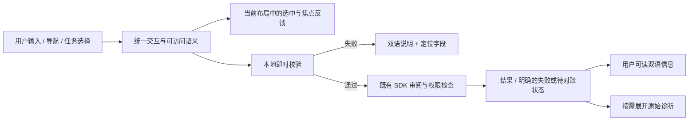

> 当前界面以 [本轮完整优化报告](native-ui-refinement-2026-11-10.md) 为准。下面保留早期检查点；其中“改为淡入”的选中动画已由实际布局测量的滑动底板取代。

# Morph 原生客户端：国际化、切换与交互整治

## 目标与实施顺序

本轮直接修改当前 GPUI 客户端，不为 UI 创建 GitHub issue。前一轮改动仍在同一 dev 工作区。先确定规则与验证方法，再实施；不以局部截图替代完整覆盖检查，不运行完整协议 gates。

| 用户要求 | 处理原则 | 验证方式 |
|---|---|---|
| 国际化完整 | 应用拥有的标签、帮助、状态、错误说明、可访问名称统一双语；后端原文只作为明确标注的诊断，用户名称和协议值不改写 | 逐页与全部任务目录静态清点，目录完整性测试，中英原生画面、错误路径与语言切换 |
| tab 动画定位 | 不用写死的行索引乘步长推测位置；选中效果跟随控件自身布局；页面外框不位移 | 各导航、内页 tabs、快速切换、缩放与紧凑布局的真实 bounds 检查 |
| 更大 Logo | 侧栏统一扩大，紧凑状态保留足够容器；欢迎页同步扩大 | 普通／紧凑窗口截图，图像边界不越界 |
| 更大默认字体 | 唯一 16px 基础字号，继续提供 90%–150%；布局也按基础字号重新计算 | 100%、150%，中英，最小窗口与宽窗口；输入与偏好保留 |
| 全面交互升级 | 一致的导航／页签，任务查找，键盘焦点与校验定位，复制反馈，明确错误恢复，窄窗口操作栏 | 真实点击／键盘／布局专项测试与逐页原生检查 |
| 不开 UI issue | 所有计划、实现与证据留在仓库和 Vault | 本轮不调用 GitHub issue 写入工具 |

## 发现与决定

1. 原导航指示条使用 `index × 49 × scale + 12 × scale`，依赖 14px rem 与特定 gap。扩大默认字号后更容易偏移；它还在按钮之前绘制，会被选中背景覆盖。改为控件内部的选中表面与边缘标识，效果始终在自己的 bounds 内；不再让指示条跨越无关区域。
2. 页面进入的 `relative top` 位移会使切换时的内容位置与静止布局不同。保持页面几何位置，只做短暂透明度过渡。快速切换、失焦恢复和减少动态效果不会触发额外演示。
3. 国际化目录已有许多键，但结果、事件、错误和记录摘要仍可绕开它。需要检查数据到视图的边界，不能只增加几个按钮翻译。
4. 输入焦点应在进入新任务时到达首个可编辑字段；校验失败直接定位有问题的字段。返回／切换语言不丢失草稿，不能自动确认、重试写入或绕过审阅。
5. 搜索、页签、复制和提示遵循同一交互规则。复杂技术内容保留可展开的原文，主界面先告诉用户发生了什么、下一步能做什么。

## 不可破坏的约束

所有 23 个 Hub 操作、独立任务草稿、精确金额、审阅绑定、未知写入对账与私密导出边界保持有效。新增 `morph-wallet` 提供独立的本机钱包签名权威；它只签准确审阅的链上钱包交易，不替代通道日志或双方／Factory 授权。钱包备份不能恢复或回滚通道签名日志。保留减少动态效果及可调字号，不引入 JS/TS、WebView、新渲染后端或 GPUI 依赖升级。

## 验收记录

2026-11-10 当前工作区的专项测试：桌面 **21 通过**，钱包单元测试 **10 通过**。其中新增测试直接驱动 GPUI 渲染、鼠标与键盘，不只是检查样式常量：

- 780×580 与 1440×960，中英、90%／100%／150%，全部主导航和页面外框的 bounds 保持稳定。
- 钱包五个页签在 650×480、相同双语字号矩阵下不移动点击区域，方向键、Home／End 可用。
- 选中动画在正常前台完成；切到另一窗口后立即采用最终状态，不留下旧页签高亮。
- 780×580、150% 字号下，故意填错末尾费用字段；审阅使输入获得焦点并滚入视野，既不生成有效审阅也不发请求。
- 语言切换保留付款草稿；提交口令后替换整个输入实体，撤销历史不能恢复已提交值。
- 钱包后台观察结果不能把尚未完成的命令错误地标为完成。
- `Text` 枚举与双语目录逐项相等；原始错误仅在诊断中展示，用户名称、金额和协议数据不被翻译。

没有运行全库 gates，没有新建 UI issue，没有提交／推送／发布本轮改动。钱包链上验证、原生截图和运行限制见 [钱包运行手册](runbooks/local-wallet.md) 与 [实施方案](native-wallet-and-guided-flows.md)。通道钱包出入金向导、真实网络节点图和液体玻璃仍未交付，不能据这些专项测试宣称全产品已完成。
