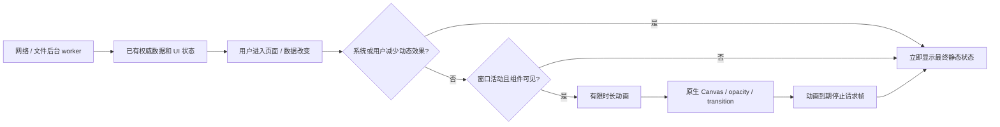
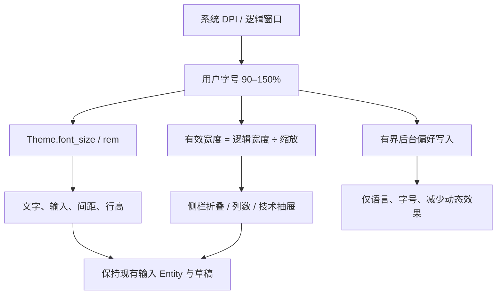
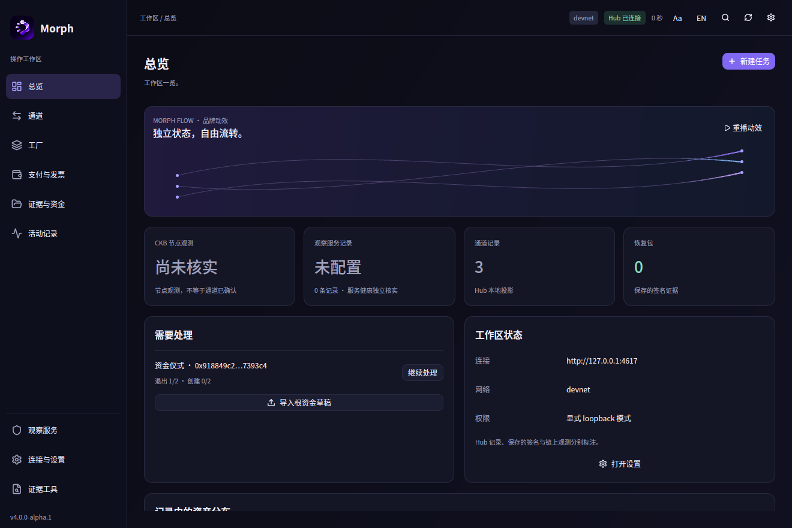
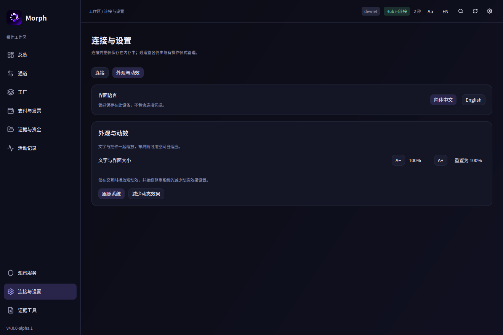

# Morph 动效与自适应字号：设计及实施计划

## 选择：Morph Flow

以用户提供的 Morph Logo 为视觉中心，使用深蓝底、紫色轨迹与冰蓝光点。让界面呈现轻盈、克制、有方向的运动：进入概览时，三条曲线完成一次流光；切换页面短暂淡入；导航标记平滑移动；统计卡片以最终真实值轻微显现。视觉语言统一，不在业务页面堆叠互不相关的演示效果。

动画只能表达界面反馈。装饰轨迹不代表真实转账、在线节点或已经确认的通道。金额、哈希、签名数量始终显示真实最终值，不用插值制造不存在的中间资金状态。输入焦点、IME、任务草稿和提交命令不由动画驱动。

## 为什么采用这条实现路线

仓库锁定 GPUI Kit 0.9.0 / GPUI pre 0.3.11。以本地供应链源码为实际能力边界：`gpui-base/src/motion.rs` 提供可中断 transition；GPUI `AnimationExt` 提供一次动画与帧率上限；`canvas` 提供已有 GPU 绘图命令。上游[运动接口](https://gpui-kit.com/base/motion/)与[绘图接口](https://gpui-kit.com/docs/paint/)用于理解设计，但网站默认展示的版本可能比锁定版本更新。

这次使用现有绘图管线，不引入 WebView、JS、第二套 GPU 设备或新的运行时依赖。React Bits 的 WebGL 着色器不是可以直接粘贴到 GPUI 的组件；[上游自定义 shader 请求](https://github.com/zed-industries/zed/issues/43273)不能作为已有接入能力。液体折射、整窗实时模糊、复杂透视和全屏粒子场留作单独渲染实验，避免为装饰改变已固定的供应链。

## 动效矩阵与预算

| 区域 | 行为 | 预算 / 边界 |
|---|---|---|
| 概览品牌轨迹 | 三条曲线、有限光点，进入时播放一次 | 1.2 秒；最多 60 次采样/秒；固定上界绘图；子视图缓存 |
| 主内容 | 轻微淡入，不移动表单和命中区域 | 180 毫秒；减少动态效果时立即完成 |
| 导航 | 紫色标记平滑跟随当前页 | 160 毫秒；快速切换从当前位置转向 |
| 概览卡片 | 最终真实值显现、边框 hover 反馈 | 180 毫秒；不滚动资金数值、不制造支付确认 |
| 后台或离开概览 | 停止装饰动画 | 不为隐藏组件持续请求帧 |
| 静止界面 | 不请求装饰动画帧 | 原有健康检查和网络轮询独立存在，不能声称进程零唤醒 |

性能目标：交互动画以 60 Hz 为上限，单帧预算参考 16.7 毫秒；不承诺所有机器都能达到。验证要记录实际环境、进程 CPU 与静止/动画差异。没有 GPU 帧时间证据时，不能把 CPU 采样写成 60 FPS 认证。完整 gates 按用户要求不重跑。

## 字号与布局

提供 90%–150% 的界面缩放、重置按钮和键盘快捷键；14 个逻辑像素为 100% 基准。系统 DPI 缩放继续由 GPUI 负责，不重复乘物理屏幕倍率。控件、间距用 rem；现有关键固定高度、侧栏、JSON 字号、虚拟列表行高按比例调整。断点按 `窗口逻辑宽度 / 用户缩放` 决策，字号增大时提前折叠侧栏、减少概览列数并收起技术侧栏。窄窗口保留垂直滚动，不为了容纳内容偷偷缩小用户选择的文字。

偏好是当前未发布格式，直接使用唯一的新形状，不添加旧形状缺字段迁移。旧预览偏好无法读取时显示提示，可重置开发配置。偏好不得保存 RPC、token、钱包、恢复包或签名权威。

## 实施与验收

1. 扩展唯一 UI 偏好；添加双语控制、快捷键及范围校验。
2. 实现缓存的有限 Canvas 轨迹、页面显现和导航 transition；系统及应用减少动态效果均生效。
3. 检查中文/英文、最小窗口与 150% 字号、输入保留、切换与重复点击、离开概览及窗口失焦。
4. 执行动效停止与缩放边界的针对性测试；构建并打开原生优化版本。记录实际结果后更新本文。
5. 签名提交到 dev，更新 PR #59 的最终说明并合并；不打 tag、不发布版本、不部署合约。

## 实际验收记录

实现已经完成。没有增加依赖、GPU 设备或修改 GPUI 供应链源码。`motion::Flux` 是固定三条轨迹、每条九段尾迹的缓存子视图；动画最长 1.2 秒，按最高 60 次/秒的定时通知采样，结束后不再安排通知。导航 transition 160 毫秒、页面与统计卡片显现 180 毫秒。Canvas 的曲线分段、尾迹和端点均有常数上界，无粒子两两连接、纹理逐帧分配或文件/RPC 读取。

系统减少动态效果由锁定的 Base 平台接口读取；应用设置还可主动减少 Morph 动效。失焦、不可见或离开概览会停止装饰动画，恢复焦点不会补播已经停止的轨迹。用户可显式重播。健康轮询依然独立工作；离线且没有待处理任务/提示时，移除了原来每秒一次的无意义根视图刷新。

外观设置与连接设置分成两个页签，标题栏 `Aa` 直接打开外观。Ctrl+= / Ctrl++ 放大，Ctrl+- 缩小，Ctrl+0 重置；也可以使用设置按钮。150% 对应 21 个逻辑像素的基础 rem，系统物理 DPI 仍由 GPUI 单独管理。语言、90%–150% 缩放和减少动态效果保存于唯一 `morph.desktop_preferences.v2` 形状；v1 预览配置不会迁移。读取失败时使用默认值并提示，修改偏好后写入当前形状。

### 验证结果与限度

| 验证 | 实际结果 |
|---|---|
| `cargo test --locked -p morph-desktop` | 10 通过，0 失败；仅桌面包，不是 workspace 或完整 gates |
| 动效调度负测 | 活动时确实产生通知；超过时长后两秒内没有新通知；系统减少效果/组件隐藏也不产生通知 |
| 几何上界 | 三条曲线的 3,603 个采样点均在绘图表面内；尾迹固定最多 27 段 |
| 780×580、150% | 测试真实布局与滚轮事件；放大按钮可滚动到可见区域且不横向越界 |
| 草稿/输入 | 放大至 150%、切换中文、减少动态效果后保留同一输入 Entity 与原文；90%/150% 边界及100%重置通过 |
| 偏好 | 当前格式读写往返，拒绝旧形状/缺字段/非法比例；非法写入不覆盖此前合法值 |
| 原生检查 | Linux X11 优化程序：中英切换、字号按钮及 Ctrl+0、折叠导航、只读连接隔离 Hub；没有资金提交 |

优化原生程序还做了短时 `/proc` 进程采样：20 逻辑核机器，离线设置静止 8 秒使用 0.04 CPU 秒（单核口径 0.50%，RSS 约 120 MiB）；概览重播一次流光的 3 秒窗口使用 0.25 CPU 秒（单核口径 8.33%，RSS 约 137 MiB）。后一个窗口同时进行了原生窗口视频采集，测量属于受此环境影响的短时观察，不是纯净 A/B 基准。这些是 CPU/RSS 数据，不能推导 GPU 帧时间或低端硬件始终达到 60 FPS。构建耗时与 CPU 数也不能当作 UI 流畅度证据。

本轮没有运行完整本地 CI、VM、devnet 或产物资格 gates，没有重新认证合约身份。PR 新触发的 GitHub 工作流应独立看待，不能沿用历史 d988c79 的验收结果。

### 原生画面

[5 秒原生窗口录像：包含一次显式流光重播](uiux/motion/flow-native.mp4)。录像是窗口采样，30 帧/秒，不是渲染帧率测量。

### 后续性能升级触发条件

当前只为有限交互付费。若以后需要常驻极光/大量节点图、真液体玻璃，先在独立实验中测 GPU 呈现时间、显存、缩放裁剪、休眠/失焦和低端设备；通过后再决定是否接入。若真实节点页出现性能问题，先拆分数据视图、缩减无关重绘和复用几何，再考虑更重的效果。这份实现不以 shader 接入或新组件库作为交付前提。
