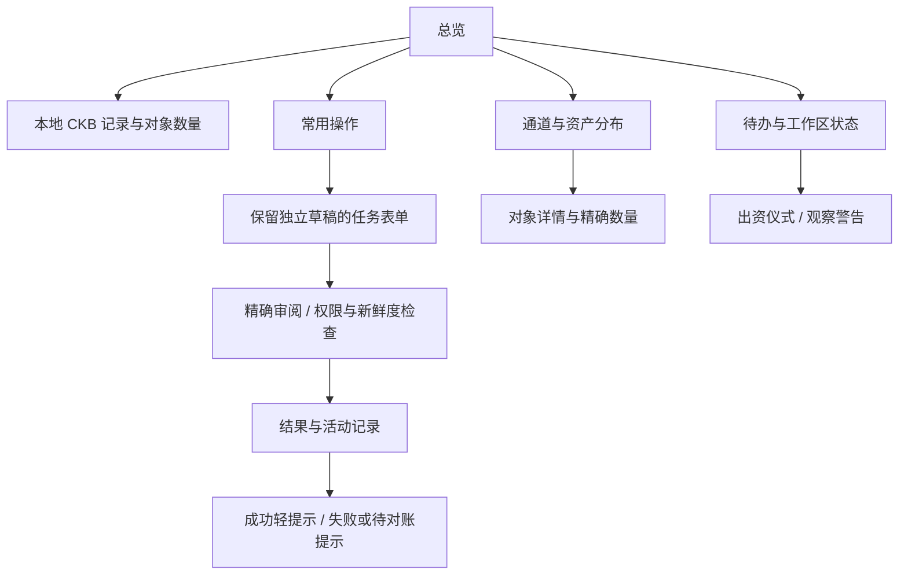
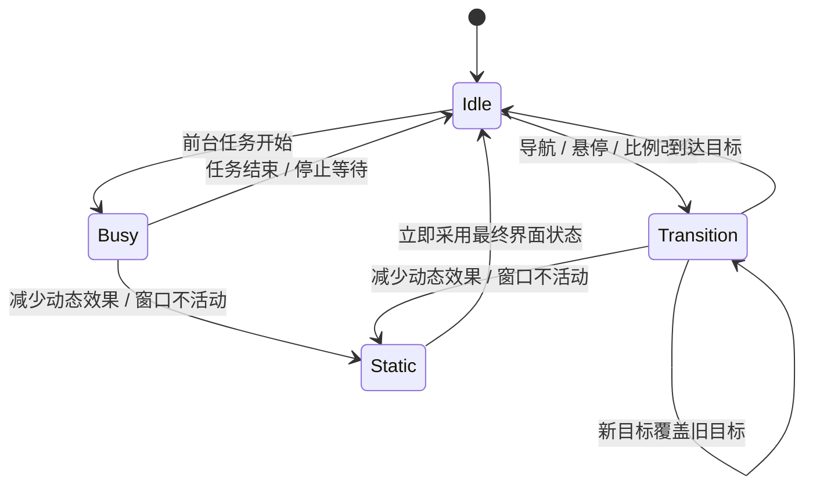
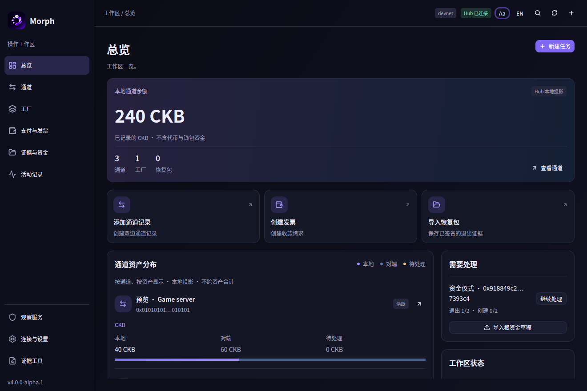
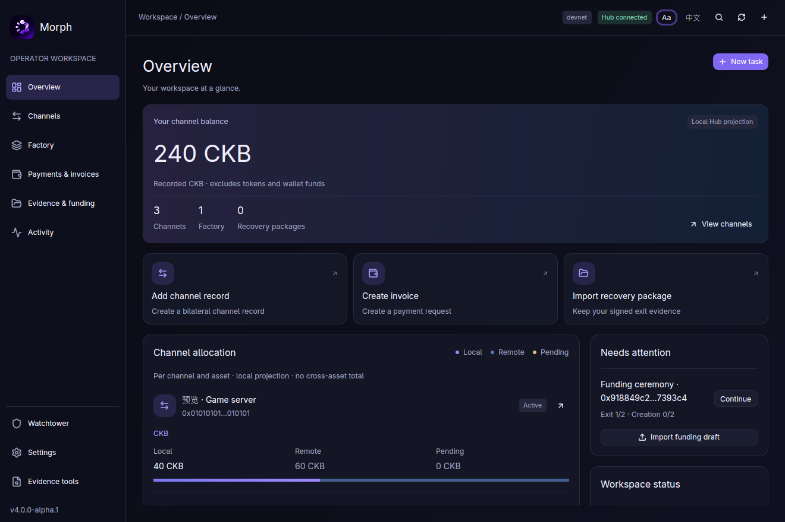
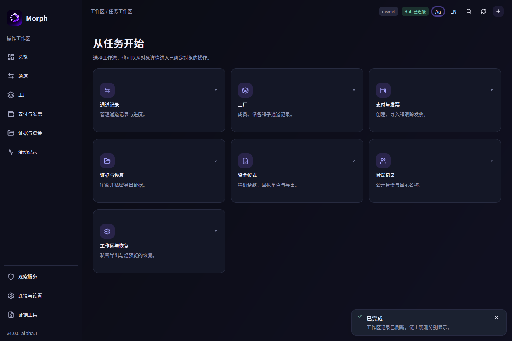
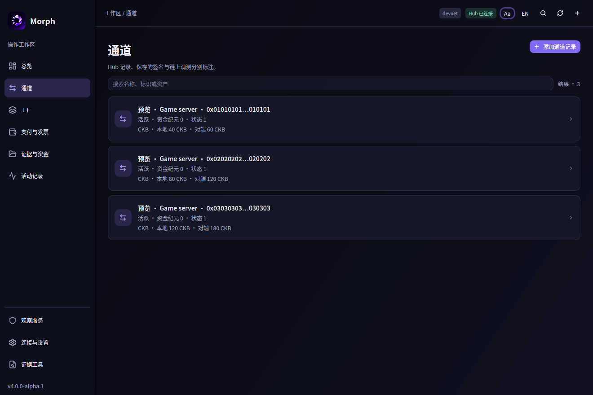
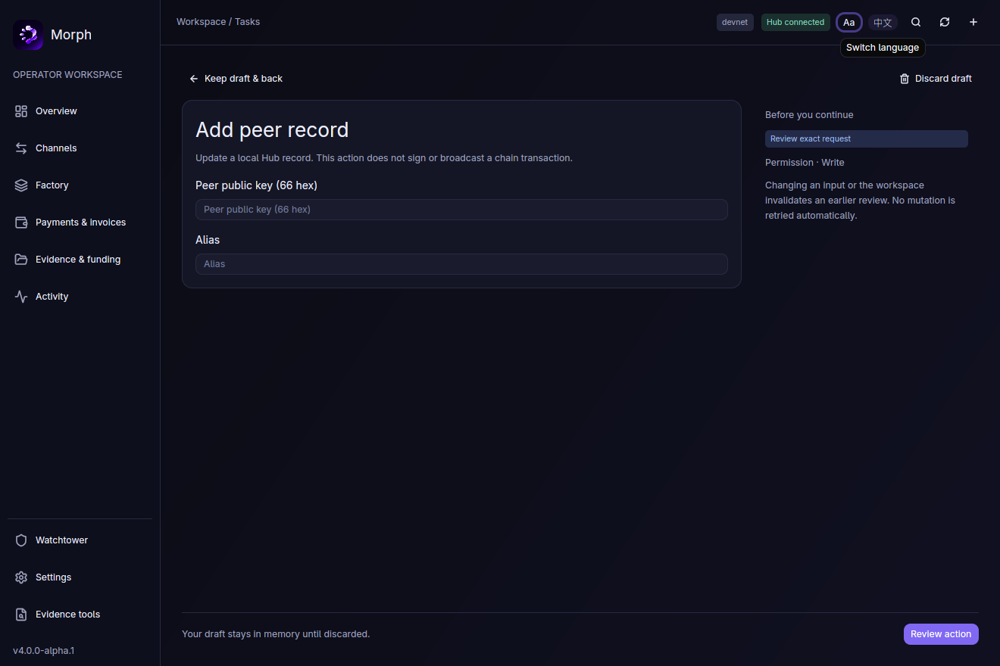
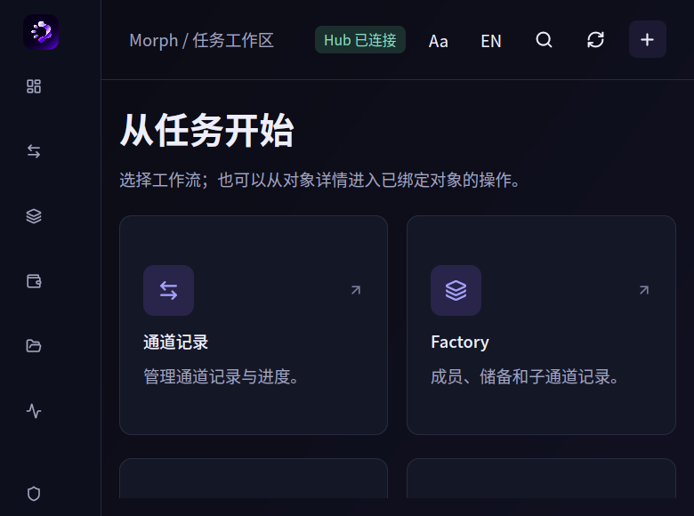

> 当前实现补充：[2026-11-10 原生 UI 优化](native-ui-refinement-2026-11-10.md)。本轮恢复基于实际几何的滑动底板，并改为柔化 Bézier 极光；以下更早的截图与指标保留为历史检查点。

# Morph 原生 UIUX：让动效服务于操作

本次修订替换之前的 Morph Flow 演示方案。概览里的流光演示、手动重播按钮和相应文案已经删除。旧设计把用户注意力引向动画本身，没有帮助用户完成任务，因此不再作为产品方向。

当前实现使用用户提供的原始 Logo、蓝紫色调、同一套中英文界面和 90%–150% 字号设置。没有增加 JS/TS、WebView、着色器后端或升级 GPUI。11 月 10 日新增的本机钱包及其密码学依赖单独记录在 [本机钱包方案](native-wallet-and-guided-flows.md)，不能再把整个改动描述为纯展示调整。

## 一、界面如何重新组织

| 区域 | 这次的变化 | 用户得到什么 |
|---|---|---|
| 总览 | 以已记录的本地 CKB 为主要数字；通道、Factory、恢复包数量降为辅助信息 | 先看到资产概况，再进入具体对象 |
| 常用操作 | 通道记录、收款请求、恢复证据三个直接入口 | 减少寻找任务的层级 |
| 资产分布 | 每个通道、每种资产分别显示本地／远端／待处理数量及比例条 | 看清一条通道内的分配，不混加不同资产 |
| 待办 | 宽窗口与资产分布并列；窄窗口优先显示待办 | 未完成出资仪式和观察警告不会埋在长列表后面 |
| 记录列表 | 图标、名称、状态与金额形成层次，行间留白，移除每行重复的来源标签 | 更容易扫描和选择；详情仍显示来源 |
| 任务目录 | 统一卡片尺寸、图标区、描述和入口箭头，悬停自然过渡 | 整张卡片可操作，同时保留原生键盘和可访问语义 |
| 活动 | 状态图标和纵向时间线代替连续的大盒子 | 更容易区分进行中、完成、失败和待对账 |
| 提示 | 成功信息使用浮层，不推动正文；警告和未知写入对账仍在正文 | 普通反馈不打断布局，重要状态不被隐藏 |
| 字体与顶栏 | 提高正文／说明文字的默认可读性；删除不断跳动的秒数；顶栏增加任务入口 | 少一些工程仪表，多一些操作空间 |

### 金额与视觉比例的边界

总览数字是 **Hub 本地通道记录的 CKB 合计**，不是钱包余额、可立即花费额度或链上确认。它不包含 xUDT。实现用 `u128` 检查加法；重复通道、同通道重复 CKB、解析失败或溢出会显示“余额暂不可用”，不会跳过坏记录后给出一个看似完整的合计。

比例条只比较同一资产的 local／remote／pending。浮点数只用于几何宽度，邻接文字始终采用精确整数金额。零合计、坏数据或合计溢出显示中性轨道，不编造占比。超长总额保留完整文本并允许横向滚动，不使用科学计数法。总览最多预览六条通道、每条八项资产，完整数据在对象列表与详情中查看。

## 二、动效是反馈，不是展示按钮

| 触发 | 实现 | 生命周期 |
|---|---|---|
| 指针进入／离开操作卡片 | 蓝紫底色与边界过渡 | 130 ms，可在中途反向 |
| 页面切换 | 保持几何位置，只改变透明度 | 210 ms，最多 60 次动画采样／秒 |
| 导航／页签变化 | prepaint 测量实际按钮 bounds，背景底板平移与变宽 | 220 ms 缓出；快速反向连续重定向；失焦／减少动态效果对齐最终位置 |
| 同一资产分配实际变化 | 比例条平滑到新比例 | 280 ms；初次呈现直接采用已有比例 |
| 前台任务等待 | 顶栏下方窄流光条 | 仅实际前台工作期间，最多 30 次采样／秒；不显示虚假完成百分比 |
| 用户或系统减少动态效果 | 显示最终状态或静态忙碌标记 | 不依赖动画完成才能操作 |
| 前台可见的极光背景 | 三组 Bézier 曲面、每组十二层低透明轮廓 | 44 秒周期，最多 20 次采样／秒，失焦／隐藏／减少动态效果时静止 |

没有动画重播控制，不让金额经历虚构的中间数值。用户允许常驻效果后，加入独立缓存子视图绘制的极光；尚未加入大量节点图或真正的液体玻璃。透明曲线不是背景折射。动效不能改变请求体、签名角色、审阅绑定或资金状态。

## 三、为什么这样实现性能成本较低

仍使用锁定的 GPUI Kit 0.9.0 / GPUI pre 0.3.11：原生按钮、`transition`、`AnimationExt` 和已有 Canvas 绘图命令。忙碌条每帧只画一个矩形，范围裁剪到两像素高的区域。比例条是三个有界色段。没有第二个 GPU 设备、全屏模糊、像素回读或逐帧文件／RPC 调用。

忙碌条和比例条使用缓存子视图。比例条的实体引用单独保存在 keyed state 中，动画通知直接发生在叶视图，避免 keyed state 自动订阅把每个动画帧传回整个工作区。卡片过渡和页面进入是短期交互成本，不是常驻时钟。

顶栏不再每秒刷新“距上次检查几秒”。原有网络与文件队列继续独立轮询，工作区仅在新鲜度越过阈值时额外刷新状态；真实数据完成事件仍正常更新界面。不能据此声称整个进程零唤醒。

实现过程中实际窗口发现了重复设置原生按钮 hover 样式会触发断言的问题。已经改为 `ButtonCustomVariant` 配置原生状态样式；卡片渲染与点击回归测试覆盖此路径，没有修改供应链源码来绕过断言。

## 四、中英文、字号和自适应

使用唯一类型化双语目录。切换语言不重建输入实体；草稿、审阅和已填写字段保留。用户内容、协议标识与底层技术诊断保持原文。

字号保持 90%–150%、Ctrl+=／Ctrl++、Ctrl+-、Ctrl+0 和外观设置按钮。100% 的基础字号提高到 16 个逻辑像素，150% 为 24 个逻辑像素。DPI 继续交给 GPUI。布局按逻辑宽度与字号共同选择侧栏、列数和详情抽屉，窄窗口允许滚动，不偷偷缩小用户选定的字体。侧栏 Logo 同步扩大，紧凑布局仍保留完整图像。

偏好仍使用唯一 `morph.desktop_preferences.v2`：语言、比例、减少动态效果。没有引入旧格式迁移，也不保存凭据或签名权威。

## 五、验证范围

桌面专项测试覆盖：金额精确转换、合计的重复／溢出防护、比例的零值／坏数据、前台忙碌动画的停止调度、真实卡片渲染和点击、成功提示不移动正文、780×580 下 150% 字号设置可滚动到达，以及切换语言／字号后同一草稿输入保持不变。

本轮按要求不跑完整本地 gates，不重新执行合约产物资格验证。钱包另做了两项隔离开发节点转账测试；这不是完整协议 devnet 验收。下方是此前 UI 重排的历史证据；新增钱包及当前交互证据以 [当前验收记录](native-interaction-review.md) 为准。

### 前一轮 UI 重排验收（历史记录）

- `cargo test --locked -p morph-desktop`：**12 通过，0 失败**。最终测试无编译警告。
- `cargo build --locked -p morph-desktop --profile desktop`：优化原生构建成功，无编译警告。
- 桌面包格式检查与 `git diff --check` 通过；没有运行完整 gates。
- Linux X11 实际窗口检查：1320×880 的总览、通道、任务目录、活动、双语表单；780×580 与 150% 字号的折叠布局；Ctrl+0 恢复 100%。最小窗口设置控件的滚动可达性另有真实布局／事件测试。
- 手动重播入口、演示文案、旧轨迹实现和对应仓库演示录像已经移除。重复选择当前导航不重新启动页面动画；失焦后恢复不会补播已过期的页面进入效果。
- [7 秒原生交互录像](uiux/refinement/navigation-native.mp4) 记录真实导航操作。录像为 30 fps 窗口采样，**不是**渲染帧率认证。

以下画面是原生程序截取，使用隔离开发 Hub 的本地记录；没有签名或广播资金交易。

### 前一轮本机开销记录（不能代表新增钱包和极光的成本）

最终优化版连接开发 Hub、概览静置 8 秒，`/proc` 记录 CPU 时间 0.07 秒，即约 0.87% 单核占用，RSS 124,024 KiB（约 121 MiB），主机 20 个逻辑核。原始记录见 [idle-cpu.json](uiux/refinement/idle-cpu.json)。这是短时进程采样，不代表 GPU 帧时间、低端设备或所有工作负载的保证；没有把它写成“稳定 60 FPS”。

代码保留在 `dev` 工作区供本轮界面审阅，未新建 Release 或部署。此前 #59 的合并不包含本轮新增修改。
