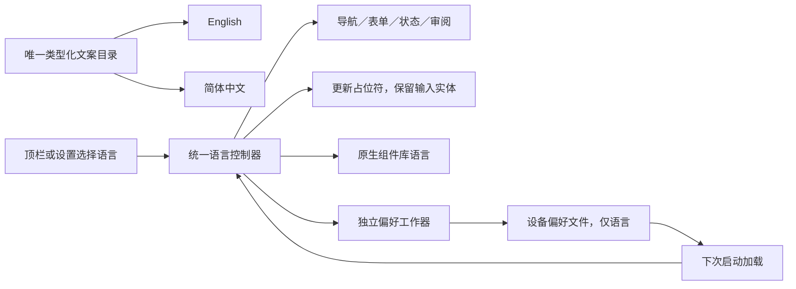
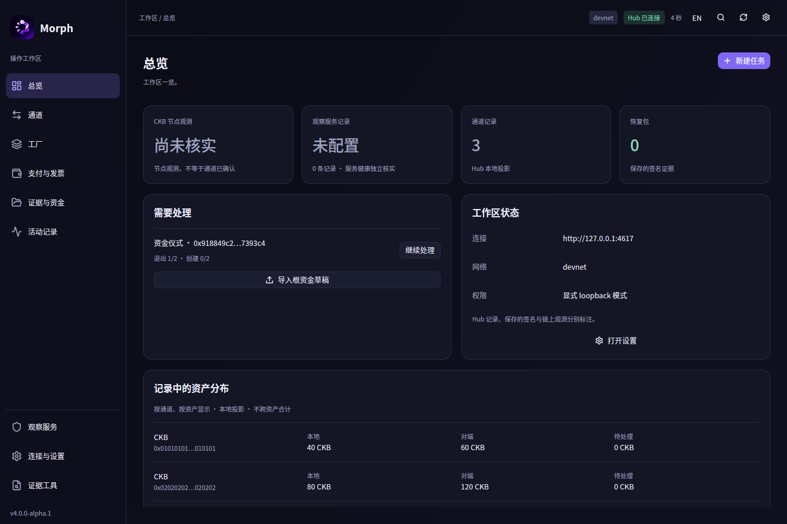
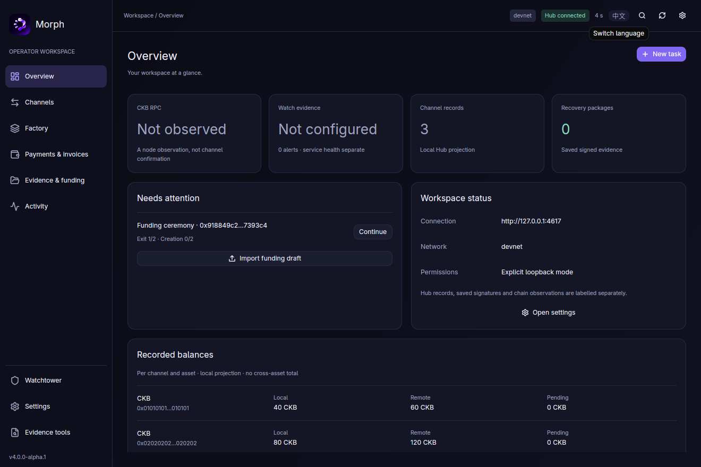
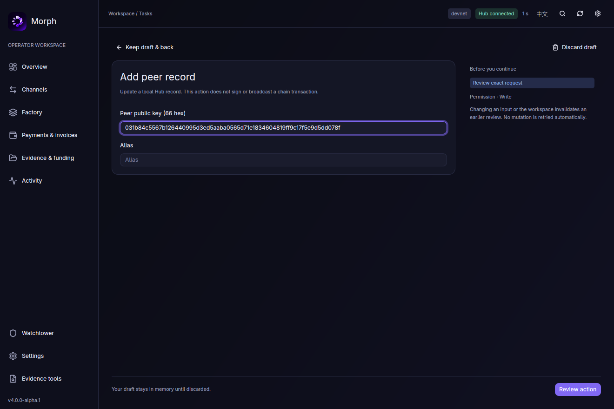
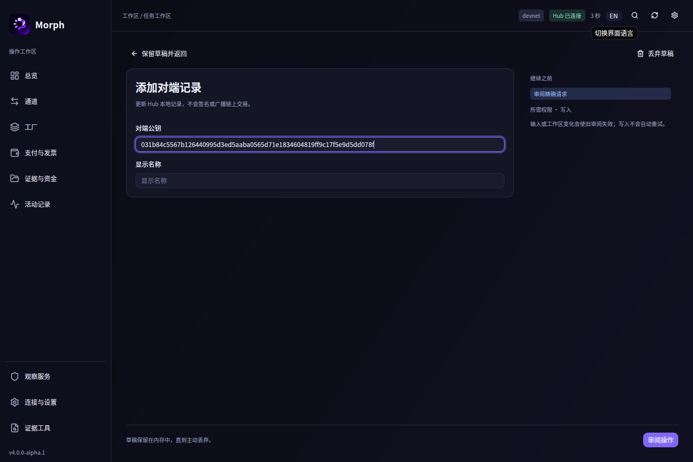
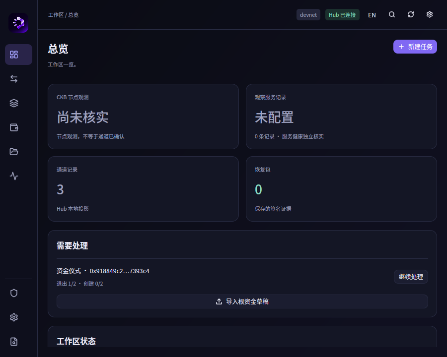

# Morph 原生界面：蓝紫品牌与中英国际化

本轮继续改进尚未提交的 GPUI 工作区。按最新指示，**暂停提交、推送和合并**；没有恢复 GPG 签名，也没有创建 Release。此前的协议／客户端迁移验收只适用于其记录的提交，不能用来证明本次界面变更已经通过完整 gates。

## 1. 品牌和视觉方向

使用本次提供的 Morph Logo 原始 PNG，直接嵌入 Rust 二进制，应用在侧栏品牌区和首次进入的欢迎页。图像没有重新生成、改色或重画；原图里的蓝紫光泽负责品牌识别，日常操作界面使用更克制的色彩。

| 层级 | 实际实现 |
| --- | --- |
| 主背景 | 深靛黑 `#0b0c15`，很轻的蓝紫色背景渐变 |
| 侧栏 | `#0e0f1c`，窄分隔线，Logo 与 Morph 字标 |
| 面板 | `#141625`，14px 圆角，低对比边界 `#272a41` |
| 主要操作 | 蓝紫 `#8068f3`，白色文字；hover／active 同色系 |
| 选中导航 | 深紫底 `#292449` 与浅紫前景，保持清楚的选中关系 |
| 字体 | 英文优先 Inter／Adwaita Sans，中文优先静态思源黑体；按已安装字体回退 |
| 状态 | 成功、警告和失败继续使用独立语义颜色与文字，避免把品牌紫误当成所有状态 |

移除了原先偏棕灰的默认按钮、绿色主操作和大块重复说明。总览用简洁的连接／网络／权限信息代替重复的工程边界段落；任务侧栏收紧为审阅要求、权限和输入变化提示。长 token 数量仍占整行，资金量不使用浮点数或科学计数法。

## 2. 中英文是统一目录，不是两套界面

`i18n.rs` 现在包含 **505 个实际使用的类型化文案项**，每项同时提供英文和简体中文。Rust 的穷尽匹配要求每个消息都有两种文本；界面按 `Text` 选择文案，不再在各个页面散落临时中英二选一。

覆盖导航、字段、占位符、提示、审阅、禁用原因、状态、文件单位、金额单位、任务活动及可访问名称。表单目录只保存一份消息标识，既用于标签，也用于当前语言的占位符。组件库内置编辑菜单同步设置 `en`／`zh-CN`。

| 切换行为 | 结果 |
| --- | --- |
| 右上角 EN／中文 | 直接切换当前界面，无需重连 |
| 设置中的语言选择 | 与右上角使用同一个语言控制器 |
| 已填写的草稿 | 只更新文案与占位符，不重建输入，不清掉文本 |
| 已打开的审阅 | 请求体、对象、事件、签名角色与精确确认保持原绑定 |
| 本次任务与通知 | 应用生成的固定文案随语言更新 |
| 用户名称、用途、标识和协议内容 | 保留原值，不把用户内容当翻译键 |
| 底层技术诊断 | 保留原始信息；原始服务端内容不伪装成应用翻译 |

系统文件选择器由操作系统决定语言，应用自己的选择器提示已经本地化。本轮没有改变系统语言。

## 3. 语言偏好持久化

语言偏好在独立的小型后台工作器中读写，避免阻塞网络、证据文件队列或 GPUI 主线程。默认使用系统语言；有已保存偏好时加载偏好。加载期间用户已做新选择，迟到的旧偏好不会覆盖选择。

路径为 `$XDG_CONFIG_HOME/morph/desktop-preferences.json`，或 `$HOME/.config/morph/desktop-preferences.json`。唯一当前格式是 `morph.desktop_preferences.v1`，内容只有 schema 与 language；未知字段和其他格式不被当作兼容输入读取。

写入通过新的临时文件、fsync、同目录替换与目录同步完成；Unix 文件权限为 0600。读取有 4 KiB 上限、普通文件检查和非阻塞打开。保存失败时当前会话仍可切换语言，并在设置中说明偏好未能持久化。

**此文件不保存**令牌、endpoint、私钥、恢复包或签名期刊，也不构成任何签名或资金权威。

## 4. 原生界面截图

截图来自实际 GPUI 原生窗口，使用隔离的预览 Hub。余额是本地演示记录，没有资金交易。

## 5. 本轮检查范围

- 本地桌面预览构建和 `cargo build --locked -p morph-desktop --profile desktop` 优化构建均成功，最终构建无警告。
- 原生窗口检查了中英切换、相同 Hub 的两种语言、900×720 与 1320×880 布局。输入 66 字符公共公钥后切换语言，原值保留，字段和占位符同步更新；重启后从语言偏好恢复中文。
- Logo 从原图直接复制并嵌入，不依赖临时文件路径或外部网络。
- 继续沿用现有精确金额、规范 SDK、权限、新鲜度、未知写入对账与私密导出边界。
- 按要求不运行完整 CI、单元测试、VM、devnet 或资格 gates；没有把一次预览当成跨平台、最大文档性能或完整辅助技术认证。

所有本轮代码仍是工作区修改，没有提交、推送或合并。之后是否恢复这些动作，等待新的明确指示。

## 后续动效与字号扩展

最新实现见 [Morph Flow 与自适应字号](native-motion-and-typography.md)。用户随后授权完成实现并合并 #59；本文早先记录的暂停提交仅描述当时阶段，最终 Git 状态以提交与 PR 记录为准。
