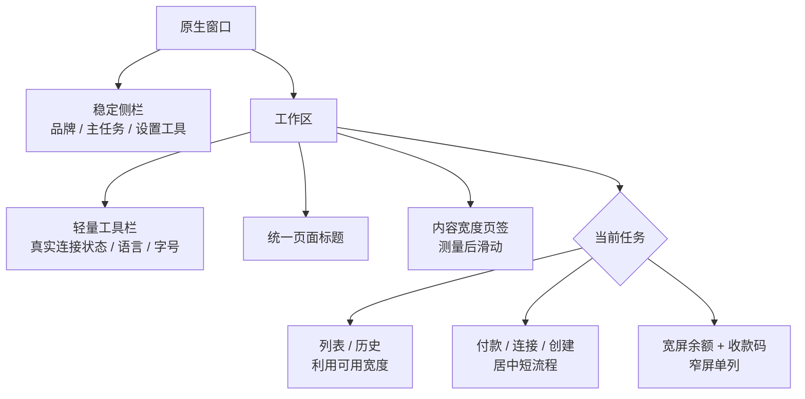
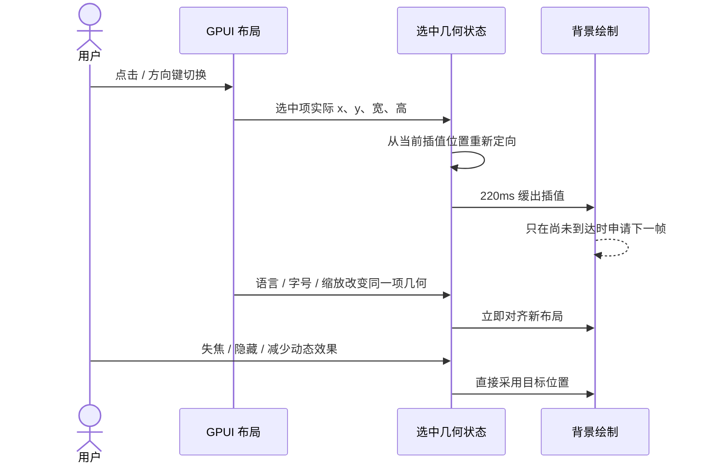
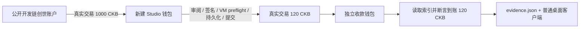
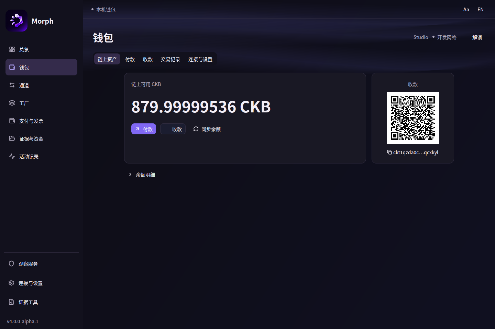
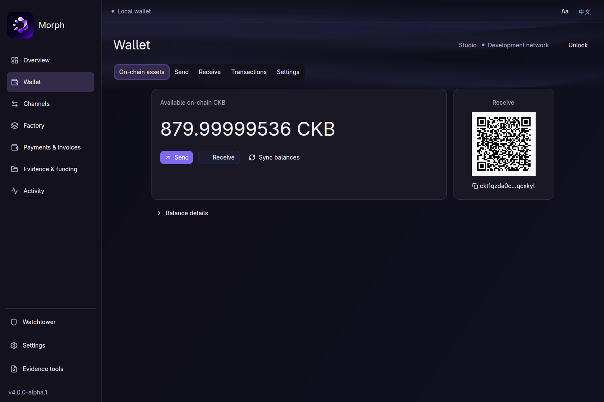
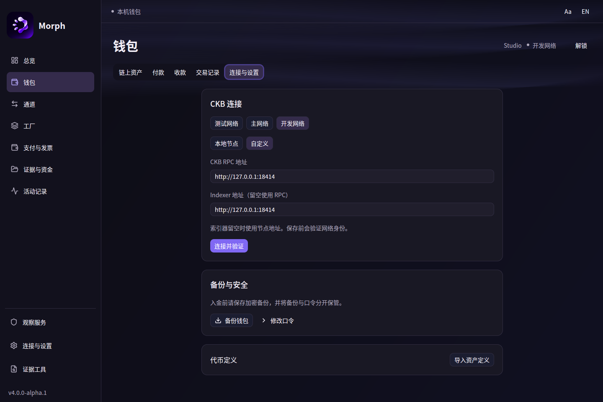
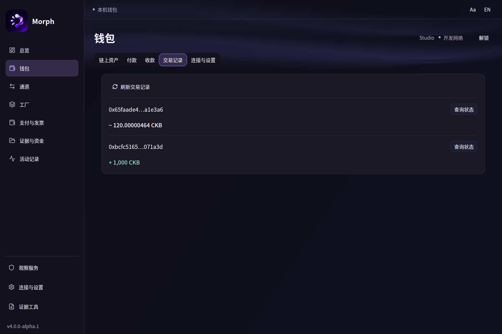
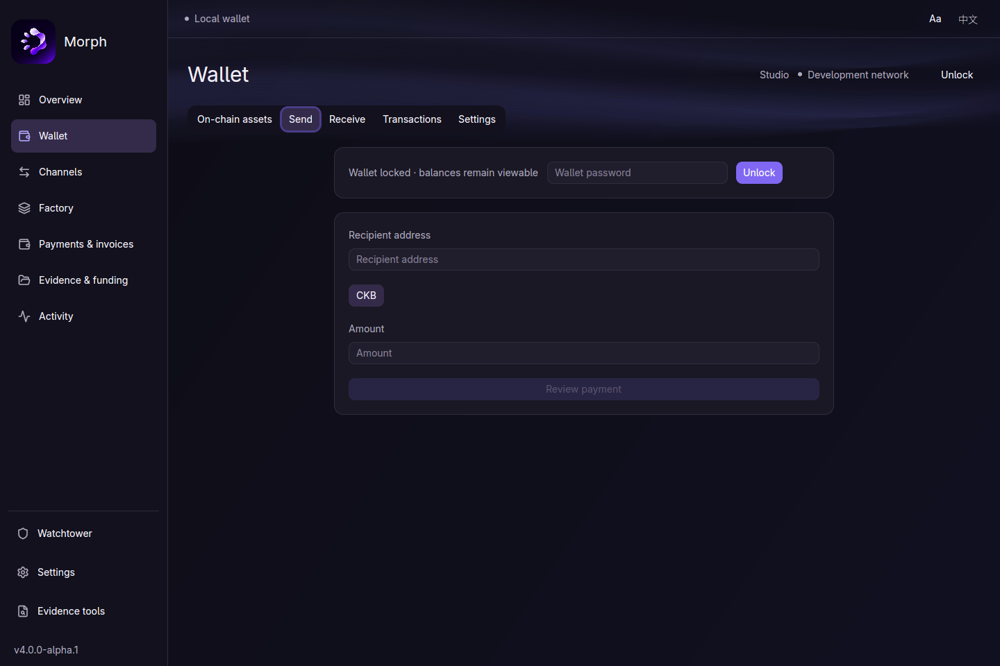
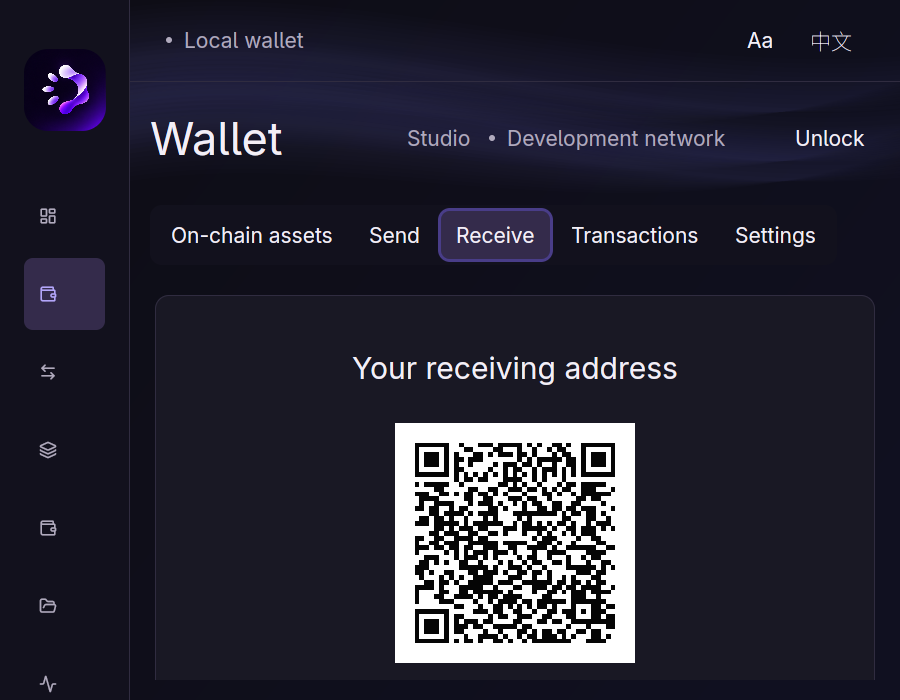
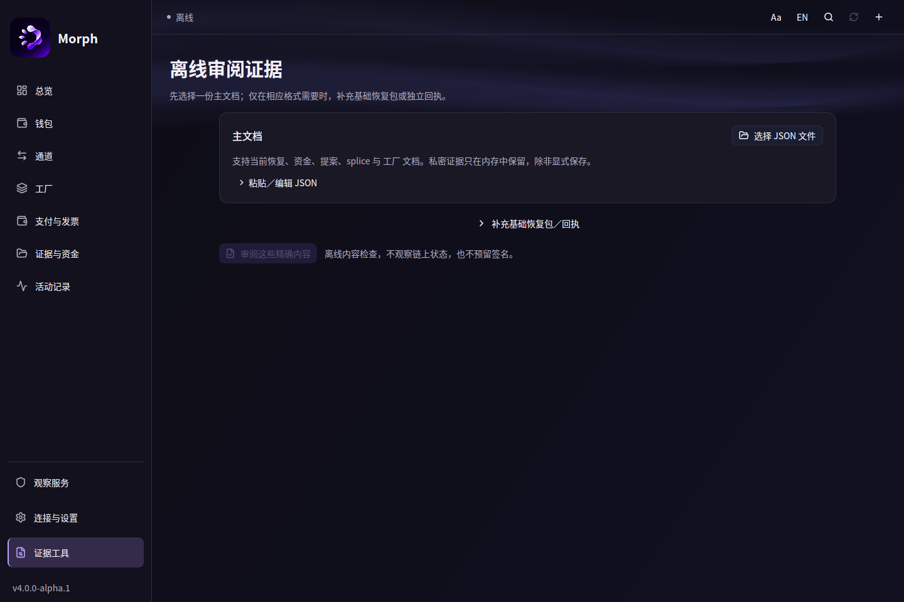

# Morph 原生界面：从控制台堆叠到日常工作区

日期：2026-11-10。本文记录本轮 UI 实现、参考来源和实测；此前报告中“用控件内淡入代替滑动”的决定由本轮取代。没有新增 UI issue，也不改变协议脚本或签名权限。

## 为什么重新组织

原来的问题不只是颜色：顶栏、状态横条、页标题、提示横幅逐层堆叠，真正要操作的短表单反而缩在一角。大量同形卡片和解释性文案让每件事看起来同等重要；“本地记录”和“链上动作”又挤在同一组快捷入口里。

本轮按实际工作拆开：阅读列表占据工作区；填写短表单在中央完成；连接、备份和密码各有自己的设置区域。金额、收款人和提交结果是视觉主角。背景保留 Morph 蓝紫色，但稍微向暖灰、柔紫偏移。

## 两个 Fiber 产品：吸收什么，不照搬什么

| 参考 | 实际观察 | Morph 的决定 |
|---|---|---|
| Fiber Studio，`SendPaymentPanel.tsx` | 先解析输入、自动选已有通道对端；审阅打开后冻结预览，避免后台更新改变用户正在确认的内容 | 保持准确审阅绑定；通道和资产候选从已有上下文带入，不让用户重复抄写；不因视觉重构削弱签名边界 |
| Fiber Studio，`NodeSettingsSection.tsx` | 设置按用途分组；网络切换有明确前置条件，节点参数不是每页都展示 | 钱包设置拆成连接、备份安全、代币定义。网络与节点方案分开选择，保存前验证身份 |
| Fiber Studio 网站的产品预览 | 收付操作、账户资产和通道流动性各有明确区域 | 钱包宽屏为余额＋真实收款码，窄屏保留主任务；不从营销预览复制虚构余额或节点数据 |
| Fiber Dashboard，`ChannelDetail.tsx` | 状态、参与者、生命周期按阅读顺序展开；切换网络会退出旧详情 | 本地工作区记录与钱包链上余额分开；列表检索与数量在同一行；真实状态用小灯＋文字呈现 |

源码参考：[Studio 付款面板](https://github.com/chukwuma619/fiber-studio/blob/main/app/src/components/payments/SendPaymentPanel.tsx)、[Studio 节点设置](https://github.com/chukwuma619/fiber-studio/blob/main/app/src/components/settings/NodeSettingsSection.tsx)、[Dashboard 通道详情](https://github.com/nervosnetwork/fiber-dashboard/blob/master/app/src/features/channels/components/ChannelDetail.tsx)、[Studio 产品预览](https://www.getfiberstudio.com/)。这些是交互研究来源，不是 Morph 已具备 Fiber 网络路由的证明。

## 十一个要求的落点

| 要求 | 本轮处理 |
|---|---|
| 0. 一角表单与整屏横条 | 钱包短流程居中限宽；Hub 任务编辑、审阅、底部动作共享中轴；连接与外观卡片居中；去掉重复面包屑和常驻进度横线 |
| 1. bars 和小元素 | 页签改为内容宽度；共享实测滑动底板；列表搜索限宽；状态点与文字组合；选中和悬停不再画多层冲突底色 |
| 2. 无假演示 | 首页移除“新增通道记录”快捷项；通道主操作改为导入真实资金草案。手工记录维护集中在工作区工具；独立展示脚本执行真实开发链收付 |
| 3. 稍暖蓝紫 | 背景 `#0e0d16`、面板 `#191824`、正文 `#f3eff7`、强调 `#b3a6fa`；绿色只表示正向状态／入账，不铺满卡片 |
| 4. 节点设置 | 测试网公共 RPC 默认；本地节点、开发链、自定义 RPC 和独立 indexer；不自动连接或自动换服务商 |
| 5. 柔化流动效果 | 等宽折线带替换为三组长 Bézier 曲面，每组十二层低透明轮廓；44 秒周期、20 Hz 上限、缓存子视图 |
| 6. Wallet 标题 | 标题固定为 Wallet／钱包，使用统一 `title()`；用户账户名作为次级文字 |
| 7. 修复滑动 | 恢复横向页签、纵向导航的实际滑动，不使用 index×固定高度；快速反向从当前坐标继续 |
| 8. 参考 Fiber | 参考源码与具体吸收点见上表；不复制其网络能力声明 |
| 9. 去除模板感 | 去掉“工作区／当前页”的重复标题、重复指导面板和默认备份横幅；操作按任务组织 |
| 10. 删繁就简 | 密码修改按需展开；公共／本地节点不露原始输入表单；备份归安全；技术维护归工具 |
| 11. 人类友好元素 | 真实收款码与余额并列；复制立即反馈；空状态用克制的圆形图标；留白服务于当前任务，不用假指标填空 |

## 布局规则



钱包短流程最大 720px，余额工作区最大 960px，历史最大 1100px；Hub 编辑和审阅宽度随字号放大，默认 760px。限宽始终受父容器约束，窄窗口不会生成第二套 UI。16px 默认字号、90%–150% 缩放和中英双语保持有效。

## 滑动为什么不会再错位

旧方法从索引推算位置，忽略真实字体、间距、换行和语言变化。新方法在 GPUI prepaint 阶段测量被选中按钮的实际矩形；所有子元素完成测量后，底板在背景层绘制。按钮位置和点击区域从不参与动画。



底板不会挡住文字、改变 focus 或扩大按钮 hitbox。横向换行和纵向菜单共用实现。持续极光是独立缓存叶子；没有动画重播按钮、随机进度、假网络节点，也没有把渐变称作液体玻璃。

## 节点：简单选择，明确保存

| 网络 | 公共预设 | 本地预设 |
|---|---|---|
| Testnet | `https://testnet.ckb.dev/` | `http://127.0.0.1:8114` |
| Mainnet | `https://mainnet.ckb.dev/` | `http://127.0.0.1:8114` |
| Devnet | 无公共预设 | `http://127.0.0.1:18114` |

新钱包未提供环境配置时默认选测试网公共节点。`MORPH_CKB_RPC` 显式设置的开发环境仍会保留。已保存的钱包网络和自定义 indexer 读取后原样显示；切换公共／本地预设只修改待连接配置，用户点击“连接并验证”才提交。

公共地址来自 [CCC 当前 Testnet 客户端](https://github.com/ckb-devrel/ccc/blob/master/packages/core/src/client/clientPublicTestnet.ts) 和 [Mainnet 客户端](https://github.com/ckb-devrel/ccc/blob/master/packages/core/src/client/clientPublicMainnet.ts)。本环境读取公共 RPC 返回 HTTP 403，不能据此断言服务全局不可用，也不能记录为公网验收通过。运行时仍验证 genesis、索引高度及一致性，失败保留配置并提供诊断。不会静默降级到另一个运营者。

## 一键展示：真实交易，产品无演示模式

```bash
CKB_BIN=/absolute/path/to/ckb scripts/native-wallet-showcase.sh
```

需要 CKB 0.209、`curl`、`jq`、Perl 和当前 Rust/原生构建依赖。默认只使用空闲的 18414／18415 端口，可分别用 `SHOWCASE_RPC_PORT`、`SHOWCASE_P2P_PORT` 调整。`SHOWCASE_NO_UI=1` 只运行链上流程和证据生成。

流程会创建新的 `target/native-showcase.XXXXXXXX` 目录，启动专用节点与 indexer，验证固定开发链 genesis，再创建独立加密钱包：



展示钱包的公开口令为 `morph showcase development only`，仅适用于该一次性开发链。不是用户钱包口令，不能用来保管真实资产。脚本不覆盖已有钱包、不向正常客户端注入余额／历史、不把密钥放进 argv 或环境变量；退出时清理自己启动的节点进程，保留证据和隔离目录。桌面打开后选择“钱包”，收款与交易记录均来自实际节点。

## 截图与验证

本轮原生截图、7 秒操作视频、交易证据和验证清单保存在 `docs/uiux/wallet/`，同步到 Vault。只运行桌面／钱包针对性验证；没有运行全库协议 gates，没有改 GPUI 固定版本，没有提交、推送或发布。

| 验证项 | 结果与限制 |
|---|---|
| 桌面专项测试 | 24 通过，包含滑动重定向、横纵实际几何、换行、双语、大字号与键盘 |
| 钱包单元测试 | 10 通过；本轮未重复全套协议与 xUDT 原生 gates |
| Clippy | `morph-desktop`、`morph-wallet`，all-targets，warnings-as-errors 通过 |
| 格式／补丁检查 | `cargo fmt --all`、`git diff --check`；展示 shell 语法检查通过 |
| 优化构建 | `cargo build --locked -p morph-desktop --profile desktop` 通过 |
| 展示 E2E | 从新目录启动新 CKB 节点，真实入账 1000 CKB，真实转出 120 CKB，接收方精确到账 |
| 原生视觉 | 中英 1440×960、英文 900×700／150%；实际窗口、实际钱包数据 |
| 性能 | 本机短时单核 CPU 前台约 7%、隐藏约 0.75%，RSS 约 215 MiB（采样早于证据工具底栏的最终对齐；动效与钱包代码相同）；仅 CPU/RSS，非 FPS、GPU 或跨设备达标结论 |
| 公共 RPC | 当前环境 HTTP 403；未记为公网连接验收通过 |

新增三个专项测试：`rail_retargets_from_current_position_and_snaps_layout_changes`、`rail_uses_real_wrapped_control_bounds_in_both_axes`、`connection_presets_preserve_network_separation_and_custom_indexers`。前两者分别验证动画数学与 GPUI 实际布局；最后一个验证预设不会混淆主网、测试网、开发链和独立 indexer。

实测时发现并修正了两件事：CKB 初始化的时间戳消息会改变展示链身份；GPUI 缓存曲面上的渐变在缩放后出现接缝。展示脚本固定创世消息，极光改用纯色低透明曲面叠加。焦点丢失的 CPU 样本被排除，保留的前台样本同时记录输入焦点和窗口管理器活动窗口。

### 余额与收款码





### 设置与真实交易记录





### 短流程与大字号







[原生滑动录制](uiux/wallet/navigation-native.mp4) · [交易证据](uiux/wallet/showcase-evidence.json) · [运行采样](uiux/wallet/runtime.json) · [验证清单](uiux/wallet/verification.json)

本次展示交易：入账 `0xbcfc5165b14b3d2a9db6ce4d2f0fd4aaf3784d043cb20196ae543f260f071a3d`；付款 `0x65faade464a9d2f748f6535b457abaabe736d56a319d02edced0e67634a1e3a6`。这些只属于隔离开发链，不是主网交易。

范围边界：通道／Factory 的完整桌面钱包出入金向导、真实大型网络图、折射玻璃仍是后续能力。此次没有伪造这些路径，也没有把本地 Hub 记账标为链上完成。
