# Morph 原生 UI/UX 全面优化实施记录

> 最新视觉与语言实现：[蓝紫品牌与中英国际化](native-ui-design-and-i18n.md)。按后续指示，提交、推送和合并暂停。

日期：2026-11-09。基线：`dev` 分支 `d988c79` 之后的工作区改动。状态：**已实现；本轮完整 gates 按要求未运行；无发布。** 本文记录界面与交互改造，不把此前提交的验收结果继承为本轮结论。

## 1. 这次真正改变了什么

此前的 GPUI 界面已经接替了浏览器前端，但信息架构仍直接对应 API：十一类读页面、二十三个操作、通用表单和常驻 JSON。用户需要自己复制对象 ID、理解请求结构、换算单位，再判断结果属于本地记录还是链上事实。

本次把它重构成 **Morph 原生操作工作区**。从对象详情和待办进入任务，填写、审阅、明确确认，再回到对象或活动记录。Rust SDK、规范包实现和既有签名仪式继续是权威边界；本轮没有新增共识编码、链上能力或第二套验证器。

| 维度 | 此前 | 当前实现 |
| --- | --- | --- |
| 导航 | 十一类入口和长操作菜单 | 六个主工作领域，观察／设置／工具独立 |
| 首页 | 计数与说明段落 | 来源分离的状态卡、未完成资金仪式、观察记录、按资产余额 |
| 对象 | 点击后看 JSON | 结构化详情、可复制完整身份、绑定对象的任务 |
| 输入 | 手工 ID 和基础单位 | 对象选择、CKB 精确单位切换、已知 Type 快捷项 |
| 草稿 | 部分共享、部分重置 | 按操作和对象隔离，显式保留／丢弃，仅内存 |
| 审阅 | 原始请求 JSON | 动作、对象、金额、资产、回执角色及来源摘要 |
| 异步 | 单一消息和后台队列 | 网络／文件独立队列，任务活动与连接状态分离 |
| 不确定写入 | 需要理解技术错误 | 持久待核实状态，刷新原工作区并人工核对后继续 |
| JSON | 常驻主区域 | 主动打开的技术详情和证据工具 |
| 视觉 | 工程表单 | 深色中性底、薄荷色主动作、统一字体／间距／语义状态 |

## 2. 实际原生界面

以下是本轮 GPUI Linux 原生窗口截图，不是网页或设计稿。数据来自隔离的 loopback 预览 Hub，使用公共 fixture 资料和明确的本地记录；**没有真实资产、出资、签名或链上提交**。预览中的余额只说明布局，不代表链上资金。

### 总览

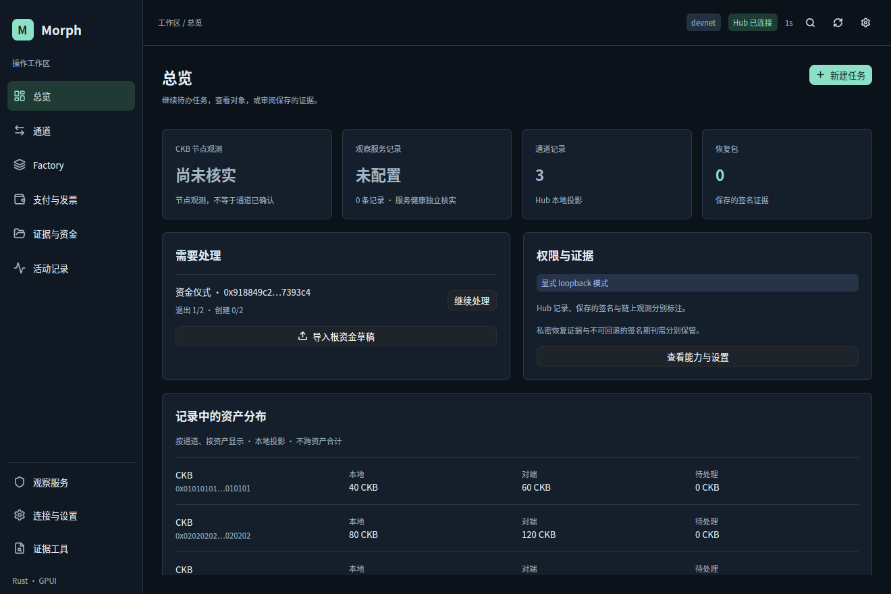

总览将 Hub 连通性、CKB 节点观测、观察记录和保存证据分别呈现。“尚未核实”保留为明确状态，不用一次 HTTP 读取成功代替链上确认。未完成资金仪式可直接继续；资产按通道和 Type 分别展示。

### 对象详情

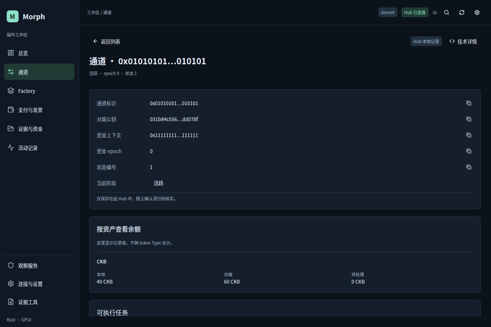

列表选择对象后，详情显示来源、资金上下文、状态编号和独立资产余额。完整标识可复制；从详情进入动作时自动绑定对象。技术 JSON 不再占据日常操作空间。

### 资金仪式与回执审阅

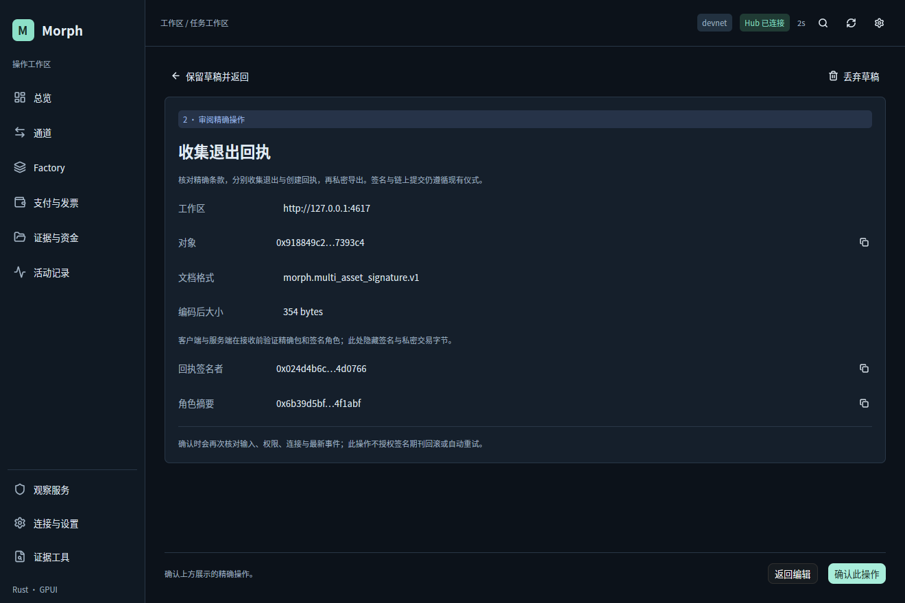

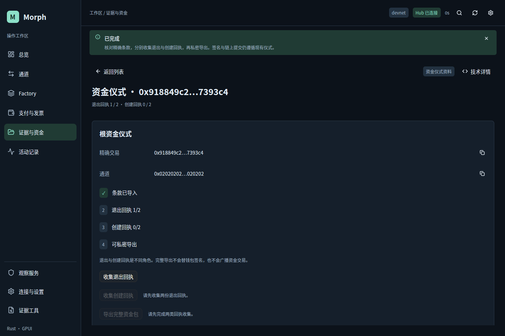

回执审阅展示签名者和角色摘要，客户端核对参与者及目标摘要，规范 SDK 与服务端执行实际签名验证。预览中确认一份已有公共退出回执后，进度变成 1/2。创建回执和完整导出保持禁用，旁边说明欠缺的前置条件。上述两张截图来自同轮稍早的预览构建；随后仅调整字段呈现等收尾。

### 窄窗口

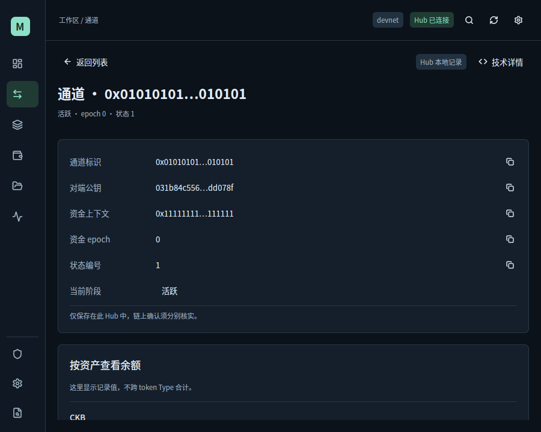

宽度小于 1050px 时使用有可访问名称和提示的图标导航；内容保持单列可滚动。1450px 及以上才允许技术详情侧栏，其他宽度使用专门视图。窗口最小尺寸为 780×580；本轮实际目检覆盖 1320×880 和 900×720，不声称全部尺寸和缩放组合通过。

## 3. 信息架构：围绕对象和任务

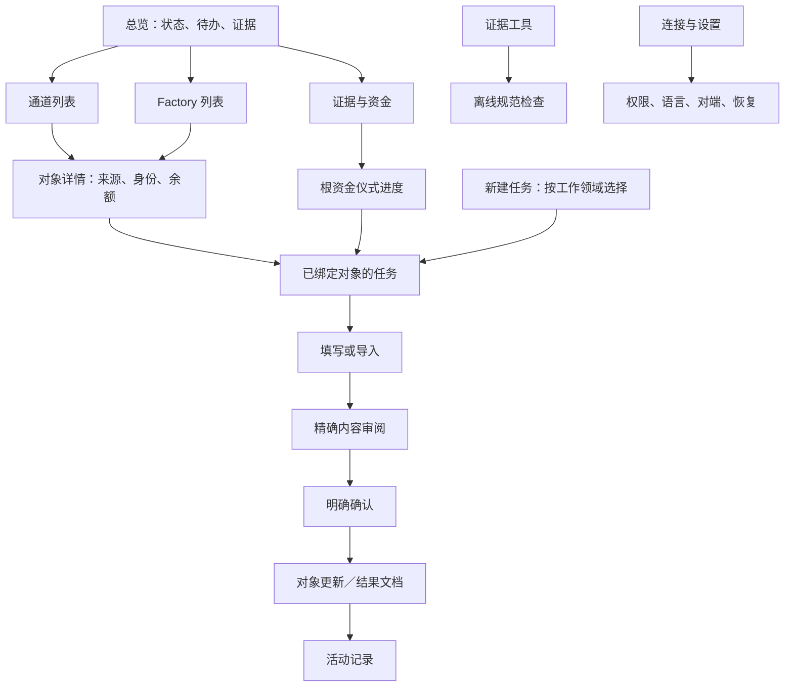

六个主入口是总览、通道、Factory、支付与发票、证据与资金、活动记录。观察服务、连接设置和证据工具位于辅助导航。对端管理收进设置。二十三项 API 工作流仍全部保留，但按领域归类；没有通过删除能力实现“简化”。

Hub 的记录操作使用“添加记录”“记录发布／终局”等与实际效果一致的措辞。它不是新钱包，按钮不暗示界面能够代替现有签名者、广播器或资金选择器。

## 4. 草稿和确认为什么需要重做

草稿的键是 `操作 + 对象`。同一通道的拼接表单不会继承另一个通道的资料；切换任务可以保留并返回，也可明确丢弃。最多保留 32 份草稿，达到上限时提示，不静默删除。草稿和敏感输入不写入磁盘，关闭进程即丢失，不能当作恢复备份。

确认绑定精确请求体、对象 ID、连接代次、endpoint 和最新事件编号。输入或工作区事件变化会立即使审阅失效，确认时再次检查权限、新鲜度和内容。对象绑定任务不提供偷偷改 ID 的输入框；选择其他对象会进入新上下文。

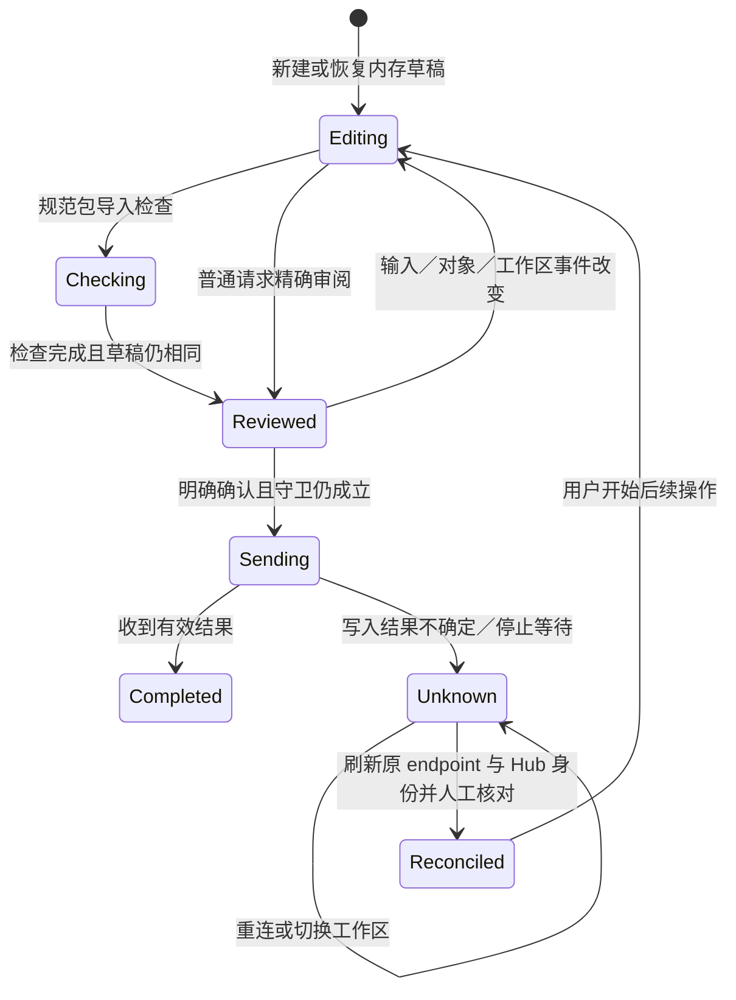

恢复工作区有单独流程：读取候选快照 → 服务端预览变化与策略 → 继续绑定同一候选、摘要、连接和事件的恢复确认。不要求用户手写 `confirmation_hash`。服务端的恢复开关和已有操作历史保护仍生效，工作区快照从来不等于签名期刊备份。

## 5. 异步、错误和未知写入

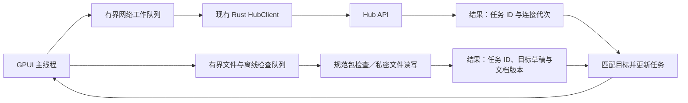

后台轮询只更新数据和连接状态，不再刷掉用户尚未读完的失败消息。成功提示短暂显示，失败与未知结果持续显示；任务历史保存对应对象、状态和说明。活动记录最多 200 条，原始输出文档仅保留最近八份，不是持久审计数据库。

文件解析失败留在文件或草稿附近，不把 Hub 变成离线。旧连接结果不能覆盖新连接；已切换任务或已编辑的证据不会被迟到检查结果覆盖。网络请求和文件处理使用同一工作器实现的独立有界实例，不在 GPUI 主线程执行 RPC 或磁盘 IO。

不确定写入仍不会自动重试。断开连接不清掉待核实状态；必须读取原 endpoint 且核对 Hub 身份，查看记录后明确确认已核对。停止等待只是停止本地等待，不能显示为“交易已取消”。服务端 Retry-After 只限制后续手动写入，不触发自动重发。

## 6. 金额、资产和证据

| 类型 | 当前呈现和规则 |
| --- | --- |
| CKB | CKB／shannons 可切换；十进制最多八位，通过 checked u128 精确换算，不用浮点数 |
| xUDT | 按完整 Type 身份区分；未知精度使用基础整数单位，不猜代币小数位 |
| 业务余额／reserve／pending／费用 | 分别展示，不跨资产相加；费用明确以 shannons 表示 |
| 标识与公钥 | 平时短显示，复制完整原值；任务确认仍使用完整身份 |
| 文件 | 名称、大小、schema 和导入关联；手改内容使原文件关联失效 |
| 私密原件 | 默认隐藏敏感内容；显式展示／复制，使用现有 owner-only 不可覆盖导出 |
| 审阅摘要 | 帮助理解规范检查结果，不是可恢复资金的原始证据包 |
| 本地记录／签名包／观察记录 | 各自有来源标签，不统一称为链上已验证 |

视图用于跟踪文件内容变化的内部指纹不是协议 commitment，也不代替密码学签名验证。根仪式以精确交易哈希定位，退出和创建是独立角色；收齐回执不表示钱包组已签名或资金交易已广播。

## 7. 视觉与原生交互

设计 token 集中到 `design.rs`：背景 `#0c121a`，面板 `#151f2b`，主文字 `#e3ecf4`，辅助文字 `#a4b5c6`，主动作 `#8ce0c8`。警告、失败、完成都同时有文本说明，不仅靠颜色。统一字号、圆角、边框和密度；图标只打包实际使用的 Lucide SVG，并组合 GPUI Kit 默认图标，修复仅引用枚举却未携带资源的空图标问题。

字体优先使用系统已安装的思源黑体，再选择 Noto CJK／平台中文字体。本机使用静态 Source Han Sans CN，修复此前中文可变字体在原生窗口中显得过细的问题。没有把截图字体选择误写成跨平台已保证结果。

中文默认，可在设置切换 English，偏好仅本会话。主要导航、字段、操作、禁用原因、状态和审阅文案集中维护；服务端或规范验证器返回的原始技术错误仍可能是英文。

| 快捷键 | 效果 |
| --- | --- |
| Ctrl K | 全工作区搜索 |
| Ctrl 1／2／3 | 总览／通道／Factory |
| Ctrl N | 新建任务目录 |
| Ctrl R | 读取最新记录 |
| Alt ← | 关闭详情 |

列表行使用可聚焦的原生按钮并提供可访问名称。Enter 与 Esc 不绑定全局金融确认，继续交给编辑器和输入法。本轮没有重新完成物理键盘 IME 或屏幕阅读器全流程验收；用户此前对中文输入正常的确认属于先前构建。

## 8. 审计发现逐项对应

| 审计项 | 本轮实现 |
| --- | --- |
| UX-01 来源歧义 | 连接、链观测、本地记录、签名证据分别标注 |
| UX-02 对象与动作脱节 | 详情上下文操作、根仪式进度、恢复预览直接继续 |
| UX-03 草稿串用 | 操作／对象隔离、保留／丢弃、文件来源失效处理 |
| UX-04 消息与错误混用 | 连接状态、任务活动、局部错误独立，轮询不覆盖 |
| UX-05 JSON 确认与失效不明显 | 结构化审阅，实时失效，提交时再次精确检查 |
| UX-06 资产与单位 | 精确 CKB 切换，Type 快捷项，未知精度不猜测 |
| UX-07 菜单扁平 | 六个主领域，辅助导航和领域任务目录 |
| UX-08 宽度竞争 | 分档导航，JSON 默认隐藏，窄屏独立技术视图 |
| UX-09 常驻连接表单 | 设置页集中输入，顶部只保留状态和常用控制 |
| UX-10 首页缺乏待办 | 未完成仪式、观察记录、资产分布与继续入口 |
| UX-11 文案和视觉粗糙 | 中英文人类标签、语义状态、统一 token 与字体图标 |
| UX-12 键盘与本地化 | 原生可聚焦按钮、任务快捷键、集中双语；辅助技术完整验收仍待做 |

“已实现”表示代码和当前预览已落地，不等于十二项经过完整验收。没有为了 UI 体验放松规范包验证、角色签名、期刊或服务端权限边界。

## 9. 文件组织与后续维护

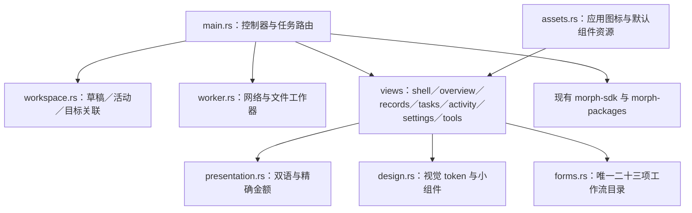

拆分是为了后续能独立修改领域视图、文案和任务路由，不再把所有页面堆进一个渲染函数。没有新增浏览器入口、JS/TS 包、兼容命令或第二份协议 schema。

## 10. 本轮验证范围与限制

实际执行：

- 多次仅用于预览的 `cargo build --locked -p morph-desktop`，最后构建成功、无警告；格式化了改动的原生 Rust 文件。
- 启动真实 Linux GPUI 窗口和独立的本地预览 Hub，通过应用限定的原生辅助接口导航、打开对象、填写公共回执、审阅并明确确认。
- 实际观察回执进度从 0/2 更新到 1/2，后续动作保持前置条件限制。
- 目检宽／窄窗口、字体、图标、来源和结构化审阅，保存实际窗口截图。

**按用户要求没有运行 make ci、workspace tests、desktop-check、CKB-VM、devnet、资格或发布 gates。** 新增的草稿／输入隔离与精确金额回归用例也未执行。没有主张网络故障、未知写入、全部二十三项工作流、恢复、所有辅助技术或其他系统已完成运行验收。

本轮没有发布或链上操作；提交与合并状态以 Git 记录为准。预览 Hub 使用旧的现有后端二进制；桌面使用当前工作区构建。此前 `d988c79` 的完整迁移验收仍只对应那个提交。以后恢复验收时，应针对当前源码重新建立证据，不能复制旧的“通过”状态。

## 11. 第二轮打磨：从“能操作”到可持续使用

在第一轮工作区重构之后，继续检查了次级页面和长内容。以下是第二轮新增的代码改动，不是只列建议。

| 断点 | 实际处理 | 原理与边界 |
| --- | --- | --- |
| 对象选择只取前 32 条 | 全量搜索、每页 8 条、匹配数量、前后分页 | 查询与页码按草稿隔离；35 条预览记录中的第 35 条可检索，不要求手填 ID |
| 选择对象前仍能填写，绑定后看似丢输入 | 先选对象，再出现任务字段 | 对象上下文先确定；高级手动 ID 仍显式提供 |
| 已有对象草稿重复预填 | 只有新建草稿才应用对象默认值 | 返回草稿保留用户改过的资产或输入，草稿达到上限时不误写旧任务 |
| 缺填只在总错误里提示 | 字段旁显示错误并聚焦首个字段 | 包括必填、整数、CKB 小数、Type、公钥形状及 preimage/hash 二选一；只是 UX 反馈，规范 SDK／服务端验证仍执行 |
| 丢弃容易误点 | 第一次显示说明，第二次明确确认；可继续保留 | 丢弃只处理内存草稿，不声称撤销已经提交的操作 |
| 文档没有方便的移除方式 | 每份文档有独立移除按钮 | 修改／移除继续使此前审阅与文件关联失效 |
| 三块 JSON 同时展开 | 主文档优先，辅助基础包／回执按需展开 | 收起时明确显示已载入数量，隐藏的辅助内容不会悄悄消失 |
| 文件迟到覆盖新编辑 | 选择器打开前固定输入版本，读取完成后比较版本 | 编辑变化则保留输入，把文件留作活动中的未检查原件 |
| 审阅后结果藏在表单底部 | 独立完成页，提供返回输入；短只读任务的执行入口放在内容旁 | 草稿内容保留，旧完成页不显示成一个可再次提交的审阅确认 |
| 写入后还留在通用表单 | 当前任务未切走时返回更新的对象或对应列表 | 目标由排队时的精确请求捕获，后续编辑不能改变结果归属 |
| 活动太难定位 | 全部／需要处理／处理中／已完成，加独立搜索 | 任务历史仍只在本会话；未知写入的阻断规则不变 |
| 审阅只显示几个哈希 | 独立资产 lanes、State carrier、参与者、条件和结算分配；长 token 数量单独占整行 | 只呈现规范检查结果；不能凭任意 JSON 的 `assets` 字段推导出已验证承诺 |
| 列表仍是难辨认的哈希 | 通道带已知对端名称及按资产余额 | 名称来自 Hub 对端记录，完整协议身份仍使用原 ID |
| 长 hex 编辑卡顿 | JSON 使用等宽字体，不自动折行；横向滚动 | 原始值不截断、不改协议字节；普通表单和中文说明保持原来的文字布局 |

### 第二轮实际窗口

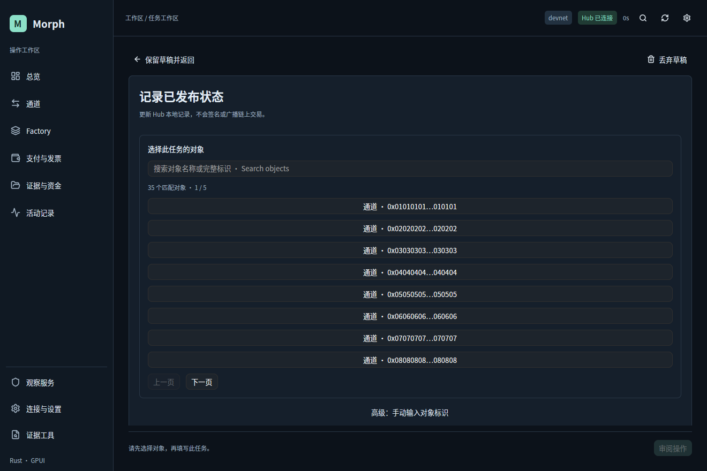

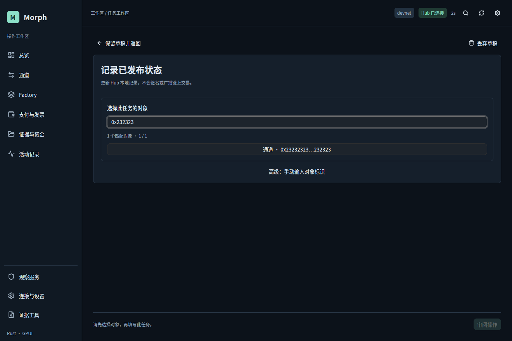

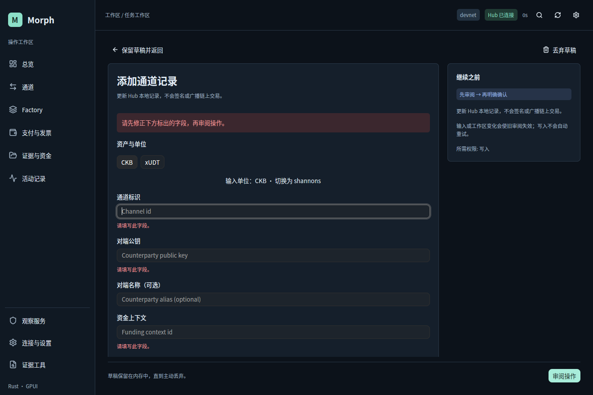

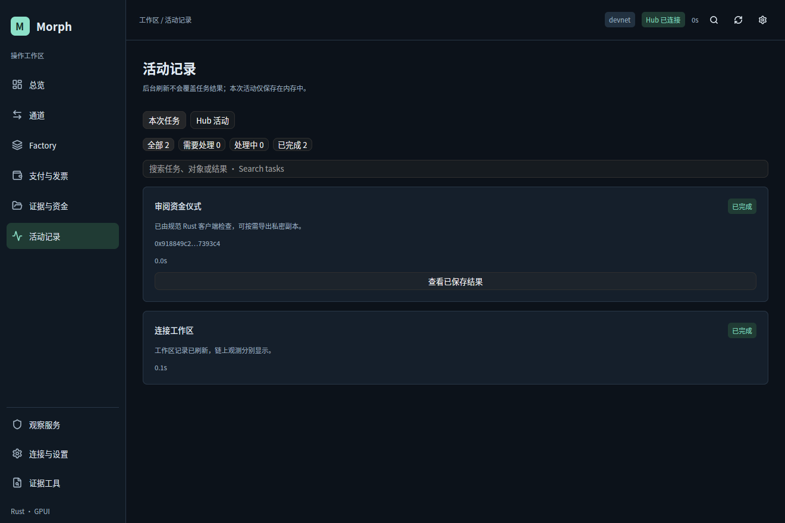

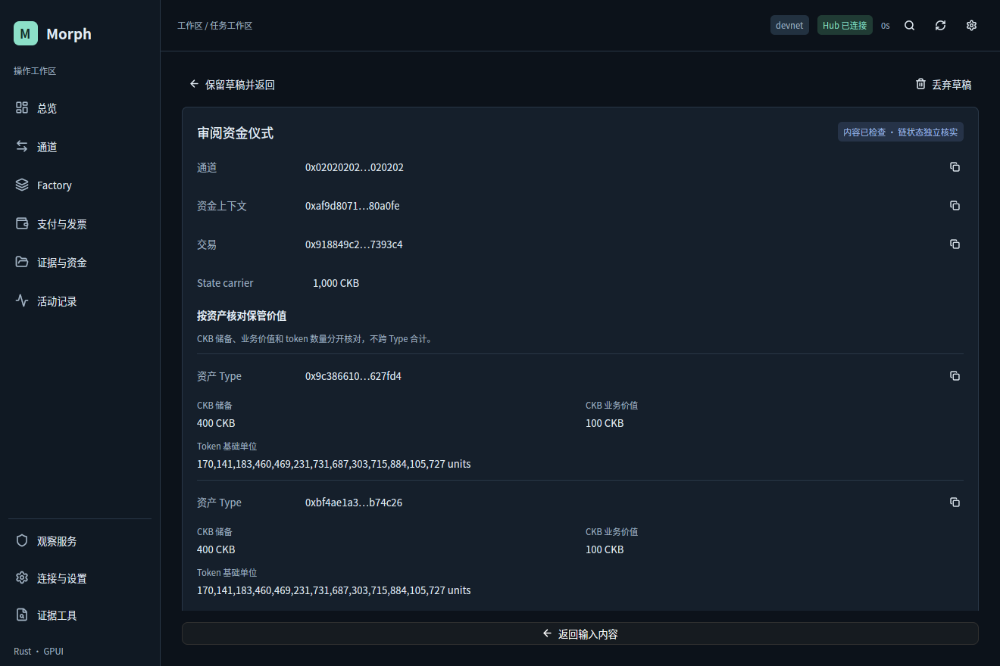

以上截图均来自本轮实际原生窗口。分页、字段和活动截图记录各自完成时的阶段构建；完成页使用第二轮收尾的桌面优化构建；文件回调同时核对草稿实体身份，丢弃后重建同名草稿不会接收旧文件回调。它们不是全量回归或跨平台资格证据。

### 文件与任务结果的归属

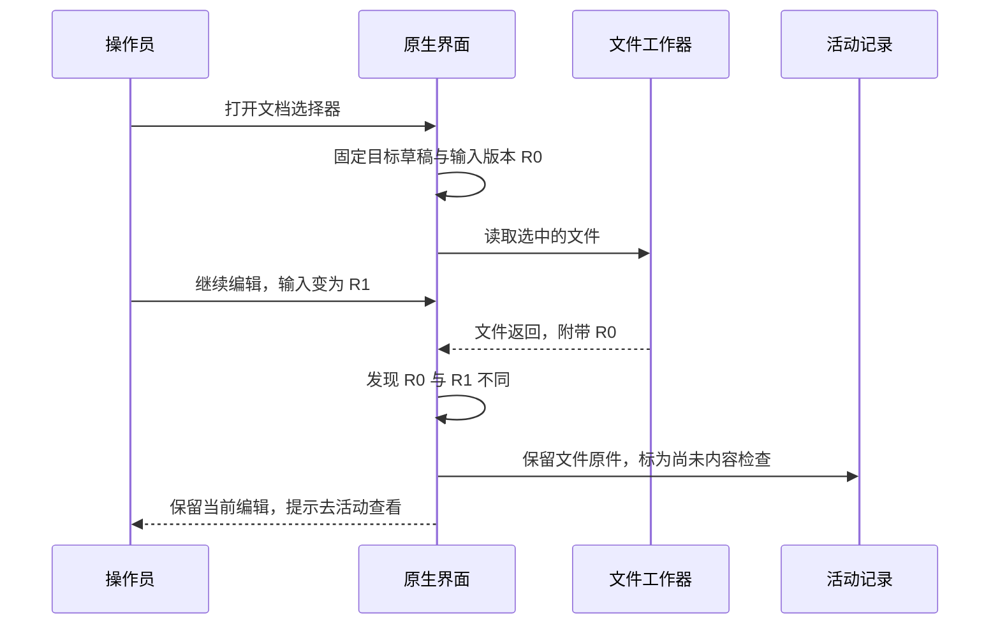

`validation.rs` 负责用户输入的即时反馈；`views/evidence.rs` 负责已经检查过的资产条款呈现。两者均不实现新的协议 parser 或签名授权。

### 第二轮验证范围

- 本地桌面预览构建通过，包括桌面专用 `--profile desktop` 优化构建；没有执行打包或发布步骤。
- 原生窗口实际检查了空字段提示、活动筛选、保留草稿确认、35 个对象的分页与检索，以及根资金审阅。
- 在优化构建的等宽、不折行编辑区，通过原生事件输入 5,958 字符公共根资金 JSON，之后完成规范离线审阅。未修改系统剪贴板。这个操作只证明该实际输入路径，不是最大 4 MiB 文档的性能证明，也不是物理 IME 测试。
- 预览过程中临时添加的对象都是隔离 Hub 本地投影，操作完成后还原预览状态；没有真实资产和链上交易。
- 完整 gates、单元测试、VM、devnet、故障注入、辅助技术全覆盖仍未运行。文件迟到保护等边界有代码检查，本轮不冒称全部时序已经实测。

本文记录实现与本地预览证据；提交与合并状态以 Git 记录为准。本轮没有发布，后续完整验收应基于这些源码重新运行。
