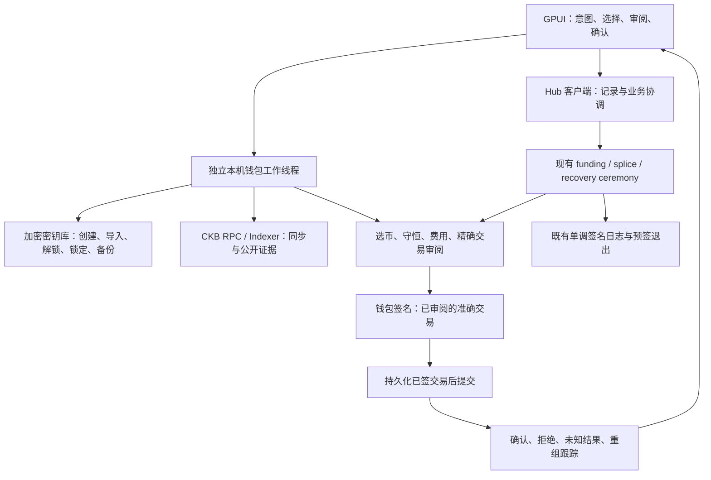
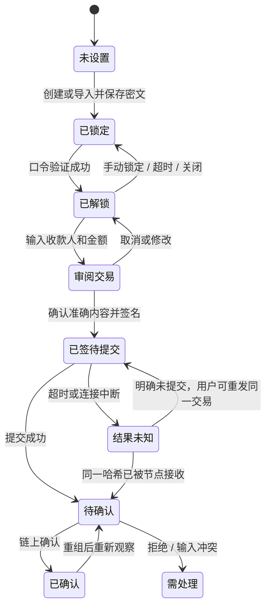
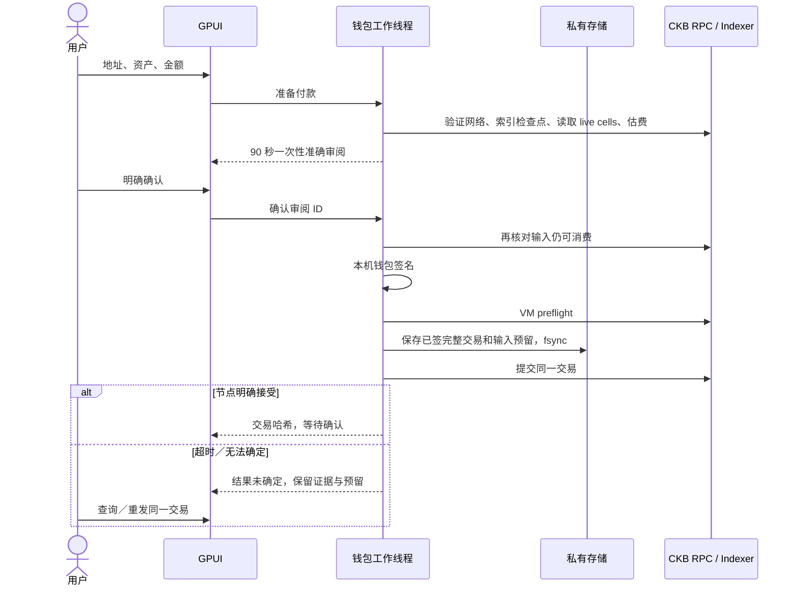
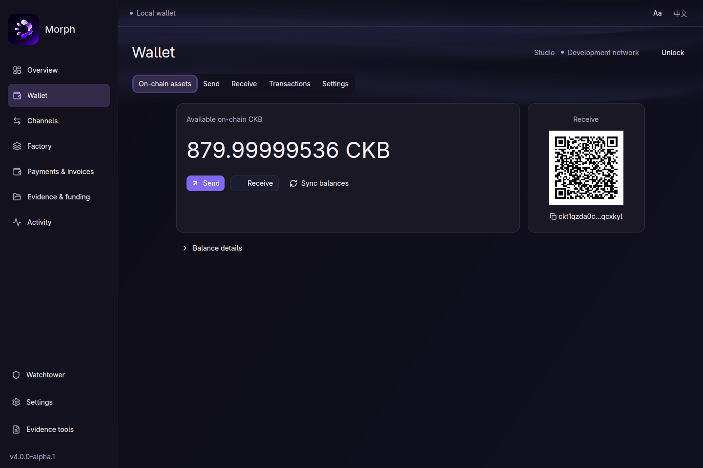
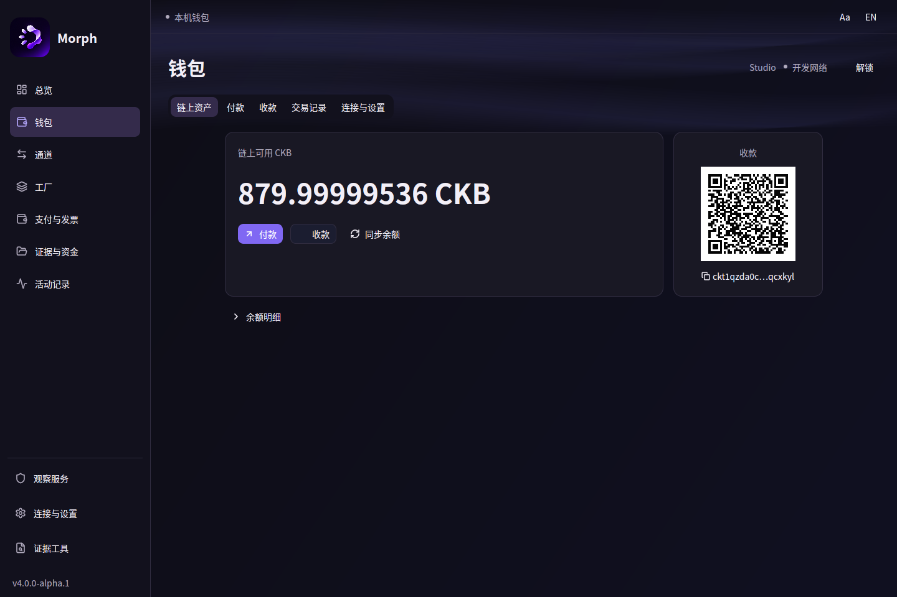
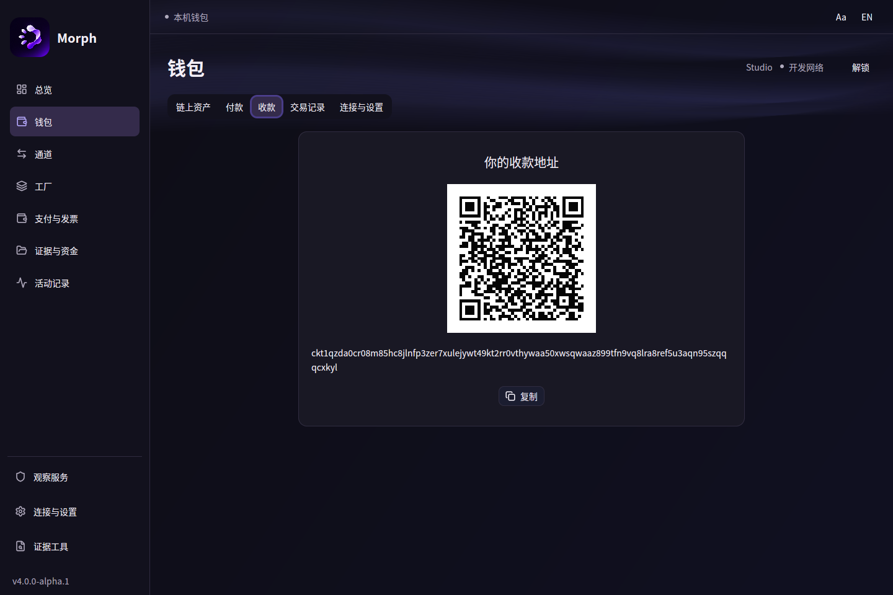
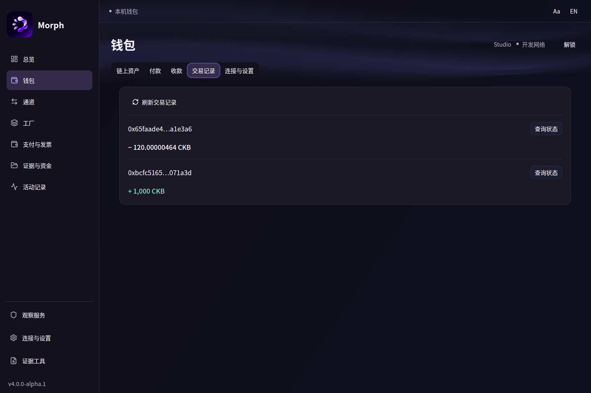

> 本轮布局、节点预设、滑动修复与真实展示脚本见 [2026-11-10 UI 优化](native-ui-refinement-2026-11-10.md)。本页截图已更新为该轮原生窗口。

# Morph 本机钱包与少输入交互方案

状态：2026-11-10，按用户最新要求实施。先完成本机自托管钱包，不优先硬件钱包／外部钱包。仅 Rust / GPUI，不新增 UI issues，不发布。本文件区分现有能力、设计决定与待完成实现，不将规划写成已交付。

## 为什么需要重新组织

当前 Hub 的 `POST /api/channels` 调用 `store.state.node.open_channel`，登记本地通道记录；它不是链上出资交易。当前桌面将该接口的 `channel_id`、`funding_context_id`、双方余额等字段直接暴露，这要求用户替程序组装上下文，且容易把登记误解为真正开通道。现有 native funding ceremony 已具备准确交易构造、预签退出、钱包签名及提交，但目前在 CLI 操作路径中；普通用户界面必须连接这些真实能力。

产品原则：用户选择意图与经济参数，程序收集与验证证据。不能随机生成“看起来合理”的资金上下文，不能把本地投影余额当作链上可花余额，不能替用户推断收款人或支付授权。

## 参考与采用范围

- [Fiber Studio](https://github.com/chukwuma619/fiber-studio)：参考首次设置、资产、收付、通道和节点任务的组织；它包装真实节点，不把表单提交等同于链上确认。其 [资产页面后端](https://github.com/chukwuma619/fiber-studio/blob/main/app/src-tauri/src/commands/assets.rs) 分开读取链上钱包余额和通道合计。Morph 也必须分开呈现两者。
- [Fiber Dashboard](https://github.com/nervosnetwork/fiber-dashboard/blob/master/README.md)：参考节点、通道状态、按资产统计及容量分布。该仓库的公开 API 主要为网络观察，不作为完整钱包签名实现的依据。
- 两者均仅参考产品流程与职责；不引入其 JS/TS 栈，也不把 Fiber 通道／发票格式当成 Morph 格式。

## 主界面与默认路径

| 用户要做什么 | 正常路径所需输入 | 程序提供 | 高级内容 |
|---|---|---|---|
| 建立钱包 | 创建或导入、钱包名称、解锁口令、备份确认 | 地址、锁脚本、公钥、本机密文存储 | 原始锁脚本、导出格式 |
| 收款 | 资产、可选金额／备注 | 当前网络地址、二维码、复制反馈 | Type hash、原始请求 |
| 链上付款 | 收款地址、资产、金额 | 地址网络检查、余额、选币、找零、占用容量、费用估算 | 指定输入、费用上限、精确交易 |
| 创建 Morph 发票 | 金额、可选备注 | 资产与通道候选、有效期、密码学随机付款秘密 | 显式 hash、指定通道、有效期 |
| 支付 Morph 发票 | 粘贴或导入发票 | 解析收款人、网络、资产、金额与到期状态；查找可执行路径 | 路由与条件详情 |
| 开通道 | 对端、资产、自己投入金额 | 自己身份、可用输入、找零、预签退出、资金上下文、仪式状态 | 对端出资、保留容量、挑战策略等 |
| 管理 Factory | 成员选择、资产、初始分配 | 已知成员、合计、容量地板及退出约束 | 权益证明与原始操作包 |
| 关闭／回收 | 选择对象与确认 | 已保存最新包、成熟时间、可执行操作及手续费 | 原始包、交易与诊断 |

找不到可靠来源时，显示“需要补充”的具体原因。只有一个合法候选时预选；多个候选时要求选择；保留覆盖来源与重新审阅。高级字段默认折叠，错误发生在高级字段时自动展开并定位。

## 后端分层

钱包私钥不进入 Hub HTTP 请求、日志、页面结果、通用 JSON 导出或子进程参数。钱包只拥有链上钱包签名职责，不能绕过双方／Factory 签名，不能在 UI 内另建通道签名权威。后台耗时工作不阻塞 GPUI。

### 本机钱包完整交付范围

1. 创建、受保护文件导入、加密备份／恢复、解锁／锁定与口令变更；错误口令和损坏文件不得修改原钱包。
2. 当前网络地址与二维码；网络配置有 genesis 身份校验，不能仅凭“testnet”标签信任任意 RPC。
3. CKB 与明确支持的 xUDT：链上总容量、占用容量、可用容量、代币数量分别展示；金额全程整数，不将不同资产相加。
4. 有界 Indexer 分页与公开交易记录，处理节点断开、索引滞后和重组；未完成同步不显示为确定可花余额。
5. 转账预览、选币、费用、找零、占用容量、签名、提交与确认；未知提交结果按精确交易哈希对账，不能自动重新构造另一笔付款。
6. 钱包与通道出入金衔接；必须先拿到准确交易对应的完整退出授权，才能签钱包出资。真实单方恢复使用既有包和脚本。
7. 正常模式仅展示用户决策；专业诊断保留但不占据主流程。中英文、可调字号和键盘可访问性贯穿全部页面。

### 钱包状态与交易状态

## 视觉增强预算

允许持续极光和数据节点图，但仅在前台可见区域运行；输入、表单与签名确认不依赖装饰动画。极光采用独立缓存绘制层、低分辨率／低频更新；节点图必须来自实际数据，采用裁剪、聚合和静止布局缓存，不能编造“网络活跃度”。减少动态效果时完全静止。

真正液体玻璃意味着背景采样、模糊／折射与正确合成；简单透明面板或渐变不能冒称实现。先核验当前 GPUI 渲染接入能力和实测帧预算，再决定可交付范围；不为特效升级整套已固定的 GPUI 依赖。默认视觉保持文字对比度，模糊不得参与金额／地址的可读性。

## 实施与验收顺序

| 次序 | 交付 | 核心证据 |
|---|---|---|
| 1 | 导航、字体、双语、键盘与草稿交互收尾 | 原生几何矩阵、错误和输入事件测试 |
| 2 | 本机钱包核心与独立后台边界 | 密钥库负测、地址／签名向量、选币与逐资产守恒 |
| 3 | 钱包 GPUI 与有界 RPC 同步 | 创建／导入／备份／收款／发送的完整真实路径 |
| 4 | 简化任务与前后端推导 | 全部常用流程不再要求手抄 ID、hash、输入或找零 |
| 5 | 真实通道资金仪式衔接 | 先退出后出资、准确交易审阅、提交与重组恢复 |
| 6 | 视觉增强与性能回归 | 原生截图／录制、空闲与活动 CPU、交互延迟，未测量项如实记录 |

本轮不运行全库协议 gates；钱包新安全边界与交易实现需要针对性测试，不能以“不跑 gates”跳过选币、签名和持久化验证。

## 2026-11-10 实施检查点

| 范围 | 当前状态 | 实际边界 |
|---|---|---|
| 本机密钥库、创建、受保护文件导入、加密备份恢复、锁定、口令变更 | 已实现 | Linux；一个标准 secp256k1 密钥，不是 HD／助记词账户体系 |
| 网络身份、地址／二维码、CKB／代币余额 | 已实现 | 固定 genesis；当前完整 Bech32m 地址；代币需明确导入部署定义 |
| 真实 CKB／xUDT 付款 | 已实现并经节点确认 | 手续费估算、逐资产选币、占用容量、准确审阅、持久化后提交 |
| 交易记录、查询、精确重发 | 已实现基本路径 | 自动读取首批、逐资产净变化、方向与费用；最多 200 条；没有替换提费／取消／自动放弃输入预留 |
| 发票少输入流程 | 已实现 | 金额＋可选说明，钱包先保存加密随机秘密；hash、到期与通道绑定放在高级选项 |
| 其他常用表单 | 部分优化 | 对端候选、对象上下文和唯一资产可带入；不能把技术记录接口冒充真实开通道 |
| 通道／Factory 钱包出入金 | 尚未接入桌面 | 须复用现有精确交易与预签退出仪式，不能另写宽松签名路径 |
| 双语、16px 默认字号、Logo、稳定页签和错误定位 | 已实现并有原生测试 | 覆盖中英和 90%／100%／150% 字号、小窗口 |
| 常驻极光 | 已实现 | 独立缓存子视图、三组低透明 Bézier 曲面、44 秒周期、20 Hz 上限；非活动／减少动态效果时静止 |
| 大规模真实网络图、液体玻璃 | 未实现 | 当前没有自定义折射渲染；不将渐变宣称为玻璃 |

### 钱包签名为何与通道签名分离

这条路径只涉及普通钱包资产。通道出资还需要双方独立、持久化的初始退出授权与单调日志，不能因为钱包已解锁便跳过。钱包备份包含密钥密文、加密发票秘密和公开交易证据；它不是通道签名日志备份。

### 已通过的检查

- 桌面专项：21 项；钱包单元：10 项；Clippy 对两个 crate 的全部 targets 以 `-D warnings` 通过。
- 账单按实际输入／输出计算本钱包净变化；不把找零显示成收入。补充测试核对真实 CKB 收入、xUDT 支出与费用。每批最多 10 笔、每笔最多 64 输入／128 输出、总读取预算 30 秒；特殊 header-dependent 交易不推断费用，不支持的数据不显示部分代币合计。
- 隔离 CKB 0.209.0 节点（RPC `127.0.0.1:18314`）：两项真实链测试通过。CKB 收款方收到准确 100 CKB；代币收款方收到 250 基础单位，钱包总余额与选中输入找零分别守恒。备份恢复保留相同地址、加密发票秘密和已签交易记录。
- 本次 CKB 交易：`0x1d9d21398fd64eaca2853c86403481c8fc18eef5902696c77d9c201690597ae4`。
- 本次 xUDT 交易：`0x0a889ba19f6bc3d454ebac4ed169794bba88e866d0caf7eb6f0a3401fe4d2f8c`。
- 重复运行测试曾暴露“选中输入必然为本次铸造的 1000 单位”的错误假设；修正后按实际已签输入计算找零，同时验证钱包总额和收款方。补充账单校验后的最后一次选择先前的 500 单位输入，付款 250、找零 250，合法且守恒。

上述交易属于隔离开发链，不是公共网络证据。没有运行完整协议 gates、没有修改合约边界、没有新增 UI issue，也没有提交、推送或发布本轮改动。原生画面与性能记录另列，帧率未测量时不宣称稳定 60 FPS。

### 原生画面与开销

优化构建 `cargo build --locked -p morph-desktop --profile desktop` 通过。下面是 1440×960、100% 字号的实际窗口；显示的是已创建、加密保存并在隔离开发链收到 1,000 CKB 的钱包，不是 Hub 投影余额。

专项结果、源文件 SHA-256 与优化二进制 SHA-256 保存在 [verification.json](uiux/wallet/verification.json)。这记录的是未提交工作区，不是发布产物认证。

同一优化进程的 8 秒 CPU/RSS 采样：

| 窗口状态 | CPU 时间 | 单核占用 | RSS |
|---|---:|---:|---:|
| 前台收款页，极光开启 | 0.48 秒 | 6.00% | 161,208 KiB |
| 窗口隐藏 | 0.08 秒 | 1.00% | 161,208 KiB |

前台样本前后均核对 `_NET_ACTIVE_WINDOW`；隐藏样本前后均核对 `_NET_WM_STATE_HIDDEN`。原始记录见 [runtime.json](uiux/wallet/runtime.json)。这证明该次采样中的隐藏开销明显降低，不构成 GPU 帧时间、输入延迟、低端设备或 60 FPS 保证。没有修改 GPUI 固定版本或供应链源码。
