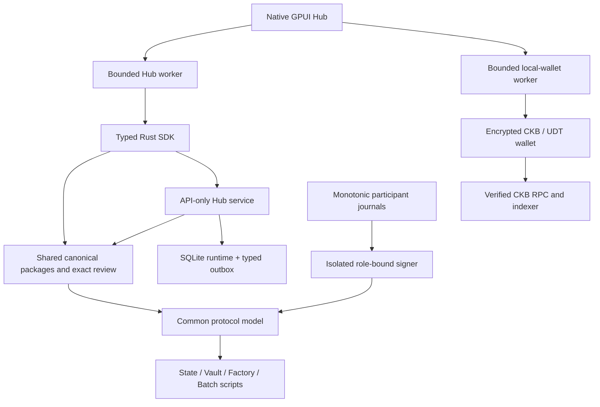

# Morph Channel 4.1.0

**Version:** `4.1.0` · **tag:** `v4.1.0` · **GitHub title:** `Morph Channel 4.1.0`.
Host workspace, SDK and Hub versions advance together. The nine internal contract
crates retain `0.1.0`; the actual wire versions and ELF hashes identify their
executable protocol. This follows the repository’s leading-v three-component
version/tag and product-title convention.

This release covers the major evolution **since 3.0**, not just the latest
resource patch: one custody foundation, multi-asset conditions, the rebuilt native
Hub/wallet, durable runtime/signers, cooperative close and bounded recovery.
The current deployment scope remains **controlled devnet, no real assets**.

## From 3.0 to 4.1

| Milestone | Main change | Why it matters |
| --- | --- | --- |
| 3.0.0 — 2026-08-25 | Bounded conditional CKB Batch settlement, preimage/refund and enforceable fallback | A payment condition becomes script-enforceable evidence, rather than only an invoice or application status. |
| Pre-alpha 4.0 model — 2026-11-04 | Independent 318-byte State, complete multi-Vault custody, multi-asset Factory and exact root/splice funding contexts | State authority is separate from asset custody; each Type conserves its own quantities. This was a source milestone, not a separate published `v4.0.0` tag. |
| 4.0.0-alpha.1 — 2026-11-05 | Shared-foundation Option C, current reduced rights/physical operations, independent Factory journals and private child exits | CKB, one token and many tokens share one channel implementation; Factory rights remain a distinct authority. Retired formats are removed rather than kept in parallel. |
| 4.1.0 — 2026-11-12 | Native Rust Hub/wallet, typed runtime/API/signer boundaries, exact cooperative close, asset-bound UDT conditions, nonforwarding Fiber shadow and compact resource execution | The application, recovery and operational layers catch up with the common custody model while preserving their separate permissions. |

Full history: [CHANGELOG](../../CHANGELOG.md) and
[3.0 → 4.1 source comparison](https://github.com/Morph-Channel-Network/Morph/compare/v3.0.0...v4.1.0).

## Protocol: one custody model, explicit capabilities

The sole bilateral State is 318 bytes, layout 2, descriptor 7. It commits a
complete set of 1–8 exact Vault OutPoints and independent per-asset values. One
asset is simply a one-entry current manifest. Separate participant signatures,
State authority, Vault value and outside fee funding are not collapsed into a
single wallet permission.

Root funding collects a complete bound initial exit before broadcasting. Splice
binds the full raw transaction, future creation and initial exit before the old
context is irreversibly reserved. Canonical confirmation hands off the same
journal path; withheld receipts, orphaned transactions and restart cannot create
another signer authority. Retired codecs, old JSON aliases and alternate old
funding paths are gone.

Factory State is 306 bytes with 2–16 sorted members. Full consent authorizes
root/metadata/custody/materialisation; exactly one touched member can perform
localized reduced rights/deposit/release/child operations backed by appropriate
claims. A child can have parties outside the parent roster and becomes an
independently recoverable bilateral channel. It does not need the parent to stay
alive. Shared last reserves and the collective carrier still require full consent.

### Conditions and terminal close

One signed state supports **1–8 asset-sorted Batches, each with 1–8 transfers**.
CKB conditions consume only business capacity; UDT conditions consume only the
exact Type’s u128 quantity and preserve the signed capacities. Fulfill uses
SHA-256 or CKB-personalized Blake2b; refund uses canonical absolute block height.
Unchanged mature Batches may remain during fixed-context consolidation. Edited
or new-context terms still require fresh bounded deadlines.

Terminal settlement consumes the whole authentic custody set. Each conditional
asset becomes an independently spendable Batch, with complete decisions and exact
two-party payouts. Batch args bind channel, funding context, state number and
asset-bearing terms. Batches resolve separately; another asset cannot reuse the
canonical input/output positions.

`MORPHMC!` adds exact-transaction cooperative terminal close without waiting out
the challenge window. Its signatures are distinct from ordinary state votes;
reservations, fee replacements and source-consumption races remain durable.
Native preparation, fee-wallet signing, keyless submit/status/export and canonical
reconciliation are implemented. Generic transaction scheduling, generic RBF and
all future close GUI/API adapters are not claimed.

## Hub reconstruction: native application, shared contracts, separate authority

The Hub is no longer a browser frontend bundled with a server. It is a native
GPUI application, a bounded typed Rust SDK and a separate API-only Rust service.
JavaScript/TypeScript, React/Vite, Node/Bruno runners, browser/static serving and
the previous Agent name are retired. The application gateway is
**Morph Payment Gateway** (`morph-payment-gateway`).

| Layer | What changed | Preserved boundary |
| --- | --- | --- |
| Public contract | `morph-hub-api` owns DTOs/errors; schemas generate from Rust; decimal-string counters/amounts and canonical hex remain exact | Private runtime snapshots never become public API types |
| Packages / SDK | `morph-packages` owns codecs and review; `morph-sdk` owns bounded authenticated transport and stateless inspection | Inspection never reserves a state number or creates signing authority |
| Desktop tasks | Contextual object selectors, retained drafts, progressive disclosure and exact review/confirm replace giant engineering forms | Source freshness, role, endpoint and request identity remain checked |
| Local wallet | Create/import, encrypted backup/restore, receive addresses/QR, CKB/UDT transfers, fee review, balances/history and public/local/custom RPC/indexer settings | Wallet keys cannot sign channel states or authorize a Factory |
| Native UI | Warm blue-purple palette, supplied brand, live Chinese/English, 90–150% text scaling and adaptive layout | User text and exact amounts survive locale/scale changes |
| Interaction / motion | Real-geometry navigation rails, interruption-safe retargeting, bounded cached aurora and reduced-motion behavior | No replay-animation button, fake progress, injected balances, simulated network graph or claimed liquid-glass shader |
| Asynchronous work | Independent bounded workers and revisions prevent late results from overwriting a different task | An ambiguous write stays unknown until explicit same-source reconciliation; no blind retry |
| Distribution | Native Linux bundle carries exact dependency sources, modifications and notices | No hidden WebView/Node runtime; other desktop platforms remain unqualified |

The real wallet showcase is a script that starts its own development node and
executes actual funding and a 120-CKB transfer. It is not a demo-data mode in the
product. The authoritative [native guide](../native-desktop.md) now consolidates
the superseded UI plans/review documents and preserves current native screenshots.
The [wallet runbook](../runbooks/local-wallet.md) records its practical limits.

## Runtime, operations and Fiber boundary

SQLite families commit state revisions, exact recovery intents and typed outbox
references atomically. External effects are recorded before broadcast; durable
attempts and canonical reconciliation distinguish observed, committed and
finalised outcomes. Business stores, immutable signed packages and monotonic
signer journals have different recovery rules.

Private-key input uses protected files. The Linux participant signer owns the
key and independently reviews the existing journal under an explicit role;
reservation → fsync → isolated signing → verified record → fsync remains intact.
Timeout or lost response does not release an old reservation. Full-store rollback
still requires an independent freshness boundary; local hashes/fsync alone do
not establish it.

Watch cursors bind canonical hashes and restart from a retained creation-era scan
origin after reorg. Supervision/readiness/metrics are bounded and scoped; process
liveness does not authorize mutation. Public events carry safe references rather
than private signing bytes, keys or preimages. Request-level experiment admission
tracks permitted shapes without turning operator policy into consensus.

Fiber integration includes a pinned external-edge hook and canonical
**nonforwarding shadow service**, with process restart, journal-busy, source-spent
and reorg evidence. Morph deliberately does not implement routing. Existing
Gateway traffic on a Fiber route is not proof of live Morph-backed forwarding;
future routed/MPP/provider-loss work must also handle independent clocks and
conditional recovery.

## Resource improvements and current encoding

| Measured fixture | Cycle change | Byte change |
| --- | ---: | ---: |
| Eight assets / 64-condition terminal | −69.67% | −3.29% |
| Maximum ordinary cooperative close | −45.32% | −3.11% |
| Eight-token splice replacement | −41.86% | −0.51% |
| Full Factory, 8 assets / 4 children / 16 members | −2.21% | −28.80% |
| Reduced child, same maximum dimensions | −5.99% | −31.13% |

Validated views replace repeated full parsing. Canonical Script dictionaries
remove duplicate transmission, actual counts replace unused condition slots,
precomputed defaults preserve the sparse root, and mandatory immutable StateType
validation avoids repeated full close/splice checks. Independent domains,
signatures, conservation, custody and complete private recovery stay intact.
Small full-consent paths can be slightly more expensive; budgets were not raised
to hide that. Eight ELFs total 807,592 → 742,920 bytes.

| Boundary | Sole current version |
| --- | --- |
| State / descriptor | Layout 2 / descriptor 7, 318 bytes |
| Custody encoding | 2, checked sorted Script dictionary |
| Conditional terms | 5, `221 + 92*n` bytes |
| Conditional trailer / resolution | 3 / 3 |
| Conditional public package | `morph.conditional_batch_package.v3` |
| Batch args | 104 bytes |
| Factory materialisation / reduced frame | FM 2 / FR 2 |
| Authority code selection | Immutable data-hash modes; native deployment Data1 |

[The cost report](../model-resource-optimization.md) separates VM fixture maxima,
real-wallet preflight, bytes, execution, recoverable capacity, transaction fees,
routing fees and dated CKB/USD/CNY prices. Fiber source-derived sizes are not
claimed as fresh Fiber cycles measurements. See [ADR 008](../adr/008-bounded-cost-and-current-encoding.md).

## All closed GitHub issues

The repository had **21 closed issues** at the release snapshot. Every one is
listed below, including work first delivered in 4.0 alpha. The title/status/date
snapshot and scoped delivery summaries are also [machine-readable](v4.1.0-closed-issues.json).
Closed PRs are separate from issue counts; the main Hub integration was merged
in [#59](https://github.com/Morph-Channel-Network/Morph/pull/59), followed by
[#61](https://github.com/Morph-Channel-Network/Morph/pull/61).

Issue closure describes its accepted boundary. It is not a claim that all future
integrations, hardware backends, production assets or independent attestations
are complete.

| Issue | Delivered scope | Remaining distinction | Reference |
| --- | --- | --- | --- |
| [#15](https://github.com/Morph-Channel-Network/Morph/issues/15) Factory materialisation: separate public intent from private child exit packages | Separate public Factory intents/possession receipts from private child exits; preserve owner-only delivery and recovery artifacts. | Child exit signatures never enter parent public requests. | [Factory model](../multi-asset-channels.md) |
| [#16](https://github.com/Morph-Channel-Network/Morph/issues/16) Signing CLI: remove private keys from argv and support protected key input | Remove participant/wallet private-key argv and raw-secret environment entry points; use protected key files. | Protected input is currently Linux-specific; no insecure fallback. | [Key input](../runbooks/key-input.md) |
| [#18](https://github.com/Morph-Channel-Network/Morph/issues/18) Factory contracts: harden delegated verification and cross-script-group invariants | Harden delegated contract validation, authentic authority selection, complete custody and cross-script-group negative cases. | Delegation authenticates mandatory immutable code; it does not omit physical conservation. | [ADR 008](../adr/008-bounded-cost-and-current-encoding.md) |
| [#19](https://github.com/Morph-Channel-Network/Morph/issues/19) Factory signers: implement independent durable journals and private exit delivery before approval | Independent durable Factory member/child journals, crash-safe signature reservation and private exit delivery before parent approval. | Possession attestations rely on honest child persistence; they do not prove everlasting data availability. | [Factory model](../multi-asset-channels.md) |
| [#20](https://github.com/Morph-Channel-Network/Morph/issues/20) Factory CLI: implement native multi-asset creation, activation, and materialisation submission | Native Factory root, activation, metadata, retained/terminal materialisation, wallet funding, keyless submission and child recovery. | Actual admitted shapes remain narrower than all parser maxima. | [Factory capabilities](../factory-multi-right.md) |
| [#21](https://github.com/Morph-Channel-Network/Morph/issues/21) Deployment policy: qualify one current custody envelope and explicit admission limits | One current custody envelope with exact-request admission, lifetime reservations and canonical/reorg-aware accounting. | Controlled no-value scope only; owner removed external-operator/external-record prerequisites. | [Envelope](../preproduction-envelope.md) |
| [#24](https://github.com/Morph-Channel-Network/Morph/issues/24) Supply chain: upgrade the RustCrypto signing stack and remove the RUSTSEC-2026-0387 waiver | Upgrade RustCrypto signing and Biscuit; remove the two resolved crypto advisory waivers. | The deprecated vulnerable stack is not retained as a compatibility path. | [RustCrypto upgrade](../rustcrypto-upgrade.md) |
| [#25](https://github.com/Morph-Channel-Network/Morph/issues/25) Supply chain: upgrade CKB dependencies and the toolchain to close faster-hex and removable legacy waivers | Upgrade CKB dependencies and Rust 1.95 toolchain; record reviewed vendor patches and remove obsolete waivers. | The documented upstream rand 0.7 waiver remains; closed does not mean zero waivers. | [CKB/toolchain upgrade](../ckb-toolchain-upgrade.md) |
| [#28](https://github.com/Morph-Channel-Network/Morph/issues/28) Current capability bounds: qualify admitted joint exits and retained floors | Qualify bounded admitted exits, claim backing, payout geometry, retained floors and exact resource shapes. | Not a proof every arbitrary legal rights allocation/asset topology can independently liquidate the last floor. | [W1 completion](../w1-completion-2026-11-11.md) |
| [#29](https://github.com/Morph-Channel-Network/Morph/issues/29) Runtime storage: add a transactional boundary for coordinated node state | Introduce transactional SQLite runtime families, revisions and atomic exact intent/outbox updates with current-schema validation. | A runtime database or its backup never replaces the monotonic signer journal. | [Runtime store](../runbooks/runtime-store.md) |
| [#31](https://github.com/Morph-Channel-Network/Morph/issues/31) Signing: add a role-bound external signer protocol and isolated implementation | Provide role-bound participant signer review and bounded private Linux IPC with timeout/lost-response/crash recovery. | Existing reservations survive uncertainty; no automatic local-key fallback or hardware-wallet claim. | [Participant signer](../runbooks/external-participant-signer.md) |
| [#32](https://github.com/Morph-Channel-Network/Morph/issues/32) API: versioned public Rust types, checked schemas and Rust clients | Make public Rust DTOs/errors authoritative; generate checked schemas and reuse typed SDK/GPUI contracts. | The earlier TypeScript-output proposal was superseded by the owner’s Rust-only client decision. | [Hub API](../hub-api-mutations.md) |
| [#35](https://github.com/Morph-Channel-Network/Morph/issues/35) Observability: add bounded metrics and mutation readiness separate from liveness | Bound observability and authenticated mutation readiness independently of process liveness, with scope/freshness checks. | Readiness is neither signer authority nor a guarantee of pooled failover. | [Readiness](../runbooks/service-readiness.md) |
| [#37](https://github.com/Morph-Channel-Network/Morph/issues/37) Fiber bridge: implement the external-edge hook and canonical shadow-mode service | Implement pinned Fiber external-edge hook and canonical, durable nonforwarding shadow coordination/service. | Diagnostic mirrors do not route payments or create liquidity/settlement evidence. | [Shadow service](../runbooks/shadow-service.md) |
| [#43](https://github.com/Morph-Channel-Network/Morph/issues/43) Verification: require bounded parser fuzzing and real-process crash recovery gates in CI | Add bounded parser/mutation, real-process crash/recovery and I/O fault evidence with reproducible budgets. | 780,000 bounded host mutations are not VM executions, coverage-guided proof or a universal security claim. | [Verification campaigns](../runbooks/verification-campaigns.md) |
| [#44](https://github.com/Morph-Channel-Network/Morph/issues/44) Release evidence: publish a versioned machine-checked node and integration manifest | Bind source, schemas, node/Fiber identities, ELFs, policy, client bundles and per-gate receipts in machine-checked evidence. | Previous candidates retain their own identities; skipped/stopped runs are not relabelled passes. | [Integration evidence](../runbooks/integration-evidence.md) |
| [#46](https://github.com/Morph-Channel-Network/Morph/issues/46) Factory reduced rights: qualify native publication through the sole current capability | Publish current one/four/ten-right reduced updates through native prepare, independent signing, funding and proof refresh. | Uses the sole compact current frame; no parallel historical reduced protocol. | [Factory capabilities](../factory-multi-right.md) |
| [#51](https://github.com/Morph-Channel-Network/Morph/issues/51) Accepted: explicit bilateral cooperative terminal close | Implement exact-body bilateral cooperative terminal close, retained replacement attempts, source races and conditional/child recovery. | Native CLI consensus/signing/operation scope is implemented; generic send/RBF and all UI/API adapters are not implied. | [Cooperative close](../runbooks/cooperative-close.md) |
| [#55](https://github.com/Morph-Channel-Network/Morph/issues/55) Double-spend review: qualify typed capabilities, freshness, signer rollback and exact custody | Review current typed authority, exact custody, roles, stale settlement, replay and rollback assumptions; bind acceptance to source. | Local hashes/fsync cannot detect rollback of the entire authority store without independent freshness. | [Boundary matrix](../verification-boundary-matrix.md) |
| [#56](https://github.com/Morph-Channel-Network/Morph/issues/56) Funding: retire obsolete shapes and enforce initial-exit recovery on the sole current path | Retire obsolete funding shapes; require complete initial exits and support withheld-receipt, offline recovery and exact orphan replay. | No missing-field migration, second authority initialisation or journal reset. | [Initial funding](../runbooks/initial-funding.md) |
| [#63](https://github.com/Morph-Channel-Network/Morph/issues/63) Optimize current protocol parsing, witness bytes and duplicated verification | Cache validated conditional views; compact Script/condition/right transport; authenticate one mandatory close/splice verifier; refresh resource evidence. | Preserve 256-bit commitments, independent signatures, u128 amounts, conservation and complete private recovery. | [Resource report](../model-resource-optimization.md) |

## Verification and release provenance

The signed implementation **`991f7e30ab2f1225afbccd72862f60784a154196`** passed
all ten local controlled-devnet gates: CI, native matrix, signer lifecycle,
cooperative close, typed conditions, fuzz, shadow service, contract packaging,
desktop packaging and final qualification. It recorded **114 VM cases / 0
failures**, five native cases, ten stateful scenarios, 88 unique transactions,
145 assertions and eleven audit families. Three seeds covered 780,000 bounded
host/parser/SDK/store mutations. These are not 780,000 VM executions or a
coverage-guided proof. [Original exact evidence](../evidence/model-cost-991f7e3/README.md).

**At the owner’s explicit request on 2026-11-12, repeated acceptance for the
4.1.0 version/documentation update was stopped and skipped.** The partial
`6c9dc87` attempt is not counted as another pass. The version bump rebuilt all
eight ELFs with unchanged CKB hashes against the existing reviewed manifest.
The release packages are built from the actual release source, with their own
source/version/hash manifest. The attached provenance keeps that release build
separate from the previously qualified implementation; old qualification receipts
are never relabelled with the tag’s commit.

The final GitHub notes and release evidence identify the actual tag commit,
existing qualified source, dependency lock, eight contract identities, desktop
binary and downloadable archive hashes. Automated GitHub workflows may run on
push; their status is recorded as observed, not assumed passed. No independent
review/rebuild or public-network measurement is claimed.

To reproduce the full workflow later (not required again for this owner-approved
publication), use [local candidate qualification](../runbooks/local-candidate-qualification.md).
Packaging commands are `make package-contract-release` and `make package-desktop`.
The release publication does not rewrite the no-real-assets envelope.

## Assets and replacement

| Asset | Contents |
| --- | --- |
| `morph-current-custody.tar.gz` | Existing capability-named deterministic eight-ELF archive, manifest, envelope and watch/publication policies |
| `morph-desktop-linux-x86_64.tar.gz` | Versioned native Linux build, source identity, dependency sources/modifications and required notices |
| `morph-v4.1.0-evidence.tar.gz` | Sanitized prior qualification and separate release build/issue/provenance records |
| `SHA256SUMS` | Digests of the three downloadable archives |

GitHub also supplies source archives for the tag. Private journals, child exit
signatures, keys, secret preimages and raw unbroadcast authority are excluded.

Resolve existing disposable custody with its saved recovery before replacing
development state. Recreate the current no-value cells/packages/stores after an
incompatible change; do not insert fields, restore snapshots or unfreeze a signer
to regain old authority. See [replacement/recovery](../runbooks/upgrade-and-migration.md).

## Documentation consolidation and remaining work

The current [documentation index](../README.md), [native guide](../native-desktop.md),
[implementation overview](../implementation.md) and this record replace twelve
superseded UI design/review, old-envelope tutorials and interim W1 plan/progress pages. Twenty-one obsolete
UI draft/screenshot artifacts are removed. Current wallet/refinement evidence,
ADRs, historical releases, audit findings and immutable qualification records are
retained with their original identities.

Real-asset/mainnet gates, arbitrary asset behavior, recovery-data retention,
watch availability, publication fees, whole-store freshness, last shared Factory
floor/carrier, member rotation and live routed Morph-backed/MPP acceptance remain
explicit. Independent audit arrangements were cancelled by the owner. Publishing
4.1.0 closes neither those scope boundaries nor unrelated still-open issues.
