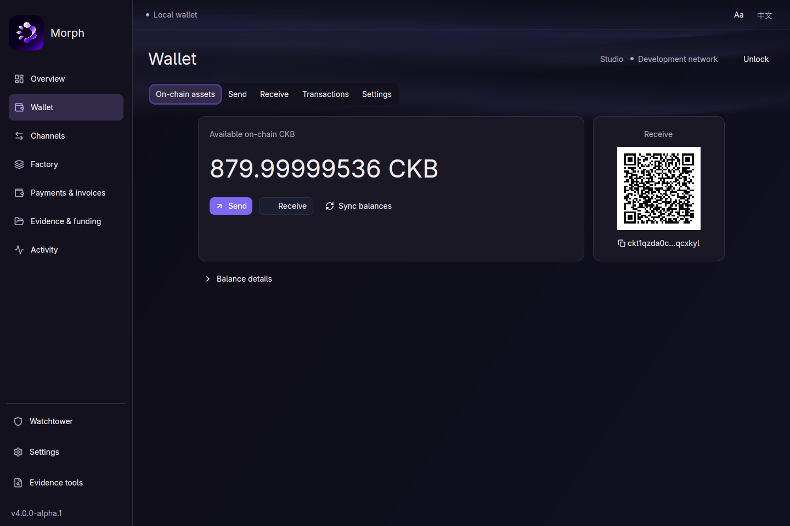

# Morph Channel 4.1.0

Morph brings CKB and UDT payments into off-chain channels, with shared channel
factories and a native desktop app to manage your wallet and channel activity.

## Morph Hub

A Rust desktop app built with **GPUI**, featuring:

- **A local CKB/UDT wallet** — create or restore a wallet, back it up, send and
  receive assets, share a receive QR code, and view balances and transactions.
- **Channel and Factory management** — browse balances, invoices and activity,
  review transactions, and manage recovery documents.
- **An interface that fits** — English and Chinese, adjustable text size,
  responsive layouts and smooth navigation.
- **Your choice of connection** — public CKB services, your local node, or custom
  RPC and indexer settings.

## Channels and payments

- **Multi-asset channels:** hold up to eight assets in one channel and update
  balances off chain.
- **Conditional CKB/UDT payments:** claim with the agreed secret or refund after
  the deadline.
- **Flexible funding:** add or withdraw funds while keeping the channel open.
- **Cooperative close:** settle together without the dispute-window wait, with
  unilateral recovery available when cooperation fails.
- **Channel factories:** pool reserves and create independently recoverable child
  channels.

## Try it

The desktop app is available for **Linux x86-64**. This release is for controlled
**devnet testing with no real assets**.

[Download Morph Hub](https://github.com/Morph-Channel-Network/Morph/releases/download/v4.1.0/morph-desktop-linux-x86_64.tar.gz)
· [Setup guide](../native-desktop.md)
