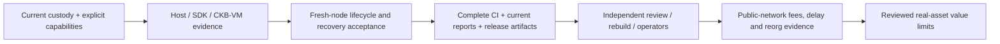

# Roadmap

This roadmap tracks current implementation and the evidence needed for release.
Historical v1–v4 milestones do not define parser compatibility. There is one
current unpublished channel State/Vault-set implementation and one Factory
rights authority. See [current coverage](current-protocol-coverage.md) and
[the consolidation ledger](unified-protocol-migration.md) for exact scope and
work still being completed.

## Current capability baseline

| Area | Current implementation | Remaining qualification |
| --- | --- | --- |
| Channels | 318-byte layout-2 State, descriptor 7, 1–8 Vaults, exact provenance, complete-set finalisation and independent per-Type accounting. | Independent review and deployment-specific resource/asset qualification. |
| Funding and splice | Independent durable signers, exit-before-creation ceremony, exact-transaction root/splice authorizations, wallet-group funding, keyless replay and canonical same-path handoff. | Current fresh-node report/CI refresh, terminal abort tracking and production recovery rehearsal. |
| Conditional CKB/UDT | Explicit descriptor capability, shared bounded Batch terms/executor, context-bound 104-byte Batch args, cooperative consolidation and script-enforced preimage/refund fallback. | Local candidate `bc4be3ff` qualified; routed integration and production operational evidence remain separate. |
| Factory authority | Current 306-byte State; transaction-bound root/update, complete custody activation, full-consent materialisation and funded custody changes. | Current transition/child acceptance and release evidence must be evaluated together; independent review remains open. |
| Reduced Factory capability | Sole compact locality proof path for rights (up to 10), deposits, releases and children (up to 9 physical claims); actual custody/fee/funding checks. | Proof-data retention/replacement snapshot discipline, independent review and arbitrary-asset/worst-topology resource qualification. |
| Factory operations | Independent member journals, current request/custody packages, native preparation/wallet signing/keyless submission, private child exits and public delivery attestations. | Complete fresh acceptance/report matrix and independent operator rehearsal. |
| Payment/provider integration | Current backend owns payment authorization and recovery; provider-edge checks bind current materialisation and Factory origin evidence. | Real Morph-backed routed/MPP provider acceptance; existing Fiber traffic alone is insufficient. |
| Watch service | Configured once/loop/service paths reuse the canonical current watcher, bounded publication, attempt reconciliation, reorg cursors, health and alerts. | Independent hosts/RPC providers/administrators, pooled publication/failover and long-running adversarial rehearsal. |
| Release policy | `morph-current-custody` no-real-assets envelope, artifact tooling and policy checks. | Fresh complete CI, reports/manifests, independent rebuild, owner sign-off and external review. |

The former envelope-kind package commands and separate single-Vault physical
implementations are removed. Flat, sparse and compact reduced-right operations
are represented by one current compact frame; they are not parallel roadmap
profiles. The current typed count-based Batch terms and generic signature/Merkle
primitives are used inside the current capabilities.

## Protocol work still separate from consolidation

| Work | Constraint to resolve |
| --- | --- |
| Cooperative channel close | A separately authorized zero-challenge close must still preserve exact outputs, Type conservation and carrier refund. Current ordinary closure waits the challenge window. |
| Member rotation / lost-key governance | Factory membership is committed; replacement must not confiscate another member's entitlement or invalidate their independent proofs. Reduced operations do not retire the last collective carrier/floor. |
| Conditional UDT routing | Type-bound settlement is implemented. A live Fiber bridge still needs explicit millisecond/block timeout policy, routed/MPP and provider-loss acceptance. |
| Recovery data availability | Retain complete initial rights data; deliver full snapshots for arbitrary all-member root replacement; retain child recovery privately before parent approval. A commitment alone is insufficient. |
| Asset admission | Qualify actual Type behavior, code identity, value limits and shutdown/recovery operations. A refusing Type script can still block an atomic complete-set spend. |
| Public-network reliability | Collect at least 1000 fresh latency samples and repeated fee/reorg/delay evidence with independent operating scopes. Local measurements are not substitutes. |
| Supply chain and release review | Close or narrowly review dependency advisories, reproduce exact current ELFs independently and record release-owner approval. |

## Acceptance before a release claim

The consolidation is not declared finished by this roadmap. Complete the
[implementation ledger](unified-protocol-migration.md), regenerate current
fixtures and deployment hashes, run full CI and fresh node acceptance, and
review every safety-negative/resource regression. Reports must identify their
actual binaries, transaction branches and canonical confirmations.

Production and real assets additionally require every gate in
[mainnet readiness](mainnet-readiness.md). The current envelope permits only
controlled no-value devnet evidence generation.
