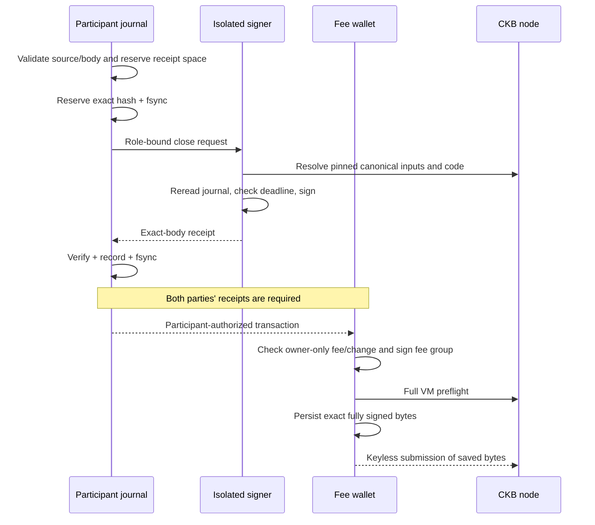

# Bilateral cooperative terminal close

This is the current controlled-devnet CLI path for #51. Both parties must approve
the **exact raw transaction** using the new close role. The target allocation is
the latest complete recovery package in each existing participant journal. It is
not an ordinary update, a splice, or a Factory withdrawal.

The consensus verifier and host lifecycle support the current Vault-set model.
The native wallet helper deliberately accepts one plain secp fee input and one
change output to that same owner. It infers all channel payouts, assets, reserves
and carrier refund from signed evidence. It cannot take transaction fees from
channel custody, select replacement inputs, change payout addresses or drop
pending conditions. A conditional channel produces the committed Batch output;
its eventual fulfill/refund is a separate operation.

## Before starting

- Use the RPC-enabled `morph-cli --features devnet` build and newly deployed,
  manifest-matching close-capable StateType/Vault-lock ELFs. Old deployments do not
  gain the new branch by upgrading the CLI.
- Retain both complete recovery packages and the existing authoritative journals.
  Do not clone, roll back or migrate active authority. Current snapshots require
  explicit `close`, including null; there is no old-shape fallback.
- Check the actual source State OutPoint. It may be bound Active/0 or a Settling
  State no newer than the target. A changed source requires unilateral recovery,
  not automatic rebasing of existing close approvals.
- Each independently installed signer configuration must explicitly permit
  `cooperative_close`. The service's journal, key, chain, endpoint and deployment
  must match. Existing policies are not silently expanded.
- Finish/reconcile any pending update or splice first. Preparing close temporarily
  blocks those paths. Cancellation is allowed only before any close reservation
  or received signature. A reserved close remains frozen even when no receipt is
  available locally.

## Prepare, authorize and submit

Example paths below refer to protected local files. `$SOURCE`, `$FEE_CELL` and
`$FEE_PUBLIC_KEY` are public values, not private keys; the first two use `hash:index`.
`$RPC` is the same pinned development endpoint used in the participant lineage.
The package dependencies must resolve all approved scripts, including the wallet.

```sh
# Infer the entire allocation and construct a bounded external wallet fee.
target/debug/morph-cli devnet --devnet-only --rpc-url "$RPC" multi-asset-close prepare \
  --package /srv/morph/recovery/latest.json \
  --contracts-dir /srv/morph/contracts \
  --state-out-point "$SOURCE" --fee-out-point "$FEE_CELL" \
  --fee-pubkey "$FEE_PUBLIC_KEY" --fee 100000 --max-fee 100000 \
  --min-confirmations 4 --output /srv/morph/close/draft.json

# Each party prepares this same draft against its own latest journal.
target/debug/morph-cli multi-asset-session --session /srv/morph/alice/session.json \
  cooperative-close prepare --draft /srv/morph/close/draft.json

# Use the returned transaction_hash. The key service must already be running.
target/debug/morph-cli multi-asset-session --session /srv/morph/alice/session.json \
  cooperative-close sign --transaction-hash "$CLOSE_HASH" \
  --signer-config /srv/morph/alice/signer.json

# Persist and exchange each returned receipt. Both parties import the other one.
target/debug/morph-cli multi-asset-session --session /srv/morph/alice/session.json \
  cooperative-close add-signature --transaction-hash "$CLOSE_HASH" \
  --signature /srv/morph/close/bob-receipt.json

# Participant-authorized intermediate: this is not yet a wallet-signed transaction.
target/debug/morph-cli multi-asset-session --session /srv/morph/alice/session.json \
  cooperative-close export --transaction-hash "$CLOSE_HASH" \
  --output /srv/morph/close/authorized.tx

# Independent fee wallet verifies both close signatures before using its key.
target/debug/morph-cli devnet --devnet-only --rpc-url "$RPC" multi-asset-close wallet-sign \
  --package /srv/morph/recovery/latest.json --contracts-dir /srv/morph/contracts \
  --draft /srv/morph/close/draft.json --transaction /srv/morph/close/authorized.tx \
  --max-fee 100000 --min-confirmations 4 \
  --private-key-file /srv/morph/keys/fee.key --output /srv/morph/close/signed.tx

# No participant or wallet key is accepted by this command.
target/debug/morph-cli devnet --devnet-only --rpc-url "$RPC" multi-asset-close submit \
  --package /srv/morph/recovery/latest.json --contracts-dir /srv/morph/contracts \
  --draft /srv/morph/close/draft.json --transaction /srv/morph/close/signed.tx \
  --max-fee 100000 --min-confirmations 4 --store-dir /srv/morph/close/submitted \
  --operation-store /srv/morph/operations/operations.db \
  --mine-blocks 4
```

`submit --dry-run` performs full VM preflight and persists the exact approved
binary/recovery evidence without broadcasting. A missing/invalid fee signature
cannot occupy the immutable signed-artifact path. Participant-only `export` is
explicitly a separate intermediate and has no such submission claim.

The operation store must have protected ancestors; it need not be inside the
artifact directory or repository. `--mine-blocks` is a bounded controlled-devnet
convenience, not a service or a production confirmation mechanism. Zero leaves
mining to the node. Save `operation.operation_id` and use
[operation-status/export](ckb-operations.md) for recovery and independent depth
queries. The configured four confirmations are now enforced before reporting
`finalised`; shallower inclusion is `committed`.



## Replacement and recovery

Every command addresses a specific transaction hash, never an implicit latest
attempt. Changing fees/inputs/dependencies creates another approval requiring both
participants. All older approvals remain valid until their source is consumed.
The journal keeps them all; it cannot revoke them by deleting local files.

The runtime now also records explicit fee-version relationships. Register the
fully wallet-signed predecessor first (a dry-run is sufficient), then pass its
operation ID as `submit --replaces-operation <id>` on the new independently
authorized body and all its retries. Same source/allocation/network/RPC/depth
are required. Registration does not cancel a transaction or imply a canonical
winner. A later `replaced` status identifies the actual linked winner after fresh
canonical verification; an older approved body can still win. Its confirmations
are never credited to the losing operation. See [operation recovery](ckb-operations.md).

Core permits at most 32 proposals of at most 128 KiB raw bytes each. The CLI's
separate 512 KiB **whole-session** limit is normally tighter. Before saving a new
proposal it reserves serialized space for both maximum-width receipts in every
retained attempt. Budget exhaustion leaves the disk journal and unilateral exit
intact. Do not raise just one read/write/IPC bound or trim history to retry.

| Observation | Required action |
| --- | --- |
| Signer unavailable or receipt lost | Retry the exact hash; the durable reservation remains binding |
| Receipt already recorded | The signer command returns it without another key-service call |
| Peer refuses to close | Publish/finalise the retained latest unilateral recovery; keep journal frozen |
| Source consumed by an ordinary publication | Runtime reports `operator_action` with zero close confirmations; supersede if needed using the latest recovery, then finalise |
| Confirmed close is orphaned and original inputs are live | Revalidate and replay the saved fully signed body; no participant signatures are needed |
| Submit response lost | Query the durable operation; every query checks the pinned canonical chain, and a timeout is not failure |
| Close already canonical | Exact submit returns its durable operation and artifact paths, with fresh depth and no second broadcast |
| Signed transaction file lost | Export exact bytes from the private operation store offline; export claims no canonical confirmation |
| Reorg revives an older close body | Keep all original approvals; no automatic unfreeze or source rebase |

Actual tests include three host SIGKILL cuts and eight `ENOSPC`/`EIO` syscall
failures. These establish application recovery with intact storage; they are not
power-loss hardware qualification or protection against restoring an entire old
consistent authority snapshot. The explicit #55 freshness assumption remains.

## Reproduce and interpret evidence

```sh
SCENARIO=close CKB_BIN=/path/to/ckb \
  bash scripts/devnet-external-signer-e2e.sh
```

This reuses the existing private-node signer harness. It builds/captures the CLI,
checks eight prebuilt ELFs against the manifest, and keeps source fingerprints
unchanged across the run. For two and eight **devnet token Types** it exercises
two fee versions, independent signing-service loss/retry, exact close publication,
all payout readbacks and orphan replay. A second rollback lets the older fee
version win, proving that declaring its replacement did not revoke it; both
directions of winner attribution are checked. A third rollback lets ordinary
publication win, followed by successful unilateral finalisation. Both journals remain
byte-identical during chain operations. The **final canonical branch is the
unilateral fallback**, not the earlier orphaned cooperative transaction.

See [execution evidence](../evidence/cooperative-close-execution-2026-11-10/README.md).
The later [operation-runtime checkpoint](../evidence/operation-runtime-2026-11-10/README.md)
adds durable attempts, depth-aware canonical reconciliation, independent status
queries, offline export and transactional outbox.

The [Factory-child checkpoint](../evidence/factory-child-close-2026-11-11/README.md)
adds actual reduced, retained-full-consent and terminal-parent child closure through
those same bilateral journals and isolated signers. The terminal-parent child
preserves its pending CKB Batch; independent fulfillment and mature refund both
pass on separate controlled forks. All three cases subsequently complete stale
publication, watch correction and unilateral finalisation on the retained branch.

```sh
SCENARIO=factory-close CKB_BIN=/path/to/ckb \
  OUT_DIR=/private/owner-controlled/fresh-run \
  bash scripts/devnet-external-signer-e2e.sh
```

The fresh directory and its ancestors must meet the runtime store's permission
policy; a private child under a group/world-writable repository ancestor does not
make that ancestor trusted. Use a private location rather than relaxing the store
check. Operation databases are separately retained in owner-only temporary
directories named in the private report. Preserve the private evidence for replay;
do not publish or recursively upload it.

Current native stateful ledgers require the three close outcomes, confirmation
depth, payout verification and honest fork labels. Cost summaries include their
operation receipts as observed committed transactions, alongside Batch resolution.
This does not assert that all competing branches remain canonical simultaneously.
Autonomous scheduling, other #41 adapters, API/SDK/desktop integration and final
candidate qualification remain open. This does not close #51 or approve real assets.
