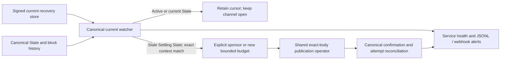

# Current watch service

`watch-config-once`, `watch-config-loop`, and `watch-config-service` use the
same current State/Vault-set watcher as `multi-asset-watch`. They read complete
signed current recovery packages. They neither open channels nor reserve
participant signing authority.



The service can run continuously; the underlying watcher performs bounded
passes. Stop files, bounded error backoff, health snapshots, canonical
reconciliation and per-pass configuration reload remain available. A stopped
or stale health file is operational evidence, never signer authority.

## Configure the current store

Generate a policy, a bounded publication profile, and a configuration:

```sh
cargo run -p morph-cli -- print-watch-policy-fixture > target/watch-policy.json
cargo run -p morph-cli --features devnet -- devnet --devnet-only \
  publication-profile-fixture > target/publication-profile.json
cargo run -p morph-cli -- print-watch-config-fixture > target/watch-config.json
```

Edit the generated current `morph.watchtower_config.v1` before use:

- Set each `channel_id` and `from_block`; the scan origin must be no later than
  the channel's funding block.
- Point `store_dir` at the current recovery store, whose directories are
  `channel_id/funding_context_id/`. Retain old funding contexts after a splice.
- Supply an explicit `publication_profile` and `publication_attempt_log` for
  every effective channel configuration. Set the same `operator_id` in the
  profile and configuration. There is no unbounded publication fallback.
- Set policy limits for detection depth, timeout, actual publication fee cap,
  sponsor capacity, mining and webhook use. The watcher checks the complete
  authorised cap, rather than a smaller nominal funding fee.
- Choose exactly one sponsor path: an explicit `sponsor_out_point`, or
  `auto_fund_sponsor: true`. Auto funding creates a separate sponsor cell only
  when a stale State needs correction. Its policy binds the exact State Type,
  channel, selected state number and maximum fee. The publication itself uses
  public sponsor authorisation and does not sign with the funding wallet.
- Put cursor, attempt log, alert JSONL and health files on durable storage.
  Optional webhooks use the existing HMAC secret mechanism.

Paths are relative to the configuration file. The generated default paths are
examples; review them rather than assuming they refer to an existing store.
Retired configuration schema names and unknown fields are rejected.

## Run and reload

```sh
cargo run -p morph-cli -- validate-watch-policy target/watch-policy.json
cargo run -p morph-cli -- validate-watch-config target/watch-config.json
cargo run -p morph-cli --features devnet -- devnet --devnet-only \
  watch-config-service --config target/watch-config.json \
  --private-key-file target/operator-secrets/watchtower.key \
  --health-file target/watchtower-health.json \
  --stop-file target/watchtower.stop --json
```

The wallet key remains outside the configuration. It funds new sponsor cells
when configured; stored participant signatures authorise channel correction.
A service reload validates the file and each effective publication profile
before its next pass. An operator identity change requires an explicit
restart. Invalid reloads enter the normal bounded error/health path; the
service does not silently continue with an unverifiable configuration.

`stop_after_publication` counts only a canonically confirmed publication or a
reconciled canonical attempt. A mempool submission alone is insufficient.
`last_pass` in the terminal report contains the last successful current watch
report. Monitor health age, errors, cursor progress, retained data, sponsor
funding and webhook delivery independently.

## Development evidence

The current `multi-asset-smoke --sponsor-publication --watch-publication
--watch-reorg` matrix exercises the service over real current channel cells:
late package rescan, conflict and scan-origin rejection, auto-funded sponsor,
canonical publication, terminal health, controlled rollback, reconciliation
and replacement publication, followed by finalisation. It also retains the
direct explicit-sponsor path. Run only on an isolated devnet.

This development matrix does not provide independent operators, production
fee samples, or a public-network availability guarantee. Production acceptance
continues to require the readiness evidence described in
[mainnet readiness](../mainnet-readiness.md).
