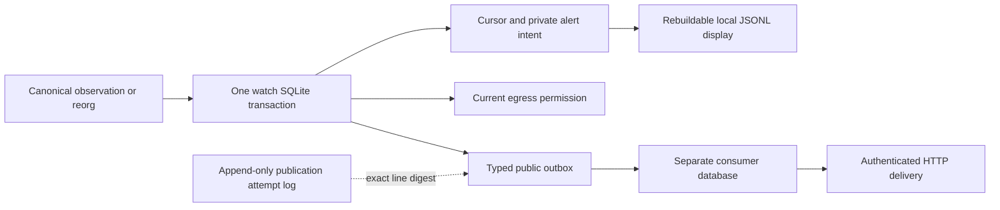
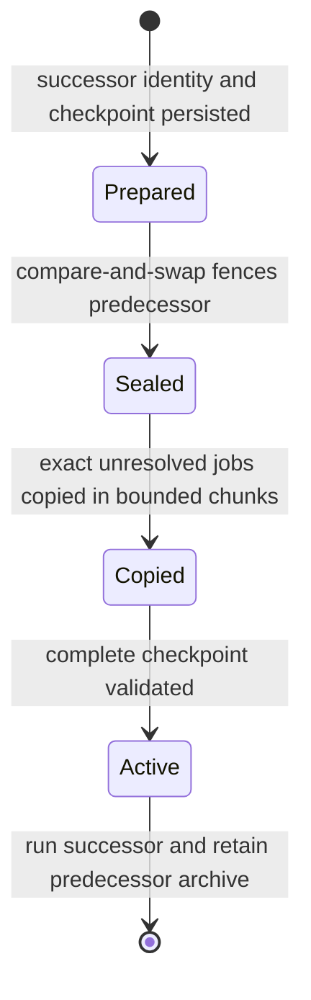

# Durable Hub/Gateway/watch events and authenticated webhook delivery

This implements Hub, Gateway, watch and exact-operation producers and a dedicated consumer for #34.
Producer-history retention and the remaining #35 service integrations remain unfinished. Consumer generations support explicit resumable archival and scoped dispatch readiness. It does not enable payments or chain publication.

## Ownership and actual semantics

`morph-packages::events` owns the public event/page DTOs. `morph-events` owns the
consumer and transport. Hub API DTOs do not acquire database or HTTP dependencies.

Hub, Gateway and watch each write their projection and applicable public event to the **same runtime transaction**.
The event contains a closed kind/severity, creation timestamp, source identity and
revision, stable event ID, correlation digest, subject and applicable public
funding-context/payment-hash references. Provider revision and publication evidence
references are explicitly null where this Hub producer has no corresponding proof.
Free-form notes, invoice descriptions, preimages, keys, tokens, signatures and
private recovery packages are not copied into these events.

`component=hub|gateway|watch|operation` and `evidence_level=local_record` are explicit; kind/component
mismatches fail validation. A local
`state_published` or `channel_finalised` record is **not independent CKB evidence**.
Consumers must not turn a Hub record into signing authority or chain confirmation.

The first exact-operation producer is cooperative close. Registration, broadcast
intent and changed observations append typed events in the same transaction as
their private record/attempt. The public event uses the operation ID as subject
and includes only its evidence digest, never transaction/witness bytes, local paths
or endpoint URLs. `operation_observed` asks a subscriber to query fresh status;
it is not an independent canonical proof. Repeated unchanged observations emit
no duplicate event. No delivery is enabled without a separately configured
consumer. See [operation recovery](ckb-operations.md).

Event ID is the CKB-personalized Blake2b-256 digest of the event-ID domain and
`source_id:immutable_outbox_id`. The source ID is the runtime database's persistent
identity. Correlation is a separate domain digest of the originating operation ID.
The ID, payload and source revision survive process restart and consumer replay.

The consumer opens the source **read-only**, verifies its identity, and owns a
separate runtime database. One transaction copies a source page into delivery jobs
and advances its cursor. A crash before that commit leaves neither; a crash after
it leaves both. Delivery changes never advance the Hub's business revision.

The source history is immutable. Consumer attempt records are also append-only.
They link event identity and safe delivery metadata; they do not modify publication
attempt files, recreate protocol evidence or carry secrets. Acknowledgement records
include a domain-separated digest of the exact acknowledged body.

## Run the real consumer

Use an existing current Hub, Gateway or watch runtime database. Put a separately generated 32-byte
hex HMAC secret in an owner-controlled regular file with mode 0600; use a private
0700 parent directory. The file loader rejects symlinks/FIFOs and unsafe ownership
or permissions. No raw secret argv/environment input is supported.

The following paths and receiver are operator-selected configuration examples,
not a demo backend:

```sh
morph-cli event-delivery \
  --source /private/hub/state.db \
  --store /private/events/receiver.db \
  --url https://receiver.example/morph-events \
  --hmac-key-file /private/keys/events.hex \
  run-once --limit 4
```

Replace the final subcommand with `serve --interval-ms 1000` for continuous ticks,
`status` for a read-only summary, or `replay --event-id <64-lowercase-hex>` for an
explicit dead-letter replay. `status` may run while the worker owns its stable
sidecar lock. Mutating commands refuse a second process holding that consumer lock.
Do not unlink the lock file.

Source, target URL and key-policy fingerprint are pinned in the consumer database.
Changing them fails closed. A deliberate new target/key policy requires a separately
reviewed consumer, which starts at the beginning of retained source history; it is
not an in-place silent redirect. Retain the previous database and its evidence.
Receivers still deduplicate the original event IDs across that replay. This is not
a completed automated rotation or archival workflow.

Source and consumer must be different databases. A Hub source is private plaintext.
For an encrypted Gateway source, additionally pass
`--source-storage-key-file /private/keys/gateway-storage.hex` with its actual
protected 32-byte storage key. This is a separate key from the webhook HMAC key.
Missing/wrong keys fail before enrollment or sending. This trusted local consumer
therefore receives the ability to decrypt the source database; its implementation
validates the store and copies only typed public outbox events, never private
intents/projections. Remote clients can instead use the operator-authenticated
Gateway event API without receiving a storage key.

The CLI does not open signer journals or watch JSONL files, and does not parse
previous outbox payload shapes. Gateway projection schema is now **3**, with
mandatory typed events; schema 2 is rejected rather than migrated. Reset only
unpublished development state according to the migration runbook; never delete
uncertain delivery/payment/signer evidence to make a health report green.

## Watch producer and recovery

`--cursor-file` now names a private SQLite runtime database (normally
`watch-cursor-<channel>.db`), with a 0700 parent and 0600 files. JSON cursor inputs
are rejected, not imported. For fresh no-value development state, use a new database
and scan from no later than channel creation; retain the complete saved recovery
packages and immutable publication-attempt logs.

A watch transaction writes the cursor, current egress policy and private alert
intent together, plus a redacted typed outbox record when there is an alert.
Ordinary block checkpoints do **not** generate notifications. Reorg reset and its
critical alert are committed together before rescanning. A missing/invalid package
can no longer advance a persisted observation without its corresponding alert.



There are nine watch kinds: reorg, invalid recovery, publication failure, older
state, publication submission, splice detection, stale splice package, splice
publication submission and scan idle. Only actual emitted observations produce
these events; defining a kind does not add a new publisher or activation service.
Messages, RPC errors, paths and package/signature contents stay out of public
notifications. Publication submission carries `evidence_digest`, the CKB-personalized
Blake2b-256 hash of `morph.watch.publication_evidence.v1\0` followed by the exact
matching JSONL attempt line, **including its newline**. It is a local evidence
reference, not a claim of canonical confirmation; the attempt log is never rewritten.

`alert_file` remains a local Hub display projection. Startup merges missing committed
alerts without erasing other channels, repairs a torn final display append, and
deduplicates existing rows. Its sidecar lock is nonblocking. Display failure logs a
fixed diagnostic and does not stop canonical observation/publication; the durable
intent/outbox remains available. Complete malformed display records require local
repair, but are never accepted as observation authority. The projection currently
has a 32 MiB bound, and history export still scans retained intents; production
archival and long-running capacity qualification remain open.

Watch no longer accepts `alert_webhook_url` in its config or reads the old raw-secret
environment input. Configure the separate `event-delivery` process instead, using
its protected HMAC key file and the watch database as `--source`. A valid watch
policy must explicitly allow `allow_webhook_alerts`; no policy defaults to false.
This permission is persisted on each successful watch transaction. File edits take
effect when the watcher next commits; they are not an immediate remote revocation
API. The consumer checks the persisted permission before ingest and claim, including
jobs queued earlier. Disabled permission prevents new claims; a request already in
flight cannot be recalled, and its valid acknowledgement can still be recorded.

## Gateway producer events

| Kind | Durable local transition | Public references |
| --- | --- | --- |
| `gateway_initialized` | Current encrypted projection created | None |
| `gateway_challenge_created` | Challenge persisted | Requirement ID, payment hash |
| `gateway_offer_created` | Fair-exchange offer persisted | Offer ID, payment hash |
| `gateway_payment_recorded` | Bounded payment observation updated | Requirement ID, payment hash |
| `gateway_receipt_issued` | First receipt/consumed requirement committed | Requirement ID, payment hash |
| `gateway_outgoing_reserved` | Exact outgoing submission intent durably reserved | Requirement ID, payment hash |
| `gateway_outgoing_succeeded` / `gateway_outgoing_failed` | First accepted terminal result persisted | Requirement ID, payment hash |

Each event is constructed from an explicit typed mutation descriptor, not from
serializing or heuristically filtering the private recovery object. A malformed
public reference fails before either projection or event commit. Unchanged retries
create no new revision/event; duplicate terminal polling and rejected conflicting
terminal observations cannot emit another success/failure event. `reserved` does
not mean the provider received a payment. `payment_recorded` is an observation,
not a new submission or an independent settlement proof.

The encrypted source retains its exact private recovery evidence. The plaintext
consumer stores only the public envelope and safe delivery metadata; invoice
strings, preimages, credentials, offer decryption keys, payer signatures, provider
URLs and raw provider results are excluded. The complete signed receipt remains
available through the existing authorized receipt workflow, not this event stream.

## Receiver authentication and deduplication

Transport requires HTTPS except literal loopback HTTP for local tests. User-info,
query strings, fragments, redirects and environment proxy inheritance are rejected
or disabled. Connection timeout is 3 seconds and the complete request/body timeout
is 10 seconds. Response body is bounded to 4096 bytes, including unknown-length
bodies. Errors expose a fixed class, never a URL, response text or secret.

Request headers:

- `Content-Type: application/json`
- `X-Morph-Event-Id: <event_id>`
- `X-Morph-Signature-Algorithm: HMAC-SHA256`
- `X-Morph-Signature: <64 lowercase hex>`

The request MAC input is exactly:

```text
b"morph.event.request.v1\0" || event_id.as_bytes() || b"\0" || original_body
```

Use `morph_events::verify_request` with the bounded **original bytes**; it checks
the current event shape and header/body identity as well as the MAC. Do not parse
and re-serialize before authentication. A valid MAC is a notification authenticity
check, not proof of on-chain truth.

The receiver must atomically record `(source_id, event_id, exact_body_digest)` and
apply its intended effect. An already recorded identical event returns its existing
result; the same ID with a different body must be rejected. Commit that deduplication
and effect **before** acknowledging. The tests reopen an actual receiver database
between duplicate requests; in-memory deduplication alone is not sufficient.

For successful acceptance, return a 2xx response with exactly one `X-Morph-Ack`
header containing this HMAC, preferably with an empty response body:

```text
b"morph.event.ack.v1\0" || event_id.as_bytes() || b"\0" || original_body
```

`morph_events::acknowledgement` creates the header value. The distinct domain means
a reflected request signature is not an acknowledgement. TLS authenticates the
endpoint, and the response MAC binds acceptance to the shared receiver key and
exact event body. Unsigned 2xx, wrong-key acknowledgements, duplicate acknowledgement
headers, redirects, oversized bodies and network errors are not successful delivery.

There is no remote acknowledge/reset/replay administration endpoint. Repair is an
operator-local command protected by the same private files and consumer ownership.
A peer with the HMAC key can acknowledge its own subscription; it cannot gain signing
or chain authority. A receiver must not use its MAC capability to acknowledge work
it has not durably accepted.

## Retry, failure and retention bounds

| Bound | Current development policy |
| --- | --- |
| Public event body | 8192 bytes |
| Source copy page | At most 32 events; cursor and jobs commit together |
| Retained jobs | 1024 per active consumer generation, including acknowledged and dead-letter jobs |
| Consumer revision watermark | 8000; pause new mutations while preserving headroom for the seal |
| Active claims | At most 4 across database connections |
| CLI dispatch | At most 4 concurrent requests; `run-once --limit` is 1–16 |
| Claim horizon | 30 seconds; HTTP is capped at 10 seconds |
| Attempts | 8 per event retry generation; archival does not reset it |
| Failure backoff | `1000ms * 2^attempt`: 2, 4, 8, 16, 32, 64, 128, 256 seconds |
| Pending age | 24 hours from enrollment or explicit replay |
| Explicit dead-letter replay | At most 3 additional generations, preserving ID/body |
| Continuous tick interval | 100–60000 ms, default 1000 |

Claiming saves `in_flight` and an immutable attempt **before** network I/O. A process
crash before send may consume an attempt without sending. A crash after acceptance
but before local completion leaves an uncertain attempt; once its claim expires,
it retries the exact body. Competing connections cannot obtain the same fresh claim
from an idempotent transaction receipt. A response from an older attempt cannot
overwrite a newer attempt or replay generation.

This is **at-least-once delivery within the declared bounded retry policy**, not an
unconditional delivery guarantee and never HTTP exactly once. A prolonged outage,
repeated crash, invalid acknowledgement, age limit or exhausted attempts leaves
visible unresolved work/dead letters; it does not drop the event. An explicit
replay records another immutable attempt and retains the original event bytes.

The worker makes no network call while holding a producer database transaction,
Hub state lock or signer lock. A slow receiver occupies at most its configured
consumer workers; other producers and consumer databases can progress independently.
Local wall-clock rollback before enrollment fails closed, but the design does not
provide independent freshness against an adversary restoring whole consistent
source/consumer histories. Claim expiry can permit duplicate HTTP calls, so durable
receiver deduplication remains necessary.

Acknowledged jobs remain in the active database until explicit generation archival.
Reaching 1024 sets `archive_required`; `source_blocked` also becomes true if unread
events remain. Enrolled jobs can continue to drain until the revision watermark.
At revision 8000, new queue mutations stop with `ArchiveRequired`, leaving room
below the shared store's 16384-intent limit for the final seal. The record and event
size bounds keep ordinary queue payloads below the separate byte limit; actual disk
exhaustion can still require the operator to free/provision storage.

## Resumable consumer archival

The sealed old database **is the archive**. No histories, attempts, acknowledgements
or dead letters are deleted. A new private database receives the same source/receiver
binding and source cursor, plus every pending, in-flight and dead-letter job with
its exact original body, ID, attempt count, replay generation and lease timestamp.
Acknowledged jobs stay only in the old database. This recovers active-job capacity
and starts a fresh bounded consumer history without replaying acknowledged events.

```sh
morph-cli event-delivery \
  --source /private/watch/channel.db \
  --store /private/events/generation-001.db \
  --url https://receiver.example/morph-events \
  --hmac-key-file /private/events/webhook.key \
  archive --next-store /private/events/generation-002.db
```

Add `--source-storage-key-file` when the producer is encrypted. Stop the consumer
worker first; the CLI refuses a busy current or successor lock. After success,
retain generation 001 and start `serve` using generation 002 as `--store`. The
reported store IDs and checkpoint digest identify the handoff. Keep the lock
sidecars stable. There is no symlink switch, implicit new endpoint, or remote
archive/erase endpoint.



The prepared successor cannot dispatch. The predecessor CAS fails if any concurrent
claim, completion or enrollment changed its snapshot. Once sealed, all its Queue
handles refuse new mutations; an in-flight HTTP request cannot be recalled and may
need the normal at-least-once retry after its preserved lease expires. No retry or
age budget is reset by archival.

If interrupted, repeat **the same archive command with both original paths**.
Preparation, seal, chunk copies and activation are idempotent; retrying after
activation never rewinds a successor that has already progressed. A different
successor identity is rejected after sealing. If the old generation advanced before
the seal, its prepared candidate is stale: keep it as evidence and choose a fresh
successor path while the predecessor is still active. Do not delete a sealed or
prepared generation to bypass a failed handoff. Storage corruption/loss requires
recovery of the matching databases, not invented authority or a new empty cursor.

Consumer metadata is now `morph.event.consumer.v2`; v1 is rejected without fallback.
For disposable predeployment subscriptions, retain prior evidence and create a new
subscription explicitly; an empty new cursor may replay old source events and is
not the archival procedure. Durable receiver deduplication remains necessary.

Archival does not relieve 1024 **unresolved** jobs, promise eventual delivery,
reduce total retained disk usage, or compact producer histories. It does not detect
whole-store rollback. Operators retain every sealed generation and the current/
prepared database; safe long-term deletion and producer-history segmentation remain
separate work. #34 is not closed by consumer archival alone.

`status` reports retained/pending/in-flight/acknowledged/dead-letter counts,
oldest unresolved age, source cursor, `source_pending`, `source_blocked`,
`archive_required` and `sealed`.
It reports in-flight attempts even if their claim has expired until a worker
reconciles them. It is observation, not a permission to mutate. Concurrent mutation
can cause a retryable snapshot conflict. The #35 `readiness` and `metrics` commands now combine this backlog with a
boot-bound worker heartbeat and committed egress policy; see
[service readiness](service-readiness.md).

## Durable polling and UI streaming

Authenticated `POST /api/event-log` is a read query. First request:

```json
{"after":null,"limit":32}
```

It returns `events`, `next` and `has_more`. Send the exact returned `next` as `after`
to continue. `next` includes the source ID, decimal-string source revision, and
immutable outbox ID. The page limit is 1–64, with stable `(revision, outbox_id)`
ordering, including multiple events from one transaction. A cursor from a different
source or one naming a nonexistent/wrong-revision event is rejected. An empty final
page preserves its cursor so a later poll observes later commits. No source pruning
or implicit gap skipping exists.

Gateway exposes the same query/response at operator-bearer-authenticated
`POST /v1/events`, via its own encrypted store owner. `PaymentGatewayClient::events`
checks the same page invariants. Authentication is required unless the Gateway was
explicitly configured for unauthenticated local development. Invalid/cross-source
cursors are rejected; this read query has no payment side effect.

The Rust SDK's `event_log` validates bounded page shape, source binding, event IDs,
revision progression and next-cursor consistency. OpenAPI/schemas are generated
from the same public Rust types, with drift tests. The existing `/api/events` SSE
endpoint and `HubView.events` are bounded **UI activity** views; do not use them as
a durable event bus or webhook checkpoint.

## Evidence and remaining scope

Tests cover transaction/restart identity, competing connections, expired claims,
late acknowledgements, retry/age/replay caps, full consumer and malformed source
pages, cursor binding, strict event shapes, HMAC/redirect/body limits, real receiver
acceptance with dropped response and persistent deduplication, and source progress
while HTTP is blocked. Four real child-process kills stop after enrollment, after
claim, after receiver acceptance, and after local acknowledgement.

The actual Hub/SDK/CLI HTTP test pages real mutations, invokes the standalone
consumer binary, verifies request/ack authentication, restarts for a status query,
and checks that delivery did not change the source business revision.

The encrypted Gateway integration also invokes the actual consumer binary, checks
missing/wrong storage-key rejection, authenticates both initialization/payment
notifications, restarts the consumer, checks the source bytes did not change, and
scans the consumer bytes for private markers. This verifies transport of actual
producer records; it is not a new real-provider payment acceptance run.

Watch tests additionally cover atomic cursor/alert/policy commits, actual process
kills before commit, after commit and after display update, reorg reset, public
redaction, exact publication-log digest without rewriting bytes, strict JSON/foreign
store rejection, shared-channel display recovery and egress revocation after enqueue.
These are local correctness tests, not independent operator availability evidence.

Remaining: producer-history archival and safe capacity recovery, per-resource and
critical-backlog readiness/metrics, and cross-service fault/retention qualification.
#34, #35 and the W1 objective remain open.


The 2026-11-10 watch checkpoint passed 389 scoped regression tests plus one
explicit native-evidence readback test, and scoped all-target Clippy. A private
CKB devnet run exercised sponsor/fee rejection, mempool eviction, independent
operator replacement, canonical confirmation, reorg/republication and bounded
service lifecycle. `tests/watch_native_events.rs` reads the resulting real sources,
checks event/source identities and exact attempt-line digests, and verifies that
reading did not change source bytes. Run it with:

```sh
MORPH_WATCH_NATIVE_EVIDENCE=/private/run/evidence \
  cargo test -p morph-cli --all-features --test watch_native_events -- --ignored
```

The run has its own binary/harness/worktree binding; the final scoped regression
bracket includes a later test-only temporary-file cleanup. These are checkpoint
results, not final candidate qualification or independent infrastructure evidence.


The consumer-archive checkpoint adds six event tests (20 event tests total) and
extends the real encrypted Gateway/CLI/webhook integration through archive and
successor startup. Four actual process kills cover prepared, sealed, partially
copied (128 of 129 carried jobs), and activated states. Other assertions cover
concurrent pre-seal mutation, old-handle fencing, unchanged dead-letter/lease/
retry state, 1024-job recovery and the 8000-revision sealing reserve. The scoped
CLI/events/store/API/SDK/Gateway suite passed 395 tests and all-target Clippy.
The chain-dependent watch readback test was explicitly ignored in this run;
no new CKB qualification follows from these consumer tests.


### Corrupt consumer record rejection

Consumer reopen validates that cursor revision zero has an empty cursor ID (and
nonzero revision has a nonempty ID), and every saved job belongs to the pinned
source store. Archive schemas/links/counts, job identity/body, retry bounds and
acknowledgement consistency retain their own checks. Invalid records fail closed;
opening does not initialize a replacement queue, reset the source cursor or
silently discard jobs. Retain the original database and archive evidence for
inspection instead of deleting it to regain dispatch permission.

The [private-record checkpoint](../evidence/private-records-2026-11-10/README.md)
contains 20 reopen negatives and the initial failing cases. It tests consumer
payloads written through valid generic transactions, not filesystem attacker
access or whole-database rollback detection.
