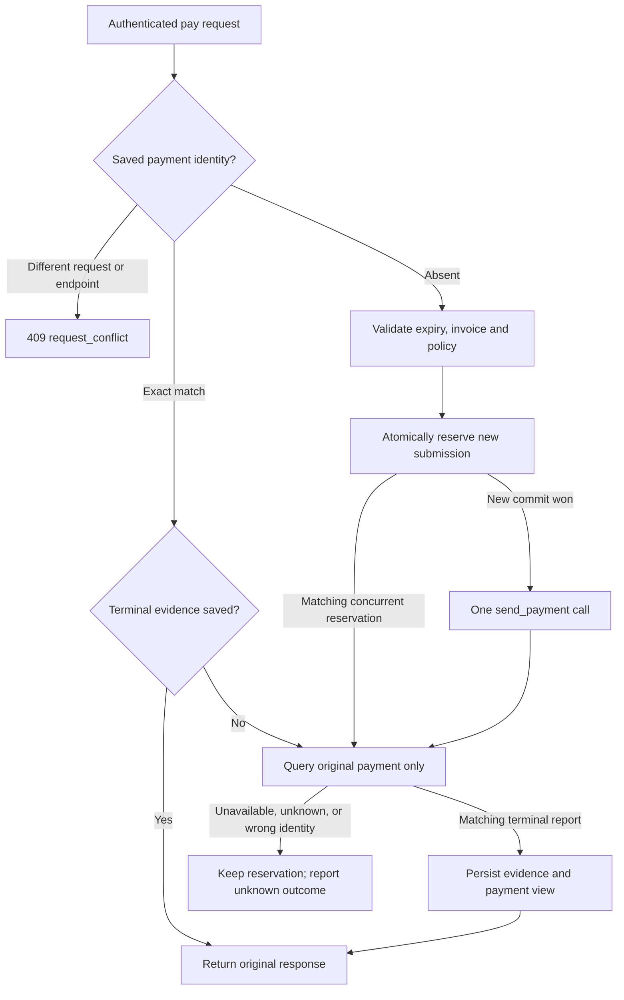

# Gateway outgoing-payment retries

`POST /v1/pay` uses the signed payment hash as its durable submission identity.
The complete typed request (including payer proof, optional fee and timeout
choices) and configured Fiber endpoint are frozen at first acceptance. JSON
whitespace/object-key order is irrelevant; changing an optional default to an
explicit value is different request content. No new idempotency header is needed
for this endpoint. This does not make other Gateway endpoints idempotent.

## Submission and reconciliation

1. Verify the payer proof and configured outgoing payer. For a new payment also
   check current expiry, parsed invoice, deployment fee/timeout limits.
2. Atomically save the exact request, exact Fiber submission body, resolved
   timeout, provider endpoint and `PendingSubmission` view before sending.
3. Only the invocation that newly commits that reservation may call
   `send_payment`. A normal idempotent database receipt is not send authority:
   `Store::commit_new` rejects a replayed transaction under the same SQLite
   transaction lock. A racing loser reloads the saved attempt and only observes it.
4. An exact retry queries `get_payment` for that same hash, or returns its saved
   terminal response. Every observed result must name the requested hash.
5. Terminal evidence and the payment view commit together. Duplicate observations
   return the first stored response without another write. A contradictory
   terminal status cannot overwrite it.

| HTTP result | Meaning / action |
| --- | --- |
| `200` | Stored terminal result; `completed: false` means the provider reported Failed, not authorization to retry sending |
| `409 request_conflict` | Identity/content/endpoint or durable revision conflict; do not change payment terms to bypass a saved spend |
| `503 payment_outcome_unknown` | An external call may have taken effect, or its report cannot be attributed; retry only the exact request to query again |
| `504 payment_timeout` | No terminal evidence before the bounded observation deadline; reservation remains |
| `503 store_capacity_exceeded` | Admission limit reached; existing records remain available for reconciliation |
| Storage failure | No new send unless a fresh reservation commit returned successfully; preserve the database and reconcile |

An already accepted payment can be queried or have its cached response delivered
after invoice expiry. Expiry cannot revoke a previous spend. A never-accepted
expired payment remains rejected. Current payer authorization is checked even
for cached delivery; changing provider endpoint does not silently move an old
attempt onto another node. Endpoint equality is a configured transport binding,
**not cryptographic proof of Fiber node identity**.

## Boundaries and operations

The durable ledger holds at most 256 outgoing identities, independently of the
bounded recent-payment display. Evicting a display row never frees an identity.
Requests, submission bodies and provider result bodies are bounded at 64 KiB
within the existing encrypted store/transaction limits. There is no automatic
ledger pruning, expired-intent deletion, new-attempt or MPP scheduler here.
A full ledger rejects new payments while retaining exact retries. Do not delete
or roll back the database to regain quota or to repeat an ambiguous payment.

A crash between reservation and send is deliberately indistinguishable from a
lost send acknowledgement. A provider's missing-record error is not proof that a
request was never processed. The current implementation leaves that identity
reserved and queries only; safe new-attempt authorization and bounded retention
require the wider #36 lifecycle. It offers at-most-one local send authorization
per intact stored identity, not exactly-once delivery, guaranteed completion,
provider-independent settlement or whole-store rollback protection.

This adds a required outgoing-ledger field to the sole unpublished Gateway
snapshot. No old-field defaults/migration readers are accepted. Preserve and
reconcile outstanding development records before choosing a fresh test store;
never treat that reset as payment recovery. Public request/response DTOs remain
current; generated errors now include the two stable conflict/unknown codes.

Evidence uses controlled Fiber RPC behavior and real HTTP clients/SQLite files:
concurrent duplicate POSTs, changed content, missing/mismatched reports, reopen
and late success, expiry, immutable terminal records, display eviction, capacity,
and independent database connections. It is not a new real-Fiber or routed-MPP
qualification. Six actual HTTP-service SIGKILL/restart scenarios now cover reservation,
provider acceptance with/without its reply, and persisted successful/failed terminal
responses. See [process-kill evidence](../evidence/gateway-process-kill-2026-11-10/README.md).
The same stored identity never grants another send; a pre-send crash can remain
unresolved. The test launches the production router from a test executable, not
the CLI bootstrap; power loss and whole-store rollback are separate boundaries.

## Typed event boundary

The current Gateway projection is schema **3**. Each actual mutation atomically
appends a typed public event; schema 2 and the retired generic revision-only event
are not migrated. Exact/cached retries that leave state unchanged emit no new
event. Reserved and terminal outgoing events retain payment identity without
exporting payer proofs, credentials, preimages or raw provider results.

Operator-authenticated `POST /v1/events` and `PaymentGatewayClient::events` page
this durable outbox. The independent delivery CLI can consume it using an explicit
protected source storage-key file; its HMAC key is separate. See
[event delivery](event-delivery.md) for receiver deduplication, key ownership,
retention limits and remaining watch integration.

A requirement ID already reserved under another payment hash is a permanent
request conflict. The store's CAS recovery must not relabel it as transient Busy.
A matching concurrent reservation returns the stored attempt for observation;
a genuinely unrelated CAS race may remain Busy. Neither case permits an extra
send. This distinction has a minimal regression and a three-seed sequential
payment model; see [the model checkpoint](../evidence/lifecycle-models-2026-11-10/README.md).
