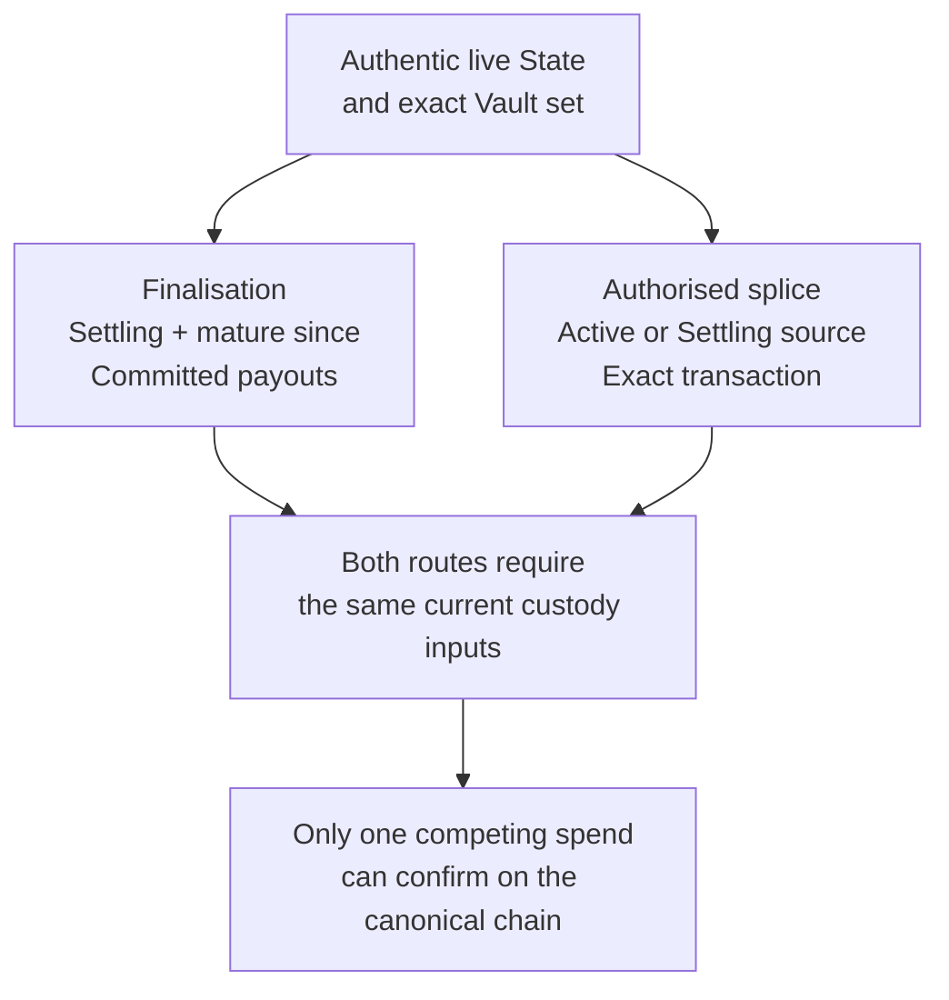
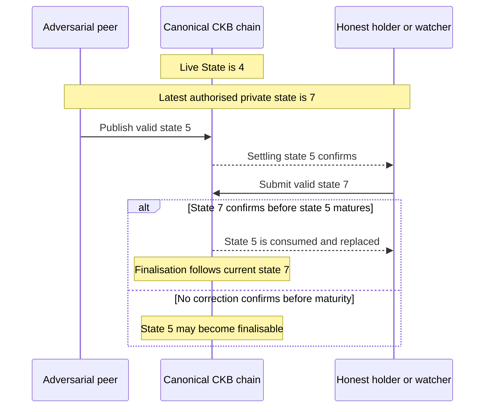
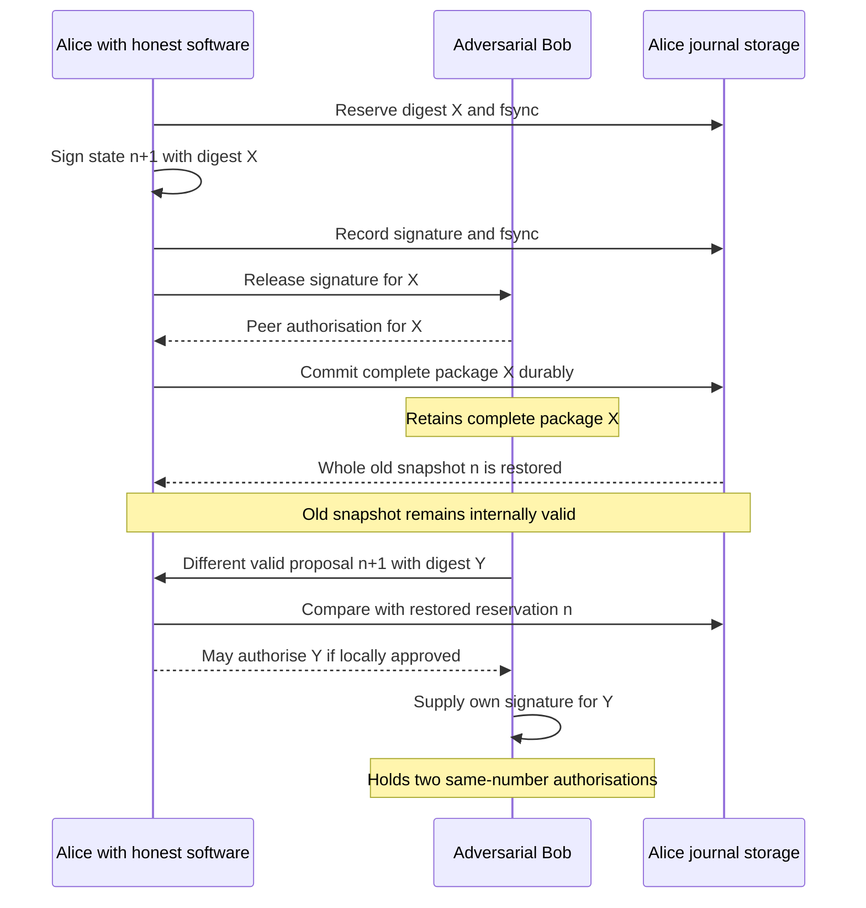
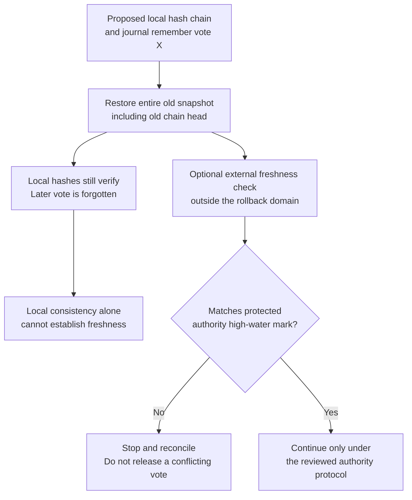

# Double-spend review: qualify state freshness, signer rollback, and cross-profile guarantees

Current W1 qualification supersedes the historical cross-profile inventory below:
see [the current capability/assumption matrix](w1-acceptance.md#55-current-capability-matrix-and-retained-assumptions).
The old baseline analysis is retained for provenance. Its legacy test names and
unfinished-Factory statements do not describe the current implementation. The
final #44 report binds executed current tests and exact artifacts; it does not
turn this historical static review into a new independent audit.

Review baseline: [`24484e72a20edf0fbe0344d59afdcd9af1fe9b29`](https://github.com/Morph-Channel-Network/Morph/commit/24484e72a20edf0fbe0344d59afdcd9af1fe9b29), workspace version **4.0.0**, reviewed on **2026-11-04**.

Companion to #53. This issue consolidates the eight attack categories in the double-spend review, corrects the residual-risk claims, and defines the evidence needed to support cross-profile security statements. Existing execution issues retain ownership of their implementation work.

**Review conclusion:** the static checks did not confirm a new exploitable Critical/High double-spend path. That is a bounded review result, not proof that every such path is absent. The proposed tally of “two confirmed Mediums and four Lows” is unsupported: two Low claims are defeated by current controls or construction constraints, and the journal-rollback claim requires materially different assumptions and remediation.

The evidence is source inspection, pinned dependency source, existing test definitions, and documented boundaries. No new VM test, real-node acceptance, rollback exploit, or independent external certification was produced by this review. The current approved deployment remains controlled devnet without real assets.

## 1. What “double spend” means here

CKB's single-spend rule prevents two confirmed transactions on the same canonical chain from consuming the same live Cell. It does not by itself answer whether an authorised output represents the latest agreement.

Separate four questions:

- **Repeated consumption:** can the same custody be successfully released by two competing transaction paths?
- **Stale settlement:** can an older allocation finalise because the latest agreement was not confirmed in time?
- **Conflicting authorisation:** can a signer issue two different valid allocations at the same state number?
- **Conservation or replay failure:** can quantities be created, outputs counted twice, or signatures reused under a different authority context?

A second signature is not a second confirmed spend. A stale payout can cause economic harm without violating Cell uniqueness. A journal's authentic contents need not be its freshest contents.

For the current multi-asset lifecycle, finalisation and splice compete for the same exact State/Vault custody:



This is a dependency illustration, not a transaction that runs both branches. **Phase exclusivity is not the general protection:** multi-asset splice may retire an Active or a Settling source. Each route must also pass its own authorisation, exact-source, output and conservation checks. See [multi-asset retirement][ma-retirement] and [splice runtime verification][splice-runtime].

## 2. Eight attack categories and their actual protections

The table records observed protections and their limits. Existing test names identify specific evidence; they are not a claim that this review reran the tests or proved all possible attacks absent.

| Attack category | Observed protection | Scope and evidence limit |
| --- | --- | --- |
| 1. Publish an old allocation | Ordinary bilateral progression preserves the funding context and requires a strictly greater state number; valid participant signatures authorise the candidate | “Higher than chain” can still be “older than the latest off-chain agreement.” Timely confirmed supersession remains necessary |
| 2. Settle the same value through different paths | Authentic State authority, exact custody provenance, complete-set consumption and route-specific output checks; competing transactions consume the same inputs | The one-Vault group rule belongs to the original profile. Multi-Vault safety instead requires completeness, uniqueness and exact OutPoints |
| 3. Claim both fulfillment and refund | Current CKB Batch resolves every committed transfer exactly once; fulfillment hashes the preimage, refund checks canonical absolute-block maturity | Whole-Batch resolution and single-spend prevent separate double claims. These are not implemented multi-asset conditional guarantees |
| 4. Overspend sponsor capacity or divert change | Checked budget arithmetic, per-transaction caps, exact fee attribution and clean change at the committed lock | A per-cell budget is not an automatically persistent global account. The alleged self-lock reset is not a feasible ordinary configuration |
| 5. Mint or double-count Factory rights/reserve | Legacy kind-8 checks common roots, canonical right order, cross-side localisation and independent per-asset non-increase; physical release has its own conservation rules | New multi-asset `MORPHFS!`/`MORPHFM!` custody needs a separate evidence row; legacy reduced proofs cannot substitute for it |
| 6. Replay signatures across contexts or roles | Domain-separated digests, canonical encodings, fixed participants/context, exact-transaction root/bridge commitments and explicit target-digest checks | The relevant guard is the full message and verifier path. A count or prefix inventory of domain constants alone does not establish separation |
| 7. Sign two different proposals at one number | Against intact authority history: stable locks, reserve → fsync → sign → record → fsync, and checks against the reserved number/digest | Whole-store rollback or independently cloned signing authority is a different threat. Factory independent journals are still unfinished |
| 8. Revive a splice-retired authority | Irreversible bridge reservations, changed funding context, exact old inputs, guarded lineage and keyless exact submission checks | A retained old exit can only spend its still-live source context; it cannot release successor custody after a confirmed splice |

Evidence entry points: [ordinary progression][ma-progression], [complete Vault/payout verification][ma-runtime], [Batch resolution][batch-resolution], [Sponsor fee boundary][sponsor], [historical kind-8 fixes][kind8-fixes], [root signing role][root-domain], [durable signing][session-signing], and [splice recovery/sealing][splice-recovery].

Representative existing negatives include `state_type_rejects_equal_state_number`, `vault_lock_rejects_fake_state_header_without_state_type`, `multi_asset_rejects_incomplete_duplicate_reordered_or_substituted_outpoints`, `batch_lock_rejects_wrong_preimage`, `batch_lock_rejects_premature_refund`, `sponsor_lock_rejects_third_party_capacity_diversion`, `factory_type_rejects_multi_right_unlisted_change`, and `factory_type_rejects_multi_right_cross_asset_rebalance`. The historical signed-withdrawal, unlisted-change and cross-asset quantity issues have documented fixes; they must not be presented as current unpatched findings. See [signed withdrawal fix][withdrawal-fix] and [kind-8 remediation][kind8-fixes].

## 3. Disposition of the reported residual risks

The identifiers are preserved for traceability. “Withdraw” below applies to the supplied claim on the reviewed path, not every conceivable alternative path.

| Input | Corrected disposition | Reason / required follow-up |
| --- | --- | --- |
| R-1 — stale publication and no slashing | Retain as an explicit conditional-security assumption; correct the wording | A valid state newer than chain but older than the latest agreement can be published. Historical states are not forever replayable, and actual challenge maturity is enforced on chain |
| R-2 — journal rollback | Retain as a documented trust limitation; substantially revise the scenario and proposed fix | One rolled-back honest signer plus a malicious peer can suffice for conflicting authorisations. An internal hash chain cannot prove freshness after whole-store rollback |
| R-3 — watch/deployment gaps | Retain as a release gate needing operational evidence | Finite passes and unfinished orchestration matter, but signer supervision and local failover evidence already exist. No-real-assets restrictions remain in force |
| Low-1 / reported R-4 — Sponsor self-change reset | Withdraw as an ordinary reachable configuration flaw | `change_lock` is inside the Script whose hash it would have to equal; the claim requires a self-referential hash construction |
| Low-2 — high-s malleability | Withdraw for the reviewed Morph participant-verification path | Pinned k256 0.13.4 rejects high-s in its verifier |
| Low-3 — extra same-lock splice outputs | No demonstrated unauthorised payout; optional canonicality work | The legacy checker requires an exact asset/amount match and rejects multiple matching outputs. Extra funded nonmatching outputs are not themselves a duplicate release |
| Low-4 — finder scans without a local 64-item bound | Needs resource and reachability evidence before severity assignment | Scan-to-exhaustion exists, but no budget bypass or exploitable service DoS has been established; “only the submitter pays” is also too strong |

Do not preserve an aggregate severity tally after withdrawing its underlying findings. A deployment assumption can have serious loss consequences without being a newly discovered code vulnerability. Conversely, absence of slashing or a local scan-count check does not alone determine severity.

### R-1 — Newer than chain is not necessarily the latest agreement

Suppose the canonical State is number 4, while the parties have privately signed both 5 and 7. A malicious participant may submit valid state 5 because it is newer than the live State. The honest participant must get 7 confirmed before 5 can finalise.



This is the intended challenge-response model, not an unconditional “the honest party can always overwrite.” Detection, transaction construction, fee access, inclusion and reorganisation handling must all fit the response budget. Broadcast or mempool visibility is not sufficient.

The phrase “any historical 2-of-2 state can always be published” is incorrect. Ordinary publication still requires an authentic live State, matching context/provenance, and a number strictly greater than the current on-chain number. Confirmed progression, context replacement and retirement constrain replay. See [progression checks][ma-progression].

The header's `challenge_policy_commitment` is preserved signed metadata; the scripts do not interpret an arbitrary policy hash as executable policy. **The actual delay is nevertheless enforced:** StateType reads `finalise_since` from its args, validates canonical relative-block `since`, and VaultLock independently checks its bound delay. See [State args][state-args], [finalisation checks][ma-retirement], and [Vault checks][ma-vault].

If the concern is that a human-readable challenge policy and the concrete deployed delay disagree, trace the creation/signing admission and deployment binding separately. Do not describe that concern as an absence of on-chain maturity checks.

Required action: state the response assumptions explicitly, qualify them with measured deployment evidence, and test already-confirmed newer-state rejection separately from missed-deadline behavior. Related: #27, #35, #42 and #53.

### R-2 — Normal restart safety is not whole-store rollback resistance

A normal restart reloads the latest durable reservation. A rollback reloads an earlier, internally valid reservation. File locking and internal consistency checks do not make those events equivalent.

A single-victim rollback scenario is sufficient to expose the distinction:

1. Alice and Bob hold state `S_n` for a funding context that remains live.
2. Both authorise `S_(n+1, X)`; it remains off chain.
3. Alice's complete journal is restored to its earlier valid `S_n` snapshot. Adversarial Bob retains X.
4. Alice later approves a different otherwise-valid proposal Y. Her restored journal remembers only reservation n, so it may authorise `S_(n+1, Y)`. Bob willingly supplies another signature.



Bob does not need to roll back his journal: an adversary can bypass their own signing software. If Bob instead remains honest and preserves his history, his software should reject a conflict. That conditional protection does not prove that one-sided rollback is always caught.

The backend's `eligible()` compares against the currently loaded reservation. Deserialisation checks that snapshot's internal consistency; it has no independent record of a later off-chain vote. Chain guards verify canonical funding and custody, not the highest state privately authorised but never published. `recover_committed()` can detect an unexpected package when supplied, but a malicious peer need not disclose it. See [reservation/validation][backend-votes], [recovery checks][backend-recovery], and [chain guard][session-guard].

**Security consequence:** two complete same-number authorisations do not make one Cell spendable twice, and do not automatically prove inflation or attacker profit. They break uniqueness of authorisation. Because supersession requires a strictly greater number, presenting a different package at the same number does not correct whichever version confirms first. Establish any claimed economic exploit with its actual business commitments, balances and confirmation order.

Existing tests distinguish normal cancellation/restart and internally inconsistent snapshots:

- `multi_asset_backend_cancel_and_restart_cannot_reuse_signed_state_number` preserves the reservation across serialisation and restart.
- `multi_asset_backend_restoration_rejects_tampered_pending_and_vote_snapshots` changes individual fields to make the snapshot invalid.

Neither is evidence that a complete previously valid snapshot will be rejected. See [restart test][restart-test] and [tampered-field test][tamper-test].

The repository already states the assumption of one authoritative journal without operator-induced rollback or independent cloned stores. Preserve that boundary instead of reporting this as a newly demonstrated bypass inside the supported intact-journal model. See [explicit assumption][journal-assumption].

### R-2 remediation — A local hash chain proves consistency, not freshness

An internal hash chain, signed snapshot, encrypted file, or local counter can detect certain modifications. Restoring all of those objects together can restore a valid old history.



The local hash-chain modification and external branch are design illustrations, not implemented protections established by this review.

If rollback resistance becomes a required supported property, specify an independently protected high-water mark bound to signer identity, role, channel/Factory identity, funding context, number and digest. Hardware monotonic state or an independent append-only witness are candidate mechanisms, not automatic solutions. The design must address atomic ordering, concurrent/cloned authorities, unavailable witnesses, recovery, freshness of the witness itself, and context transitions.

The durable reservation must remain in force before private signing, and a signature record must be durable before receipt release. Do not reverse splice seals or infer that no signature existed from an empty record. Related execution boundaries: #17, #19, #29 and #31.

### R-3 — The deployment response path remains part of security

Incomplete watch continuity is relevant because failure to respond can permit stale-state finalisation. This directly overlaps the liveness review; “safety and liveness findings have no intersection” would be inaccurate.

Use the precise current scope:

- Multi-asset dispute watching is still implemented as finite passes; complete service scheduling/failover and finalisation orchestration remain work.
- Continuous signer supervision, nonblocking checks and expiring health already exist. They do not themselves publish dispute corrections.
- Local two-operator contention/failover, bounded fee/RBF and reorg evidence exists. Independent hosts/RPC providers/administrators and production-quality public-network measurements remain separate obligations.
- Native multi-asset Factory operations and independent durable Factory signer histories are unfinished. The bilateral journal guarantee must not be used as proof that every Factory signer is implemented.
- The current approved envelope does not authorise real-asset use.

See [watch integration scope][watch-scope], [supervision][supervision], [local publication evidence][publication-evidence], [Factory boundary][factory-doc], and [readiness gates][readiness].

Required action: qualify protection per affected channel and remaining deadline, not merely process responsiveness. Demonstrate package availability, canonical scan progress, usable fee capacity and confirmed corrective publication under the selected failure families. A P99.9 estimate is empirical evidence with residual tail risk, not a deterministic network guarantee. Related: #20, #27, #35, #41, #42 and #53.

### Low-1 / R-4 — The Sponsor self-lock reset claim is not constructible as stated

The claimed configuration sets a Sponsor policy's `change_lock` to the hash of that same Sponsor Script, then relies on repeated spending without advancing `already_spent`.

But `change_lock` occupies bytes 104–135 of the very args being hashed. The requested value x must satisfy:

```text
x = H(complete Sponsor Script whose args contain x)
```

Calculating a Script hash and then inserting it into `change_lock` changes the Script hash. No feasible ordinary self-reference construction has been supplied under the assumed hash security. See [policy field layout][sponsor-fields].

A policy can commit to the already-known hash of a different successor policy. That can form a finite preauthorised chain of per-cell budgets. It is not arbitrary third-party permission to reset the same policy, and it must be assessed under the actual per-cell funding model.

The current lock requires `sponsor_input_capacity - committed_clean_change = transaction_fee`, applies checked per-transaction/total limits, and rejects typed or nonempty-data change. Extra capacity diversion is counted against that exact fee equality. See [Sponsor checks][sponsor] and [clean-change verification][sponsor-clean].

Disposition: withdraw the reported ordinary configuration flaw. Do not add a parser restriction as though a practical repeated-budget exploit had been demonstrated. Reopen only with a feasible exact Script/transaction sequence crossing the stated budget boundary.

### Low-2 — Pinned k256 rejects high-s on the reviewed path

Morph's participant verification calls `verify_prehash` through k256. The lockfile fixes k256 0.13.4, whose verification implementation explicitly returns an error for high-s signatures. Absence of a separate project-level `normalize_s()` call does not imply acceptance. See [Morph verifier][signature-verifier], [pinned dependency][k256-lock], and [versioned dependency source][k256-source].

Disposition: withdraw high-s malleability for this path. If a different external-wallet verifier was intended, identify that exact path and separately establish its accepted encoding, consequence and security boundary.

A canonical-signature regression test can be useful during the crypto migration in #24. That is preservation of an existing control, not repair of a confirmed current flaw.

### Low-3 — Extra outputs at the same withdrawal lock are not automatically double payment

The legacy withdrawal checker looks for the required lock, exact asset and exact withdrawal amount, and rejects multiple matching outputs. It may tolerate unrelated nonmatching outputs at the same lock. That is different from attributing the same output to two obligations. See [legacy withdrawal checking][withdrawal-check].

To establish a vulnerability, provide a complete transaction that passes all applicable checks while underpaying an authorised withdrawal, releasing the same channel value twice, or minting a protected asset. Extra independently funded outputs alone do not establish that consequence. The multi-asset splice uses canonical flow/output positions and must be assessed separately.

Disposition: no demonstrated unauthorised payout. Tighter output canonicality is optional design/hardening unless a value-authority bypass is shown.

### Low-4 — Finder scan counts need a resource threat model

Some legacy finders scan inputs/outputs to exhaustion without a local 64-item guard. See [State input finder][input-finder] and [splice output finder][output-finder].

That source fact does not establish an unbounded VM execution or exploitable service DoS: transaction and cycle budgets still matter. Equally, it is inaccurate to assert that only the submitter bears verification cost. RPC preflight, pool admission and other validators may perform work.

Before assigning severity, specify the exact transaction shape, invocation count, script-cycle cost, submission path, existing node/service rate limits and an observable impact. Distinguish an attacker making an invalid transaction expensive to reject from an admitted legitimate exit becoming too costly to execute. Any local bound must remain consistent with supported complete-exit shapes and combined budgets (#28).

Disposition: resource qualification / hardening requiring evidence, not a confirmed double-spend path.

## 4. Coverage needed before saying “the full model is protected”

Do not reuse a protection statement across profiles whose authority and custody rules differ. Agreement across reviewers, earlier conversation-only reports, and a history of fixed findings cannot replace a current source-to-control trace and profile-specific evidence.

- **Original bilateral / single-Vault:** State/Vault uniqueness, authentic authority, exact OutPoint, relative maturity and exact payout.
- **Multi-asset bilateral:** whole-set completeness, exact source OutPoints, per-Type accounting, canonical output attribution and full retirement.
- **Legacy Factory reduced families:** explicit family dispatch, authorised touched participant, localisation, shared roots and independent per-asset non-increase. These paths intentionally do not all require N-of-N.
- **New multi-asset Factory:** `MORPHFS!` root/activation/custody-preserving updates versus `MORPHFM!` physical materialisation. Activation carries no fresh member signatures; root/update/materialisation have their respective full-member rules. New release authority must authenticate input-zero Factory State, exact State/Vault OutPoints, raw transaction and full/retained partitions.
- **Host signing:** normal intact-journal crash safety, private delivery, initial funding, each splice role and independent Factory journals require their own coverage.
- **External assets and operating environment:** Morph's own conservation checks do not certify arbitrary xUDT behavior, real deployment resource costs or timely chain inclusion.

The new Factory runtime authenticates the exact source and checks the actual raw transaction before complete-set/partition verification. Existing tests include `factory_multi_asset_rejects_physical_changes_even_with_fresh_all_member_approval`, `factory_multi_asset_metadata_update_preserves_custody_and_requires_all_members`, `factory_multi_asset_retained_custody_reactivates_and_rejects_noncanonical_deps`, and `factory_multi_asset_root_approval_cannot_reprice_the_transaction`. Those are relevant evidence, not a substitute for the cross-profile matrix. See [Factory source and transaction checks][factory-runtime] and [Factory VM tests][factory-tests].

## 5. Required acceptance matrix

These are required checks or evidence mappings. Rows must distinguish existing test definitions, previously recorded results and newly executed acceptance; this issue does not assert every case has already run.

| Boundary / failure injection | Required result | Evidence to attach |
| --- | --- | --- |
| Old/equal state, changed participants/context, old package after confirmed progression | Reject inadmissible progression; separately expose missed-response assumptions | Host/script negatives plus canonical supersession and deadline scenarios |
| Competing finalise/splice from multi-asset Settling custody | At most one exact-source spend confirms; neither route can release successor value using old authority | Exact transaction/OutPoint traces and node acceptance |
| Fake State header, cloned Vault, ambiguous authority, incomplete multi-Vault set or reused payout | Reject fake authority, substitution, partial retirement and duplicate attribution | Separate original and multi-asset negative tests |
| Batch partial/duplicate resolution, wrong preimage, premature/noncanonical refund | Resolve every current CKB transfer once under its valid branch | Batch parser/VM evidence; explicit rejection of unsupported typed shapes |
| Sponsor overflow, over-cap fee, dirty change or third-party diversion | Preserve exact fee attribution and committed change | Existing negatives and any separately feasible proposed budget-reset construction |
| Legacy reduced/kind-8 hidden sibling change, wrong signer, inconsistent roots or cross-asset offset | Reject unrelated-right mutation and asset-domain minting | Host/script parity and VM negatives |
| New Factory metadata-only Vault spend, stale source, forged reserve, duplicate child attribution or altered raw transaction | Reject physical release outside exact source and full/retained conservation | Independent MORPHFS/MORPHFM coverage, intended script costs and real-node evidence |
| Signature reused across channel/epoch/role, root vote used as ordinary vote, receipt substitution or exact-TX body mutation | Reject inappropriate authority reuse | Canonical domain/encoding fixtures and role-specific negatives |
| Crash at reservation/signature persistence boundaries | Preserve reservation and same-intent retry; do not release conflicting authority | Real-process fault injection against the intact journal |
| One honest signer restored to a whole valid old snapshot while its peer retains the first package | Report existing limitation, or reject conflict using a separately reviewed freshness authority | Whole-store rollback evidence distinct from corrupt-field tests; separate proof of any claimed economic loss |
| Watcher/RPC failure, fee exhaustion, reorg or stale health during a dispute | Identify affected coverage and remaining budget; reconcile and confirm correction within declared assumptions | Independent operational/public-network evidence and explicit failure disposition |
| High-s input, additional same-lock outputs or large finder scans | Preserve current canonical verification; establish exact payout/resource impact before assigning findings | Dependency-aware regression tests and bounded transaction/cycle measurements |

## 6. Delivery order and completion criteria

1. **Correct the report before making fixes.** Withdraw Low-1/Low-2 on the reviewed paths. Replace “all historical states forever replayable,” “all splice retirement is Active-only,” “all Factory updates require N-of-N,” and “single-sided rollback is always rejected” with scoped statements.
2. **Decide the rollback threat model.** Retain the documented no-rollback requirement, or explicitly require rollback resistance and review the external freshness/custody design. Do not label an internal hash chain as a completed solution.
3. **Complete profile-specific authority coverage.** Keep legacy rights proofs, new physical Factory custody and unfinished independent Factory signing distinct (#18, #19, #20, #22).
4. **Qualify the operational safety premise.** Integrate continuous dispute publication, canonical lifecycle recovery, expiring readiness and independent measurements (#27, #35, #41, #42, #53).
5. **Preserve known controls through changes.** Keep irreversible reservations, current formats, domain/parity checks, exact transaction binding and per-asset conservation. Resource or crypto migrations must not silently weaken those controls (#24, #28, #43).

Completion checklist:

- [ ] Publish a corrected per-profile claim/evidence map covering all eight attack categories and every residual-risk identifier.
- [ ] Record Low-1 and Low-2 as withdrawn on the reviewed path; do not count them as repaired current vulnerabilities.
- [ ] Explicitly distinguish literal Cell double spending, stale settlement, same-number authorisation conflicts, inflation and cross-context replay.
- [ ] Separate restart durability, internal corruption detection, clone prevention and full-store freshness in the signing contract and tests.
- [ ] If claiming rollback resistance, specify and validate the external high-water-mark protocol, failure/recovery ordering and supported trust boundary.
- [ ] Add missing MORPHFS/MORPHFM physical/host coverage without using legacy kind-8 or bilateral journal tests as substitutes.
- [ ] Establish any claimed profitable exploit or resource DoS with its exact preconditions, complete transaction/business scenario and measurable consequence.
- [ ] Attach pinned source/build/ELF identities and label the status of each test or experiment. Test-name inventories alone do not establish exhaustive absence.
- [ ] Keep real-asset/mainnet admission subject to the separate deployment and independent review gates; closing this tracking issue does not expand the envelope.
- [ ] Update documentation and final severity counts to match the accepted evidence and explicit remaining assumptions (#23).

Related work: #15 private/public materialisation artifacts; #17 splice recovery; #18 delegated verification; #19 Factory signer histories/delivery; #20 native Factory lifecycle; #21 deployment envelope; #22 real-node acceptance; #23 documentation; #24 crypto migration; #26 independent review; #27 fee/reorg/operator evidence; #28 combined resource budgets; #29 storage; #31 external signer roles; #35 readiness; #41 transaction reconciliation; #42 continuous watch; #43 crash/fuzz gates; #53 liveness.

[ma-retirement]: https://github.com/Morph-Channel-Network/Morph/blob/24484e72a20edf0fbe0344d59afdcd9af1fe9b29/contracts/morph-state-type/src/multi_asset.rs#L170-L198
[splice-runtime]: https://github.com/Morph-Channel-Network/Morph/blob/24484e72a20edf0fbe0344d59afdcd9af1fe9b29/contracts/morph-script-common/src/multi_asset_splice_runtime.rs#L30-L131
[ma-progression]: https://github.com/Morph-Channel-Network/Morph/blob/24484e72a20edf0fbe0344d59afdcd9af1fe9b29/contracts/morph-state-type/src/multi_asset.rs#L138-L166
[ma-runtime]: https://github.com/Morph-Channel-Network/Morph/blob/24484e72a20edf0fbe0344d59afdcd9af1fe9b29/contracts/morph-script-common/src/multi_asset_runtime.rs#L90-L228
[batch-resolution]: https://github.com/Morph-Channel-Network/Morph/blob/24484e72a20edf0fbe0344d59afdcd9af1fe9b29/contracts/morph-script-common/src/lib.rs#L4120-L4214
[sponsor]: https://github.com/Morph-Channel-Network/Morph/blob/24484e72a20edf0fbe0344d59afdcd9af1fe9b29/contracts/morph-sponsor-lock/src/main.rs#L36-L67
[kind8-fixes]: https://github.com/Morph-Channel-Network/Morph/blob/24484e72a20edf0fbe0344d59afdcd9af1fe9b29/SECURITY-FIXES.md#L339-L384
[root-domain]: https://github.com/Morph-Channel-Network/Morph/blob/24484e72a20edf0fbe0344d59afdcd9af1fe9b29/contracts/morph-script-common/src/multi_asset.rs#L565-L605
[session-signing]: https://github.com/Morph-Channel-Network/Morph/blob/24484e72a20edf0fbe0344d59afdcd9af1fe9b29/crates/morph-cli/src/multi_asset_session.rs#L607-L646
[splice-recovery]: https://github.com/Morph-Channel-Network/Morph/blob/24484e72a20edf0fbe0344d59afdcd9af1fe9b29/docs/multi-asset-splice.md#L121-L140
[withdrawal-fix]: https://github.com/Morph-Channel-Network/Morph/blob/24484e72a20edf0fbe0344d59afdcd9af1fe9b29/SECURITY-FIXES.md#L42-L55
[state-args]: https://github.com/Morph-Channel-Network/Morph/blob/24484e72a20edf0fbe0344d59afdcd9af1fe9b29/contracts/morph-state-type/src/main.rs#L53-L80
[ma-vault]: https://github.com/Morph-Channel-Network/Morph/blob/24484e72a20edf0fbe0344d59afdcd9af1fe9b29/contracts/morph-vault-lock/src/multi_asset.rs#L42-L68
[backend-votes]: https://github.com/Morph-Channel-Network/Morph/blob/24484e72a20edf0fbe0344d59afdcd9af1fe9b29/crates/morph-core/src/multi_asset_backend.rs#L195-L245
[backend-recovery]: https://github.com/Morph-Channel-Network/Morph/blob/24484e72a20edf0fbe0344d59afdcd9af1fe9b29/crates/morph-core/src/multi_asset_backend.rs#L402-L438
[session-guard]: https://github.com/Morph-Channel-Network/Morph/blob/24484e72a20edf0fbe0344d59afdcd9af1fe9b29/crates/morph-cli/src/multi_asset_session.rs#L447-L468
[restart-test]: https://github.com/Morph-Channel-Network/Morph/blob/24484e72a20edf0fbe0344d59afdcd9af1fe9b29/crates/morph-core/tests/multi_asset.rs#L539-L578
[tamper-test]: https://github.com/Morph-Channel-Network/Morph/blob/24484e72a20edf0fbe0344d59afdcd9af1fe9b29/crates/morph-core/tests/multi_asset.rs#L616-L638
[journal-assumption]: https://github.com/Morph-Channel-Network/Morph/blob/24484e72a20edf0fbe0344d59afdcd9af1fe9b29/SECURITY-FIXES.md#L509-L531
[watch-scope]: https://github.com/Morph-Channel-Network/Morph/blob/24484e72a20edf0fbe0344d59afdcd9af1fe9b29/docs/multi-asset-channels.md#L203-L226
[supervision]: https://github.com/Morph-Channel-Network/Morph/blob/24484e72a20edf0fbe0344d59afdcd9af1fe9b29/docs/runbooks/signer-supervision.md
[publication-evidence]: https://github.com/Morph-Channel-Network/Morph/blob/24484e72a20edf0fbe0344d59afdcd9af1fe9b29/docs/hardening/production-publication-reliability/completion-audit.md#L29-L58
[factory-doc]: https://github.com/Morph-Channel-Network/Morph/blob/24484e72a20edf0fbe0344d59afdcd9af1fe9b29/docs/multi-asset-channels.md#L109-L159
[readiness]: https://github.com/Morph-Channel-Network/Morph/blob/24484e72a20edf0fbe0344d59afdcd9af1fe9b29/docs/mainnet-readiness.md
[sponsor-clean]: https://github.com/Morph-Channel-Network/Morph/blob/24484e72a20edf0fbe0344d59afdcd9af1fe9b29/contracts/morph-sponsor-lock/src/main.rs#L184-L203
[sponsor-fields]: https://github.com/Morph-Channel-Network/Morph/blob/24484e72a20edf0fbe0344d59afdcd9af1fe9b29/contracts/morph-script-common/src/lib.rs#L4522-L4559
[signature-verifier]: https://github.com/Morph-Channel-Network/Morph/blob/24484e72a20edf0fbe0344d59afdcd9af1fe9b29/contracts/morph-script-common/src/lib.rs#L973-L995
[k256-lock]: https://github.com/Morph-Channel-Network/Morph/blob/24484e72a20edf0fbe0344d59afdcd9af1fe9b29/Cargo.lock#L1816-L1825
[k256-source]: https://docs.rs/k256/0.13.4/src/k256/ecdsa.rs.html#201-208
[withdrawal-check]: https://github.com/Morph-Channel-Network/Morph/blob/24484e72a20edf0fbe0344d59afdcd9af1fe9b29/contracts/morph-vault-lock/src/main.rs#L514-L564
[input-finder]: https://github.com/Morph-Channel-Network/Morph/blob/24484e72a20edf0fbe0344d59afdcd9af1fe9b29/contracts/morph-vault-lock/src/main.rs#L424-L463
[output-finder]: https://github.com/Morph-Channel-Network/Morph/blob/24484e72a20edf0fbe0344d59afdcd9af1fe9b29/contracts/morph-vault-lock/src/main.rs#L599-L642
[factory-runtime]: https://github.com/Morph-Channel-Network/Morph/blob/24484e72a20edf0fbe0344d59afdcd9af1fe9b29/contracts/morph-script-common/src/factory_multi_asset_runtime.rs#L244-L315
[factory-tests]: https://github.com/Morph-Channel-Network/Morph/blob/24484e72a20edf0fbe0344d59afdcd9af1fe9b29/crates/morph-core/tests/contract_scripts/factory_multi_asset.rs#L479-L786

