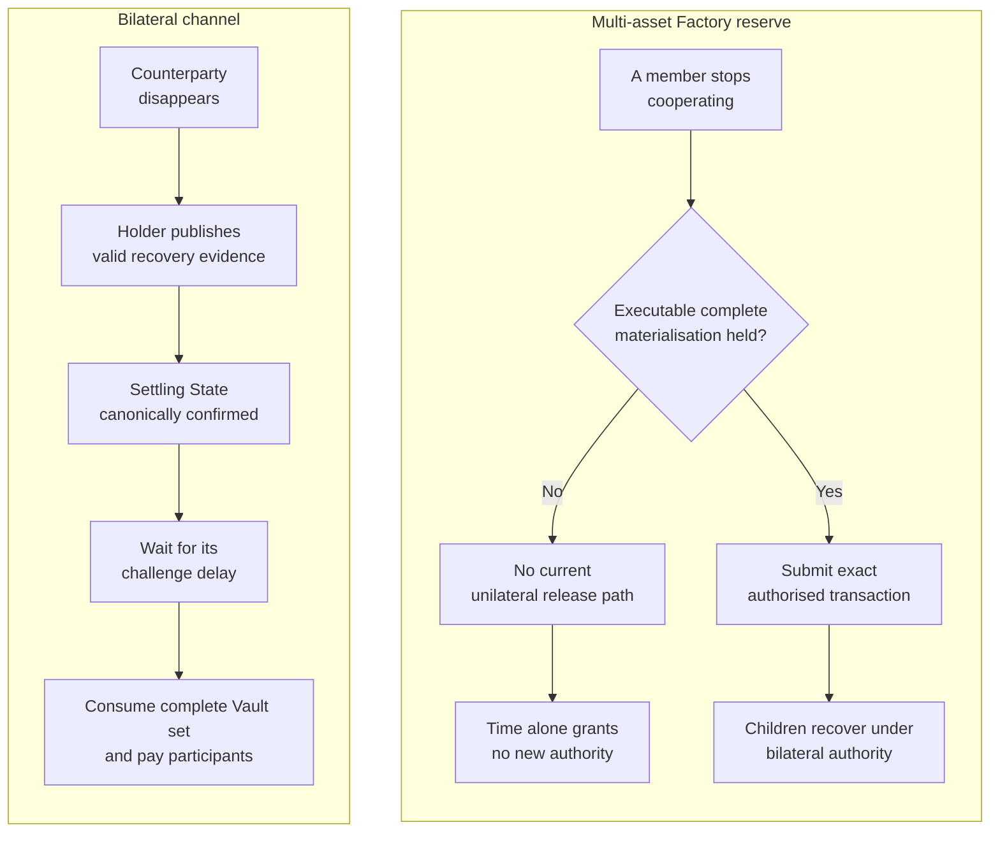
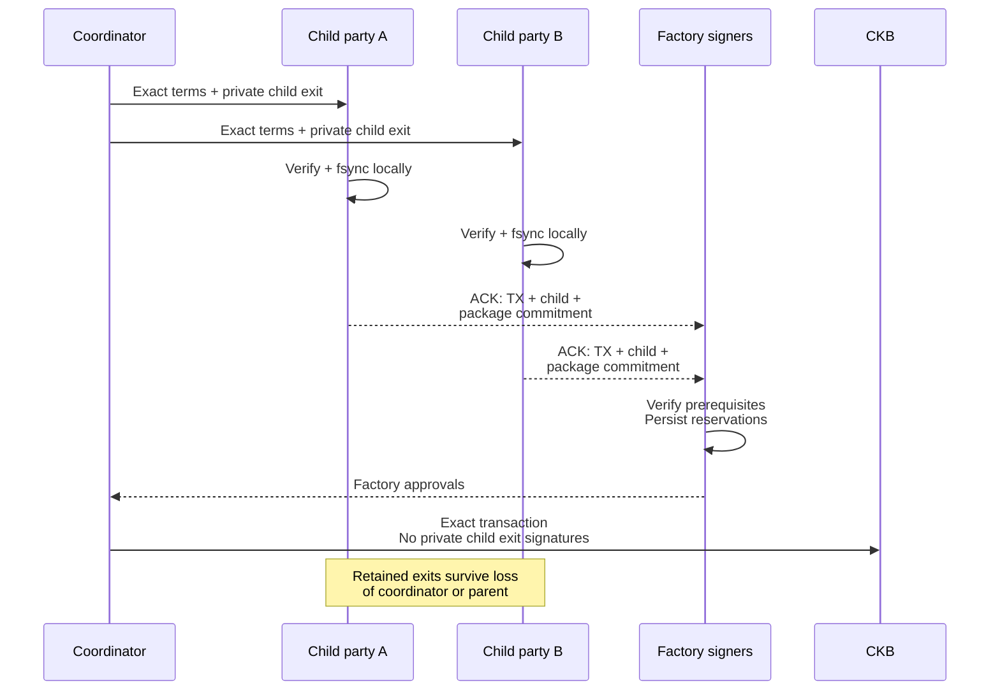
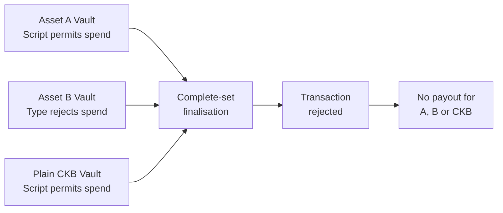
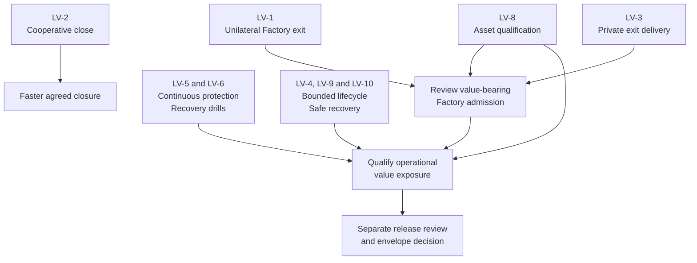

# Liveness: close Factory unilateral-exit gaps and qualify end-to-end recovery

Review baseline: [`24484e72a20edf0fbe0344d59afdcd9af1fe9b29`](https://github.com/Morph-Channel-Network/Morph/commit/24484e72a20edf0fbe0344d59afdcd9af1fe9b29), workspace version **4.0.0**, reviewed on **2026-11-04**.

This is one umbrella issue for protocol and operational liveness. It consolidates LV-1 through LV-10, incorporates source-level corrections, and links existing execution issues rather than replacing them. The review is based on source, documentation, and existing recorded evidence; it does not add a new proof, fresh VM/node acceptance, or independent security certification. The approved deployment remains controlled devnet with no real assets.

## 1. What users should be able to rely on

**A counterparty disappearing should normally cost time and fees, not the ability to recover funds.** That expectation is conditional, and today it holds for a narrower scope than “every Morph funding arrangement.”

Safety asks whether someone can take value they are not entitled to. Liveness asks whether an entitled participant can eventually recover value when others stop cooperating. A system can preserve safety while leaving value inaccessible indefinitely.

Three terms used below:

- **Recovery package:** the complete signed state, settlement descriptor, Vault identities, dependencies, and other evidence needed to construct an exit. A state number or hash alone is insufficient.
- **Factory materialisation:** consuming shared Factory custody to create independently controlled child channels, optionally retaining a smaller Factory reserve.
- **Challenge window, Δ:** the relative-block delay during which newer signed evidence must replace stale on-chain settling evidence before finalisation.

The proposed claim for the supported **bilateral** recovery profile is:

> An entitled participant holding a complete valid recovery package containing the highest relevant authorised state and required recovery evidence for the current live funding context can recover without fresh counterparty signatures, provided all required scripts permit the recovery spends within the qualified resource budget, sufficient separately funded fee inputs are available, and the required transactions obtain canonical confirmation within the assumed response and reorganisation budgets.

“Latest” must mean the highest relevant authorised state, not merely the newest file that one operator happens to possess. Successful broadcast or tx-pool presence is not confirmation. Fee availability can come from an authorised SponsorCell or an explicitly supplied wallet; one particular sponsor is not a consensus requirement. Current sponsor publication also does not automatically pay finalisation fees.

The paper makes timely confirmed supersession an assumption, and the repository still requires empirical qualification of the challenge window. Neither source inspection nor a P99.9 measurement establishes an unconditional guarantee against prolonged partition, censorship, deep reorganisation, or unavailable asset scripts. See [paper challenge-window semantics][paper-window], [fee boundaries][implementation], and [readiness gates][readiness].

## 2. The important boundary: bilateral recovery versus shared Factory custody



Both sides assume usable scripts, fee access, recovery data, and chain inclusion. The Factory gap concerns value **still inside the shared custody**. It does not freeze already materialised bilateral children.

| Profile / phase | Recovery without fresh signatures from unavailable peers | Main qualification |
| --- | --- | --- |
| Direct bilateral, with a complete current-context recovery package | Supported through publication and delayed full-set settlement | Canonical chain, usable scripts, sufficient fees and response budget |
| Materialised multi-asset child with its private initial exit package | Supported under the child's own bilateral authority | Parent survival or continued approval is unnecessary |
| Current multi-asset Factory reserve | No general unilateral release | A valid complete pre-signed materialisation may still be submitted; otherwise cooperation is required |
| Existing bounded single-Vault Factory reduced paths | Supported only for their defined proof and transaction shapes | They do not automatically authorise multi-Vault custody release |
| A recipient who never received any usable private exit | No general recovery guarantee | A coordinator possessing the package does not establish recipient possession |
| Current CKB conditional Batch profile | Separate fulfillment/refund recovery rules | Do not extrapolate these rules to unimplemented multi-asset conditions |

## 3. Findings and work classification

Priorities below express recovery impact and dependency order, not CVSS scores.

| ID | Finding | Failure class / impact | Treatment |
| --- | --- | --- | --- |
| LV-1 | No reduced or timed unilateral release for multi-asset Factory custody | Funds can remain inaccessible indefinitely without further cooperation | Highest-priority protocol gap; block unilateral-exit claims and gate any proposed value-bearing admission |
| LV-2 | No terminal cooperative-close branch | Complete closure pays a dispute delay even when parties agree | Efficiency / product capability |
| LV-3 | Private child exit delivery is not enforced by a complete native ceremony | Child can be created without a recipient having its only usable exit evidence | Release blocker before native materialisation |
| LV-4 | Durable splice reservation can survive a later guard failure with no recorded signature | Old-context new signing remains sealed; retained recovery can still exit the live context | Improve recovery without reversing reservations |
| LV-5 | Dispute-watch continuity and independent operational coverage remain incomplete | Missing a response deadline can permit stale-state finalisation | Deployment safety and liveness gate |
| LV-6 | Package retention and monotonic journal continuity are external obligations | Loss of all usable exit evidence can remove unilateral recovery | Enforce retention and rehearse recovery |
| LV-7 | Unilateral finalisation consumes the complete Vault set | No independent unilateral withdrawal of just one asset | Explicit profile limitation; cooperative splice is available |
| LV-8 | External asset scripts can block complete-set consumption | One unspendable asset can block other assets and CKB in the same custody | Asset admission and shared failure-domain qualification |
| LV-9 | Command locks, RPC waits, and incomplete lifecycle orchestration | Long command blocking; native Factory operations and terminal tracking remain unfinished | Bounded runtime work and lifecycle completion |
| LV-10 | Reorg or unavailable RPC stops guarded signing | Temporary halt, or unresolved lifecycle if exact funding cannot return | Exact replay and same-path reconciliation where possible |

### LV-1 — Multi-asset Factory reserve has no guaranteed unilateral exit

**Example:** sixteen members fund shared custody. One loses a key before an executable materialisation has been fully authorised. The remaining fifteen cannot create the missing signature, and waiting longer does not create a new spending branch.

The multi-asset Factory has its own State and witness profiles. Root creation, metadata updates, and materialisation require the relevant complete N-of-N member authorisation. **Activation is different: it explicitly carries no new member signatures** and binds the complete direct Vault set to the previously authorised root. Completing activation does not provide a way to release reserve.

The ordinary State path does not supply a timed retirement escape, and Factory Vault consumption requires the admitted materialisation evidence. Existing single-Vault reduced exits cannot be substituted into this profile. See [Factory dispatch and State paths][factory-runtime], [activation parser][factory-state], [Vault gate][factory-vault], and [materialisation verification][factory-materialisation].

The precise impact is:

> If a required member remains unavailable and no complete executable authorisation exists for the current Factory State/Vault context, value still held in that Factory has no guaranteed non-cooperative release path under the current scripts.

Already materialised children are independent. A holder of an executable complete pre-signed materialisation can submit it after a signer disappears, subject to exact inputs and dependencies still being usable. Native Factory funding/submission is currently disabled, so this is a candidate-profile consensus gap and release blocker, not evidence of trapped production deposits.

For intuition only, if each member independently has probability `p` of being unavailable during a defined recovery interval, the probability of at least one unavailable member is `1 - (1 - p)^N`. At an illustrative `p = 1%`, it is about 1.99% for N=2 and 14.85% for N=16. These are not measured Morph failure rates; independence is a simplifying assumption, and shared infrastructure can create correlated failures.

**Required direction:** specify a multi-asset reduced exit that releases the entitled allocation while proving per-asset conservation and non-interference with every untouched right and reserve. A reduced metadata update alone is not an exit.

The design must also resolve **proof availability after other members advance the Factory**. “You may exit if someone gives you a current proof” is not a strong unilateral guarantee when that someone is the adversary. Specify proof reconstruction, an enforceable freshness/dispute mechanism, or a precise additional data-availability assumption and admission restriction. Accepting stale roots without protecting newer entitlements is not a safe shortcut.

Short-term envelope disclosure, backups, and key-custody procedures reduce risk but do not establish unilateral exit. Escrow introduces a separate trust model. Do not expand membership based only on signature verification costs. Related: #20, #21, #22 and #28.

### LV-2 — Terminal cooperative close is not implemented

The current State/Vault contracts, CLI, and host operation taxonomy do not implement a complete cooperative-close branch. Normal terminal settlement requires a bound Settling State and mature relative `since`. See [implementation status][implementation] and [State retirement][bilateral-retirement].

This is primarily an exit-latency and capital-efficiency gap. It should not be ranked as equivalent to “funds cannot be recovered.”

There is an important qualification: a jointly authorised splice can release selected assets or business balances **without waiting for a dispute timeout**. It retains a valid successor channel and therefore is not a terminal cooperative close. The absence of cooperative close does not mean every cooperative withdrawal must wait Δ. See [splice retirement and withdrawals][splice-withdrawal].

Implement an explicit terminal close authorisation, separated from ordinary state-update signatures, covering the agreed settlement, funding context and required transaction semantics. Consume all required custody, retire State authority, return carriers, and preserve per-asset/capacity/fee conservation without the challenge delay. Do not reinterpret existing state signatures as consent to immediate close.

The production delay must be measured. There is currently insufficient evidence to assert that it will necessarily be “several days.”

### LV-3 — Initial child exits are validated, but recipient delivery is not enforced end to end

**Example:** a coordinator has both signatures on a child's initial Settling/1 exit. The Factory transaction is approved and confirms. The coordinator disappears before one child party receives the package, while the other party refuses new signatures. The missing recipient cannot reconstruct the private signatures from the chain.

The host already verifies complete initial exit signatures before producing the Factory signing digest or witness. That is useful and implemented; the missing step is durable possession by both recipients. On-chain materialisation intentionally exposes Factory approval and child public keys, not the child's private exit signatures. See [host prerequisite][child-host], [private delivery requirement][factory-doc], and [on-chain verification][factory-materialisation].

The planning module describes its packages as “public,” while its child structure contains a full `recovery_package`. Treat those plans as private recovery artifacts; public terminology must not become permission to upload them. See [planning package structure][planning-package].

The native ceremony should follow this proposed order. Child parties A and B are also members of the Factory signer set; they are drawn separately to show the delivery roles. Repeat delivery, independent verification, persistence and acknowledgement for **every materialised child before any Factory approval is released**:



A signed acknowledgement records a claim; it is not proof of indefinite storage. Each honest recipient's local signer must enforce verification and durable persistence before releasing its own relevant Factory approval. A coordinator's “delivered” flag is insufficient.

Test failed delivery, a missing acknowledgement, coordinator loss, restart at every persistence boundary, private artifact permissions, and child recovery after parent retirement. Existing native funding/submission must remain gated until the ceremony is complete. Related execution issue: #19.

### LV-4 — Preserve irreversible splice reservations while making recovery understandable

The current sequence is intentionally conservative:

```text
verify chain -> reserve -> fsync -> verify chain -> sign
             -> record -> fsync -> verify chain -> release receipt
```

A reorg or guard failure after the reservation write can leave a sealed old context with no recorded local signature. However, the same on-disk shape can result from a crash after signature generation and before signature recording.

**An empty signature list is not evidence that a signature never existed.** Do not add an unfreeze flag, reset the journal on restart, delete the stable lock sidecar, or move durable reservation after private signing. See [signing order][session-signing] and [irreversible reservation/cancellation][backend-freeze].

The freeze prevents new old-context signatures. It does not erase the retained recovery package. Depending on canonical custody, the operator may retry the same authorised intent, replay the exact splice, or publish the valid retained exit for the currently live context. Improve status messages and explicit recovery states while preserving reservations. A package for a retired context cannot spend successor custody. Related execution issue: #17.

### LV-5 — Watch availability is also a safety assumption

A dispute watcher must detect stale settling evidence, obtain a valid package, construct and fund a replacement, and get it canonically confirmed before the deadline. If it misses that deadline, an old state may finalise. The consequence can therefore be an incorrect payout, not merely slow access to funds.

Current multi-asset watch runs are finite passes. Multi-channel publication-service health/orchestration, unactivated-funding automation and finalisation monitoring remain incomplete. But “the repository has no continuous service or failover evidence” would be inaccurate:

- `multi-asset-supervise` continuously checks signer journals, uses nonblocking busy checks and bounded per-check RPC work, and emits expiring health. It does not sign or broadcast dispute corrections.
- Existing local tests cover two-operator contention/failover, fee/RBF behavior, and canonical reorg recovery. Independent hosts, RPC providers, administrators, and sustained public-network evidence remain separate requirements.

See [watch scope][watch-scope], [signer supervision][supervision], [local publication evidence][publication-audit], and [readiness][readiness].

A watcher being alive is weaker than a channel being protected. Health should identify coverage, package availability, canonical scan progress, fee headroom, and remaining challenge budget. Do not count signer-supervision health as proof that a dispute publication service will act.

Use measured budgets:

```text
Wmin = ceil(max(overall P99.9, each required fault-family P99.9)
            / conservative_block_ms)
     + reorg_budget_blocks
     + confirmation_blocks
     + failover_budget_blocks
     + safety_margin_blocks
```

The production methodology requires sufficient fresh samples overall and within the required fault families. It still leaves tail risk; it is not a deterministic bound on network behavior. See [measurement methodology][window-method].

Sponsor exhaustion is a denial-of-service boundary for the funded publication path, not an irreversible script condition: an independently funded authorised sponsor or wallet may restore fee access. That recovery only helps if it occurs before the remaining deadline, with sufficient fees for subsequent finalisation as well. Related: #27 and #35.

### LV-6 — Recovery packages and signing authority need different backup rules

**Example:** a participant loses every copy of its private exit package and its peer disappears. An old state digest, cursor, or account balance does not reconstruct missing signatures.

Retain complete validated recovery evidence across funding contexts, with protected off-host copies and rehearsed restoration. Give watchers read-only replicated packages. Keep `from_block` no later than creation and preserve canonical cursor evidence. A rescan can recover public chain history; it cannot recreate private evidence that was never published. See [retention runbook][retention] and [watch cursor rules][watch-wire].

Package backups do not replace a monotonic signer journal. Restoring an older signer snapshot or cloning active signing authority can enable conflicting signatures. Lost-package recovery and lost-authority recovery therefore require different procedures. If all usable private exit evidence is lost and no cooperative recovery exists, disclose that unilateral recovery is no longer guaranteed. See [journal boundary][journal-boundary].

### LV-7 — Full-set unilateral settlement is a deliberate coupling

The current multi-asset finalisation profile consumes every committed Vault atomically. It rejects partial State retirement and incomplete custody consumption. This simplifies conservation and prevents orphaned value, but means a participant cannot unilaterally withdraw just one asset while leaving the rest of the same channel active. See [atomic settlement][atomic-settlement].

A cooperative splice can withdraw/remove selected assets while retaining a valid channel. Therefore, replace “moving one asset always requires full close and reopen” with:

> Independent unilateral per-asset withdrawal is outside the current profile; cooperative asset changes use splice, while unilateral finalisation closes the complete set.

An independent partial exit would require an authenticated remaining-value authority and new recovery rules. Factory allocation into independently recoverable children can separate future failure domains, but Factory-to-child-Factory hierarchy must not be presented as an implemented alternative. Combined resource budgets belong in #28.

### LV-8 — One unavailable asset script can obstruct recovery of other assets

Morph verifies asset identity and conservation. That does not establish that an arbitrary external Type Script will permit the required future spends. A script may reject consumption, require an unavailable issuer, depend on missing code, or exceed the qualified resource budget.

Because finalisation is atomic over the complete committed Vault set, the failure can spread:



This is an inference from complete-set consumption and transaction-wide script validity, not a newly executed malicious-script PoC. It is stronger than “only the bad asset is locked.” A splice or Factory materialisation that also needs to consume the rejecting input cannot simply route around it.

The operator value-limit policy rejects unlisted xUDT assets, but it is a host-side admission control. It does not prove script behavior or automatically enforce itself on every transaction path. See [policy boundary][value-policy] and [full-set enforcement][bilateral-retirement].

Asset qualification must cover the actual deployed code/dependencies, mint/burn or issuer requirements, upgrade/freeze powers, worst-case execution cost, and recovery under missing counterparties. An asset accepted into a shared atomic custody becomes part of every co-held asset's exit assumptions. Keep production value admission separate from merely recognizing a Type hash.

### LV-9 — Bound blocking work and finish the operational lifecycle

Session commands hold a stable journal lock across chain verification and signing. A slow RPC can therefore block other commands for that session path. This is not evidence of an infinitely hanging single RPC: the normal client already has a 90-second request timeout, a 10-second connection timeout, and bounded retry counts. Multiple calls/retries can nevertheless create long command latency without a single total command budget. See [session lock scope][session-lock] and [RPC limits][rpc-limits].

The supervisor already uses nonblocking journal checks and a separate total per-check RPC budget. Preserve that isolation. Add explicit total command deadlines and cancellation semantics that do not abandon partial authority mutations or reverse durable reservations.

Native multi-asset Factory construction/submission, continuous lifecycle reconciliation and automatic terminal-abort tracking remain unfinished. The Hub's single-instance operational boundary is another availability consideration; it must not be presented as redundant infrastructure. Coordinate lifecycle state, recovery intent, and outgoing work without cloning signer authority. Related: #20, #29 and #35.

### LV-10 — Reorg recovery is a conditional halt, not automatic ceremony replacement

Guarded signing correctly fails closed when funding lineage, live custody, code dependencies, or canonical confirmations cannot be verified.

A funding or splice reorg does **not** always require a new ceremony. When the original exact transaction and its inputs remain usable, existing support permits keyless exact replay, restoration of activation, confirmation at the required depth, and explicit `refresh-chain` against the same session path. Vote history is preserved; old-context seals remain in force. See [replay and refresh][reorg-recovery].

If exact inputs have been consumed by a conflicting canonical transaction and the funding cannot be restored, keep the affected authority stopped. Record the terminal lifecycle evidence and use an explicitly reviewed procedure. Do not silently select replacement inputs, initialise a second authority, or restore an older snapshot. Automatic terminal tracking remains open. Temporary RPC loss similarly pauses signing until canonical evidence can be reconciled.

## 4. Required acceptance evidence

The central invariant should be checked **before admitting a state or funding shape for signing**:

> Every admitted value-bearing state has an executable recovery path under its declared cooperation, data-availability, fee, script, capacity, transaction-size, cycle, and chain-inclusion assumptions.

A parser accepting a larger count, successful funding, or a lower-cost metadata proof does not establish that invariant.

| Fault / adversary | Required safe behavior | Recovery or explicit limitation |
| --- | --- | --- |
| A Factory member disappears before materialisation is fully authorised | No fabricated or weakened authorisation | New reduced-exit profile releases entitled value without fresh peer signatures; current profile must disclose absence |
| Other members advance the Factory and withhold current proof data | Preserve latest entitlements and reject unsafe stale-root release | Demonstrate proof reconstruction/freshness mechanism, or state and gate the extra availability assumption |
| Coordinator disappears during child delivery | No honest recipient approves before locally retaining its usable exit | Restart the same ceremony safely; after creation, child exits independently |
| Reorg after splice reservation; crash before/after private signing | Keep the reservation durable; never infer “never signed” from an empty record | Retry/reconcile the same intent or use the valid exit for current canonical custody |
| Watcher dies during an active challenge | Publication health expires and independent alerts identify affected coverage | Another operator confirms correction within remaining Δ |
| Fee floor exceeds sponsor cap or sponsor is exhausted | Reject overspend; preserve channel value; report lost headroom | Use a separately funded authorised fee source before the deadline |
| Local package store is lost | Never substitute a rolled-back signer journal | Restore validated complete packages; disclose loss of guarantee if none exist |
| One admitted asset refuses future consumption | Show the complete-set blast radius explicitly | Reject unqualified admission; never claim other co-held value is isolated |
| RPC stalls while the session lock is held | Bound total command latency; supervisor reports busy without blocking unrelated checks | Release the lock through safe failure and retry against the same journal |
| Exact funding transaction is orphaned or becomes impossible | Stop guarded signing; preserve votes, lineage and seals | Replay/activate/refresh when possible; otherwise retain stopped terminal evidence |

The LV-1 design and implementation must satisfy:

- [ ] **Actual unilateral release:** an honest entitled member can recover with every other member refusing new signatures. Define whether release pays a wallet directly or creates an independently recoverable child.
- [ ] **Exact provenance and replay resistance:** authenticate chain, Factory identity, complete membership, authoritative roots/state, source Vault set and exact OutPoints; reject stale, cross-context, substituted and duplicate releases.
- [ ] **Per-asset and capacity conservation:** account separately for CKB, every exact xUDT Type, business balances, reserve, State carriers and external fees. Never net unrelated assets.
- [ ] **Non-interference:** only explicitly authorised withdrawing rights change; hidden sibling-subtree changes and mutations to untouched rights or untouched reserve allocations are rejected.
- [ ] **Proof availability and concurrency:** cover current-proof withholding, concurrent advancement and competing exits without requiring a missing member to supply new data.
- [ ] **Independent child recovery:** parent retirement or permanent member loss does not invalidate the child's privately retained recovery path.
- [ ] **Executable resource bounds:** qualify intended wallet/asset scripts, worst-case payouts, sufficient occupied capacity, fee bumping/rebuild requirements, and complete transaction bytes/cycles for admitted combinations.
- [ ] **Cross-layer consistency:** update host/scripts/SDK, canonical fixtures, domains, parity checks, VM negatives, native publication and reorg/restart evidence together. Follow the current-format-only policy; do not add historical parser aliases or imply automatic upgrades of live custody.

## 5. Delivery order and completion criteria



This graph is an engineering dependency proposal, not permission to deploy. Cooperative close can be developed in parallel, but it should not displace missing recovery capability or deadline-critical watch coverage.

- [ ] **P0 protocol:** resolve LV-1 and document the precise unilateral/data-availability guarantee. Until then, keep all-participant Factory custody explicitly outside any general unilateral-exit claim.
- [ ] **P0 ceremony:** complete LV-3 through #19 and integrate it into #20 before enabling native materialisation.
- [ ] **P0 deployment:** complete continuous dispute protection, package restore drills and independent fee/reorg/operator measurements for the proposed exposure (#27). Integrate readiness without confusing it with process liveness (#35).
- [ ] **P0 asset admission:** make LV-8's complete-set failure domain explicit in the envelope and qualify intended scripts and resource combinations (#21, #22, #28).
- [ ] **P1 recovery tooling:** implement the LV-4/LV-9/LV-10 bounded recovery and terminal-state work while preserving monotonic authority (#17, #20, #29).
- [ ] **P1 efficiency:** implement and qualify explicit terminal cooperative close (LV-2); document existing cooperative splice versus unilateral full-set settlement (LV-7).
- [ ] **Documentation:** align source status, release claims, private-package handling and operator procedures (#23). Record which guarantees are consensus properties, local journal properties, operational assumptions or unavailable capabilities.
- [ ] **Evidence:** attach positive and negative results for the fault matrix, exact build/script identities, representative resource measurements and remaining assumptions. Distinguish existing tests from newly executed acceptance.
- [ ] **Closure:** maintain explicit disposition for all LV-1–LV-10. “Documented limitation” does not count as an implemented guarantee; unsupported exposure remains gated, and release approval remains separate.

Existing work remains owned by its execution issues: #17 (splice recovery), #19 (independent Factory signers/delivery), #20 (native Factory lifecycle), #21 (deployment envelope), #22 (real-node/script acceptance), #23 (documentation), #27 (independent measurements), #28 (combined budgets), #29 (runtime storage) and #35 (readiness/observability).

[paper-window]: https://github.com/a19q3/Research/blob/3c202ea30ad88c145dbcdba2513363cf09c81923/morph_channel/paper.tex#L1452-L1515
[implementation]: https://github.com/Morph-Channel-Network/Morph/blob/24484e72a20edf0fbe0344d59afdcd9af1fe9b29/docs/implementation.md#L181-L208
[readiness]: https://github.com/Morph-Channel-Network/Morph/blob/24484e72a20edf0fbe0344d59afdcd9af1fe9b29/docs/mainnet-readiness.md
[factory-runtime]: https://github.com/Morph-Channel-Network/Morph/blob/24484e72a20edf0fbe0344d59afdcd9af1fe9b29/contracts/morph-script-common/src/factory_multi_asset_runtime.rs#L140-L240
[factory-state]: https://github.com/Morph-Channel-Network/Morph/blob/24484e72a20edf0fbe0344d59afdcd9af1fe9b29/contracts/morph-script-common/src/factory_multi_asset/state.rs#L210-L222
[factory-vault]: https://github.com/Morph-Channel-Network/Morph/blob/24484e72a20edf0fbe0344d59afdcd9af1fe9b29/contracts/morph-factory-vault-lock/src/main.rs#L59-L66
[factory-materialisation]: https://github.com/Morph-Channel-Network/Morph/blob/24484e72a20edf0fbe0344d59afdcd9af1fe9b29/contracts/morph-script-common/src/factory_multi_asset/materialisation.rs#L474-L497
[factory-doc]: https://github.com/Morph-Channel-Network/Morph/blob/24484e72a20edf0fbe0344d59afdcd9af1fe9b29/docs/multi-asset-channels.md#L109-L159
[bilateral-retirement]: https://github.com/Morph-Channel-Network/Morph/blob/24484e72a20edf0fbe0344d59afdcd9af1fe9b29/contracts/morph-state-type/src/multi_asset.rs#L170-L198
[splice-withdrawal]: https://github.com/Morph-Channel-Network/Morph/blob/24484e72a20edf0fbe0344d59afdcd9af1fe9b29/docs/multi-asset-splice.md#L65-L100
[child-host]: https://github.com/Morph-Channel-Network/Morph/blob/24484e72a20edf0fbe0344d59afdcd9af1fe9b29/crates/morph-core/src/factory_multi_asset.rs#L113-L140
[planning-package]: https://github.com/Morph-Channel-Network/Morph/blob/24484e72a20edf0fbe0344d59afdcd9af1fe9b29/crates/morph-cli/src/factory_multi_asset_packages.rs#L1-L30
[session-signing]: https://github.com/Morph-Channel-Network/Morph/blob/24484e72a20edf0fbe0344d59afdcd9af1fe9b29/crates/morph-cli/src/multi_asset_session.rs#L607-L646
[backend-freeze]: https://github.com/Morph-Channel-Network/Morph/blob/24484e72a20edf0fbe0344d59afdcd9af1fe9b29/crates/morph-core/src/multi_asset_backend.rs#L645-L716
[watch-scope]: https://github.com/Morph-Channel-Network/Morph/blob/24484e72a20edf0fbe0344d59afdcd9af1fe9b29/docs/multi-asset-channels.md#L203-L226
[supervision]: https://github.com/Morph-Channel-Network/Morph/blob/24484e72a20edf0fbe0344d59afdcd9af1fe9b29/docs/runbooks/signer-supervision.md
[publication-audit]: https://github.com/Morph-Channel-Network/Morph/blob/24484e72a20edf0fbe0344d59afdcd9af1fe9b29/docs/hardening/production-publication-reliability/completion-audit.md#L29-L58
[window-method]: https://github.com/Morph-Channel-Network/Morph/blob/24484e72a20edf0fbe0344d59afdcd9af1fe9b29/docs/hardening/production-publication-reliability/hardening.md#L183-L207
[retention]: https://github.com/Morph-Channel-Network/Morph/blob/24484e72a20edf0fbe0344d59afdcd9af1fe9b29/docs/runbooks/operations.md#L47-L67
[watch-wire]: https://github.com/Morph-Channel-Network/Morph/blob/24484e72a20edf0fbe0344d59afdcd9af1fe9b29/docs/multi-asset-wire.md#L189-L228
[journal-boundary]: https://github.com/Morph-Channel-Network/Morph/blob/24484e72a20edf0fbe0344d59afdcd9af1fe9b29/docs/multi-asset-wire.md#L179-L185
[atomic-settlement]: https://github.com/Morph-Channel-Network/Morph/blob/24484e72a20edf0fbe0344d59afdcd9af1fe9b29/docs/multi-asset-channels.md#L67-L105
[value-policy]: https://github.com/Morph-Channel-Network/Morph/blob/24484e72a20edf0fbe0344d59afdcd9af1fe9b29/docs/runbooks/value-limits.md#L8-L18
[session-lock]: https://github.com/Morph-Channel-Network/Morph/blob/24484e72a20edf0fbe0344d59afdcd9af1fe9b29/crates/morph-cli/src/multi_asset_session.rs#L557-L585
[rpc-limits]: https://github.com/Morph-Channel-Network/Morph/blob/24484e72a20edf0fbe0344d59afdcd9af1fe9b29/crates/morph-cli/src/rpc.rs#L16-L23
[reorg-recovery]: https://github.com/Morph-Channel-Network/Morph/blob/24484e72a20edf0fbe0344d59afdcd9af1fe9b29/docs/multi-asset-splice.md#L280-L306

