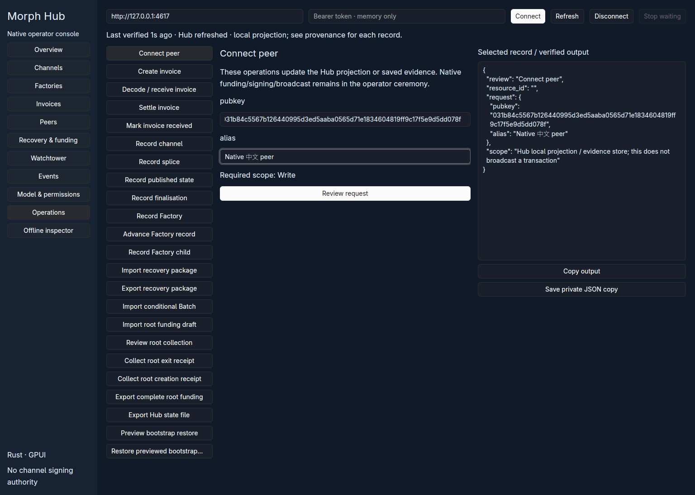
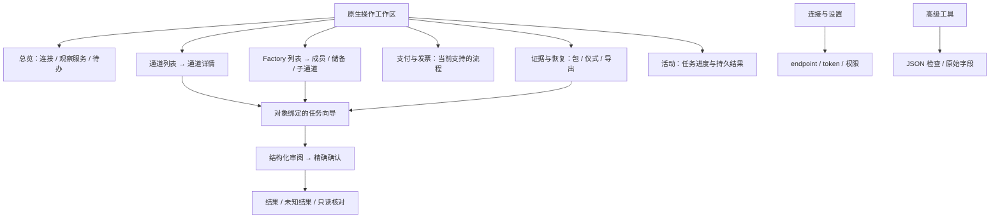
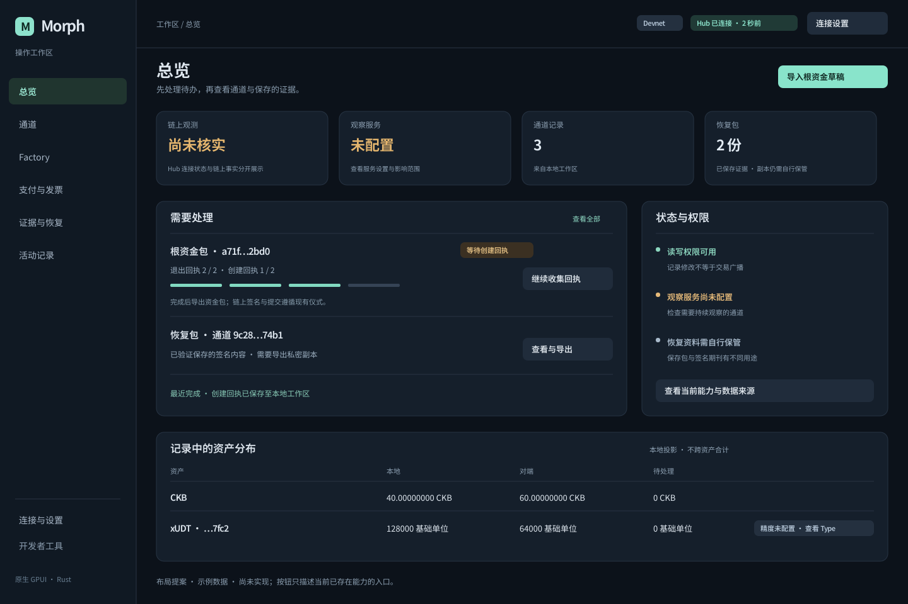

# Morph 原生 UI/UX 审计与当前实现清理

> 后续更新：本文保留改版前审计。原生工作区已按本报告整改，见[后续全面优化实施记录](native-uiux-implementation-2026-11-09.md)；后续仅做桌面预览构建与目检，没有运行完整 gates。

日期：2026-11-09。审计基线：`d988c79`，外加本轮 fixture / 迁移适配层清理。当前 GPUI 页面代码未重设计。本轮按要求**不运行 gates、构建、单元测试、VM 测试或 devnet 验收**；仅做源码阅读、引用清点、已有界面截图审阅和设计提案绘制。此前的通过记录仍属于此前提交，不能代替本轮验证。

## 结论与产品定位

现在的界面直接映射 Hub 的 API 操作和原始 JSON，已经具备原生能力接替的基础，但操作员仍需自己完成对象定位、流程串联、单位转换和结果解释。因此“像工程草稿”的主要原因是信息架构与任务设计，单独改颜色和圆角不能解决。

建议将产品明确定位为 **Morph 原生操作工作区**：管理当前通道与 Factory 记录、签名证据、资金仪式资料和观察服务。让用户从对象和待办进入任务，在详情里理解结果。当前 Hub 的本地记录操作不应被包装成已经具备链上签名、广播和真实钱包能力的一键功能。

发现分为 **6 项 P1 和 6 项 P2**。这里的 P1 表示优先修复的产品可用性问题，不是共识安全漏洞等级，也没有据此推导出可利用的资金损失路径。

## 1. 已完成的清理

### 1.1 删除迁移期保留的数据和接口

| 清理项 | 本轮处理 | 原因 |
| --- | --- | --- |
| `fixtures/interop/typescript-baseline.json` | 删除 | TS SDK 迁移快照，已不应成为当前 SDK 的接口约束 |
| `fixtures/interop/retiring-sdk-protocol-regressions.json` | 删除 | 202 次旧调用的完整重复包和预期结果，体积大且与当前包样例重叠 |
| `fixtures/interop/retiring-gateway-authorization.json` | 删除 | 非规范旧 requirement id；从当前合法向量直接变异即可检查拒绝边界 |
| `fixtures/protocol/multi-asset-conditional.json` | 删除 | 当前 Rust 构造器已提供该样例，留存副本仅供旧 SDK 使用 |
| `fixtures/protocol/conditional-batch.json` | 删除 | 同上；当前 fixture 命令和 Batch 检查仍保留 |
| `fixtures/protocol/multi-asset-conditional-root.json` | 删除 | 旧 SDK 专用条件根资金快照及其专用生成函数一起删除 |
| `fixtures/protocol/multi-asset-splice-transitions.evidence.json` | 删除 | 重复保存的节点运行证据；证据应留在相应 run 目录 |
| `inspection::public_operation` | 删除 | 按旧 camelCase 操作名动态分发的迁移适配器 |
| inspection 模块中的包模块重复公开入口 | 收回为内部引用 | 对外统一使用 `morph_sdk::packages` 的具体 Rust API |
| 旧 SDK 快照回归文件 | 替换 | 当前 SDK 检查复用当前协议样例，直接调用 `inspect` / `inspect_signature` |
| devnet 运行后回写源码 fixtures | 删除 | 避免重新制造已删的重复证据文件或把实际链运行复制成源码样例 |
| SDK 时代的 fixture helper 名称 | 直接改名 | 不保留旧别名；统一为 packet / proposal / splice 当前用途 |

总计删除 **7 份冗余 fixture**。`fixtures/` 的文件内容从 **3,490,327 字节降至 570,100 字节**，减少 **2,920,227 字节，约 84%**。当前 Gateway 向量只是移动位置，不计作删除。

### 1.2 保留的资料有明确消费者

- `fixtures/protocol` 保留 9 份当前包样例与预期摘要，由 Core、CLI 和 SDK 共用。
- `fixtures/gateway/authorization.json` 是当前规范的独立签名向量。它的 Noble 来源是数据 provenance，没有附带 JS/TS 实现或旧解析器。
- `fixtures/hub` 保留当前 loopback 权限语义的输入。
- `fixtures/fiber` 保留 15 个当前 Rust 场景族及来源清单。这些是实际执行的请求/断言定义，不能与冗余响应快照一并删除。
- 原有私钥输入拒绝、未知字段/格式拒绝和签名边界检查继续存在。这些检查拒绝旧格式，不是支持旧格式。

当前源码清点没有发现 JS/TS 文件或 npm 前端清单；本轮没有通过删除文件名伪装成删除第二套运行时。`crypto_compatibility` 原本只是固定签名向量的测试模块，已改名为 `crypto_vectors`，保留当前 low-S 和摘要绑定检查；它不是旧协议验证器。

### 1.3 验证状态

引用和消费者已同步修改，但**本轮未编译、未运行任何 gates**。新增/改写的当前 Rust 检查也未执行。历史资格文档已加上冻结提交说明，避免把旧的全绿结果冒用到本轮清理。

## 2. 现状观察与审计边界

这是此前真实原生窗口的截图，用来说明界面形态，不作为本轮重新运行的证据。当前 UI 源码与图中的信息架构一致。窄窗口风险来自宽度与组件结构分析，本轮没有声称已在所有尺寸、平台或辅助技术上实机复现。

已有良好基础需要保留：规范 Rust 包验证、权限/新鲜度门、明确的双阶段确认、未知写入结果处理、无自动写重试、私密不可覆盖导出、记录 provenance、原生 IME 与文件选择器。这些能力应由更清楚的产品界面呈现。

## 3. P1：优先修复的可用性问题

### UX-01：数据来源与“已验证”含义不够明确

**证据：** `main.rs:765` 使用 `Last verified` 表示最近一次 Hub 刷新；`main.rs:818` 把原始记录与审阅输出都放进 `Selected record / verified output`；`model.rs` 的记录本身同时包含本地投影、保存的签名包和服务状态。

**影响：** 用户需要阅读技术说明才能区分“HTTP 读取成功”“签名内容校验成功”和“链上已确认”。连续显示同一类“已验证”文案，会稀释这些区别。

**整改：** 为每个对象显示独立的来源标签：本地记录、签名证据、链上观测。顶栏只说“Hub 已连接 / 上次刷新”，链上确认显示对应交易、区块和观测时间。链上事实尚不可用时直接显示“尚未核实”，不由连接状态推导。

### UX-02：对象列表与操作脱节，用户要手工拼接工作流

**证据：** `main.rs:542` 的记录点击只调用 `show_result`；`main.rs:333` 的操作表单要求手工输入 Resource id。根资金、回执收集、导出、恢复预览与恢复是不同的全局操作按钮（`forms.rs:203`、`forms.rs:220`）。恢复执行还需要调用方提供 `state` 与 `confirmation_hash`（`morph-sdk/src/hub.rs:497`）。

**影响：** 查看通道后仍要复制 ID 再找操作；完成 preview 后仍要理解下一个 JSON 请求形状。这是 API 操作者的流程，不适合日常操作人员。

**整改：** 列表进入对象详情，由详情启动已绑定对象的动作。根资金建立“导入→审阅→收集退出回执→收集创建回执→导出”向导。恢复预览直接进入绑定该预览摘要的确认步骤，不让用户手工改装请求 JSON。

### UX-03：草稿按不同规则重置和保留，容易产生错误上下文

**证据：** `main.rs:146` 切换表单重新创建普通字段；`id`、`asset`、`documents` 却是整个 Desktop 共享的实体（`main.rs:35`）。页面切换与操作切换的保留行为不同。

**影响：** 一部分输入突然消失，另一部分来自上一个操作的 ID / JSON 继续存在。用户难以判断当前操作绑定的是哪个对象和哪份资料。

**整改：** 草稿按任务和对象隔离，任务标题显示对象标识。切换有改动的任务时提供保留或丢弃选择；敏感输入不默认持久化到磁盘。导入文档要有文件名、schema、来源、大小和明确的移除按钮。

### UX-04：全局消息容易被轮询覆盖，错误会错误地影响连接呈现

**证据：** `main.rs:252` 每次成功刷新重写 `message`；`main.rs:305` 约每 5 秒触发刷新。统一的 worker 错误分支（`main.rs:294`）也会清空 `last_checked`，其中包括文件读取/解析错误，而不仅是网络错误。

**影响：** 文件格式错误可能表现为数据 stale；用户还没看完错误，下一次正常刷新就把它替换为“Hub refreshed”。保存、失败与对账过程缺乏可追踪结果。

**整改：** 将连接、数据刷新、当前任务、文件输入和持久通知拆开。字段错误靠近字段；任务结果留在任务详情和活动记录；轮询只更新连接与数据状态。未知写入结果作为持久任务状态，提供“重新读取并核对”，不得自动重发。

### UX-05：确认主要依靠 JSON，失效审阅没有及时反映到界面

**证据：** `main.rs:379` 将审阅写成 JSON；`main.rs:397` 在点击确认时才比较当前草稿、event id、权限等。输入修改和 Hub 更新不一定立即清空可见确认按钮。

**影响：** 用户需要自行比较原始字段；已变化的草稿仍可能显示“确认已审阅请求”，点击后才告知需重审。底层守卫是有效的，本发现不是确认绕过。

**整改：** 使用结构化确认面板，展示对象、动作、资产、金额、资金上下文和实际效果。修改草稿、对象或相关状态后立即标注“需要重新审阅”并禁用确认。保留既有精确比较，不能为了体验而放松检查。

### UX-06：金额和资产身份过于依赖手工技术输入

**证据：** `forms.rs:36`、`forms.rs:66` 等要求基础单位和 Type hash；`model.rs:80` 直接展示发票 amount。资产输入由空字符串代表 CKB，其余输入是 token Type hash。

**影响：** 用户需要手算 CKB/shannons，并记住资产 Type 与精度；长 hex 很难识别。即使服务端能拒绝不合法请求，也不能替用户发现“合法但理解错了单位”的输入。

**整改：** CKB 明确显示 CKB 与 shannons 双值；金额始终使用精确整数/十进制转换。token 仅使用可信配置中的精度，未知精度显示基础单位，不猜测。资产显示名称、网络、Type 摘要和可复制的完整身份；reserve、业务价值、pending 与费用分别呈现，不跨资产求和。

## 4. P2：结构与视觉完成度问题

| ID | 发现与证据 | 建议 |
| --- | --- | --- |
| UX-07 | 11 个一级入口与 23 个操作按钮同级堆叠；`main.rs:513`、`:637`。每个任务都要重新搜索操作目录 | 一级导航按工作领域分组，动作进入对象详情或任务向导；高级工具收进独立区域 |
| UX-08 | 215px 导航、235px 操作列、460px 输出列和边距竞争空间；输出区固定 440px 高，缺少宽度分档 | JSON 默认折叠为“技术详情”；宽屏可开侧栏，窄屏使用抽屉；内容优先保留字段宽度 |
| UX-09 | 所有页面顶端常驻 endpoint、token、Connect、Refresh、Disconnect、Stop waiting；`:779` | 首次连接用专门引导；连接后收成状态条和设置入口，仅在任务执行时显示停止等待 |
| UX-10 | `overview`（`:589`）主要是几行计数与解释文字，没有待办优先级和对象入口 | 总览回答“服务情况怎样、哪些任务待处理、证据是否齐备、下一步做什么”；指标可点击并带来源 |
| UX-11 | 字段显示 `pubkey` / `counterparty_pubkey` 等内部 key（`:657`），尽管 `Field.label` 已提供人类可读标题；状态用 Debug 枚举拼接；应用色彩和尺寸散落 | 使用可见的人类标签、短标识+完整复制、语义状态标签与统一排版/间距/色彩 token；不要只依赖 placeholder |
| UX-12 | 没有应用层的明确任务快捷键、焦点返回规范和本地化资源结构；本轮没有足够证据判断辅助技术全覆盖 | 定义导航/搜索/关闭面板快捷键、可见焦点、字段错误语义和一致术语；将文案集中管理，屏幕阅读器能力单独核实 |

**纠正一个容易误判的点：** 操作页已经在 `main.rs:704` 使用 `overflow_y_scroll`，记录列表也已虚拟化。本审计不声称“完全没有滚动”或“底部按钮一定无法触达”。问题是长操作目录和表单一起滚动、信息密度过高，以及缺少对象化布局和宽度分档。布局风险需要在后续实现中按尺寸实测，不能用静态推断冒充实测结果。

## 5. 建议的原生界面结构

“支付与发票”只展示当前实际支持的功能。不能因为导航叫支付就增加一个无法真实执行的“发送付款”按钮。根资金导出也不能被文案描述为已经完成广播。

### 总览布局提案

[可编辑 SVG](uiux/operator-overview-proposal.svg)。这张图是**提案与示例数据，尚未实现**，不是新的运行截图。它展示如何重新组织现有能力；不是对图中数值、观察服务、备份或链上状态的证明。

### 页面职责

| 页面 | 第一眼应看到什么 | 主动作 |
| --- | --- | --- |
| 总览 | 连接/链上观测分别显示，紧急提醒和待办 | 继续一个未完成任务，或导入当前证据 |
| 通道详情 | 对端、资产、记录与证据状态、资金上下文、当前进度 | 对该通道执行当前合法动作 |
| Factory 详情 | 成员、按资产储备、权益与子通道、可用授权路径 | 进入明确的 Factory 任务 |
| 根资金工作流 | 退出/创建回执分别几份、缺谁、下一步 | 收集回执，完整后导出 |
| 恢复包详情 | 签名内容验证结果、对象、epoch、资产、私密属性 | 审阅与私密导出 |
| 活动 | 正在进行、成功、失败、结果待核实 | 查看结果或进行只读核对 |
| 高级工具 | 原始 JSON、schema、完整标识和诊断 | 检查、复制或导出技术资料 |

宽度策略：宽屏可以同时看列表与详情；中等窗口将技术详情放入可关闭侧栏；更窄窗口使用单列与抽屉。长表单独立滚动，确认区保持可见。精确分档应由最终内容尺寸确定，而不是在本轮虚报已经支持的断点。

## 6. 先解决任务，再统一视觉

### 第一批：产品语义和上下文

1. 区分 Hub 连接、本地记录、签名证据和链上观测。
2. 列表进入对象详情，动作预绑定对象与资产。
3. 给根资金和恢复流程建立连续任务，草稿按任务隔离。
4. 确认面板结构化；草稿或相关状态变化立即使审阅失效。
5. 拆开连接状态与任务反馈，明确显示未知写入结果。

### 第二批：信息架构与版式

1. 收起 23 项全局操作目录；按领域呈现入口。
2. JSON 转为按需打开的高级详情。
3. 将连接设置从每页大表单收进设置/首次连接流程。
4. 总览重做待办、状态和恢复资料入口；金额按资产与单位呈现。

### 第三批：视觉与原生交互细节

统一标题层级、间距、状态色、按钮优先级和字段说明；完善键盘和焦点行为；再处理多语言资源和原生窗口尺度。原生 GPUI 与现有组件库继续使用，不建立第二套前端。

建议组织为 `shell`、`theme`、`components`、`pages` 和 `flows`。继续复用现有 SDK、worker、精确确认、规范包实现和协议权威边界。无需为了重设计 UI 改动链上格式、复制状态机或新增一套包 codec。

## 7. 后续设计评审场景

这些是改版应能说明清楚的用户路径，**本轮未执行**：

- 从通道列表进入详情，发起该通道的记录更新，不复制粘贴 ID。
- 从根资金草稿开始，完成回执收集和私密导出，知道何时仍需既有链上仪式。
- 导入错误 JSON，只标记该文档错误，不把 Hub 描述成断线。
- 修改金额后，旧确认立即标为失效；无法继续提交旧审阅。
- 写入响应丢失后，任务持续显示“结果待核实”，只读刷新不会静默重发。
- 不同窗口尺寸下保留完整的可操作表单和明显的技术详情开关。
- 离线检查一个恢复包，清楚理解“签名内容正确”与“当前链状态已核实”的区别。

本轮交付是清理代码、审计结论与布局提案；GPUI 改版尚未实施。此前的 CI 与资格记录不代表清理后的工作树已经测试通过。
