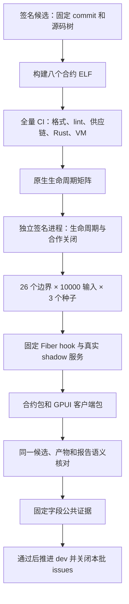
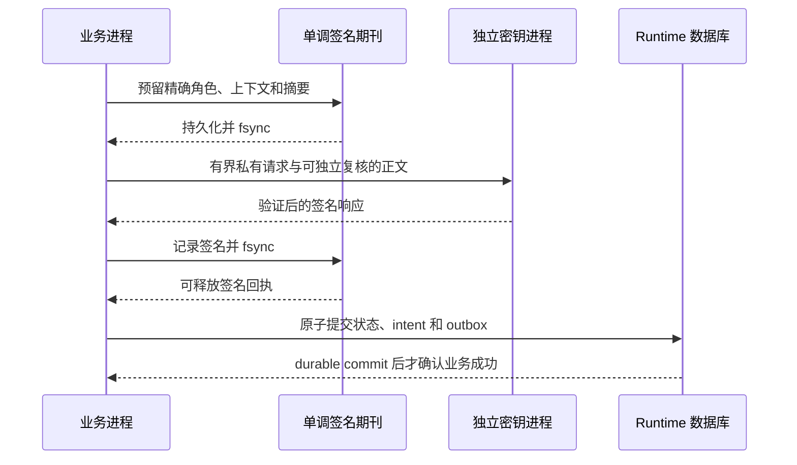
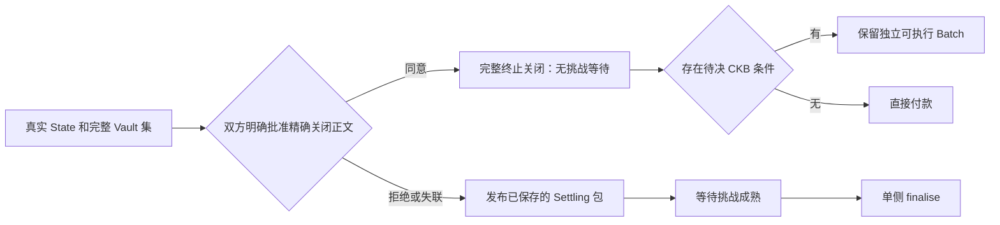
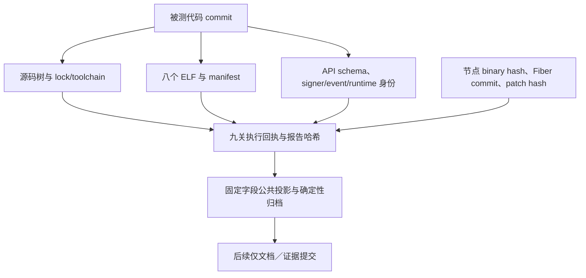

# Morph W1 收尾报告：从能力实现到同一候选的完整验收

日期：2026-11-11。范围：#28、#29、#31、#32、#35、#37、#43、#44、#51、#55。

本报告说明这一批工作做了什么、为什么这样做，以及证据能支持到哪里。执行结果和精确哈希见文末的机器报告摘要。本次目标是受控、无真实资产的本地开发基线；没有发布版本、创建 tag、合并 main 或扩大真实资产准入。

## 1. 这次最重要的变化

先前的问题不只是某个功能缺失，而是能力、持久化、签名、观察和验收分别成立，却没有汇合到同一个源码和产物身份。旧检查点中的 77 个 VM 用例不能自动证明新合约；一次独立脚本通过也不能证明桌面包、运行服务和链上脚本相互一致。

这次把当前能力收敛为 `w1-local-no-value`。每一关必须记录实际命令、起止时间、退出码、日志哈希和执行前后的源码身份；最后还要检查报告语义。只有退出码而没有实际场景、角色、规范链恢复或精确产物信息，不能晋级。



独立审计、公网测量已按所有者决定从这次本地前置中排除，报告明确记为 excluded/deferred，不填写为通过。live routing、厂商 HSM、新 GUI 工作流和未来端点也没有被临时加入 W1 关闭前置。

## 2. 十个 issue 分别完成什么

| Issue | 本轮完成边界 | 为什么需要 |
| --- | --- | --- |
| #28 | 当前准入组合的签名、退出、保留地板、外部费用、证明保留及生命周期计数 | 各维度分别合法，并不保证组合后能够退出 |
| #29 | runtime 状态、恢复 intent、outbox 原子提交；CAS、加密、故障恢复和只读校验 | 不能先告诉调用者成功，再发现恢复记录没有落盘 |
| #31 | 七类当前签名角色的独立审查与有界私有 IPC；保留单调预留 | 把“业务进程要签什么”和“密钥进程允许签什么”分开验证 |
| #32 | 已暴露 Hub/Gateway 端点的 Rust DTO、schema、错误及 SDK；幂等和 revision 规则 | 客户端、文档和服务不能各自解释金额、标识或重试 |
| #35 | 已实现 scope 的 readiness、固定标签指标、预算余量与操作响应 | 进程活着不代表能够及时签名、扫描或发布 |
| #37 | 固定 Fiber 补丁、精确托管 observer、真实非转发 shadow 服务恢复 | 避免用一个绿色 provider 回执代替实际链上资产可用性 |
| #43 | 当前边界 mutation campaign、状态模型、真实进程与 I/O 故障；PR/定时配置 | 用可重现的失败切点验证恢复，而非只测正常返回 |
| #44 | 一份候选身份连接源码、ELF、schema、node/Fiber、客户端和每一关回执 | 防止把不同版本的绿色结果拼成一份“通过” |
| #51 | 明确的双边合作终止关闭；替换、竞争、条件、Factory 子通道和单侧 fallback | 双方同意时完整返还资产，不再被迫支付挑战等待 |
| #55 | 当前托管、角色、守恒、重放和新鲜度矩阵；保留真实假设 | 不能把“cell 不会消费两次”误写成“永远不能旧态结算” |

### #28：能存进去，还必须能退出来

解析器允许的最大值、VM 测量维度、真实节点场景和 envelope 准入是四种不同证据。本次 Factory 准入仍为两名成员、普通 CKB、每次一个子通道；最大维度测试属于研究范围，没有扩大准入。

设 Vault 容量为 `C`，保留占用下限为 `F`，各成员正值 CKB ReserveClaim 为 `q_i`。准入要求每个领取金额能形成其实际钱包输出，并满足：

```text
Σ q_i ≤ C − F
释放 q_j 后：C' = C − q_j
所以：Σ 剩余 q_i ≤ C' − F
```

这个不等式解释了为什么一个人的合法释放不会花掉其他人的 backing。它依赖实际脚本和输出几何，不是任意资产、任意分配的普遍退出定理。共享 carrier、最后保留储备仍需全体授权；费用和子通道 carrier 必须独立出资。每个成员保存完整 rights 数据，公开根本身不能重建遗失叶子。

### #29 / #31：把业务恢复和签名权威分开



图中是两类权威的边界，不意味着每个操作都固定执行最后一笔 runtime 事务。SQLite 负责当前业务投影、恢复 intent 和事件的一致性；签名期刊仍负责“这个来源/号码已经批准什么”。二者不能互相替代，数据库备份不是签名权威备份。

真实故障覆盖响应丢失、进程终止、磁盘写满、fsync EIO/ENOSPC、错误 schema 和损坏。签名响应丢失后只能重试同一意图，不能因为文件里暂时没有回执就解除预留。

### #32 / #35：公共交互和运行可用性要说清楚

所有已暴露端点使用权威 Rust 类型、生成 schema/OpenAPI、稳定错误和规范 decimal/hex。原计划 TypeScript 交付已被 Rust-only 决策替换，不保留第二套客户端或旧格式读取器。诊断 request ID 不等于幂等身份；幂等、预期 revision、精确重试的边界有独立定义。

readiness 只报告明确配置和实际观察到的 scope。未配置、已过期、忙碌、预算不足、签名服务不可达，都不能从另一个绿色探针推断为可用。观察结果不是签名授权；真正操作仍须检查来源和链状态。固定标签避免指标把通道、交易或敏感信息无限展开。

### #37：shadow 服务证明了什么

真实 CKB、固定提交与补丁的 Fiber，以及独立 Morph worker，完成注册、双方进程恢复、期刊争用、已花费托管禁用、孤立激活禁用和精确激活重放。最终镜像保持 disabled，所有阶段 `forwarding=false`。

这证明的是当前非转发 shadow 路径及恢复。真实服务源为 Root xUDT；Factory/splice observer 由其他明确测试覆盖，不把它们写成该服务场景已经全跑。路由付款、provider-loss 自动执行和 #40 的实际转发仍是后续工作。

### #51：合作关闭终于成为独立、明确的终止操作

`MORPHMC!` 将新的双边授权绑定到目标状态与完整 raw transaction hash。普通状态票不能替代关闭签名；修改费用、输入或依赖须重新批准。链上验证完整真实 State/Vault 集、逐资产守恒、reserve/carrier 和外部费用。



子通道创建后，父 Factory 的成员表不再是子通道的签名者。三类来源——reduced child、保留父级的全签 child、终止父级的 child——都用各自双方签名期刊实际关闭，父级不需要再签名。

条件履约和退款分别在互斥的受控规范链分支执行；不声称同一 Batch 在同一链上被领取两次。最终保留原有单侧 fallback 分支，终止父级场景的待决条件仍在该分支 Batch 内。回滚不回滚签名期刊，也不撤销已发出的关闭批准；竞争仍由同一来源第一次规范消费决定。

### #55：新鲜度的边界没有被“修成一句口号”

同一 cell 不能重复消费，不代表旧分配不能胜出。最新私有共签状态需要在挑战窗口内完成规范链纠正。手续费预算、保存的退出包、可执行资产脚本和 watch 可用性仍是条件。

完整、一致地回滚或克隆全部签名权威，无法只靠内部哈希链、进程隔离、加密或 SQLite 检测。本次明确选择“完整、未克隆且不回滚的权威”假设，并运行测试展示局限。没有宣称实现外部可信高水位，也没有把单次回归验收写成穷尽安全证明。

历史风险归类同步纠正：普通 Sponsor 自引用重置未建立可达路径；当前参与者 verifier 拒绝 high-s；额外非匹配出资输出和扫描循环数量本身不构成已证实双领或服务 DoS。

## 3. 冷启动完整验收实际发现并修正的问题

| 问题 | 根因与修正 | 为什么没有放松安全规则 |
| --- | --- | --- |
| 干净源码 vendor 校验失败 | 上游 cosmic-text Cargo.lock 被嵌套 ignore 忽略；将与 provenance 一致的原文件纳入候选 | 没有修改上游依赖内容或跳过 inventory |
| Clippy 大枚举 | Gateway 大分支装箱并调整调用处 | 不改序列化、付款身份或重试授权 |
| 偶发期刊 Busy | fork/exec 继承的文件描述继续持有 flock；锁守卫 drop 显式解锁 | 保留稳定 inode 和 reserve/fsync，新增有旧行为对照的确定性回归 |
| 被动 watch 找不到刚创建通道 | 从 genesis 扫描无法在既定预算内赶上长场景 | 使用真实 funding block，既定超时不增加 |
| 退款偶发未成熟 | generate_block 返回时规范 tip 可能尚未前进 | 每步等待精确 tip hash，保留总期限与成熟条件 |
| 证据收集器读取 SQLite 为 JSON | 数据库迁移后四个场景路径仍是 .json | 改成 .db，不添加旧格式兼容读取 |
| Watch 健康汇总判错 | 旧 schema 和“全局零失败”假设掩盖故障隔离场景 | 强制当前 v3；明确要求一资源失败、另一资源发布成功，拒绝重复或矛盾证据 |
| ledger 维度判错 | 将付款已验证这个布尔观察当作资产向量 | 正确归为状态观察；实际资产向量仍独立非空校验 |

失败尝试保留在私有运行目录，没有修改失败回执、调高预算或把运行后修改冒充原运行源码。每次修改后形成新的签名候选，最终结果只对应文末那个成功候选。

## 4. 源码、证据与产物的关系



被测代码提交与后续证据提交是两个身份：后者只能添加说明和公开证据，不能宣称新执行了一遍代码验收。私有原日志、密钥、token、preimage、退出包、活动期刊和操作数据库不进入公共归档。

## 5. 最终实际结果与精确身份

被测代码提交：[`1003299952a1ef0d3fba1f3900b49e2104c6623e`](https://github.com/Morph-Channel-Network/Morph/commit/1003299952a1ef0d3fba1f3900b49e2104c6623e)。GPG 签名已验证。profile 为 `w1-local-no-value`，`full_w1_qualified=true`；九个必需 gate 均 exit 0，运行期间源码保持干净且未改变。

| 实际项目 | 结果 |
| --- | --- |
| CKB-VM | 101 通过 |
| CLI 单元测试 | 360 通过，包含 12 个成本／报告测试 |
| Python 证据工具 | 44 通过 |
| 原生矩阵 | 5 cases、10 scenarios、145 assertions、11 audit families |
| 独立签名 lifecycle | 22 次角色操作，66 个服务／44 个用钥／44 个新调用进程 |
| 合作关闭 campaign | 16 次角色操作，48 个服务／32 个用钥／32 个新调用进程 |
| mutation campaign | 三种子、26 targets、每 target 10000，共 780000 输入 |
| 固定 Fiber 测试 | hook／认证 2 通过，SQLite 备份／恢复 2 通过；其余过滤项不计通过 |
| 实际 shadow 服务 | 真实 Fiber、CKB 和独立 worker 恢复断言通过；始终不转发 |
| 合约包／桌面包 | 同一候选产物核对通过，未发布 |

下表时间来自实际执行回执，使用 UTC：

| Gate | Started (UTC) | Finished (UTC) | Exit |
| --- | --- | --- | ---: |
| ci | 2026-11-11T02:32:29+00:00 | 2026-11-11T02:38:05+00:00 | 0 |
| native | 2026-11-11T02:38:06+00:00 | 2026-11-11T02:45:44+00:00 | 0 |
| signer-lifecycle | 2026-11-11T02:45:45+00:00 | 2026-11-11T02:47:39+00:00 | 0 |
| cooperative-close | 2026-11-11T02:47:40+00:00 | 2026-11-11T02:49:36+00:00 | 0 |
| fuzz | 2026-11-11T02:49:37+00:00 | 2026-11-11T03:06:00+00:00 | 0 |
| shadow-service | 2026-11-11T03:06:01+00:00 | 2026-11-11T03:19:12+00:00 | 0 |
| contracts-package | 2026-11-11T03:19:13+00:00 | 2026-11-11T03:19:34+00:00 | 0 |
| desktop-package | 2026-11-11T03:19:35+00:00 | 2026-11-11T03:30:30+00:00 | 0 |
| qualification | 2026-11-11T03:30:32+00:00 | 2026-11-11T03:30:34+00:00 | 0 |

| Identity | Exact value |
| --- | --- |
| code commit | `1003299952a1ef0d3fba1f3900b49e2104c6623e` |
| Git tree | `fa69458ed2e3ea7ebc636701953d11c9aa7f15dc` |
| source SHA-256 | `10439fc8230f5d601c13c5175cd47af42855d19ea9b9004be1bd0423d115d474` |
| Cargo.lock SHA-256 | `179b0b9c561f4074efd1e157e261275291cc7e067f038f328c35f922cdf77d02` |
| contract manifest SHA-256 | `47060e4f7f5c79ad26a6051aaf22bf7eed4ae34dd75217147b20542e34bdf067` |
| contract bundle SHA-256 | `d6097bf712b2e8dd30e5d9517731241a2aef8b6163442a7f80e4091ccc8d4e21` |
| desktop binary SHA-256 | `55fdd5493a3883428e02fa3673c92a38012ca51e7480b429910cd4191f671ca6` |
| desktop bundle SHA-256 | `2a81394cd6997d85f2c147a520518eb4a0af5e27a7f7937172a780d029bbc670` |
| public integration archive SHA-256 | `3ebf60f806ff741cd35da20b9aade4cd0537f1b9f23bccd85eb61923fd5080d4` |

八个脚本的链上身份使用 CKB 个性化 BLAKE2b data hash；上表文件校验使用 SHA-256，二者不能混称：

| Script | Bytes | CKB data hash |
| --- | ---: | --- |
| morph-state-lock | 12960 | `0xec66a96655a9bda524e2a55a6da2b90e9982f3b57088186134438a20a2ae45b4` |
| morph-state-type | 190856 | `0x8ca45c9bf6cfbae187fd6bd7c59e9e3a77a0ad0fb6a57766015f5210b4f47e14` |
| morph-factory-type | 224224 | `0x73f77e4980a6127b03353eac1961c3aa5bdc35fc71d2faf6658fbf85cf9f8799` |
| morph-factory-vault-lock | 94872 | `0x91e6104edf5b1474687acbe7ef1ec9f52e51e3bc10c9f51033e7dd182ad9dba4` |
| morph-vault-lock | 172360 | `0x202b85e0e47824bb25604de075146d45c7eddcd7ea03da5bfcbb2ca860543e19` |
| morph-batch-lock | 44160 | `0xb565ee1f9518a90aa2908e99418dbe9b8d563701349dd20bce33558a85145bf5` |
| morph-sponsor-lock | 16592 | `0x016cea922778eae65dcda0279b5e33f6aa76b965a6eac59b03d7918c3e2f5aa6` |
| morph-devnet-xudt | 13584 | `0x0aa0aefe66ef0eda5121d7c12b0856d0bff08fc204a8119c0afb192a3416cc05` |

公开证据与可重放位置：[本次验收目录](evidence/w1-local-10032999/README.md)。英文机器索引与本文各自保留范围说明，未将 excluded/deferred 项写成通过。被测提交之后的文档／证据提交不改变执行代码身份。


## 6. 剩余边界与下一批工作的关系

| 已完成本地范围 | 明确没有由本次结果推导的结论 |
| --- | --- |
| 当前 envelope 下的退出和联合预算 | 任意分配、任意 Type script 和最大维度组合均可生产使用 |
| 当前角色的私有签名 IPC 与 intact restart | 恶意同 UID 隔离、任意 HSM 已适配或整套权威回滚抗性 |
| 当前非转发 shadow 观察与恢复 | live forwarding、自动 provider-loss 付款恢复或完整 MPP 路由 |
| 现有 operation/event/replay 消费者的相关回归 | #34/#38/#40/#41 的未来整合因此自动全部完成 |
| 有界确定性 mutation campaign 和真实故障测试 | 覆盖引导 fuzz、穷尽验证或独立审计 |
| 本机完整验收与产物核对 | 远端定时任务、公网压力、独立运营者或真实资产批准 |

下一批可以在这份可重放的开发基线上推进 routing、通用操作编排、更多事件消费者和产品工作流。新代码改变合约或其他绑定身份时，重新冻结并执行相应验收；本次绿色结果不跨版本继承。
