# Morph W1 后续实施记录：事务存储与 API 重试契约

日期：2026-11-10。范围由用户确认：处理 `issue-execution-order-2026-11-05.md` 中**整个 W1 的未完成项**，按依赖推进。本文记录当前工作树进展，不是发布说明，也不宣称 W1 已完成。

## 范围与当前顺序

原先点名的 #16、#18、#21、#24、#25 已于 11 月 6 日关闭。剩余 W1 包含以下十项；不能因为已有部分代码就直接关闭整项。

| Issue | 当前进展与下一步 | 完成依赖 |
| --- | --- | --- |
| #29 事务存储 | 本轮建立公共存储 crate，接入 Hub 与 Gateway，完成下述本地测试；继续验收接口和消费者边界 | 是 #30/#34/#36/#41 的基础，不等待它们全部完成 |
| #32 API 契约 | Hub/Gateway 已具备公共类型、端点注册表、生成 schema/OpenAPI、持久事件分页与 Rust SDK；Hub 持久幂等/CAS、Gateway 付款身份和未知结果对账已落地；仍需逐暴露端点完成验收对照，不能用未来新 API 反向扩大本项前置 | 存储用于幂等与 CAS；不重新引入 TypeScript |
| #55 新鲜度与双花矩阵 | 本轮明确普通数据库不保存签名权威，也不提供整体回滚检测；完整能力与恢复矩阵仍未验收 | 为 #31 定义可信新鲜度边界，后续结合 #43 |
| #31 外部签名器 | 六个原角色的隔离服务、真实节点和 42 个组合故障/48 个 I/O 场景已有证据；#51 新增独立 close 角色及真实节点与崩溃测试；最终统一候选验收待收尾 | #32/#55 基础；新 close 域由 #51 独立定义 |
| #28 退出几何与联合边界 | 尚需逐项对照已批准形状、实际脚本、保留地板、证明数据与并发退出 | 先验证当前边界，再讨论扩容 |
| #51 合作关闭 | MORPHMC! 验证器、Core/日志、七角色签名、费用钱包、持久操作、替换竞争和重组退路已实现；最新 CLI 333 项通过；原生条件 Batch/Factory 子通道和最终资格验收仍待补齐 | 必须早于最终共识产物冻结 |
| #35 指标与 readiness | Hub、Gateway、watch、监督服务及 outbox 消费者已有分能力 readiness 和有界指标；实际签名器/操作服务等剩余边界、统一故障与告警验收待补齐 | 完整判断消费 #34/#41/#42 的真实状态 |
| #37 Fiber 外部边 | 已实现固定 Fiber 补丁、持久诊断镜像及单次规范链观察；Root 双/八资产关闭、回滚、Settling 拒绝，以及三种 Factory 子通道、Root→splice 两次切换均有真节点证据；Morph 侧持久编排与双端重启对账仍待完成；未启用转发 | #29/#30/#32/#34；启用转发还依赖恢复能力 |
| #43 fuzz/进程崩溃 CI | 已有 11 个有界 mutation 目标、CI 分层、真实签名/store/outbox kill 与 I/O 故障；继续补当前状态机、FS/FM 与新增运行时的完整故障矩阵 | 后续不断加入实际服务边界 |
| #44 证据清单 | 尚需统一各组件身份及 pass/fail/skip/deferred 的机器校验 | 最终证据必须绑定最终源码和产物，不套用旧结果 |

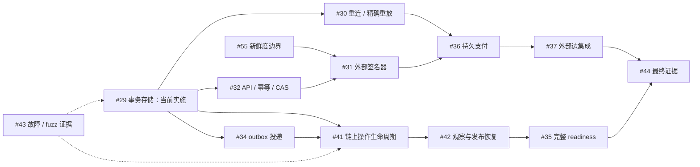

图中的 W2 项是实际完成依赖，不是悄悄缩小 W1，也不是要求先完成整个 W2 才能写 W1 的基础接口。#26 独立审计仍按用户要求取消；#21 已批准的本地无价值范围不会被旧文档重新加上外部证据前置条件。

## 为什么先处理存储

此前 Hub 用“复制内存状态 → 写 JSON 快照 → 替换内存”，Gateway 用加密快照。它们各自已有一定持久性，但没有可复用的事务边界同时表达：

1. 这次操作修改了哪一版状态；
2. 崩溃后需要保留的确切操作内容；
3. 随状态变化产生、仍待处理的事件；
4. 与操作关联、不能覆盖的尝试记录。

因此，不能在持久化状态后再单独“尽力写一条事件”，也不能在网络超时后生成一个新操作假装旧操作没有发生。新 crate 将这些内容放进同一次提交。

## 本轮实际实现

新增 `crates/morph-runtime-store`，使用固定 `rusqlite 0.41.1` 和 bundled SQLite。主机代码使用它；CKB 合约没有引入 SQLite。

| 数据 | 可否覆盖 | 用途 |
| --- | --- | --- |
| records | 通过全局修订 CAS 更新或删除 | Hub、Gateway、Payment、Edge、Publication 的当前投影 |
| commits / intent | 不可覆盖 | 操作 ID、原始请求指纹、提交修订和恢复内容 |
| outbox | 不可覆盖 | 与提交绑定的待处理事件；尚不等于已经投递 |
| attempts | 不可覆盖 | 与提交绑定的操作尝试；尚不等于链上确认 |
| metadata | 仅事务内推进修订 | 当前 schema、数据库身份、保护模式 |

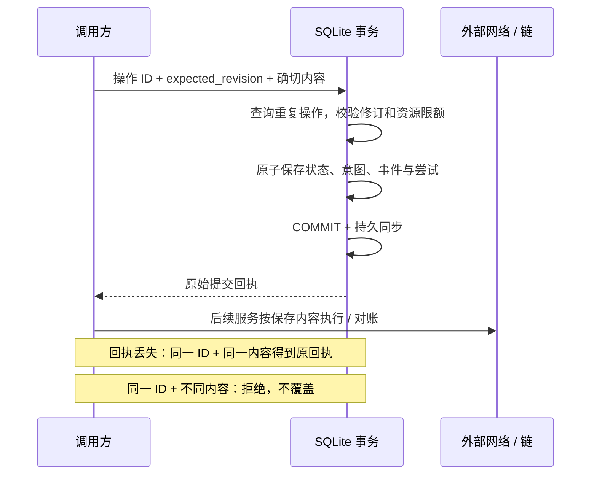

采用 `journal_mode=DELETE`、`synchronous=EXTRA`，开启外键。当前场景不需要为了 WAL 并发收益引入额外检查点与在线备份义务。所有写事务保持短小，不在持锁期间调用 RPC。数据库目录要求当前用户所有、0700；文件要求普通文件、0600，拒绝符号链接、硬链接及可被其他用户替换的父目录。根用户管理的 sticky `/tmp` 可作为受保护子目录的祖先。

有内存实现用于测试，但它运行同一 SQLite 事务代码，并没有第二套不同语义的模拟数据库。

### 两个真实消费者已经接入

**Hub：** 普通修改通过新数据库保存当前投影、提交意图和新增事件。陈旧的独立进程无法用旧修订覆盖新状态。原 `/api/state-file` 仍导出当前 JSON 投影；恢复操作保留原先身份、资金包与运行状态限制。它不能覆盖数据库历史，更不能替换签名日志。恢复前备份是私有 JSON 投影，不是直接复制一个正在写入的 SQLite 文件。

**Payment Gateway：** 原有加密快照写入器被替换，保留加密、容量限制、一次性收据语义和现有调用接口。私密记录与原始恢复操作都先做 AES-256-GCM 加密，再交给 SQLite。恢复意图包含原始 challenge、offer、payment observation 或 receipt 操作内容，后续修改当前投影不会覆盖它。outbox 只保存无秘密的 revision-committed 事件。

这里的 Hub 意图针对协调投影提交。它不是自动上链指令；公共 HTTP 幂等键属于 #32，完整链上操作恢复属于 #41。Gateway 的历史也不意味着已经实现 #36 的完整支付会话和自动安全重试。

### 签名权威保持独立

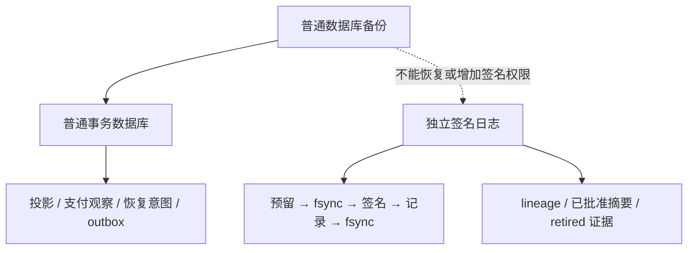

数据库中没有 signer family，也没有搬入密钥、投票预留或签名日志。数据库整体回滚仍可能恢复旧的普通运行状态；它不能证明新鲜度。#55 的外部可信边界问题没有被一个 SQLite 修订号“解决”。

## 本地验证与边界

测试覆盖了：

- 两个独立连接的 CAS 竞争、相同请求重试和同 ID 内容冲突；
- 同时修改两个 record family、intent、event、attempt 的全部成功或全部失败；
- 在提交前、提交后响应前、成功回执后真实杀死子进程，再打开数据库；
- 用仅加载到测试子进程的 syscall shim 注入真实 `fsync/fdatasync` EIO 和数据库写入 ENOSPC；
- SQLite 页限额耗尽、错误密钥、损坏/截断文件、旧格式与 schema 漂移；
- 敏感内容不以明文进入数据库，密文绑定数据库身份、记录类型、ID 和修订；
- 稳定 `(revision,id)` 分页，不漏掉后续插入但字典序更小的事件；
- Hub 陈旧所有者不能提交，网关重复保存不重复产生历史，现有 HTTP 和受保护密钥进程测试；
- `runtime-store-validate` 对真实 Hub 数据库只读校验，校验前后字节完全一致。

当前测试命令：

```sh
cargo test -p morph-runtime-store -p morph-payment-gateway -p morph-cli
cargo clippy -p morph-runtime-store -p morph-payment-gateway -p morph-cli --all-features --all-targets -- -D warnings
cargo deny --log-level warn check advisories licenses sources
cargo audit --json
```

本地结果：CLI 242 项、真实 Hub HTTP 客户端 1 项、Gateway 库 32 项、Gateway 二进制 3 项、受保护密钥进程 2 项、存储 crate 11 项，共 291 个 Rust 测试函数通过，零失败。存储计数包含两个由父测试启动的子进程入口；不是 11 个独立故障场景。Clippy、格式与 diff 检查通过，advisory/license/source 检查通过。锁定的 bundled SQLite 为 3.54.1。

源码文件哈希、工具链身份、原始日志和命令校验保存在 `target/runtime-store-evidence/2026-11-10/verification.json` 及同目录。本次是脏工作树上的本地实现验证；没有重新跑合约 ELF/真实节点协议验收，没有把旧产物资格重新标记为当前资格。

`cargo audit` 未报告漏洞条目，仍报告原有 `RUSTSEC-2026-0097` / rand 0.7 unsound 警告；没有新增豁免。故障测试运行在 Linux 本地文件系统，不代表硬件掉电认证或网络文件系统认证。

当前代码还不能被描述为整个 W1 完成。outbox 的实际投递/ACK/归档、跨服务重放、完整支付生命周期、Fiber hook、外部签名和链上确认均有对应未完成项。达到保留历史上限时会拒绝新修改，不会偷偷删除恢复资料。尚未发布，也没有关闭这些剩余 issues。

详细存储策略：[ADR 002](adr/002-runtime-transactions.md)。操作指南：[runtime-store runbook](runbooks/runtime-store.md)。上一轮 UI 报告：[原生 UI 改进](native-ui-refinement-2026-11-10.md)；其截图和性能记录是 UI 检查点，不能当成本轮新存储代码的性能测量。


## 后续检查点：#32 Hub 重试与审阅修订

Hub、Rust SDK 和 GPUI 已采用同一当前修改契约。用户审阅的状态带有十进制字符串 `revision`；确认时带上这个修订、随机请求标识和 API 版本。服务端将状态、事件和第一次的公开响应放进同一事务。

| 情况 | 处理 | 避免的问题 |
| --- | --- | --- |
| 回应途中丢失，以相同标识和确切内容重试 | 返回第一次的已保存响应 | 不重复签发/记账/发事件 |
| 相同标识换了内容 | 409 `idempotency_conflict` | 不覆盖旧操作的含义 |
| 用户确认前状态改变 | 409 `revision_conflict` | 不把过期审阅静默升级到最新修订 |
| 数据库已提交，内存尚未更新 | 下次读库对账当前投影 | 不长期困在旧内存状态 |
| 中间代理报错，无法证明原服务未提交 | SDK 保留原请求上下文并报告未知结果 | 不把 HTTP 错误直接当成“没有发生” |
| 只读令牌试图重放写操作 | 仍拒绝 | 幂等不是权限绕过 |

同一请求重试得到的旧响应是历史记录；要展示当前余额、权限或服务健康，必须另行刷新。桌面目前继续使用“刷新并核对”的处理方式，没有偷偷自动重试，也没有加演示按钮。

新增公开请求指纹只保存摘要，不保存可能含支付 preimage 的原始请求。普通数据库对账没有触及签名期刊，不能解决整个权威存储一起回滚的新鲜度问题。金额、ID 和公钥解析也改为拒绝空白、前导零和大小写歧义，不保留旧输入兼容。

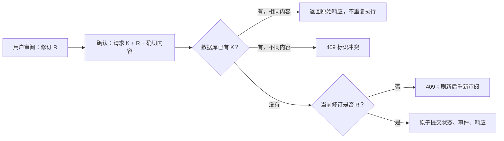

完整英文操作契约见 [hub-api-mutations.md](hub-api-mutations.md)。#32 仍保持未完成：schema 生成/漂移检查、其余公共数字字段、状态导出和 Gateway 契约不能被本检查点代替。上文 291 项测试统计属于存储检查点；新 API 的测试结果应单独记录，不混算。


API 检查点最终结果：CLI 245、真实 Hub HTTP 1、桌面 24、公共 API 1、事务存储 11、SDK 授权 3／Hub 传输 5／包审阅 2，共 292 个测试函数通过，零失败。相关五个 crate 的 all-features/all-targets Clippy 通过；最新桌面二进制构建、格式及 diff 检查通过。证据和原始日志保存在 `target/hub-api-evidence/2026-11-10/verification.json` 及同目录。CLI 在消除多余借用后单独复跑通过。测试期间出现过缺少 xkbcommon-X11 链接名的问题，采用仓库现有 `make native-build-env` 的本地 linker shim 后完成构建，没有改系统库。

仍在 `dev` 的未提交工作树中；未推送、未发布，也没有提前关闭剩余 W1 issues。


## 后续检查点：#32 公共数字编码与生成式 schema

本轮继续完成 API 的类型基础，没有将范围缩小成只通过已有测试。新增 `docs/api/hub-types/` 中 25 个独立 JSON Schema 2020-12 文档，由 `morph-hub-api` 和 `morph-packages` 的真实 Rust 类型生成。每个文件携带自身的定义引用，不能将任意一个 schema 当作整个协议的安全证明。

### 为什么统一数字编码

公共 JSON 里的大整数如果被客户端当作浮点数，超过 2^53 后可能失真。Rust 本身使用 u64 不会发生这个问题，但公共契约必须保证其他读取方也不能静默改变状态号或金额。因此，Hub 自有类型的全部 u64 字段统一为十进制字符串，内部仍是 u64。修改包含状态号、Factory update number、funding epoch、sponsor 预算、修订、时间与区块高度；小范围计数、数组索引和脚本类型标签保留 JSON 整数。

| 输入或场景 | 当前结果 |
| --- | --- |
| 最大 u64 字符串 | 精确往返，不转换成 JSON number |
| 数值 1、浮点 1.0、字符串 `01` / `+1` / 带空白 | 拒绝，不做旧编码兼容 |
| u64 最大值加一 | schema 与运行时解码均拒绝 |
| 无区块高度观测 | 显式 `null`，不会被解释为 0 |
| 原生表单输入 | 先校验 u64，再输出同一字符串形状 |

### 为什么不保留任意 JSON 摘要

原先 capability、条件 transfer 和 payout 摘要用 `serde_json::Value` 拼装。界面可以显示它们，但类型和 schema 无法说明哪些字段必须存在，也无法可靠拒绝未知分支。现在改为具体 Rust 枚举和结构，保持合法 JSON 的原有形状，并明确 Ordinary / CkbConditional、哈希算法、两方 payout 分配等信息。它们依然是**已验证包的公开摘要**，不会取代签名、守恒、lineage 或链上脚本验证。

测试还揭示了 Serde 空枚举分支的一个容易忽略的行为：即使外层设置 deny_unknown_fields，unit variant 仍可能忽略夹带字段。CKB 资产请求和 Ordinary capability 现改为空结构分支；`{"kind":"ckb","type_hash":"ignored"}` 不再被当成正常 CKB 请求。

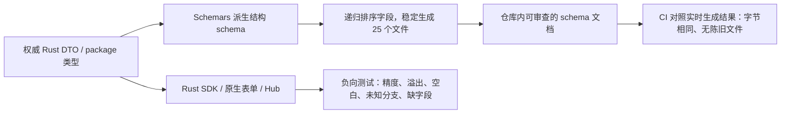

GPUI 会经依赖打开 serde_json 的 preserve_order。首轮 schema 对照测试发现这会使纯 CLI 构建与桌面构建的对象顺序不同，虽然语义一致。生成器现在递归排序对象键，在两种依赖图下产生同样的文件；没有通过放宽漂移断言掩盖差异。Schemars 固定使用仓库原有的 1.2.1，生成器仅用于开发/检查，不在界面绘制或 HTTP 请求路径执行。

生成和核对命令见 [API 类型文档](api/README.md)。本轮仍未完成整个 #32：需要继续绑定完整 HTTP 端点的 request/result/error、处理管理状态导出和 Gateway 契约。CI 类型检查不是端点全覆盖证明，也不是整个 W1 完成证明。

本检查点验证：all-features 下 CLI 273、真实 HTTP 1、桌面 24、API 单元 2、数字/摘要负向测试 4、SDK 授权 3／传输 5／包审阅 2，共 314 项通过，零失败。相关六个 crate 的 all-targets Clippy、桌面构建和 advisory/license/source 检查通过。生成结果为 25 个 schema 文件；证据在 `target/hub-api-evidence/2026-11-10-schema/verification.json`。未执行合约产物重新资格验证，未发布、未关闭 #32 或其他尚未完成的 W1 项。


## 后续检查点：#32 Gateway DTO 与统一错误契约

此前 Gateway 的错误只有文本，业务错误与框架的 JSON/查询解析错误还使用不同响应形状；客户端只能靠 HTTP 状态或字符串判断。现在将请求/响应类型提取到 `morph-payment-gateway::api`，HTTP 适配单独放在 `http_api`。服务端、SDK、Fiber 验收工具消费相同公共类型。

| 修改 | 原理与结果 |
| --- | --- |
| 统一 GatewayErrorCode | 业务、JSON/查询解析、404/405 都有机器可读错误码 |
| 版本头与请求 ID | 每次响应提供当前版本和服务端诊断 ID；不信任客户端传入 ID |
| 净化错误文本 | 不把字段原文、原始解析错误或令牌内容回显给调用者 |
| 公共 DTO 拒绝未知字段 | 顶层请求与嵌套支付协议对象都按当前形状解码 |
| 分页不再静默截断 | `limit` 仅允许规范 1..1000，拒绝 0、1001、前导零、重复参数和未知参数 |
| supported/payments 返回具体类型 | SDK 不再对这两类结果随意索引任意 JSON；索引结果明确排除原始 Fiber 结果 |
| 原生 Fiber 工具按错误码重试 | 仅将明确的 payment_required 作为继续等待结算/claim 的条件 |

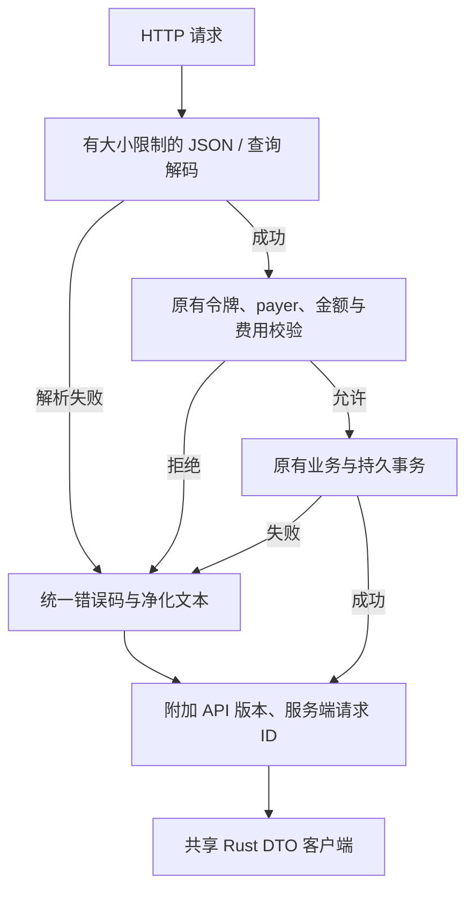

正常 x402 challenge 的 402 仍返回付款要求和 PAYMENT-REQUIRED 头；它不是错误响应。付费代理上游的原始响应也不被改写成 Gateway 错误。请求 ID 只用于诊断，不是持久幂等键；这轮没有加入自动重复付款，更不能用超时证明付款从未提交。

新真实 HTTP 测试覆盖 15 类拒绝情况，核对版本头、请求 ID 唯一性、错误码及输入标记不泄漏；还通过 SDK 验证错误、有效分页和能力响应，并逐字比较数据库前后不变。现有 payer/费用/凭据/收据/fair-exchange 测试同时保留。详细契约见 [Gateway API 错误文档](api/gateway-errors.md)。

Gateway 的全部 schema、端点绑定、其余数字/核心收据传输边界与持久重试契约尚未完成；不能把这轮错误处理的完成视为 #32、#36 或整个 W1 完成。

本 Gateway 检查点：库测试 33、二进制 3、受保护密钥进程 2、SDK 授权 3／传输 5／包审阅 2、xtask 5，共 53 项通过，零失败。相关四个 crate 的 all-features/all-targets Clippy、Gateway 二进制构建、格式及 diff 检查通过。证据在 `target/hub-api-evidence/2026-11-10-gateway/verification.json`。HTTP 请求经过真实回环 TCP 服务，Fiber 依赖使用现有测试替身，不能算作真实 Fiber 网络验收。代码仍未提交/发布，未提前关闭 W1 issues。


## 后续检查点：#32 Hub 端点、OpenAPI 与管理归档

这轮把 HTTP 方法、路径、权限、是否修改状态、请求类型和成功结果类型集中到同一份 `Endpoint` 注册表。服务端改为穷举该枚举分派；SDK 的权限和幂等上下文选择也使用它。新增端点时，不能只改一个字符串分支而漏掉文档或权限说明。

| 产物 | 本轮结果 | 仍然不代表什么 |
| --- | --- | --- |
| 端点注册表 | 26 个当前 Hub 端点，拒绝未知动作/多余路径段 | 不新增 Gateway 或链上操作能力 |
| 类型文档 | 27 个由 Rust 类型生成的 JSON Schema | 不替代签名、守恒和 lineage 验证 |
| OpenAPI 3.1 | 从注册表生成方法、路径、认证 scope、请求/响应和幂等头，引用相邻 schema | 不包含 Gateway，也不把 health 当成 readiness |
| SDK 管理接口 | export/preview/restore 使用具体公共类型 | 不再接受任意 JSON 快照穿透 |
| CI 漂移检测 | 类型 schema、端点表和 OpenAPI 均逐字对照 | 不等于全部 W1 的集成资格验证 |

### 为什么还要分开“公共归档”和“私有快照”

私有 `PersistedHubState` 是数据库内部结构，使用 Rust 的内部数值和枚举形状。直接将它作为接口返回会使存储重构变成隐式 API 改版，也容易让客户端把备份当成签名权威。现在 HTTP 导出返回 `StateArchive`，恢复请求使用 `RestoreArchiveRequest`，通过明确转换进入原有验证流程。内部数据库和私有备份仍保留内部格式；不是维护两套协议实现，也没有旧格式兼容读取。


归档的 u64 计数/时间和金额使用十进制字符串，资产 Type 与事件主体使用规范十六进制。发票只保存一份规范的已签名编码，再附加状态与时间；导入时由现有 Morph 发票解码器校验签名，不接受另一个可以单独改金额的字段副本。测试覆盖 u64/u128 上界、精度往返、溢出、前导零、未知字段和拒绝私有旧形状。

一个在测试中发现并修正的细节：零余额是合法状态，新付款请求的正金额约束不适合直接套在归档上。转换现在只为规范的字符串 `0` 放行零值，其余继续复用现有金额/资产边界校验，并检查同一资产余额之和不溢出。

导出归档**没有扩大恢复权限**：仍需 restore scope、服务端显式启用、身份/网络匹配、当前预览确认和修订约束；运行中或包含业务状态的恢复仍被空白启动限制拒绝。归档不包含可恢复的 signer journal，也不能使旧签名权限复活。所有注册的特权端点均测试了“权限不足时，畸形正文也不会先被处理”，未知动作不会修改数据库。

文档入口：[端点表](api/hub-endpoints.md)、[完整 Hub API 说明](api/README.md)，OpenAPI 位于 `docs/api/hub-openapi.json`，需与相邻 `hub-types/` 一起分发。

本检查点验证：Hub 单元 47、API 单元 5、数字/摘要 4、SDK 授权 3／传输 5／包审阅 2、真实 Hub HTTP 集成 1、原生桌面 24，共 **91 项通过，零失败**。四个相关 crate 的 all-features/all-targets Clippy、格式和 diff 检查通过。证据记录于 `target/hub-api-evidence/2026-11-10-endpoints/verification.json`；这是本地工作树检查点，不是签名提交或合约产物资格验证。

#32 尚需完成 Gateway 的完整端点/schema、剩余数字及持久重试契约。W1 其他项目继续按依赖推进；本轮没有提交、推送、发布或关闭未完成 issues。


## 后续检查点：#32 Gateway 完整传输边界与生成契约

Gateway 现在也由一份注册表生成实际 Axum 路由及 HTTP 文档：13 个路径、19 个独立类型 schema 和 OpenAPI 3.1。正常 x402 challenge 的 402 与错误 402 保持区分，付费代理继续保留上游响应，不把上游错误伪装成 Gateway 错误。健康响应、凭据验证结果、付款索引和支持能力均有具体类型；公开的 Fiber 原始结果被明确标为提供者诊断数据，不能作为 Morph 签名收据。

### 公共 JSON 不能反过来定义签名语义

Core 意图和终局收据拥有自己的二进制承诺与验签规则。本轮使用显式 serde 适配器改变 HTTP JSON 的表示：金额和全宽计数是十进制字符串，byte32 ID/承诺、公钥和签名是规范十六进制。Core 类型、二进制 ID、签名摘要及原有校验器没有修改。

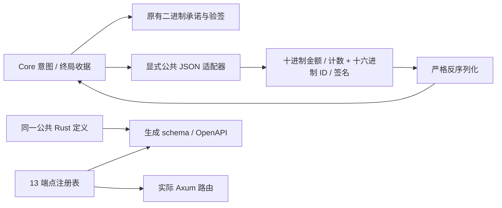

| 边界 | 本轮处理 | 实际验证 |
| --- | --- | --- |
| u64/u128 精度 | 共享规范字符串编码，拒绝数字、前导零、空白及溢出 | 最大值往返与负向测试 |
| Core 签名 | 只加公共 serde 适配，保留原有摘要算法 | CKB / xUDT / RGB++ 三类意图，带通道证据和 CKB 锚点，往返后 ID/摘要相同且验签通过 |
| 私有签名原文 | RequirementCommitment 的整数 expiry 不因公共字段改字符串而改变 | 独立授权向量的 requirement ID 和签名原样保留 |
| Script JSON | 关闭未知字段，规范 code_hash/args，使用固定 CKB RPC hash-type 解码器 | schema 覆盖原有 data/type/data1..data127，没有为了写 schema 砍掉合法类型 |
| JSON 对象顺序 | requirement ID 的 Script 对象先规范排序 | 开启桌面 preserve_order 的联合测试通过 |
| 可选嵌套证据 | 无值用显式 null；serde 与 schema 的 required 声明一致 | 缺少字段被拒绝，避免文档接受、运行时拒绝的漂移 |
| 实际 HTTP 拒绝 | 新增非规范 duration 请求 | 共 19 类坏请求，数据库前后不变，输入标记不泄漏 |

独立授权向量只改了公共 expiry 的 JSON 表示并添加注记，没有重签或替换原签名。Core 的私有序列化也保持原样。Gateway 加密存储内嵌了当前公共对象，因此旧开发记录需要按未发布策略重建；没有加入历史数字/数组读取器，也不允许借此重置 signer journal。

### 不能把错误码、请求 ID 当成幂等保证

每条路由现在都说明真实重试行为。读取可以重复；verify 会记录观测，但不发起付款；settle/claim 在现有权限和期限检查下可返回已保存收据。新建 challenge/offer 仍产生新标识，pay 或付费代理在响应丢失时可能已产生外部副作用。**Gateway 的通用持久 key/body/revision 重放契约尚未完成**，不能从 Hub 的幂等实现推导它也有，更不能自动重发付款。

因此 #32 仍未关闭。接下来按依赖继续处理持久请求与付款尝试恢复，并推进 #55/#31 的可信新鲜度和外部签名边界；不要求整个 W2 完成后才做这些基础接口。

验证记录：联合 all-features 测试包含原生桌面 24、Hub API 单元 5／公共数字 4、Gateway 库 37／二进制 3／受保护密钥进程 2、SDK 授权 3／传输 5／包审阅 2、xtask 5，共 **90 项通过，零失败**。六个相关 crate 的 all-targets Clippy 通过。48 份 Hub/Gateway OpenAPI 与类型文档中的 296 个本地 schema 引用均能解析；这只是引用完整性核对，不冒称独立 OpenAPI 认证。未修改 Core 或合约源码，未重新声明 ELF 资格。

证据与原始测试/Clippy 日志保留在 `target/hub-api-evidence/2026-11-10-gateway-contracts/`。[Gateway 端点表](api/gateway-endpoints.md)和[数字、错误及重试规则](api/gateway-errors.md)已更新。没有提交、推送、发布或关闭尚未完成的 W1 issues。


## 后续检查点：#55 新鲜度前提与 #31 外部签名请求／IPC

本轮继续整个 W1，并未缩回原先已关闭的五个 issues。完成的是外部签名的审阅与通信边界，以及可信存储前提的可执行验证；**尚无可运行的外部密钥托管服务，也尚未替换 CLI 现有签名调用**。#31 和 #55 都保持未完成。

### 先明确什么能保证、什么不能

完整最新日志里的预留，即使没有保存签名响应，也必须在重启后继续阻止同号冲突签名。新增测试验证：保存预留后重新解码日志，取消提案不会释放预留；另一分配被拒绝，原摘要仍可重试并记录原签名。

另一项测试刻意恢复整个一致的旧快照：它能通过结构校验，并在恶意对手配合下产生第二份同号、同资金来源、不同分配的有效共签包。只需要一个诚实签名者回滚，对手可以直接恶意双签，不需要“双方同时恢复备份”。这证明**本地一致性检查不能证明权威新鲜度**，而不是证明同一 CKB cell 能消费两次。

因此第一版外部签名仍以唯一、完整、未回滚的签名日志为前提。进程隔离负责缩小密钥接口，不能被宣传成独立高水位、防克隆或防完整回滚。没有增加内部哈希链来制造已经修复的错觉，也没有改变任何旧上下文封印规则。

### 同一份规范数据，重新计算审阅摘要

`morph-packages::signer_protocol` 接受六个封闭角色：root exit / root creation / update / splice creation / splice recovery / splice bridge。它复用现有协议解码和 Core 验证器，不接受通用的“给我签这个摘要”。

| 请求内容 | 作用 |
| --- | --- |
| 版本、角色、请求 ID、预期公钥、期限 | 响应只能对应同一份请求；期限不能撤销已经发出的签名 |
| 网络 genesis 与应用 chain_id | 分别绑定，不能把二者混为同一个字段 |
| channel、funding context、epoch、state number、摘要 | 防止拿另一个通道／资金上下文的回执来充数 |
| 完整规范包、提案和 exact transaction | 由签名侧重新推导金额、资产、收款锁、carrier 和条件能力 |
| 允许的部署脚本与角色 | 来自签名者本地可信策略，不能由调用者 JSON 自行放行 |
| 物理输入解析接口 | 输入容量由独立解析结果计算，进而推导手续费；本轮只有受控解析测试，还没有生产 RPC 实现 |

Root creation 必须已有完整初始退出；splice bridge 必须已有完整新创建与新退出授权。仅有一份未完成的 future exit，不能因为使用“外部签名”绕开仪式。测试逐项改变交易容量、输入、依赖和收款锁，即使重新计算请求 ID，也不能沿用原来的审阅和授权。

传输请求 ID 和持久签名权不是一回事。刷新请求期限会改变请求 ID，但不能释放原日志中的同号预留或拼接封印。集成时必须继续以现有日志的精确 target/digest 为准，不能另做一套按 request ID 去重的签名引擎。

### 有界的真实进程通信

新增 `morph-signer` Rust crate，实现 Linux 私有 Unix socket 的单请求协议。它不拥有私钥、日志或 daemon 命令。

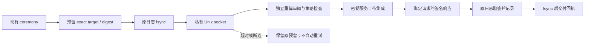

| 通信边界 | 实现 |
| --- | --- |
| 身份与权限 | 双向内核 peer UID 检查；0700 父目录、0600 socket；拒绝符号链接和非受控路径 |
| 消息大小 | 请求最多 1 MiB，响应最多 4 KiB；先读长度再分配正文 |
| 连接 | 每次一个请求／响应，要求半关闭，拒绝尾随内容和流水线 |
| 时间与并发 | 非阻塞 socket，共用一个最多 30 秒的总 I/O 预算；每个 listener 同时只接收一项工作 |
| 模糊结果 | 一旦尝试发出请求，断连／超时不能当作“没有签名”；不自动重连，不清除预留 |
| 回执 | 必须匹配原请求、角色、预期公钥和摘要；拒绝 high-s 及未知编码 |
| 日志 | 固定通信错误；Debug 不展开请求正文、签名或未验证的请求 ID |
| socket 生命周期 | 不覆盖旧 endpoint；析构只清理自身未被替换的 inode |

同 UID 和 root 仍在可信边界内。这个版本的 socket 不是对抗同一账户恶意进程的沙箱。总预算覆盖 socket I/O，也不能冒称能够强制中止任意挂起的文件系统或未来 RPC 调用；服务集成还要为它们共享有界预算。

### 本轮验证与接下来的依赖

4 个协议矩阵测试、7 个 IPC 场景和 1 个测试子进程入口、64 个 Core multi-asset 测试，共 76 个测试条目通过，零失败。IPC 中两个场景确实启动独立进程，分别验证原有 fixture 回执往返和“收齐请求后断连”；它们使用现存公共签名，不宣称已测试真实私钥服务崩溃。Core 的 64 项包含本轮新增的预留后未记录重启、完整旧快照回滚两项。

相关三个 crate 的 all-features/all-targets Clippy、两个新边界的生产 unwrap/expect/panic lint、格式和 diff 检查通过。证据及日志位于 `target/signer-evidence/2026-11-10-review-ipc/verification.json`。记录包含验证后的文件摘要，没有伪称采集了运行前后不变性证据或重新验证了 ELF。

下一步依赖是：实现隔离密钥服务及固定链解析／操作准入 → 接入 root funding 与 session 四个签名角色的原有持久化顺序 → 做实际签名后的进程退出、响应丢失和 caller 重启测试。然后才能把 #31 算作完成，#55 仍需全能力与精确产物矩阵。

详细设计与边界见 [ADR 003](adr/003-participant-signer-boundary.md)。本检查点没有提交、推送、发布或关闭 issues；W1 的其他未完成项继续保留在依赖队列中。


## 后续检查点：#31 隔离密钥服务已经接入原有签名日志

上一检查点只有请求／IPC。这轮已加入实际 `participant-signer-serve` 密钥进程，以及根出资、状态更新和三个拼接角色的调用接入。**不是新建一份 signer 数据库**：原有 ceremony 继续持有 sidecar 锁，使用原来的 Core reservation 和 record 方法；外部进程只读固定的既有日志。

### 为什么服务要自己读取原日志

单独接收一个“请签这个 digest”的进程会隔离密钥，却可能绕开预留和拼接封印。现在服务的私有配置固定 journal 绝对路径、公钥、通道、部署、网络、RPC 和可签角色。请求不能更换这些信任输入。

根日志必须已经持久预留所选角色，creation 仍要完整初始退出。双边日志则在一个临时验证副本上再次运行原来的 reservation 方法：**结果必须与落盘状态完全相同**，否则说明请求尚未获得持久预留。这个副本不会被保存，也不会变成第二个签名者。随后从日志重建的规范 payload 必须逐项等于请求内容，且完整链状态／准入检查通过，才允许实际使用密钥。

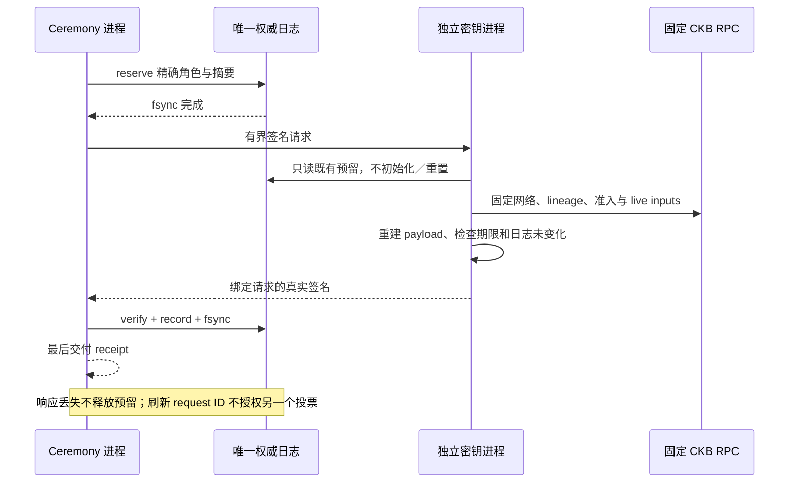

服务不等待 caller 的日志锁，避免 caller 持锁等待服务时死锁；它读取原子替换后的完整文件，并在链检查后再次比对快照。原有预留在超时后仍然有效。整个一致快照回滚／同 UID 恶意进程依然不在这项保证内，不能把这种进程分工宣传为密码学防回滚。

### 实际变化

| 项目 | 当前行为 |
| --- | --- |
| 正常签名 | `sign --target ... --signer-config ...`；没有本地私钥参数 |
| 显式开发签名 | `sign-local`，沿用同一预留／记录分支；没有旧 `sign` 私钥别名，也没有外部服务失败后的自动回退 |
| 默认构建 | 在读取本地参与者密钥文件前拒绝 `sign-local`；真实默认二进制检查返回 exit 2 |
| 密钥进程 | `participant-signer-serve --config ... --private-key-file ...`，支持持续服务或单请求 `--once` |
| 文件边界 | 配置／日志必须 owner-only 0600、父目录 0700；拒绝符号链接、硬链接、FIFO、目录与超限内容 |
| RPC | 复用现有客户端，单次尝试、共享总预算、每响应最多 2 MiB；物理输入必须为固定网络上的 canonical live cell |
| 事务审阅 | 输入数量／顺序、容量、总费用独立计算；扫描期间 tip 变化即拒绝，要求对原意图重新审阅 |
| 角色隔离 | 不接受 Factory、钱包费、Sponsor 或 release digest；watch/publication 没有参与者 signer handle |

两条签名命令只是密钥执行位置不同，共用现有状态机、持久预留和记录代码；没有新增第二套协议或兼容实现。

### 真正拿密钥签过，而不只是搬运 fixture 回执

新增进程测试会启动独立子进程，子进程只通过受保护文件读取测试密钥，调用实际服务实现：

1. 原日志尚无预留时拒签，日志逐字不变。
2. 保存 root exit 预留后，子进程生成真实签名；测试读到响应长度头后丢弃连接，不把签名正文记录到 caller。
3. 日志仍只保存预留、没有本地签名；重启密钥进程和 caller 后，通过正常 `sign` 路径重试同一意图、验签、记录并落盘。
4. 已保存回执可以在没有密钥进程时返回；收齐完整退出后，root creation 也通过外部服务签名。

这个测试的 CKB 端是有界 RPC fixture，每个输入显式安装，不是实际链证据。此前仅传递已有 fixture 签名的 IPC 进程测试仍保留，证据类别没有混用。双边更新／三个拼接角色还验证了未预留拒绝、持久预留后可重建请求；无 lineage 的测试日志仍不能作为正常外部签名权威。

联合验证有 CLI 单元 278、真实 Hub HTTP 集成 1、协议矩阵 4、IPC／文件边界 9，共 **292 个测试条目通过，零失败**（包含子进程测试入口）。随后对最终请求前置校验和 CLI 密钥入口改动重跑了根签名进程、协议／IPC 和 CLI 输入测试。all-features/all-targets 与默认构建 Clippy、生产 unwrap/expect/panic lint、格式和 diff 检查通过。检查命令和日志位于 `target/signer-evidence/2026-11-10-service-integration/`；这些是工作树证据，不是完整 clean-source 或 ELF 资格验证。

[部署与恢复手册](runbooks/external-participant-signer.md)和 [ADR 003](adr/003-participant-signer-boundary.md)已更新。下一项是实际隔离 CKB 节点上的六角色集成、canonical handoff 和故障矩阵；已确认本机可用 CKB 二进制，但本轮没有把现有钱包演示节点当作新验收证据。#31/#55 继续保持未完成，整个 W1 范围不缩减，没有提交、推送、发布或关闭 issues。


## 六角色外部签名的真实节点与故障验收（2026-11-10 后续检查点）

本次把 #31 从“协议和受控 RPC 测试通过”推进到了实际 CKB 节点。继续沿用方案 C 的唯一签名日志、唯一原始交易、唯一 reserve → fsync → sign → record → fsync 路径；没有为验收另造一套签名权威。#31 与整个 W1 仍未关闭，下面区分已证明的内容和剩余组合故障。

### 做了什么，为什么这样做

新增 `scripts/devnet-external-signer-e2e.sh`。它构建一个固定 CLI，复制八个现有 ELF 并逐项核对 manifest，启动自己的无价值 devnet。资金创建、状态更新和两次 splice 继续走现有原生构造、资金仪式、确认交接及结算路径；签名调用方与持钥服务则各自启动真实 CLI 子进程。测试自己的节点用完退出，已有钱包演示节点不受影响。

仅在库里调用一次签名函数，无法证明真实部署里的进程、RPC、权限和重启边界。此处既检验链上生命周期，也检验独立调用方从磁盘重新打开权威时的行为。开发验收父进程仍掌握公开 devnet fixture 密钥；不能把它描述成能够抵抗恶意同 UID 父进程的托管隔离。

| 签名角色 | 完成的角色尝试 | 绑定对象 |
| --- | ---: | --- |
| root_exit | 4 | 精确资金交易对应的初始退出 |
| root_creation | 4 | 完整退出已到手后的根资金域 |
| update | 2 | 当前上下文内严格递增的状态提案 |
| splice_creation | 4 | 新上下文的创建授权 |
| splice_recovery | 4 | 新上下文的初始退出授权 |
| splice_bridge | 4 | 旧上下文消费及完整 splice 原始交易 |
| 合计 | **22** | 六类原签名域未改变 |

每组尝试都使用同一份持久权威完成下面的序列：

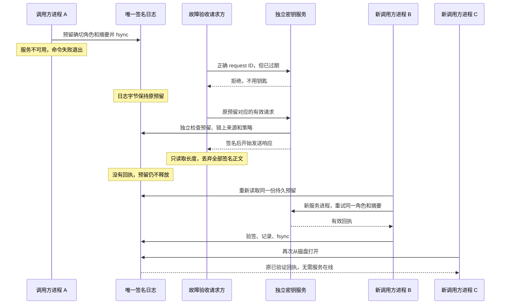

整个序列不是恢复旧快照。服务不可用后留下的预留一直保留；服务拒绝和回执丢失都不能改写它。新调用方成功后，另一个新进程读取缓存回执，要求其完全一致，且不改写日志。故障请求方在读到响应长度后断开，能证明实际服务已执行到签名之后；**没有声称对宿主每个指令/fsync 切点都实施 SIGKILL**，这仍属于 #43 的组合矩阵。

### 真节点暴露并修复的问题

第一次真实节点运行在 update 的依赖核验阶段失败。CKB 标准 secp 数据 cell 本身为 1,048,576 字节；RPC 转成十六进制再加 JSON 元数据后为 **2,097,566 字节**，比原 2 MiB 上限多 414 字节。之前的受控 RPC fixture 不含这个实际部署依赖，因此未暴露问题。

现在每个 signer RPC 响应上限为 **4 MiB**，仍使用单次尝试和共享总时间预算。新增回归测试同时验证真实标准 cell 的尺寸可以容纳、超过新上限仍会失败。协议 IPC 的请求 1 MiB、响应 4 KiB 上限没有扩大。普通 RPC 客户端的边界没有因此替换。

另一个修正是权限检查识别受保护祖先目录：本机 `/home/arthur` 是 0700，即使其下某个本人拥有的目录为 0777，其他账户也不能穿过主目录进入。检查不再误拒绝这个结构；符号链接、外人拥有目录以及暴露在公共可写祖先下的路径仍然拒绝，叶子目录仍要求本人所有且恰为 0700。已增加正负对照测试，没有修改用户原有目录权限。

服务错误现在只暴露固定类别：请求策略、私有权威读取、权威/规范链检查、规范请求审查或一般授权拒绝。底层 RPC/载荷错误不展开打印，另有负测验证秘密字符串不会进入诊断。Watch 的顶层、defaults 和每个 channel 都新增注入私钥/参与者签名器句柄的拒绝测试；Sponsor 钱包出资仍是独立角色。

### 实际结果与可复现证据

最终原生记录：`target/participant-signer-e2e/20261110T043343-86246/verification.json`。

| 检查 | 结果 / 口径 |
| --- | --- |
| 六角色真实节点流程 | 22 组完成；包括共同资金 reorg 精确重放、发布/结算、资产移出/移入 splice 与扣留 bridge 回执调解 |
| 独立服务进程 | 66 个：22 个拒绝过期请求，22 个签名后丢弃响应，22 个完成重试 |
| 新调用方进程 | 44 个经过 PID 校验的成功/缓存读取进程；另有每组服务不可用时失败退出的调用方 |
| 预留与回执 | 失败/丢失后字节不变；重试验签入日志；无服务时返回相同已记录回执 |
| 源码一致性 | 原生运行前后指纹一致，明确标记 dirty 工作树；不冒充 clean commit |
| 产物 | 固定 CLI SHA-256、报告与源码清单哈希；八个现有 ELF 与 manifest 一致；没有重建 ELF |
| 组合测试 | 先前当前生产代码组合 295 项通过：CLI 280、Hub HTTP 1、协议 4、IPC/文件 10；之后新增 watch 配置负测单独 1 项通过 |
| 静态检查 | CLI/签名 crate 的 all-features/all-targets Clippy，以及 CLI 默认特性 Clippy 通过 |

原生故障增加后再次运行，最后一轮又把调用方改成真正的新 CLI 进程；这是明确增加验收覆盖，不是把相同测试重复计算成不同功能。第一次失败记录保留在 `target/participant-signer-e2e/20261110T042435-5532`，用于说明发现问题的来源。证据目录包含私有退出包和签名日志，应私有保存；公开分享应只选去敏的结论和哈希。

复现命令：

```bash
CKB_BIN=/absolute/path/to/ckb scripts/devnet-external-signer-e2e.sh
```

需要已有 manifest 匹配的八个 ELF、`jq`、Python 和受保护的 devnet fixture 文件。脚本默认独立端口 19964/19965，可通过 `RPC_PORT`、`P2P_PORT` 调整；`FIBER_DIR` 可指定 fixture 来源。运行时不要编辑仓库源码，否则前后指纹检查应失败。

### 尚未被这份结果覆盖

- #31/#43 仍需把权威推进中的竞态、宿主崩溃切点及恶意响应组合成完整验收；现有协议/IPC负测与真节点响应丢失各自证明自己的范围。
- 这个六角色接口不签 Factory、child、钱包费用或 Sponsor 出资权限。它们与参与者投票是不同授权域，不能混称“全部角色都已接入外部签名”。
- #55 保留“唯一、未克隆、未整体回滚的权威日志”假设；进程隔离、SQLite、哈希链均不是独立新鲜度来源。
- 尚未进行完整 W1 收尾、clean-source 全门禁、最终产物资格或发布，也没有据此关闭 GitHub issues。

后续继续按 W1 依赖推进：补齐上述签名/故障验收与 #32 的剩余持久重试边界，同时推进 #35 的真实 readiness 接口、#37 固定 Fiber hook 的可行性核对；#28/#51 的协议边界工作必须早于最终产物冻结，#44 最后消费确切版本的证据。


## Gateway 付款的持久重试边界（2026-11-10 后续检查点）

本轮推进 #32 的 API 重试契约及其 #29 存储依赖，并补上 #36 所需的一块实际发送边界。**不是完成整个 #36**：提供方中立会话、多次尝试、MPP 分片聚合、自动恢复调度仍须继续实现。

### 原先的问题

`/v1/pay` 已经在 Fiber 调用前写入 `PendingSubmission`，但这个记录只是最近付款的展示投影。收到同一个请求时，处理器仍会再次执行 `send_payment`。因此“有发送前日志”并不等于“重试不会重复发送”。展示列表还会淘汰旧条目，不能用它判断旧付款是否曾经提交。

现在增加独立、不可自动淘汰的 outgoing ledger，仍位于同一加密事务存储内。付款哈希绑定完整类型化请求、付款人证明、请求的费用/超时选择、实际 Fiber 提交正文、已解析超时和配置的提供方端点。JSON 空白及字段顺序不构成差异；把省略值改成显式默认值仍属于不同请求内容。

### 新的状态与权限

| 情况 | 当前行为 |
| --- | --- |
| 第一次有效请求 | 验证付款人、过期时间、发票和运营限额；原子保存预留及 PendingSubmission，再允许一次发送 |
| 完全相同的重复请求 | 只查询原哈希，或返回原已保存终态；不再次 send_payment |
| 同哈希但内容/提供方不同 | `409 request_conflict` |
| 发送结果丢失、查询失败或报告归属错误 | `503 payment_outcome_unknown`，保留预留 |
| 观察超时 | `504 payment_timeout`，仍可用原请求继续对账 |
| 原付款过期后再查 | 已接受的付款可继续对账/取回缓存；从未接受的过期请求不能新发起 |
| 重复终态 | 返回第一份持久结果，不重复写入；Success 与 Failed 不能相互覆盖 |
| 展示列表淘汰 | 不移除发送身份，不赋予重新付款权限 |
| 达到容量上限 | 拒绝新身份，但保留现有请求的对账路径 |

每个 provider 报告，包括非终态轮询结果，都必须明确携带原付款哈希。当前付款人授权也必须在缓存读取之前校验。提供方端点比较只是在配置层固定同一传输位置，不是 Fiber 节点身份的密码学证明。

### 测试实际发现的第二层问题

多数据库连接争用测试第一次失败：**两个实例都认为自己获得了新的发送许可**。原因在于通用存储的幂等提交本来就允许完全相同的事务返回原回执；这是恢复结果时的正确行为，却不能被解释成“当前调用可以再执行一次外部副作用”。

修复在唯一事务实现中增加 `Store::commit_new`：与普通 `commit` 共享同一 SQLite 事务逻辑，但即使既存事务内容完全相同，也不会返回新的执行许可。旧 `commit` 继续保留正确的幂等回执语义。付款首次预留使用 `commit_new`，竞争失败的一方重新读取既存 attempt，只能对账。没有第二套数据库或新的 SQL schema。

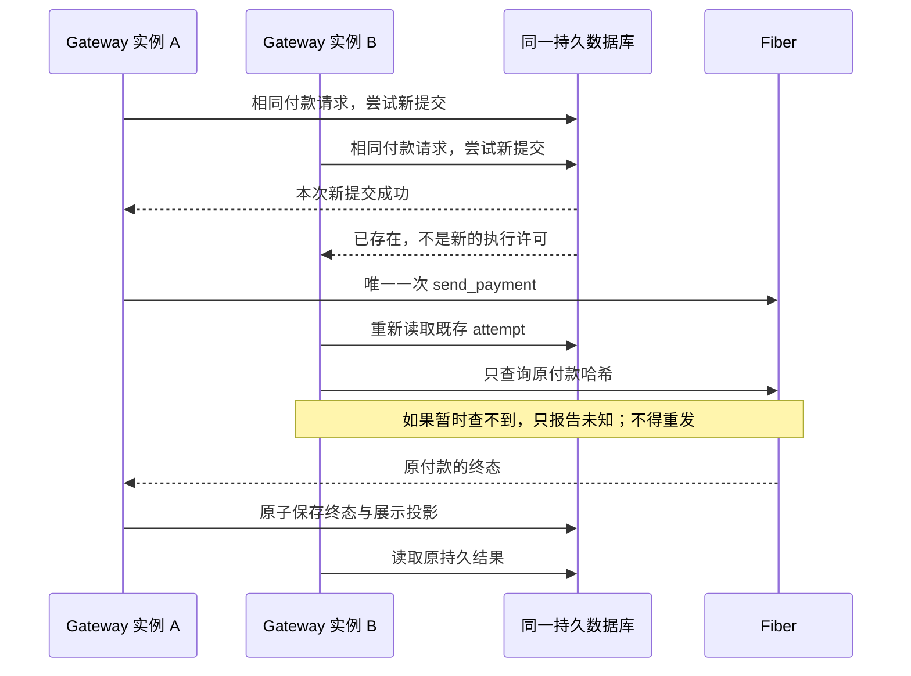

外部网络并不具备 exactly-once 保证。进程在预留后、发送前崩溃，与发送已发生但响应丢失无法仅靠本地日志区分。因此当前选择保留身份并对账，不根据“查无记录”猜测尚未提交。安全授权新尝试和解除保留，需要后续 #36 的完整生命周期设计，不能靠删库完成。

### 容量、隐私与当前格式

- outgoing ledger 上限为 **256 个身份**，不随展示列表自动裁剪。请求、提交正文和结果各遵守 **64 KiB** 边界及已有数据库总量限制。
- 不自动删除过期或已失败身份；填满后停止接受新付款。此处尚未实现长期保留/压缩策略。
- 请求、证明和原始结果继续由既有 AES-GCM 存储保护。事件只保留安全元数据，不展开秘密错误正文。
- 当前未发布快照新增必填 ledger 字段，不加入旧字段默认值或兼容读取器。保留、对账旧开发记录后才能选择新测试目录；重建目录不是付款恢复手段。
- API 的请求 DTO 不增加必须手工填写的幂等字段，直接使用已有签名付款哈希；生成的错误契约增加 `request_conflict` 与 `payment_outcome_unknown`。

### 实际验证

本轮最终检查通过：**Gateway 50 项、runtime-store 12 项、Rust SDK 10 项，共 72 项测试**；四个相关 crate 的 all-features/all-targets Clippy、格式和 diff 检查通过。API 生成物漂移检查仍从唯一 DTO/端点表生成，不增加手写第二 schema。

| 证据 | 验证内容 |
| --- | --- |
| 两个独立 Gateway HTTP 实例，各自打开同一数据库 | 并发相同请求只有一次 send_payment；内容冲突有稳定错误码；完成后返回同一原始结果 |
| 未知提交结果后关闭并重新打开服务存储 | 提供方暂不可用时保留未知；恢复后查询到迟到成功；发送次数保持 1 |
| 预留成功但没有发送的故障场景 | 提供方查无记录也不能触发新发送 |
| 错误付款哈希的轮询报告 | 不能完成原 attempt；随后正确报告仍可对账 |
| 过期请求 | 未接受过的不能付款，已保存结果仍能授权读取 |
| 独立数据库连接争用 | 恰好一个 New 结果；重开后只能得到 Existing |
| 展示淘汰及 ledger 满载 | 原身份仍存在；新身份失败；已有身份可继续查询 |
| 重复/冲突终态 | 原结果与修订不变，展示结果不回退 |

这些是受控 Fiber RPC、真实 HTTP 和 SQLite 的本地证据，不冒充新一轮真实 Fiber 或 Morph 路由资格。Gateway 整进程在每个故障切点的 SIGKILL 验收仍归 #43，整体存储回滚仍不在本地一致性保证之内。

操作说明：`docs/runbooks/gateway-payment-retries.md`。本地证据汇总：`target/gateway-retry-evidence/2026-11-10/verification.json`。

W1 继续保持原范围。#32 其他端点的完整重试/契约收尾、#35 readiness、#37 Fiber hook、#28/#51 的边界与协议工作，以及 #43/#44/#55 的最终矩阵仍在队列中。本轮没有提交、推送、发布或关闭 issue。

## Fiber 固定版本 hook 与持久诊断镜像（2026-11-10 后续检查点）

本轮处理 #37A 的具体可行性和维护路径，并实现 #37B 所需的提供方持久镜像基础。**这不是完整 #37 的完成声明，也没有打开 Morph 通道经 Fiber 转发付款的开关。**

### 为什么要真正修改 Fiber

核对的 Fiber 提交是 `a5faac7177a2a2ec086a2c6d0da1840ec9fe5703`。该版本没有 Morph 外部边 hook：`graph_channels` 是查询已有原生通道，external funding 仍然创建 Fiber 自己的通道状态机。向这些接口塞进一个 Morph ID，不能使它变成 Morph 通道。

因此选择维护一份小型、显式启用的 Fiber 原生 RPC 补丁。补丁和固定依赖锁文件放在 `integrations/fiber-shadow/`，由 Morph 维护；没有提交上游、发布或修改用户原来的 Fiber 工作目录。开发和复现都使用 `target` 下的隔离检出目录。

补丁只接入诊断模块，核心状态实现仍在 `morph-fiber-adapter::shadow`，复用 #29 的唯一事务存储。没有复制第二套 DTO、镜像状态机或数据库实现，也没有修改 Fiber 的图搜索、TLC、资金通道或结算处理。

### 现在可以做什么

| 操作 | 实际行为 | 不能据此推导什么 |
| --- | --- | --- |
| 能力握手 | 每次操作前核对 profile、Fiber 提交、补丁摘要、CKB genesis、容量和禁用转发标志 | RPC 自报版本不是远程密码学证明 |
| 注册 | 保存完整描述符，独立复算稳定 ID，修订从 1 开始 | 描述符一致不等于链上资金真实、仍然 live |
| 刷新 | 保持稳定 ID，检查预期修订和状态号，不允许同号换分配/承诺 | 提供方不能决定 Morph 最新签名状态 |
| 排空／禁用 | 创建新修订，保留身份与历史回执 | 旧成功回执不代表当前仍 active |
| 列出 | 返回持久镜像、资金 epoch、修订和明确状态 | 不能把列表当成可路由流动性或结算证据 |

所有状态都明确 `forwarding=false`。这里的 `active` 仅表示诊断记录处于活动状态。模块没有 prepare/commit 支付方法，不调用保存的 callback URL，也不持有参与者私钥或私密退出包。

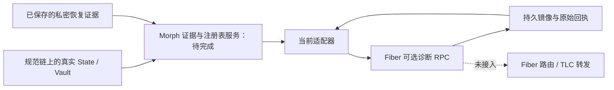

### 修掉了哪些具体断点

1. **身份数据不全。** `factory_reservation_id` 参与核心边 ID 计算，却没有随原 DTO 传输。现在它是显式必填的可空字段，接收端可以复算完整身份；丢掉它会被拒绝。
2. **缺少能力协商。** 原客户端无法明确区分缺少 hook、不同版本和可转发接口。现在每次操作重新握手，不跨提供方重启缓存权限，也不退回原生图或 external funding 接口。
3. **对账顺序错误风险。** 单纯按边哈希排序可能先注册 splice 后继，再关闭旧上下文。现在未知／旧边禁用排在最前，注册动作携带明确的旧边 ID。身份绑定矛盾直接失败，不静默改写提供方的 channel 归属。
4. **重试与修订脱节。** 注册、刷新、排空、禁用把“当前镜像＋完整请求＋原回执”放进同一事务。相同请求重读原回执，内容不同或修订不符拒绝；两个独立连接竞争只产生一次实际状态推进。
5. **旧上下文可能复活。** 后继注册要求旧上下文所有资产都已禁用，排空仍不够。已观察到更高资金 epoch 后，即使后继也被禁用，旧 epoch 的更新不能重新激活。

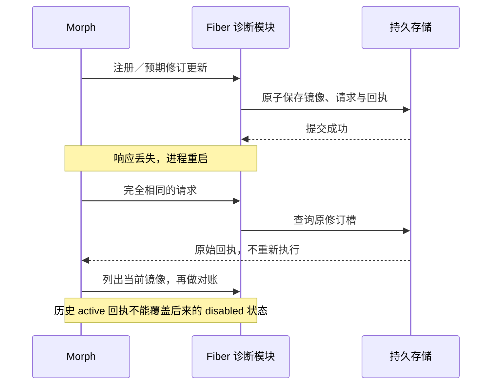

### 权限、容量和依赖取舍

- 构建时必须选择 `morph-shadow`，运行时还要启用 `morph_shadow` 模块并提供 policy/database 两个路径。只写配置或只开模块而缺少其余条件都会报错。
- Biscuit 使用独立的 `read("morph_shadow")`、`write("morph_shadow")`。原生 graph/payment 权限不自动获得镜像权限；只有读取权限不能写入。没有配置认证时，模块只接受字面量 loopback 监听地址。
- 至多保留 **128 个边身份**，禁用后也计数；不静默淘汰旧身份。请求至多 **32 KiB**，原因字符串至多 **256 字节**。共享事务存储的总量和历史限制继续生效。
- 使用严格的当前 JSON 形状，u64 为规范十进制字符串，数量保持完整 u128 精度。没有旧 `enabled` 字段兼容层，没有旧数字表示的回退解析。
- 同一物理 Type 的 XUDT／RGB++ 两种呈现不能变成两份活动容量。诊断接口逐边刷新仍不等于原子的全资产流动性快照，后续 Morph 服务必须先验证完整一致集合。
- Fiber 可选 SQLite 原为 rusqlite 0.34，Morph 是 0.41.1；两者链接同名原生库，不能共存。补丁显式统一到 0.41.1，同时使用 Morph 已审阅的相关 CKB 依赖补丁，固定合并后的锁文件。没有删掉 Fiber 的 SQLite 功能来绕过问题。
- 数据库不是签名权威，不提供整体存储回滚后的独立新鲜度。换 Fiber/补丁/genesis policy 不能静默重开旧库；删除数据库也不是处理不确定请求或重组的恢复办法。

### 验证和剩余边界

Morph 侧 **23 项测试**与 all-features/all-targets Clippy 通过，覆盖握手不匹配、缺失 hook、私密错误正文不外泄、非法/重复列表、修订冲突、两个连接争用、重启重试、splice 多资产旧上下文、别名重复容量、满载保留历史以及严格数字和可空字段。

固定 Fiber 补丁通过 SQLite 组合构建；其 **2 项原生模块／Biscuit 测试**通过，另外 **2 项 SQLite 备份恢复测试**通过。本轮合计 **27 项有明确范围的测试**。这不是全 Fiber 测试集；未选择的上游测试没有被宣称通过。

首次测试构建失败也保留了记录：新增配置字段需要同步测试构造器；上游若干测试依赖 watchtower，不能用禁用该特性的组合编译。修正后使用明确的测试特性组合重新通过。测试初期的私有目录权限错误通过修正测试目录为 0700 解决，没有削弱运行时权限检查。

复现入口：`scripts/fiber-shadow-hook-check.sh`。它在全新检出目录应用固定摘要补丁，以 Nextest 执行明确测试，并比较 Morph 依赖源码及 Fiber 源码运行前后的哈希。它不启动真实链、不转发付款、不完成 clean-commit 资格，更不代表主网准入。

**#37 仍缺少**：规范链 live State/Vault、真实脚本、历史 Factory 来源、深度和失效检查；Morph 侧持久注册表与 outbox 编排；过期、关闭、splice、重组隔离；真实无价值链上的双方进程重启／响应丢失验收；最终二进制、源码、补丁、部署的精确证据绑定。真实转发继续由 #38/#40 及其支付恢复依赖约束。

设计说明：`docs/adr/004-fiber-shadow-hook.md`。补丁、当前摘要、配置和复现指南：`integrations/fiber-shadow/`。整个 W1 仍在推进；本轮没有提交、推送、发布、上游发送或关闭 issue。

本轮证据汇总：`target/fiber-shadow-evidence/2026-11-10/verification.json`。最终全新检出复现：`target/fiber-shadow-evidence/fiber-shadow-check.00qB4Qo5/verification.json`；同目录保留 Morph 与 Fiber 各自的 before/after 源码摘要、固定锁文件摘要、构建与 Nextest 日志。补丁摘要以 `integrations/fiber-shadow/manifest.json` 为准，当前为 `39af376d9455449743a7a13da07639ff920df2ae969be063934065d0b82eeda1`。这组证据对应未提交工作树，不替代之后最终提交的资格验证。


## #35A：把“进程活着”和“业务可执行”分开

本轮新增 `morph-observability`，并接入实际 Hub 服务、公开 API 注册表和 Rust SDK。目标是让监控准确说明自己检查了什么，避免一个能返回 HTTP 的进程被误认为所有通道都受到保护。

### 三个接口，各自只回答一个问题

| 接口 | 回答的问题 | 当前行为 |
| --- | --- | --- |
| `/api/health` | 服务还能鉴权并处理请求吗？ | 返回类型化存活状态，不等待数据库锁、不访问 RPC |
| `/api/readiness` | 已配置的哪些能力具备当前可验证条件？ | 就绪返回 200，否则返回 503；两者使用同一种结构 |
| `/api/metrics` | 请求处理发生了什么？ | 输出固定标签的 Prometheus 文本，不暴露路径、通道 ID 或原始错误 |

三个接口沿用现有 read 权限和连接限制。没有匿名探测后门，也没有新增监听端口。经路由分发的响应设置 `Cache-Control: no-store`。旧 `/api/health` 曾返回完整 Hub 视图；现在统一为存活结构，视图使用 `/api/state`，不保留旧形状兼容分支。

### 就绪必须说明范围

| 能力 | Hub 当前是否配置 | 实际检查 |
| --- | --- | --- |
| 本地协调记录 | 是 | 存储完整性、当前 schema、Hub 数据有效性、磁盘与内存修订一致 |
| 发票签发 | 取决于是否加载有效发票密钥 | 上述存储检查，加启动时已验证的发票签名配置 |
| 通道参与者签名 | 否 | 明确报告未实现，不借用发票密钥状态 |
| 支付提交 | 否 | 明确报告未实现 |
| 链上发布 | 否 | 明确报告未实现 |

总 `ready` 只汇总已配置能力。一个没有发票密钥的 Hub，可以对本地记录业务就绪；这不意味着能够签发发票，更不意味着可以给通道签名或发链上交易。调用者必须检查所需能力本身。数据库通过检查也不保证任意未来写入都能成功：写入容量、CAS 与具体请求仍由实际操作验证。

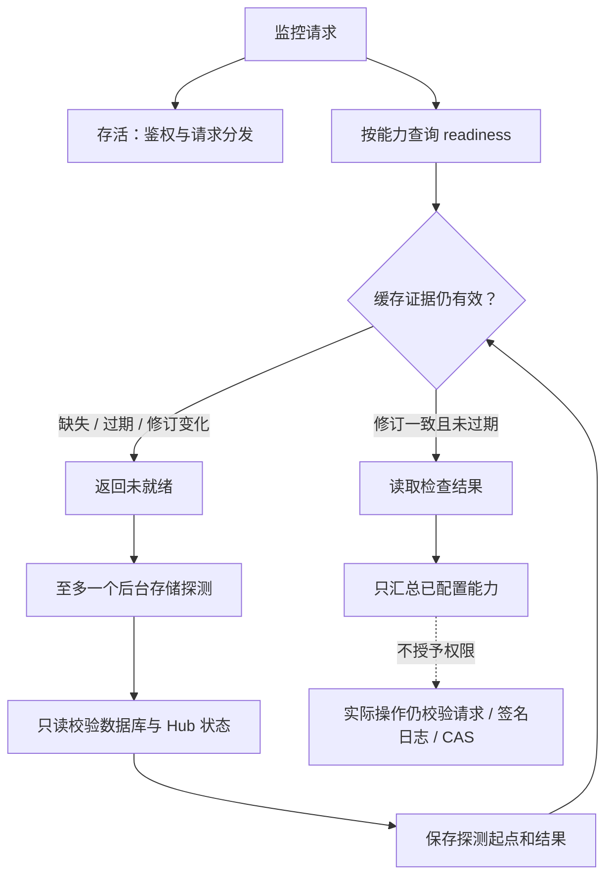

### 防止“旧检查刷成新状态”

缓存有效期为探测开始后的 **5 秒**，不是结束后的 5 秒；同时检查墙钟与单调时钟。报告生成时间 `generated_at_ms` 与每个检查的 `checked_at_ms`、`valid_until_ms` 分开。没有证据时后两个字段显式为 null，不能用报告生成时间掩盖证据已经过期。

探测不在 Hub 状态锁内访问数据库；锁忙立即报告 busy。一个进程最多只有一个存储探测在途。如果文件系统调用挂住，它占据这个探测位置，旧证据到期后继续报告未就绪，不不断创建新线程。这里没有声称能强制中断操作系统 I/O，也没有保留专用连接槽。5 秒是本地缓存策略，不是实测的生产服务目标或争议窗口预算。

存储文件不可访问、schema 不支持、状态损坏或修订改变，均不能获得就绪结果。恢复可访问性后需要重新探测；不自动删除存储、不恢复旧签名日志。

### 指标有明确容量和语义

| 指标 | 固定序列数 | 含义 |
| --- | ---: | --- |
| 操作计数 | 35 | 7 种操作 × 5 种结果 |
| 在途数量 | 7 | 每种操作当前处理数 |
| 延迟直方图 | 84 | 每种操作 9 个有限桶、无穷桶、count、sum |
| 能力就绪 | 5 | 各能力是否已配置且就绪 |
| 合计 | **131** | 文本导出测试约束在 64 KiB 以下 |

标签只能来自固定 Rust 枚举。未知路径归入同一个 unknown 分类，不把用户输入变成新指标序列。计数饱和而不溢出，重启归零；并发采样是近似观测，不是账本。

这些指标统计**已分发的 HTTP 操作**，不是链上确认数或支付结算数。请求解析、分发前认证失败和 SSE 流的整个生命周期不在此计量范围；当前 scrape 自身的完成会在下一次采样中出现。直方图边界也不是告警阈值。

### 验证与剩余工作

本轮通过 **78 项针对性测试**：共享协议/API/SDK 24 项、Hub 53 项、真实 Hub 进程 HTTP 联测 1 项。四个相关 crate 的 all-features/all-targets Clippy（警告视为错误）通过；API schema/OpenAPI 已重新生成，目前 Hub 为 **28 个端点、29 个类型 schema**。

新增测试覆盖：持锁时存活仍能响应、真实数据库修订校验、不支持的存储形状、文件失联后重新验证、过期/在途探测、读权限、固定指标基数、不泄露路径和公钥、SDK 正确解析 503 并拒绝正文与 HTTP 状态矛盾。联测启动真实 Hub 进程，通过 HTTP 查询三种接口后继续运行原有修改/重试流程。

证据保存在 `target/readiness-evidence/2026-11-10/verification.json`。源码摘要是在测试后采集，**没有**冒充运行前后源码不变的完整证明；本轮也不是全量 CI、ELF 重建或发布资格验证。

**#35 尚未完成**：Gateway、外部参与者签名器、watch、outbox 与链上操作运行时的实际探测；逐通道配置绑定和覆盖；错误网络/部署、RPC 挂起、关键 outbox 堵塞、多通道隔离的故障证据；支付、RBF、Sponsor、重组和事件积压等业务指标；基于实际发布预算的告警阈值。接下来沿 #34/#41/#42 的实际依赖继续接入，不能仅添加枚举就把服务接入标记完成。

运行说明：`docs/runbooks/service-readiness.md`。本轮没有提交、推送、发布或关闭 issue；整个 W1 继续保持未完成状态。


## #34 依赖推进：Hub 持久事件、独立投递器与断线分页

本轮沿 #29 → #32 → #34 → #35 的依赖继续实施。完成的是**实际 Hub 生产者与实际 webhook 消费者**，不是只有接口的框架；watch 和 Gateway 的事件生产者仍要迁入，#34 不关闭。

### 解决了什么问题

此前 Hub 虽已将状态变更与 outbox 一起提交，但客户端 SSE 从截断后的活动列表取事件。另一方面，watch webhook 仍同步发送一次。把 HTTP 发送直接塞回业务提交或签名锁内，会让慢接收方拖住本地业务；只在网络成功后记一次状态，又会在崩溃时丢失投递责任。

现在明确三个所有者：

| 所有者 | 保存什么 | 不负责什么 |
| --- | --- | --- |
| Hub 生产者 | 本地投影及不可变公开事件，同事务提交 | 不等待 HTTP 接收方 |
| 独立事件消费者 | 源游标、原事件正文、尝试、重试时间、确认、死信 | 不推进 Hub 业务修订，不持有签名权限 |
| 接收方 | 事件 ID 去重与自己的业务效果，同事务提交 | 不把通知当成链上确认 |

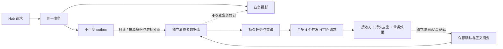

消费者采用已有 `morph-runtime-store`，没有再实现一套 SQL 存储。它拥有**不同的数据库**，因此投递失败、重试、确认不会让 Hub 的业务 CAS 修订意外变化。源页复制与游标推进在消费者的一笔事务里完成，网络发送不在任何源数据库、Hub 状态或签名者锁内进行。

### 公开事件与可信边界

公开类型放在 `morph-packages::events`，投递代码放在 `morph-events`。`morph-hub-api` 继续只引用公开类型，不因事件 DTO 而引入数据库或阻塞 HTTP 客户端依赖。

事件包含固定 schema、稳定 ID、源数据库身份、源修订、发生时间、组件、类别、严重程度、关联摘要，以及适用的公开资金上下文或支付哈希。没有依据的 provider revision / publication evidence 字段显式为 null。**不复制**备注、发票描述、原像、令牌、参与方签名或私密退出包。

`evidence_level=local_record` 明确写在事件中。因此即使类别叫 `state_published` 或 `channel_finalised`，含义也是“Hub 本地记录发生了这个变化”，不能直接声称 CKB 已经确认。链上事实仍须由真实链观察与不可变发布证据证明。

事件 ID 由源数据库身份和原 outbox ID 经独立域哈希得到。重启、超时、手动重放都保留相同 ID 和**逐字相同正文**；没有重新生成时间戳、重新组织消息或用新 ID 假装第一次执行。

### 接收方接受后崩溃，为什么不会丢事件

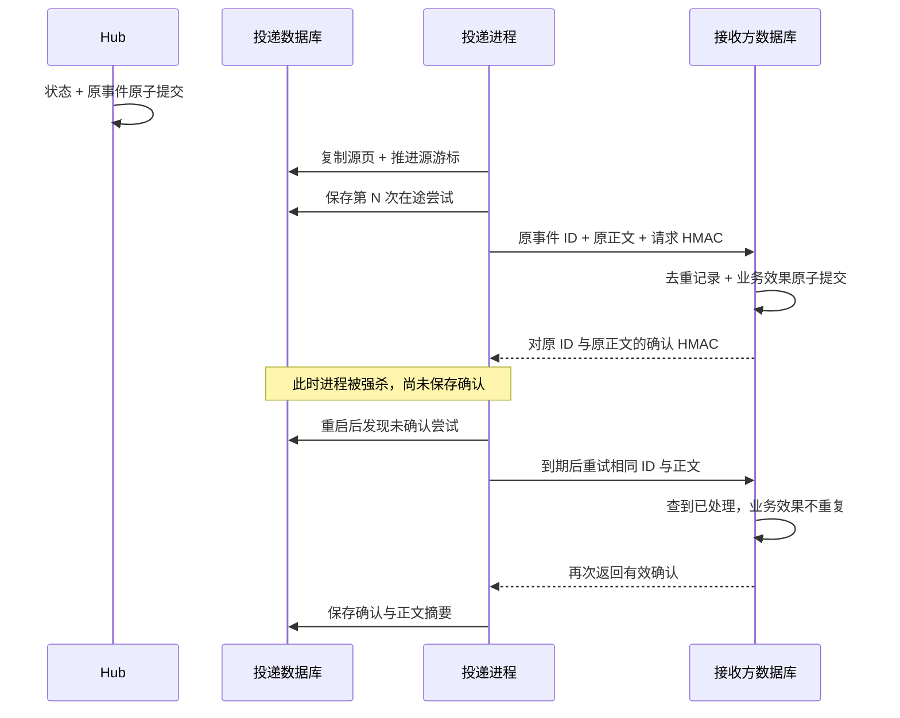

协议承诺的是**有界重试下的至少一次投递**，不是 HTTP 恰好一次。长时间离线或耗尽预算会留下显式死信，不能假装最终一定送达。接收方必须先持久化去重与效果，再确认；仅用内存集合去重不足以应对接收方重启。本轮测试使用真实接收方数据库，并在重复请求之间重新打开它。

请求和确认使用不同 HMAC 域。单纯返回 2xx、反射请求签名、用错密钥、返回重复确认头或超大正文都不能标记成功。默认 HTTPS，仅字面量 loopback 允许开发 HTTP；禁止重定向、URL 内凭据/查询串/片段，以及隐式环境代理。完整请求超时 10 秒、响应正文上限 4 KiB。日志只记录固定失败类别。

### 任务边界和修复流程

| 项目 | 当前上限 / 行为 |
| --- | --- |
| 原事件正文 | 8 KiB |
| 源页复制 | 每次至多 32 条，与游标同事务 |
| 持久分页 API | 每页 1–64 条 |
| 消费者保留任务 | 1024 条，包括成功与死信 |
| 同时在途 | 至多 4 条；CLI 也至多 4 个 HTTP 工作线程 |
| 每代尝试 | 8 次，指数退避 |
| 未确认任务期限 | 入队或显式重放后 24 小时 |
| 在途期限 | 30 秒；过期后可重试，必须允许接收方去重 |
| 死信重放 | 最多额外 3 代，原 ID / 正文不变 |
| 本地管理 | `run-once`、`serve`、只读 `status`、单事件 `replay` |

目标 URL 与密钥策略摘要固定在消费者数据库。配置变化不能悄悄重定向旧任务。HMAC 密钥只从受保护文件读入，不提供原始 argv/env 密钥入口。只读 status 可以与持有消费者 sidecar 锁的服务并行；修改命令不能争抢同一个消费者进程所有权。

**容量与保留仍有待完成部分。** 当前不会自动淘汰成功任务或删除不可变尝试；达到 1024 条时，若源仍有新事件，会报告 `source_blocked`，已入队任务继续排空。公共事务存储还有独立的字节和历史行上限，极端重试时可能先触及。安全归档、压缩和容量恢复流程尚未实现，因此不能把这一版说成可无限运行的生产投递服务，也不能通过删除数据库掩盖未确认事件。

### 持久分页与 UI 活动流分开

新增 `POST /api/event-log`，属于 read 权限查询，不要求业务修改上下文。首次使用 `after:null`；之后传回原 `next` 游标。游标绑定源数据库身份、修订和真实 outbox ID，拒绝跨源、不存在或修订不符的游标。同一事务里的多条事件不会漏读，最后一页为空时保留游标，下一次继续发现后续提交。

Rust SDK 已接入并验证页长、源身份、事件 ID、修订递进与返回游标的一致性。原 SSE 和 `HubView.events` 保留作为短期 UI 活动视图，不能用它们当可靠事件总线。当前生成产物为 **29 个 Hub 端点、32 个类型 schema**。

### 本轮验证及下一步

本轮 **172 项针对性测试通过**：组件与消费者依赖 118 项、Hub 53 项、真实二进制 HTTP 联测 1 项。相关五个 crate 的 all-features/all-targets Clippy（警告视为错误）通过。消费者新增 13 个测试入口，其中真实强杀矩阵包含四个边界：入队后、保存尝试后、接收方接受后、本地确认后。

另有慢 HTTP 期间源业务可提交、并发投递上限、旧尝试回执不能覆盖新尝试、死信/重放上限、满载不推进游标、无效源页不部分入队、HMAC/重定向/响应上限、持久分页等证据。实际 Hub/SDK/CLI 联测启动消费者二进制送出真实 Hub 事件，接收方验证请求并签确认，重启查询仍保留成功状态，Hub 业务修订保持原值。

证据：`target/event-delivery-evidence/2026-11-10/verification.json`。本次对 1515 个运行时代码、配置及 API 生成文件采集了测试前后摘要，确认覆盖集合未变。这是**未提交工作树的有范围验证**，不是完整 CI、最终候选、链上 ELF 或整个 Fiber 补丁的重新资格认证。公共库变化意味着此前 Fiber 补丁证据仍是当时的历史证据，不能自动替这次工作树背书。

下一步继续把 watch 的状态/告警生产边界迁入同一原子 outbox，再接 Gateway，随后处理保留/归档和 #35 的积压、死信、逐资源就绪判断。旧 watch 同步单次 webhook 路径目前还在，不能宣称已完成统一。全过程没有发布、推送、提交或关闭 issue。

英文运行手册：`docs/runbooks/event-delivery.md`。


## #34 下一步：Gateway 生产者与加密源已接入

本轮继续使用既有事件与事务基础，把 Gateway 从“每次提交只有一条通用修订通知”改为**每个实际操作都有明确类别的公开事件**。Hub 与 Gateway 共用一个事件封装、分页规则和投递器，没有新增 Gateway 专用发送循环或第二套重试状态机。

### 为什么不能直接把恢复记录发出去

Gateway 的恢复材料包含原付款请求、付款证明、凭据、原像、私密报价结果、提供方返回值等。它们适合保存在加密数据库中，不能因为需要 webhook 就直接序列化出去。新实现为每个修改操作显式构造公开描述，只有允许的类别与规范哈希可以进入事件；没有“先复制整份对象，再删掉几个敏感字段”的过滤流程。

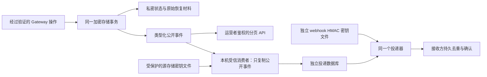

数据库的加密密钥与 webhook 的 HMAC 密钥职责不同。读取加密源需要显式 `--source-storage-key-file`；这是把源解密能力交给本机受信消费者，不能说成密码学上只能读取事件。程序会验证存储、只复制类型化 outbox；远程客户端使用有运营者鉴权的公开事件 API，不需要拿到数据库解密密钥。

### 事件与实际状态变化一一对应

| 公开事件类别 | 对应本地变化 | 允许的引用 |
| --- | --- | --- |
| `gateway_initialized` | 创建当前加密投影 | 无 |
| `gateway_challenge_created` | 保存挑战 | requirement ID、payment hash |
| `gateway_offer_created` | 保存公平交换报价 | offer ID、payment hash |
| `gateway_payment_recorded` | 更新付款观察记录 | requirement ID、payment hash |
| `gateway_receipt_issued` | 首次保存收据与已消费要求 | requirement ID、payment hash |
| `gateway_outgoing_reserved` | 保存确切付款意图，预留唯一首次发送许可 | requirement ID、payment hash |
| `gateway_outgoing_succeeded` / `gateway_outgoing_failed` | 保存首个有效终态 | requirement ID、payment hash |

付款预留不代表提供方已经收到付款，普通观察记录不代表一次新提交。事件仍写明 `evidence_level=local_record`，不携带完整签名收据，也不等于独立链上确认。组件与事件类别必须匹配，不能把 Gateway 类别伪装成 Hub 事件。

未改变状态的重试不会再提交一个修订或再发一条事件。原有“首个终态不可覆盖”规则继续生效：重复成功观察返回原结果，后到的冲突失败被拒绝，不额外产生失败通知。类型化事件和私密状态仍在同一事务，公开引用格式不合法时，两者都不提交。

### 加密源、分页与唯一当前形状

- `event-delivery` 现在能读当前 Hub 明文私有源或当前 Gateway 加密源；指定源存储密钥只是在选择保护模式，不是旧协议兼容入口。
- 缺少/错误的存储密钥在入队和发送前失败。消费者持久文件和 HTTP 正文不含原像、私密付款证明、凭据、报价解密密钥、提供方 URL 或原始 Fiber 返回体。
- Gateway 新增运营者 bearer 鉴权下的 `POST /v1/events`；Rust `PaymentGatewayClient::events` 使用同一个有界、源绑定游标。初次 `after:null`，之后传回 `next`。读取没有付款副作用。
- Gateway 当前私密投影 schema 升到 **3**，旧 schema 2 明确拒绝。没有旧通用事件读取器、自动回填或迁移分支。开发状态重置必须先保留证据、处理未决外部操作；不能通过恢复旧付款账本重新获得发送许可。
- 当前生成合同为 **14 个 Gateway 路由、21 个类型 schema**；Hub 仍是 29 个端点、32 个类型 schema，共享事件类型同步更新。

### 这次验证的范围

本轮 **176 项针对性测试通过**：组件 121 项、Hub 53 项、真实二进制 HTTP 联测 2 项。相关五个 crate 的 all-features/all-targets Clippy 通过，警告按错误处理。1519 个源码、配置、SQL 与 API 生成文件的测试前后摘要一致。

新增/加强的证据包括：

1. 旧 Gateway schema 被拒绝，拒绝前后数据库字节不变。
2. 非法公开引用在状态/事件提交前失败，不形成半提交。
3. 原像只存在于加密恢复记录，公开事件正确绑定源身份、修订、类别与公开引用。
4. 付款预留与首个成功终态各产生一条事件；重复观察和冲突失败不追加事件，也不泄露原始提供方材料。
5. 实际 HTTP 分页要求运营者鉴权，拒绝跨源游标，返回的页面通过 Rust 客户端一致性校验。
6. 实际消费者二进制读取生产代码生成的加密 Gateway 数据库，拒绝缺失/错误的源密钥，发送并验证 HMAC 确认，重启后仍保留两条成功记录。
7. 投递完成后源数据库逐字不变，消费者数据库中查不到私密测试标记。

这组测试没有重新执行真实 Fiber 付款，也没有证明 watch 已接入；原有 Gateway 付款回归覆盖继续通过。证据文件为 `target/gateway-event-evidence/2026-11-10/verification.json`，对应未提交工作树，不是最终发布资格。

**下一步仍是 watch 状态/告警的原子生产边界、保留/归档与安全容量恢复，以及 #35 的积压、死信、逐资源健康判断。** #34、#35 和整个 W1 均未关闭。本轮没有提交、推送或发布。


## #34 下一步：Watch 扫描进度、告警与事件合并为原子事务

本轮接着完成 W1 所依赖的事件生产边界。Hub、Gateway 之后，实际 watch 观察/发布路径也接入同一个事务存储和事件消费者。没有引入第二套 webhook 重试器，也没有改变合约、挑战窗口或签名权限。

### 为什么要改

原先存在两类时序问题：先保存扫描进度、再追加告警时，进程可能在两者之间退出，留下“看过了，但没有告警”的状态；同步 webhook 又把远端网络延迟带进本机观察循环。现在扫描游标、私有告警意图、公开事件和外发权限一起提交。消费者另有数据库，HTTP 不持有观察者的事务。

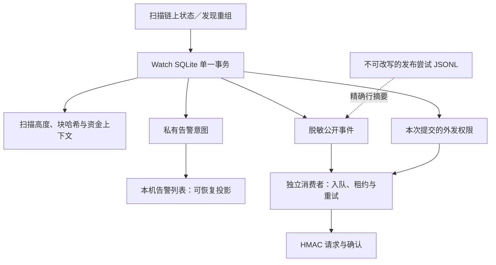

普通区块检查点不生成通知，因此不会把每个区块都塞进 webhook 队列。真实告警使用封闭的类别：重组、恢复材料无效、发布失败、发现旧状态、发布已提交、splice 发现/材料缺失/发布、扫描空闲。类别存在不等于增加了新的自动激活或发布能力；只记录现有实现实际发出的观察结果。

### 原子性和恢复边界

| 情况 | 现在的结果 |
| --- | --- |
| 在提交之前退出 | 旧游标仍在，告警和事件都未提交；重启重新观察 |
| 提交之后、更新显示列表之前退出 | 新游标、私有告警和 outbox 同时存在；重启补齐显示列表 |
| 更新显示列表后退出 | 重启去重，不重复补写相同记录 |
| 链发生重组 | 清除可被孤立的上下文、重置游标和严重告警同一事务落盘，然后重扫 |
| 多通道共用一个告警列表 | 合并缺失记录，保留其他通道记录，不整文件覆盖其内容 |
| 显示列表繁忙、损坏或无法写入 | 固定诊断提示；不能阻止观察与发布，权威记录仍在数据库 |
| webhook 不可用 | 独立消费者重试，不阻塞扫描循环 |

显示投影使用非阻塞 sidecar 锁。仅末尾未写完的一条显示记录可丢弃并从源补齐；完整但畸形的记录不会被当作权威数据，需要本机修复。投影恢复仍需要扫描保留历史，当前上限为 32 MiB；这不是已经完成长期归档的声明。

### 哪些材料能外发，哪些不能

公开事件没有任意文本字段，不复制原始 RPC 错误、路径、私密恢复包、签名或密钥。它携带组件、来源身份、修订、事件身份、公开通道/资金上下文引用，以及适用的发布证据摘要。`evidence_level=local_record` 仍然明确：事件和接收端确认都不是链上终局证明。

发布成功通知中的 `evidence_digest` 绑定原始发布日志的**精确 JSONL 行字节，包含换行符**。计算使用 CKB 个性化 Blake2b-256，加独立的 `morph.watch.publication_evidence.v1\0` 域。没有把历史发布尝试搬进新库重写；旧行继续作为可核对的原始证据。

外发权限来自 watch policy 的 `allow_webhook_alerts`，没有 policy 默认不允许。权限与每次成功的 watch 事务一起保存。消费者在入队、领取发送任务前读取它；撤销后，即使以前已经排队，也不能领取新发送任务。已经发出的网络请求无法撤回，合法确认仍可记录。修改配置文件不是即时撤销 API，必须等 watcher 提交新权限。

### 开发配置变化

- `cursor_file` 现在是当前 SQLite 数据库，默认后缀 `.db`，拒绝旧 JSON 游标和不属于 watch 的数据库；没有自动迁移或旧解析入口。
- `alert_file` 保留给 Hub 显示，不能用它恢复签名权限或判定链上状态。
- 删除 watch config 的 `alert_webhook_url` 和旧 raw-secret 环境输入；通过独立 `event-delivery` 和受保护的 HMAC 密钥文件配置通知。
- 存储需要私有目录及安全祖先目录。验收发现本机 `RustRoverProjects` 为 `0777` 后，将验收运行数据放在独立的 `/tmp` 私有目录；没有放宽检查，也没有擅自 chmod 用户项目目录。
- 发布验收脚本改为私有 umask，并对源码软链接记录目标文本而不是跟随到外部目录。原脚本的 `sha256sum` 无法处理文档目录软链接，曾在完整链场景结束后阻断证据汇总；修复后整组重跑通过。

### 本轮实际验证

**389 个作用域内回归测试 + 1 个真实原生结果读取测试，共 390 个通过；作用域内 Clippy 的 all-features/all-targets、警告视为错误也通过。** 回归覆盖 CLI、events、runtime-store、Hub API、SDK、Gateway，包括真实 HTTP、消费者强杀和这次新增的三个 watch 生产者强杀位置。常规运行会显式忽略依赖真实链结果的读取测试，随后本轮又用真实结果路径单独执行它并通过，没有把 ignored 算成通过。

原生开发节点验收独立执行了：Sponsor 费用上限广播前拒绝、节点费用下限、交易池驱逐后重发、重复 pending 广播、跨运营者替换与不足替换费拒绝、规范确认、人工重组后重新发布，以及有界服务和健康文件。独立 Rust 读取测试再检查实际数据库中的事件身份、重组/旧状态/空闲记录、发布摘要是否匹配原始日志行，并确认读取前后源数据库字节不变。

最终回归期间 **4068 个源码、文档和链接条目未变化**。本轮证据索引：`target/watch-event-evidence/2026-11-10/verification.json`；原生报告另存 `native-report.json`。原生运行有自己的精确 binary/harness/worktree 指纹，之后只修了一处测试临时锁文件清理再做最终回归，因此没有把原生运行误称为最终发布候选的全量资格。原生使用已有八个 ELF 并记录其摘要，没有在本轮改动或重建共识脚本。

### 仍未完成

本轮补齐的是 watch 生产和投递边界。**保留历史归档、安全释放容量、积压/死信与逐资源 readiness、跨服务故障矩阵仍需继续。** 每通道持久历史与消费者 1024 个保留任务上限还不能支撑无限运行。SQLite、日志摘要和进程隔离也没有解决整个存储回滚的新鲜度问题。

整个 W1 继续按依赖推进；#34、#35 和其他未完成 issue 不提前关闭。本轮没有 commit、push 或发布，也没有恢复已取消的独立审计要求。


## #34 后续：消费者分代归档与安全容量恢复

上一轮完成了 watch 的事件生产边界，本轮继续解决消费者到达容量上限后如何恢复工作的问题。旧实现保留所有已确认任务，达到 1024 个任务后便无法接收更多事件，即使这些事件已经全部投递成功；重试历史本身也会逐渐达到共享存储上限。

### 选择：封存旧库，交接未完成任务

直接删除已确认行只能减少工作列表，不能解决尝试历史的保留，也容易丢掉审计依据。现在采用**消费者分代归档**：旧数据库本身就是归档，不删除任何意图、尝试、确认或任务；新数据库只承接未完成任务和原来源游标。

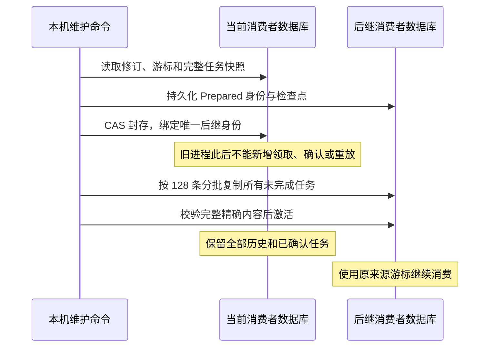

这里没有跨两个数据库的“大事务”。安全性来自交接次序：新库准备期间不能投递；旧库封存成功后才复制和激活新库。CAS 会拒绝准备期间已经被其他进程推进的旧快照。发生中断时，重复同一条命令和同一组路径可以继续；重复执行已完成的交接不会把已经运行的新库重置。

### 什么保留，什么转移

| 内容 | 封存后的旧库 | 后继库 |
| --- | --- | --- |
| 来源身份、接收端策略、来源游标 | 保留 | 精确保留绑定和游标 |
| 已确认事件及其确认依据 | 保留 | 不复制到工作列表，不重新投递 |
| 待处理事件 | 保留历史快照 | 原事件 ID 和原字节继续处理 |
| 在途事件 | 保留历史快照 | 保留原租约到期时间，不能提前重发 |
| 死信 | 保留历史快照 | 仍为死信，不被自动清除或重新放行 |
| 尝试次数、重放代次、年龄起点 | 保留 | 原样复制，不因换库获得新预算 |
| 过往 intent/attempt 历史 | 全部保留 | 新一代记录自身后续历史 |

旧进程已经发出的 HTTP 不能被撤回。如果接收端已收到、但本机在封存前未记录确认，新库仍需遵守原租约和至少一次投递语义；接收端持久去重仍然必要。分代归档没有声称实现 HTTP exactly-once。

### 容量预留和维护入口

新增本机命令：

```sh
morph-cli event-delivery \
  --source /private/watch/channel.db \
  --store /private/events/generation-001.db \
  --url https://receiver.example/morph-events \
  --hmac-key-file /private/events/webhook.key \
  archive --next-store /private/events/generation-002.db
```

先停止该消费者 worker；命令遇到当前库或后继库被占用会拒绝，而不是等待一个可能永远不释放的维护锁。成功后保留旧库，后续 `serve` 使用新的 `--store`。加密生产者继续使用受保护的 `--source-storage-key-file`。归档不修改生产者，不变更接收端，也不发送 HTTP。

当前消费者每代最多保留 1024 个任务。到达 8000 次修订时，新工作修改暂停，并为旧库的最后一次封存提交保留空间，避免直到共享存储的 16384 条历史硬上限才开始处理。状态输出新增 `archive_required` 和 `sealed`；它们是可检查的维护状态，不是签名权限或链上确认。

消费者元数据升级为当前唯一的 `morph.event.consumer.v2`，不读取旧 v1、不自动迁移。预部署数据替换必须保留旧证据并明确理解新空订阅可能重新遍历来源事件；这种重建不是正常归档流程。归档后缺失或损坏的准备库需要恢复匹配存储，不能删掉旧库再伪造一个空游标绕过绑定。

### 实际验证

本轮相关回归 **395 项通过**：CLI、events、runtime-store、Hub API、SDK、Gateway；同范围 all-features/all-targets Clippy、警告视为错误通过。events 现在有 20 项测试，本轮增加了 6 项，其中 1 项是子进程测试入口，其余覆盖实质恢复边界。

| 验证 | 实际检查的行为 |
| --- | --- |
| 四个真实进程强杀位置 | Prepared、Sealed、只复制第一批、Activated 后均可恢复 |
| 分批复制中断 | 129 个待交接任务，复制前 128 个后强杀；恢复后全部任务可继续，没有丢失或重置 |
| 并发修改 | 准备后旧库发生领取，封存 CAS 失败，过期的后继库不能激活 |
| 旧句柄失效 | 封存后的旧 Queue 不能领取、确认或重放死信 |
| 死信和租约 | 原状态、原事件字节、原重试预算保留；未到期租约不会被提前使用 |
| 1024 个任务上限 | 已确认任务留在归档，新库接着接收第 1025 条事件，原来源游标不回退 |
| 8000 次修订 | 新领取被暂停，仍能完成封存并在新库继续处理未完成工作 |
| 真实 CLI 与加密来源 | Gateway 事件经真实 HMAC HTTP 确认后归档，新库运行不重发已确认事件，生产者数据库字节不变 |

证据索引：`target/event-archive-evidence/2026-11-10/verification.json`。本轮校验窗口中的 **373 个应用源码、生成合同和构建配置条目未变化**；该指纹范围明确不含外部及 vendor 依赖源码树，不称为最终候选的全源冻结。依赖真实 CKB 运行结果的 watch 读取测试在本轮明确 ignored，没有把它算成通过，也没有声称重新跑过链上资格。

### 下一步和限制

这解决了**消费者工作容量和消费者历史的分代保留**，不是所有存储问题。1024 个仍未完成的任务不能靠归档变成已完成，所有旧代继续占用磁盘，也没有自动删除归档。生产者的长期历史分段、保留查询和安全容量恢复仍需设计实现；#35 的积压/死信/逐资源 readiness 也尚未接完。

完整数据库回滚仍不受这种摘要和交接保护；它们不能替代 #55 的独立新鲜度边界。整个 W1 保持未完成，本轮没有关闭 issue、commit、push 或发布。

## #35 后续：事件消费者的可用性与积压指标

在生产者事件落盘、消费者独立投递和分代归档之后，补上了这一条运行链的 readiness。过去“数据库能读、进程能启动”不足以回答事件是否还在被处理；现在观察明确拆成四个条件，不把其中一项成功冒充整体正常。

```mermaid
flowchart LR
    S[生产者只读库] --> Q[一致修订上的队列观察]
    C[消费者只读库] --> Q
    W[真实 serve worker] --> H[绑定订阅与数据库代次的私有心跳]
    Q --> R{四项均有效?}
    H --> R
    P[当前来源投递策略] --> R
    R -->|是| Y[event_dispatch ready]
    R -->|否| N[固定原因码 + 非零退出]
    Q --> M[固定 17 条指标]
    R --> M
```

### 四项检查的实际含义

| 条件 | 检查什么 | 拒绝或降级的情况 |
| --- | --- | --- |
| Store | 真实读取并验证两个数据库，读取前后修订一致 | 忙、损坏、不支持的 schema、读取期间修订改变 |
| Outbox | 未完成任务、死信、来源未读事件和归档状态 | 任意死信、积压超龄、来源仍有未读事件、容量阻塞、需要归档或旧库已封存 |
| Worker | `serve` 写入的短期私有心跳 | 未启动、停止、租约过期、身份不符、系统重启、时钟异常 |
| DeliveryPolicy | 生产者当前允许向外投递 | 来源策略缺失或拒绝；不会借健康检查修改策略 |

来源尚未消费完时，检查保守返回不可用，因为尚未读入的事件不能假定都是非关键事件。普通任务默认 5 分钟、critical 任务默认 30 秒达到积压阈值，可由命令参数收紧或调整。这是**本地无真实资产运行预算**，不是已经测得的网络 SLO，更不是通道挑战窗口。

### 停止进程必须反映出来

`serve` 在每轮开始前写心跳，寿命为轮询间隔加 15 秒，最多 75 秒。心跳绑定来源、消费者数据库身份和接收策略摘要；不能拿旧代或其他订阅的心跳证明当前消费者正常。`run-once` 不续约，也不会因有人运行 readiness 命令而续约。

Linux 下同时校验 wall clock、包含休眠时间的 `CLOCK_BOOTTIME` 和本次启动 ID。系统重启使旧心跳失效，向后调整墙上时间不能无限延长已过期租约。进程被强杀后不会假装立即知道这一事实，而是在已声明的租约上界内转为不可用。心跳有效也只是本地 worker 的近期观察，**不证明远端接收端在线，更不证明付款或链上交易终局**。

探测命令最多等待 2 秒，证据有效期从探测开始计算。慢读取不会在完成后重新领取一个完整新租约；读取过程中到期的 worker 心跳不能被延长。探测使用只读数据库，不获取 worker 的排他运行锁，不更新生产者业务修订或消费者任务。超时会返回不可用，不声称能取消内核中已经开始的磁盘 I/O。

### 命令和指标

```sh
morph-cli event-delivery \
  --source /private/watch/channel.db \
  --store /private/events/generation-002.db \
  --url https://receiver.example/morph-events \
  --hmac-key-file /private/events/webhook.key \
  readiness --max-pending-age-ms 300000 --max-critical-age-ms 30000
```

同一组来源、消费者和接收配置可改用 `metrics`。readiness 输出共享的结构化报告，不可用时退出非零；metrics 即使观察失败也输出明确的 ready=0，无法确认的队列数值用 `NaN`，不能伪造零积压。

固定 17 条指标覆盖队列状态、关键事件积压和年龄、来源阻塞、归档需求、worker 新鲜度及策略。没有把 URL、路径、事件 ID、消费者 ID 或原始错误装进标签，避免泄密和无限增加指标维度。共享 scope 枚举增加 `event_dispatch`，Hub 明确将其列为本服务未实现；因此 Hub 当前固定指标总数从 131 变成 132，不能据此推断 Hub 自己承担消费者投递。

### 验证结果与剩余边界

最终 scoped 回归 **405 项通过**，覆盖 CLI、events、observability、runtime-store、Hub API、Rust SDK 和 Gateway；同范围 all-features/all-targets Clippy（警告视为错误）、格式和 diff 检查通过。源码、生成合同、vendor 和构建配置共 **3897 个条目**在验证窗口前后相同。

- 单元验证涵盖双时钟、重启、跨代身份、停止、租约在读取期间到期、慢探测、各类积压原因、固定指标及无证据时的 `NaN`。
- 心跳路径误配为其他订阅或 SQLite 数据库时拒绝覆盖，保留原文件字节。
- 队列测试实际产生 critical 事件，验证 pending、超龄后的 dead-letter 与只读修订不变。
- 真实 CLI 集成先验证“空队列但没有 worker”不可用，再启动真实 `serve` 验证可用；强杀进程后等待真实租约过期，确认变为不可用。源库和后继消费者库字节保持不变；没有用修改心跳文件来伪造退出结果。

证据索引：`target/event-readiness-evidence/2026-11-10/verification.json`，包含最终测试及 Clippy 日志摘要。依赖真实 CKB 运行的 watch 读取测试本轮明确 ignored，没有算成通过；本轮不包含新链上资格或最终候选验收。

**#35 仍未完成**：Gateway、签名服务、watch 和操作运行时还需各自的真实依赖检查及业务指标。生产者长期历史分段与安全容量恢复也仍未完成。这里的文件、时钟和摘要没有解决整个存储回滚问题；#55 的新鲜度边界保持独立。整个 W1 继续推进，未关闭 issue，未 commit、push 或发布。

## #35 后续：Payment Gateway 的实际依赖观察

消费者就绪之后，本轮把同一套分项观察接入真正的 Payment Gateway HTTP 服务。原来的 `/health` 仍只回答进程能否处理请求；新增 `/ready` 与 `/metrics` 分别回答“当前哪些前置条件已经观察到”和“运行中发生了什么”。它们使用 operator bearer，不能借监控接口绕过业务认证。

### 为什么不能只返回一个绿色状态

网关本地数据库正常，不代表它连接到了正确的 Fiber 节点；节点在线，不代表某条支付路径一定有足够流动性。现在报告明确区分这些边界：

| 分项 | 本轮检查 | 没有据此宣称 |
| --- | --- | --- |
| 本地登记与持久化 | 加密数据库身份、历史完整性、当前 schema、读取前后修订和容量 | 任意大小请求都一定能落盘 |
| 发票签发前置条件 | 存储、未过期且未结算 challenge 配额、receipt 配额、预期 Fiber 身份 | RPC 的写权限、收款方在线或必然能收款 |
| 支付提交前置条件 | 仅在配置 outgoing payer 时启用；存储、不可淘汰付款身份的剩余配额、预期 Fiber 身份 | 已找到支付路径、足够流动性、支付成功或链上终局 |
| 通道签名、链上发布、事件投递 | 明确标为本服务不提供 | 从其他分项的绿色状态推导它们可用 |

每笔付款仍须经过原来的签名条款、付款人策略、到期规则、精确请求身份和持久化提交检查。健康报告从不发放付款授权；未知结果仍只能按原请求查询，不能因为网关恢复绿色就重新发送。

### 固定预期身份，避免连错节点仍显示正常

启动参数新增一对可选的观察配置：`--fiber-pubkey` 和 `--fiber-chain-hash`，必须同时提供。公钥使用 Fiber 当前的 66 位小写十六进制格式，不含 `0x`；链哈希使用非零 32 字节、小写 `0x` 格式。

只调用只读的 `node_info`，参数为空数组，逐项比较这两个预期值。错误网络、错误节点、响应畸形、RPC 不可用以及未配置预期值分别显示固定原因码。没有配置时，本地数据库分项仍能正常，但依赖 Fiber 的分项保持未验证，整体 `/ready` 返回 503。不会从每次响应中自动学习并接受一个新节点。

这里确认的是**配置的 RPC 对自身身份的报告**，不是节点签名、独立 CKB 链视图或部署脚本证明。没有把节点自报的 chain hash 写成“已经独立验证整个链”；#37 和运行资格的剩余工作继续保留。

### 慢磁盘和慢 RPC 不应把网关拖住

```mermaid
sequenceDiagram
    participant M as 监控或 Rust SDK
    participant G as Gateway HTTP
    participant P as 单个探测名额
    participant D as 独立只读加密连接
    participant F as 配置的 Fiber RPC
    M->>G: 带 operator token 的 GET /ready
    G->>P: 尝试领取唯一名额
    alt 已有探测未结束
        P-->>G: Busy
        G-->>M: 503 + 分项报告
    else 领取成功
        par 本地读取
            G->>D: 校验身份、历史、修订与配额
        and 远端观察
            G->>F: node_info，空参数
        end
        Note over G: 总预算 2 秒，证据从探测开始计时
        G-->>M: 200 或 503 + 同一种 Readiness
        Note over P,D: 请求超时或取消时，未结束的磁盘任务仍占用名额
    end
```

探测没有复用业务数据库的互斥连接。读取走独立只读连接，不创建库、不修复、不裁剪过期 challenge、不更新游标，也不创建发票或发送付款。替换成另一个同样能解密、schema 也正确的数据库，仍会因为存储身份不同而失败。

全实例最多一个探测在执行。HTTP 请求超时后，已经进入磁盘 I/O 的线程不能被假装取消；它会继续持有名额直至真正退出。这样后续 scrape 返回 Busy，而不会每两秒再制造一个永远卡住的线程。相应单测启动真实阻塞任务、取消其等待句柄，再检查名额是否仍被保留。

### 指标、客户端与合同一起更新

网关现在输出 **141 条固定指标序列**：132 条共享请求类别、结果、耗时和分项就绪指标，加 9 条网关业务观察值，包括数据库修订、challenge、receipt、offer、付款身份数、未知结果数及最长等待年龄、历史行数和已存字节数。

缺失或过期的存储观察输出 `NaN`，不能把未知包装成零积压。没有把付款哈希、原始路径、URL、公钥或原始 RPC 错误放进标签。进程计数在重启时重置，不冒充持久结算总额；未知付款保留在原存储，不通过监控重试。

HTTP 503 在 readiness 中是正常的负面观察，使用与 200 相同的结构。Rust SDK 现在能正确读取它，同时检查 HTTP 状态、服务身份和报告内部一致性。认证失败仍返回原来的错误结构。端点表、OpenAPI 和 JSON Schema 均从唯一代码定义重新生成，避免文档写一种、服务返回另一种。

### 本轮验证与后续依赖

最终相关回归 **411 项通过**：CLI、events、observability、runtime-store、Hub API、SDK 和 Gateway；同范围 all-features/all-targets Clippy（警告视为错误）、格式与 diff 检查通过。**3900 个源码、生成合同、vendor 和配置条目**在最终验证窗口前后保持一致。

| 本轮新增验证 | 实际覆盖 |
| --- | --- |
| 精确 Fiber 身份 | 两个值都匹配才通过；错误网络、错误公钥、缺字段、前缀/大小写错误、零链哈希拒绝 |
| 探测有效期与分项容量 | 慢探测、墙上时间倒退、证据过期、付款身份配额耗尽；未启用付款时不假装该能力已配置 |
| 真实 HTTP 与 Rust SDK | 无 token 拒绝；结构化 503；真实加密库的只读观察、固定 141 条指标、另一个有效数据库替换后失效 |
| 真实只读 RPC | 控制 HTTP 对端只接受 `node_info` 空参数；接入真实 Gateway 路由和 SDK 验证 200；超时期间存活接口仍响应、并发探测不重复发 RPC |
| 阻塞任务取消 | 真实后台阻塞任务开始后取消等待，名额仍被占用；直到任务退出才释放 |
| 持久业务配额 | 真实存储写到 challenge 上限；观察发现耗尽，过期后看到可回收空间但不主动裁剪，数据库字节不变 |

证据索引：`target/gateway-readiness-evidence/2026-11-10/verification.json`。这是宿主端回归，RPC 对端为受控测试服务；没有声称本轮跑过新的原生 Fiber/CKB 验收，也没有把依赖链上产物而 ignored 的测试算成通过。

#35 仍需接入 signer、watch、发布与完整付款协调服务的实际依赖和业务观察；生产者历史归档与 W1 最终资格也未完成。数据库身份和修订检查不解决整库回滚，#55 的独立新鲜度边界仍然必要。本轮未关闭 issue、未 commit、push 或发布。

## #35 后续：签名上下文监督的双时钟有效期

本轮核对了已有 signer supervisor，而不是另写一套监控。它原本会检查真实签名 journal 的链上上下文、守卫和重复 authority，并保存健康快照；但快照只有墙上时间有效期，没有本次系统启动身份和独立启动时钟上界。直接把这种快照包装成统一绿色状态，会保留一个不必要的时间判断缺口。

### 从周期开始计时，同时受两种时钟约束

当前唯一快照升级为 `morph.multi_asset_supervision_health.v2`，包含周期开始的墙上时间、启动时钟开始/完成/到期时间，以及 Linux boot ID。有效期从**整轮检查开始之前**计算，不能等耗时检查结束后才重新领取完整时长。

```mermaid
flowchart LR
    A[记录周期开始时间与 boot ID] --> B[最多四个 worker 检查 journal]
    B --> C[保存当前 v2 快照]
    C --> D{配置和 session 集合匹配?}
    D -->|否| X[不可用]
    D -->|是| E{同一次启动且两种时钟都有效?}
    E -->|否| X
    E -->|是| F{全部上下文 verified?}
    F -->|否| X
    F -->|是| Y[authority_supervision ready]
    Y --> Z[仅表示最近监督结果有效]
```

`CLOCK_BOOTTIME` 包含休眠时间，系统重启会更换 boot ID。读取结果时再次检查当前时间，墙上时间回退到检查完成之前、启动时钟回退、任一时钟到期或系统重启，都不能让旧快照重新有效。这不是不可回滚的签名计数器，也不是 #55 整库存储回滚的解决方案。

消费者原来独立实现的启动时钟读取移入 `morph-observability` 共享模块，消费者与 supervisor 使用同一个实现。没有新增另一套后向读取器：v1 快照或缺少必填启动时钟字段都拒绝。预部署更新时停止 supervisor，保留旧健康/告警证据，使用新的健康输出路径；不删除、不恢复签名 journal。

### 明确监督服务和密钥服务的区别

新增命令：

```sh
morph-cli multi-asset-supervision-readiness \
  --config /private/supervision.json \
  --health-file /private/monitor/health.json
```

加 `--metrics` 输出固定 Prometheus 指标。不加时输出统一 `Readiness`，不就绪则退出非零。读取预算为 2 秒，输入须为有界普通文件，符号链接和命名管道拒绝。报告不包含 journal 路径、公钥、funding context 或原始错误。

| 信息 | 正确含义 |
| --- | --- |
| `service=signer_supervisor` | 这是监督进程的证据，不是持钥进程的响应 |
| `authority_supervision` | 配置中的全部上下文最近通过检查，且证据仍有效 |
| `channel_signing` 未配置 | 没有据此证明持钥进程在线、接受了某请求或愿意签名 |
| 8 条固定指标 | readiness、观察可用性和六类状态数量；过期/缺失数量为 `NaN` |

busy、unmanaged、blocked、unreadable 和 duplicate authority 都不会产生绿色监督结果。重复 authority 仍重新归并检查，不把一个看似完整的健康文件当作成功。原详细 health 命令保留为本机诊断入口；实际签名仍自行进行完整 journal、策略和链上守卫验证，不消费本报告作为授权。

共享 scope 枚举增加 `authority_supervision` 后，通用指标的当前固定数量相应变为 Hub **133**、Gateway **142**；消费者仍为 **17**，supervisor 单独为 **8**。前面各检查点中的 132/141 是历史数字，当前 runbook 和生成 schema 已同步。

### 验证范围

新增验证包含重启、启动时钟到期/回退、墙上时间部分回退、检查周期过长、旧 schema/缺字段拒绝和公共报告脱敏。真实 CLI 测试启动 supervisor，保存实际 v2 快照，强杀进程后等待真实租约到期；输出从已知不可用原因转为 stale，过期指标为 `NaN`，观察文件字节不被探测修改。该测试刻意使用缺失 journal，因此不把它说成“真实链上 verified 正面用例”；链上守卫逻辑沿用现有实际检查路径。

最终相关回归 **414 项通过**，覆盖 CLI、events、observability、runtime-store、Hub API、Rust SDK 与 Gateway；同范围 all-features/all-targets Clippy（警告视为错误）、格式和 diff 检查通过。**3903 个源码、生成合同、vendor 和配置条目**在最终校验窗口前后不变。证据索引：`target/supervision-readiness-evidence/2026-11-10/verification.json`。

这次完成的是 supervisor 观察边界。持钥进程的实时可用性/策略观察、watch 与 publication 的逐资源状态、生产者历史分段和整个 W1 最终验收仍待完成；不会据此关闭 #35 或 #55。没有修改共识脚本或重跑原生链上资格；未 commit、push 或发布。

## #31 / #43：Root 签名的组合故障验收

完成几轮可观测性接入后，本轮回到签名边界最重要的剩余验收：此前分别测过协议解析、IPC 和丢失回包，但还不能把它们合称为“宿主在关键持久化位置崩溃后也能正确恢复”。现在把真实宿主进程、真实持钥进程和原来的 funding journal 连起来，先完成 RootExit 与 RootCreation 两个角色的组合矩阵。

### 为什么要分三个崩溃位置

```mermaid
sequenceDiagram
    participant H as 宿主进程
    participant J as 原有单一 journal
    participant K as 独立持钥进程
    H->>J: reserve + 原子保存/fsync
    Note over H,J: 强杀位置 A：只有不可撤销预留
    H->>K: 精确角色与持久授权的签名请求
    K->>J: 独立读取并验证授权与链上上下文
    K-->>H: 有效签名
    Note over H: 强杀位置 B：已收到但还没记录
    H->>J: record + 原子保存/fsync
    Note over H,J: 强杀位置 C：已记录但还没返回
    H-->>H: 新宿主进程重新读取同一路径
    Note over H,K: A/B 只能继续同一预留；C 直接读取已保存回执
```

| 故障类别 | RootExit | RootCreation | 观察到的恢复约束 |
| --- | --- | --- | --- |
| 预留保存后 SIGKILL | 通过 | 通过 | 预留仍在，未保存签名；新进程只继续同一目标 |
| 收到有效签名、记录前 SIGKILL | 通过 | 通过 | 不能把未知结果当作取消，预留仍在 |
| 签名保存后、返回前 SIGKILL | 通过 | 通过 | 无需再启动 signer，返回精确缓存回执，journal 字节不变 |
| 畸形 JSON 回包 | 通过 | 通过 | 宿主拒绝，不写签名，不撤销预留 |
| 超过帧上限的回包 | 通过 | 通过 | 同上，且不能因异常回包扩大缓冲区 |
| 签名本身有效但标错角色 | 通过 | 通过 | 回包角色绑定仍必须匹配，不能串用退出/创建授权 |
| 审查后 journal 合法前进 | 通过 | 通过 | 用钥前重新读取发现变化，拒绝旧审查结果 |

这是 **14 个注入场景**，由 3 个矩阵测试执行；另有 1 个只供子进程启动的测试入口，不把它单独称为安全场景。RPC 使用受控的 live-cell 测试服务，没有冒充真实 CKB 节点运行。

### “合法前进”不是回滚旧数据来造一个测试

测试让 key service 在完整授权审查后暂停，然后使用正常 `AddSignature` 命令向原 journal 加入对方的有效回执。它是一次真实的向前状态变化，不清除本地预留、不还原旧备份，也不复制一个第二 authority。

释放暂停后，原有用钥前重读检查发现 journal 字节已变化，拒绝请求。测试专用的“已用钥”标记没有出现，客户端没有收到有效回包，前进后的 journal 字节保持不变。新 signer 按当前 journal 重新审查后能继续同一个角色，最后保留完整两份签名。该检查没有被放松成“出错就重置预留”。

SIGKILL 恢复与缓存读取均启动新的宿主进程。签名密钥依旧只通过受保护文件交给独立子进程，未进入子进程 argv 或原始密钥环境变量。所有暂停和用钥标记只在 `cfg(test)` 编译；普通/devnet CLI 不提供对应的环境控制入口。

### 证据边界

本轮没有为了让测试通过而改动生产签名规则；验证的是现有 reserve → fsync → 审查/签名 → record → fsync 的真实执行路径。进程强杀在明确的应用阶段发生，不能等同于在内核 `fsync` 或 rename 内部切断电源；底层持久化测试仍有自己的范围。

Update 和三个 splice 角色的同类组合矩阵尚待补齐，Factory/child/wallet/Sponsor 的授权边界也不能被这两个 root 角色替代。因此 #31、#43 和整个 W1 仍保持未完成。SQLite、这些进程测试和 journal 摘要均不提供整库回滚的新鲜度保证，#55 的威胁模型没有改变。

最终相关回归 **432 项通过**，覆盖 CLI、signer、packages、events、observability、runtime-store、Hub API、Rust SDK 与 Gateway；同范围 all-features/all-targets Clippy（警告视为错误）、格式和 diff 检查通过。**3904 个源码、生成合同、vendor 和配置条目**在验证窗口前后一致。普通 CLI 二进制也已检查不含本轮测试故障控制标记，并记录 SHA-256。

证据索引：`target/root-signer-fault-evidence/2026-11-10/verification.json`。本轮没有重建或重新验收 ELF，没有关闭 issue、commit、push 或发布。下一步继续 Update/Splice 的组合故障边界。

## #31 / #43：补齐 Update 与三个 Splice 角色的组合故障矩阵

本轮接续上一节 Root 验收，完成普通更新、Splice 新状态创建、新状态初始退出和旧上下文桥接四个角色。六角色的外部签名接入现在均覆盖相同的七类应用阶段故障；这是 #31 的具体验收进展，不代表整个 #43 或 W1 已完成。

### 测试必须经过真正的链上上下文守卫

之前普通会话单元测试的 journal 没有确认后的 lineage，部分用例通过测试包装器跳过 RPC 校验。直接拿它们调用独立 signer 会被正确拒绝。因此，本轮没有增加“测试时忽略授权”的生产开关，而是构造显式的受控 RPC 数据：

1. 先组装当前 Root funding，并收齐创建与初始退出签名。
2. RPC 返回确定的已确认交易、包含交易的区块、激活后的 State、仍存活的 Vault 与完整代码依赖。
3. 使用正常 `confirm_initial_funding` 执行同一路径的确认交接，生成带 lineage 的 journal。
4. 后续 Propose、Accept、PrepareSplice、Sign 和 AddSignature 均走生产命令入口；独立持钥进程自行重读 journal，重新检查规范包含关系、Vault、依赖及请求内容。

```mermaid
flowchart LR
    R[受控 RPC 数据] --> C[正常确认与 lineage 校验]
    C --> J[同一路径的参与者 journal]
    J --> H[真实宿主子进程]
    H -->|持久化预留后| K[独立持钥子进程]
    J -->|只读重审| K
    R -->|规范交易与完整依赖检查| K
    K -->|角色和摘要匹配的签名| H
    H -->|持久化记录| J
    H --> X[进程强杀 / 丢失结果]
    X --> N[新进程读取原 journal 并重试]
```

这些数据使用真实序列化和交易哈希，但没有经过 CKB-VM，也没有声称合成区块满足真实链的共识。它们用于验证宿主和独立 signer 的边界；此前六角色真实节点验收仍是另一份证据。另加三个链上守卫负向场景：交易不再规范确认、Vault 已花费、代码依赖缺失；三者都使独立授权审查失败，预留文件保持不变。

历史 State 的规范包含关系与其是否仍是 live cell 不应混淆。正常 supersede 会消耗旧 State；当前检查同时要求相应 Vault 仍可用，不能把“旧 State 已消费”直接当作整个资金上下文消失。

### 这次新增的 28 个故障场景

| 故障 / 恢复约束 | Update | Splice creation | Splice recovery | Splice bridge |
| --- | --- | --- | --- | --- |
| 预留 fsync 后强杀，保留同一摘要 | 通过 | 通过 | 通过 | 通过 |
| 收到有效签名但未记录时强杀，不能取消预留 | 通过 | 通过 | 通过 | 通过 |
| 收据 fsync 后强杀，新进程无需 signer 取回精确收据 | 通过 | 通过 | 通过 | 通过 |
| 畸形 JSON 回包拒绝，正常重试恢复 | 通过 | 通过 | 通过 | 通过 |
| 超长帧拒绝，不保存签名、不扩大授权 | 通过 | 通过 | 通过 | 通过 |
| 有效签名却标错角色，拒绝串用 | 通过 | 通过 | 通过 | 通过 |
| 审查后合法加入对方回执，用钥前重读拒绝旧审查 | 通过 | 通过 | 通过 | 通过 |

Splice bridge 测试前通过正常流程收齐 creation 和 initial recovery 的两份签名，不绕过“先持完整新退出，再封印旧上下文”的条件。每个强杀场景都重启宿主；需要重签的场景也启动新的独立 signer。已保存收据的场景不启动 signer，并核对缓存读取前后 journal 字节完全不变。

审查并发场景仍使用有效对方回执使 journal 合法向前变化，不复制或恢复旧 authority。暂停的 signer 发现字节变化后拒绝，用钥标记未出现；之后按新 journal 重审成功。所有注入点仅编译进测试二进制，普通 CLI 没有对应环境开关。

### 验收清单与权限范围

重新读取 GitHub #31、#43、#55 后，已在 `docs/adr/003-participant-signer-boundary.md` 加入 #31 八项验收条件到实现及具名测试的对应表。#31 的接入范围是六个双边签名角色；Factory、child、钱包费用、Sponsor 资金和发布签名必须保持各自权限域，不是这个六目标服务的隐式能力。watch 配置仍拒绝参与者密钥及 signer handle；正常 `sign` 只接收外部 signer 配置，`sign-local` 是明确的 devnet 路径，没有失败后自动本地签名的回退。

本轮加上上一节 Root，共 **42 个组合故障场景**，由六个矩阵测试执行。子进程入口本身不是额外安全场景，三个链上守卫负向场景单独计数。可复现命令已写入 `docs/runbooks/external-participant-signer.md`。

### 最终验证与下一项依赖

- 9 个相关 Rust 包共 **438 项测试通过**，包括 CLI、signer、packages、events、observability、runtime-store、Hub API、SDK 与 Gateway。
- 同范围 all-features/all-targets Clippy（警告视为错误）、格式检查、diff 检查及普通 devnet CLI 构建通过。
- **3906 个源码、配置、生成合同和 vendor 条目**在验证窗口前后一致。
- 普通 CLI 的 SHA-256 已记录，并检查其中不含测试故障控制环境标记。
- 证据索引：`target/session-signer-fault-evidence/2026-11-10/verification.json`，保留完整测试、Clippy、构建日志及前后源码指纹。

#31 剩余的是把这些实现和真实节点/回归证据绑定到最终可审查候选提交。#43 还需独立完成有界 fuzz、定时 CI、I/O 失败，以及支付、edge、operation、outbox 等运行时的对应矩阵；不能用六角色签名测试替代。#55 继续保留完整单一 authority 不被回滚或克隆的假设，本轮没有制造外部新鲜度来源。没有重建 ELF、发布、关闭 issue 或修改共识编码。

## #43：建立有界 mutation fuzz 与 CI 测试层级

签名组合故障矩阵完成后，本轮把 #43 的另一部分落成可执行工具：`morph-xtask` 新增 `morph-fuzz` 二进制，直接调用当前协议、包和 SDK 的解析器。原 `morph-xtask` 仍是默认二进制，不改变既有脚本的命令含义，也没有新增 JS/TS 或另一套协议实现。

### 检查什么，而不只是“没有 panic”

| 目标 | 样本来源 | 实际检查 |
| --- | --- | --- |
| Manifest | 当前普通通道与条件通道 | 宿主与脚本解析接受结果相同；接受后的编码逐字节还原 |
| Settlement | 普通与 CKB 条件 descriptor | 同上，涵盖当前条件条款 |
| State + witness | 当前包的 carrier、State 与 witness | 宿主接受后必须通过脚本结构/承诺检查；State、witness 可精确还原 |
| Recovery JSON | 当前普通与条件恢复包 | SDK 与包校验的接受结果、输出 summary 一致 |
| Factory FR | 仓库五类当前操作样本 | 解析、转换约束与紧凑双证明检查；不是链上物理执行认证 |
| Event JSON | 当前公开事件 | 校验后的语义往返相同，规范 JSON 再编码稳定 |

其中 State/witness 的宿主验证比结构解析多做语义检查，因此只断言“宿主接受 ⇒ 脚本对应结构检查接受”，没有错误地要求所有层次拒绝完全相同的输入。Factory 样本先通过现有完整交易包验证，再提取 frame 供变异；变异后的测试不声称再次证明整笔交易、实际输入或 CKB-VM 执行。

### 为什么每个目标用独立进程

```mermaid
flowchart TD
    P[父进程：固定 seed、目标与预算] --> W[目标子进程]
    W --> C[读取当前 corpus 并先验证正例]
    C --> M[确定性字节变异]
    M --> D[先记录本次输入与 case 元数据]
    D --> V[当前生产解析器与不变量]
    V --> R[接受 / 正常拒绝计数]
    R --> M
    W -->|异常、超时或资源上限| F[失败；保留日志与输入]
    P -->|墙钟到期| K[强杀并回收子进程]
    K --> F
    R -->|完成全部 case| E[报告 corpus hash、计数和耗时]
```

每个 worker 的输入上限是 **1 MiB**，地址空间上限 **1 GiB**，单个输出文件上限 **8 MiB**，禁用 core dump；CPU 与父进程墙钟各有上限。必须跑完声明的 case 数才通过，跑到超时不能称为“通过了一部分”。真实运行器测试用百万次预算和 1 秒墙钟触发超时，验证父进程确实终止 worker、输出失败报告并保留调试输入。

算法为固定版本 `xorshift64-mutation-v1`，seed 必须非零。变异包含截断、比特/字节修改、插入/删除、尾随字节、固定宽度全 `ff`、反转和周期性最大长度。每十次保留一次原样正例，并逐样本轮换变异类别。因此统计中的“输入检查数”包含未变异正例，不把它夸称为等量的全新随机攻击样本。它是确定性 mutation fuzz，不是带覆盖率反馈的 libFuzzer，也没有证明代码覆盖率穷尽。

### CI 和复现方式

新增 `make fuzz-smoke`，每次创建新输出目录，保留旧失败证据。`make ci` 与 PR 工作流均调用短测试。定时工作流 `verification-campaign.yml` 使用三个固定 seed，运行较长测试并重跑既有 signer、runtime-store、events 进程/恢复回归；失败也上传报告。

| 层级 | 输入数量 | 单目标墙钟 | 状态 |
| --- | ---: | ---: | --- |
| PR / 本机 smoke | 6 × 1000 | 30 秒 | 本机已执行；已加入 CI 配置 |
| 定时长测试 | 每个 seed 为 6 × 10000；三个 seed | 180 秒 | 工作流已编写；本机执行 seed 17 的同等规模 |
| 完整 RC / 全运行时故障范围 | 待各状态机接入后明确 | 待定 | 未完成，不以本轮结果替代 |

每份报告记录实际命令、算法版本、seed、toolchain 输出、编译时 lockfile 哈希、二进制哈希、输入语料哈希、预算、接受/拒绝计数和耗时。支持单输入重放；目录必须新建，避免覆盖旧失败样本。超时若发生在调试文件写入期间，最后文件可能不完整，须同时保存 seed/config 并核对输入 hash。确认发现后仍需最小化并增加确定性回归，不能只把样本加入忽略列表。

复现与失败归属说明在 `docs/runbooks/verification-campaigns.md`。本轮没有触发或声称 GitHub 已执行尚未推送的工作流。

### 本轮范围与尚未完成项

六目标短测试 **6000 次**与 seed 17 长测试 **60000 次**输入检查通过；运行器的真实超时、结果计数、保存输入重放及拒绝覆盖旧目录测试通过。详见最终证据索引 `target/bounded-fuzz-evidence/2026-11-10/verification.json`。

本轮仍未覆盖全部公开 API/callback/store 记录解码器、Factory FS/FM parser、显式 ENOSPC/文件系统 I/O 注入，以及支付、edge、operation、重建连接等完整状态机。已有 42 个 signer 场景和 runtime/outbox 测试保持各自范围，不把定时调用它们描述成这些未实现状态机已经全部验证。没有修改共识代码、重建 ELF、关闭 issue 或发布。

最终固定源码验证窗口还完成 `morph-xtask` 的 **9 项测试**、all-targets Clippy（警告视为错误）、生产二进制 unwrap/expect/panic 卫生检查、格式与 diff 检查。包含本轮 fuzz 语料目录在内的 **3939 个源码、配置和语料条目**前后一致。该数量与上一节不直接比较：本轮指纹范围显式增加 `fixtures/`，避免漏掉编译进 fuzz 的原始样本。报告和日志的 SHA-256 已记录在上述 verification 索引。

## #43：API/回调/存储 fuzz 与六角色 I/O 失败恢复

上一节的六个目标扩展为十个。本轮没有重复制造一套 SQLite 故障注入：检查代码发现 `morph-runtime-store` 已有实际子进程中的 fsync EIO、数据库写入 ENOSPC 和 SQLite page-limit 测试，本轮回归继续执行它们。新增工作集中在未被这套数据库测试覆盖的签名 journal，以及 API/回调/事务输入的变异校验。

### 新增四个 fuzz 目标

| 新目标 | 所经过的现有生产逻辑 | 验证的不变量 |
| --- | --- | --- |
| Hub mutation context | `MutationContext` 解码与 `valid()` | 幂等键与修订号合法，修订号保持唯一的十进制字符串表示，往返内容不变 |
| Gateway authorization | 当前 requirements 校验与付款人签名验证 | 使用固定观察时间 100，签名仍绑定精确要求；规范重编码后仍验证通过 |
| Callback authentication | 实际事件请求 HMAC 验证 | 接受的请求必须绑定相同 event ID 与原始 body；错误密钥和 ack 域都不能变成有效 request |
| Runtime commit | 当前 `Commit` 解码及真实内存 SQLite `Store` | 拒绝不能留下部分记录；精确重试返回同一收据；改 intent 的同 ID 必须冲突；重试不能再次取得新副作用执行权 |

存储目标还逐项读取投影、outbox 和 attempts，核对内容、修订号和 operation ID，避免只看 `Ok` 或最终计数。不可预期的数据库错误会使 fuzz 失败，不能当作普通非法输入略过。它运行的是实际内存 SQLite，不把这一目标描述成磁盘断电测试。新目标复用当前 DTO、验证器、协议域和数据库实现，没有增加后向解析器。

Callback corpus 使用公开合成事件与固定测试 HMAC 密钥；Gateway corpus 复用仓库已有公开授权样本。没有真实钱包或生产签名日志进入 corpus。

### 新增 48 个签名 I/O 故障场景

| 发生位置 | 故障 | 正确结果 |
| --- | --- | --- |
| 保存预留的临时文件 | write 返回 ENOSPC | 命令失败；原 journal 不变；外部 signer 没有收到连接 |
| 保存预留的临时文件 | 文件 fsync / rename 返回 EIO | 同上，不能在预留落盘失败后继续用钥 |
| 预留文件已 rename | 目录 fsync 返回 EIO | 命令失败且不调用 signer；新 journal 可能已可见，恢复读取它并保持预留 |
| 保存已收到的签名 | write ENOSPC / 文件 fsync / rename EIO | 命令失败；已保存的预留不撤销，新进程只能重试同一摘要 |
| 签名记录已 rename | 目录 fsync EIO | 命令失败；若原路径已有完整收据，新进程无需 signer 取回同一结果 |

每个角色测试两个保存位置与四种故障：**6 × 2 × 4 = 48**。角色是 RootExit、RootCreation、Update、SpliceCreation、SpliceRecovery、SpliceBridge。它们与前面的 42 个 SIGKILL、错误回包、授权前进场景合计 **90 个明确列出的 signer 故障场景**；不是 90 个独立 Rust `#[test]` 函数。

```mermaid
flowchart TD
    A[保存预留或签名记录] --> W[写入私有临时文件]
    W --> S[文件 fsync]
    S --> R[rename 到原 journal 路径]
    R --> D[父目录 fsync]
    W -->|ENOSPC| F[返回失败，不确认成功]
    S -->|EIO| F
    R -->|EIO| F
    D -->|EIO：rename 可能已完成| F
    F --> C[新进程检查原 journal]
    C -->|预留仍在、无收据| T[仅重试精确原意图]
    C -->|完整收据已保存| E[无需 signer 返回已存结果]
```

关键点是最后一种错误：不能把所有 `Err` 理解成“文件完全没改”。测试明确覆盖 rename 后目录同步失败，禁止把旧字节恢复回去。临时文件不会被选作新的 authority，也不删除原来的稳定 `.lock`。

故障通过小型 C 库拦截真实宿主测试子进程的系统调用，限定为它的目标临时文件和目录；每个场景必须留下命中标记。若将来底层改用其他 syscall 而未真正注入，测试会失败，不会伪装成负例通过。普通 CLI 不链接这个库。独立 signer 仍走原有授权、规范 RPC、签名和回包流程。

预留失败的场景用私有监听 socket 直接断言没有收到外部连接。记录失败的场景先让真实独立 signer 完成签名，再注入存储错误；恢复使用新宿主进程。这个测试没有清除预留、还原旧快照或重新初始化另一份 authority。

### 验收范围

十目标 smoke 为 **10000 次**输入检查，长测试为 **100000 次**。定时工作流自动读取相同目标集合，已有的 `fault_tests` 筛选也会包含新增 I/O 矩阵。CI 配置的远端执行仍需最终候选推送后确认，不以本机通过替代 GitHub 运行。

目前的 syscall EIO/ENOSPC 注入验证调用方处理错误的方式，不证明内核断电、磁盘缓存或整个文件系统的持久化。#55 的完整单一 authority 假设不变。完整 API DTO/持久记录覆盖、Factory FS/FM，以及支付、路由、operation、重建连接等全状态机 fuzz 仍待完成；不能据此关闭 #43 或整个 W1。

最终证据窗口：**449 项相关 Rust 测试通过**（十个包），Clippy、生产工具卫生检查、格式/diff 检查与普通 CLI 构建通过；**10000 次 smoke 与 100000 次长测试**输入检查全部通过。**3940 个源码、配置和语料条目**前后一致。普通 CLI 不含 I/O 或暂停/用钥故障控制标记，其二进制哈希与上一轮相同，符合本轮生产签名路径未改动的范围。

证据索引：`target/auth-store-io-evidence/2026-11-10/verification.json`。该目录保留完整测试日志、两轮 fuzz 报告、前后源码指纹和普通 CLI 哈希。未 commit、push、发布或关闭 issue。

## #51：协作终止关闭的设计决议与实际成本基线

本次选择**增加独立、显式的双边协作终止关闭路径**，在最终合约冻结之前实现。普通争议关闭继续作为对方失联时的退出方式。Factory 的 N-of-N / reduced 权限不改变；splice 仍然用于创建后继通道，不冒充终止关闭。详细约束见 [ADR 005](adr/005-bilateral-cooperative-terminal-close.md)。这次完成设计与现有路径测量，尚未实现新合约分支，不能关闭 #51。

### 为什么需要新的签名角色

普通状态签名表示“这是双方认可的可争议状态”，并不表示“允许对方立即结清”。直接让两份普通签名跳过挑战期，会改变已发出签名的含义。因此协作关闭需要专用域，绑定目标状态和完整 raw transaction，包括真实 State/Vault OutPoint、付款输出、外部费用输入和依赖。

仅增加签名域仍不够。签出关闭授权后，如果还能继续签下一笔支付，对方就可以扣住旧关闭交易，在收到新支付后直接按旧分配关闭。为避免这一点，**先持久化不可逆关闭预留，再调用签名器**；预留之后不再为这个上下文签新支付或 splice。没有收到回执、请求过期、重启、reorg，都不能成为解封理由。对方不配合时，用此前保存的最新单侧退出包关闭。

```mermaid
sequenceDiagram
    participant U as 用户
    participant H as 通道服务
    participant J as 单调签名日志
    participant K as 隔离签名器
    participant C as CKB
    U->>H: 关闭选中的通道
    H->>H: 从最新完整包推导资产和付款地址
    H->>J: 持久化关闭意图与不可逆预留
    J-->>H: 落盘成功
    H->>K: 审核精确交易并签专用关闭域
    K-->>H: 签名回执
    H->>J: 验证并持久化回执
    H->>H: 收齐双方关闭授权和外部钱包签名
    H->>C: 提交完整终止交易
    C-->>H: 规范链消费结果
    Note over H,J: reorg 只改变观察结果，不恢复新支付签名权限
```

### 实测结果与边界

新增两个 CKB-VM 测试，共输出 **14 条实际交易测量**；其中普通关闭覆盖 CKB、1/4/8 种 token，并分别证明：即使放入两份有效普通状态签名，去掉成熟等待仍然被拒绝。另复跑现有条件整理的宿主测试，确认整理后回到相同托管下的普通状态；Scoped Clippy 通过。八个现有 ELF 的数据哈希和大小重新核对，全部匹配 manifest，未重建或发布合约。

| 普通通道形状 | 发布 + finalise 序列化字节 | 终止输出数量 | 终止输出最低占用 CKB |
| --- | ---: | ---: | ---: |
| 纯 CKB | 3,303 | 3 | 126 |
| 单 token | 3,720 | 3 | 288 |
| 四 token | 6,912 | 9 | 1,026 |
| 八 token | 11,168 | 17 | 2,010 |

这组 fixture 的 State carrier 是 **1,000 CKB**，State 实际最低占用是 **464 CKB**。之前约 0.5 CKB 的描述不正确。carrier 是签名承诺的真实容量，关闭时完整退回；最低占用不是手续费，也不能代表所有真实脚本的占用。

测试使用简化钱包锁、开发 token 和 6 区块挑战期。普通/条件 fixture 的实际矿工费为零，splice fixture 为 10,000 shannons；这不是生产费率建议。新关闭分支尚不存在，因此没有虚构它的 bytes/cycles 或节省百分比。可明确的结构性收益是少一次中间 State 发布和挑战等待，最终双方资产输出仍然需要保留。真实脚本、外部费用输入和 change 会改变交易成本。

### 条件款不能被隐藏

当前条件 finalise 会把**整个 plain-CKB Vault 容量**放进独立 Batch，包括储备与已结算余额；不是仅转入待付金额。待付条件仍只占业务价值，不能消耗储备。token 与 carrier 分开退出。因此“通道关闭”不等于“全部余额立即可用”。界面必须继续显示条件结算状态。

默认新关闭保留原 Batch 条款；若双方想直接得到普通付款，须先完成已存在的双签条件整理，然后才能预留关闭。另一个关键实现约束：链上被消费的 State 可能比链下最新包旧，共享付款验证必须使用**已经验证的目标状态号**构造 Batch 标识，不能继续无条件读取旧输入 State 的号码。

### 下一步与依赖

1. script-common 单一 frame/domain 与 State/Vault 验证，补齐完整负测。
2. Core 不可逆关闭意图、精确替换、单侧退出兜底及 reorg 状态机。
3. 隔离签名器增加明确角色，原生构建/签名/提交接入现有私有日志，复制真实 crash/I/O 验收。
4. API、Rust SDK、桌面接入真实状态；用户选择通道后推导金额与地址，不手填协议字段。
5. 最终重建 ELF，刷新 #28 资源边界与 #43/#44 同一候选的证据。

费用替换必须保持相同来源和结算意图，重新获得完整交易双签；旧批准不会被撤销，先规范消费来源的交易生效。首版不自动跨来源重基关闭交易。整体签名权威回滚仍是 ADR 003 声明的未解决假设，不能因新增关闭或数据库就宣称解决。

证据保存在 `docs/evidence/cooperative-close-baseline-2026-11-10/`。它包含当前 dirty 工作树的测试日志、测试二进制哈希、相关源码哈希和八个 ELF 身份；源码哈希是在运行后采集，**不是 clean-source 重建或运行期间源码不变的证明**。未提交、推送、发布或关闭 issue。

## #51 实施继续：协作关闭的链上共同验证器

本次已经从设计进入实现：新增唯一 `MORPHMC!` 关闭 frame，StateType 和 Vault-lock 均接入同一个共同验证器。**宿主侧关闭日志、外部签名器角色、原生构建/提交、API 和 UI 尚未接入**，因此不提供可实际签名的关闭命令，也不宣称 #51 完成。

### 这一轮改了什么

- 新签名域 `CKB_MORPH_MULTI_ASSET_CLOSE_V1` 绑定目标状态摘要和完整 raw transaction hash；Core 直接重导出共同常量，不维护另一套关闭编码。
- frame 固定部分 564 字节，包括目标状态、两份有序签名和交易哈希；后面复用已有 `MORPHMA!` 托管证据，总长最多 10,624 字节。
- Input 0 必须是真实、已绑定的 State，随后是完整且有序的精确 Vault OutPoint 集合。关闭不能留下同 Type 的后继 State。
- 目标进度不得倒退；相同状态号必须是字节完全一致的头。新签名不能豁免资产数量、付款地址、储备、carrier 或来源检查。
- 外部费用输入和额外找零必须是无 Type、无数据的普通 CKB cell。实际 lock 仍独立执行；这里没有根据名字推断“钱包”或“sponsor”。首版宿主构建器计划只接钱包费用，不增加 sponsor 适配。
- 共享结算函数显式接收已验证的目标头。原有 finalise 传真实输入头；协作关闭传目标头，确保待结算 Batch 绑定最新目标状态号。

```mermaid
flowchart TD
    W[唯一 MORPHMC 证据] --> S[StateType]
    W --> V[Vault-lock]
    S --> C[共同关闭验证器]
    V --> C
    C --> A[精确来源及完整 Vault 集合]
    C --> D[专用域双签和完整 raw tx hash]
    C --> P[复用逐资产付款与 carrier 检查]
    P --> O[普通资产付款]
    P --> B[最新目标状态绑定的独立 Batch]
    P --> R[完整 carrier 退款]
```

### 验证结果

| 检查 | 结果 | 证明范围 |
| --- | --- | --- |
| 完整 CKB-VM 合约套件 | 98 通过 / 0 失败 | 新关闭及原有 State/Vault/Factory/splice/Batch 路径 |
| 增加最大脚本、未绑定来源、重复 State 后再跑关闭组 | 5 通过 / 0 失败 | 上述 98 个函数中的子集，不重复算成 103 个 |
| 当前 multi-asset 宿主套件 | 67 通过 | 包括新 frame、摘要/签名角色、随机有界解析 |
| script-common / hash parity | 8 / 4 通过 | 共同语义及域对齐 |
| xtask | 9 通过 | 包括真实 worker 启动、超时及重放 |
| mutation campaign | 11 目标 × 1,000 输入通过 | 新增 close-frame；该目标只证明解析/承诺/重编码，不冒充签名验证 |
| scoped Clippy | 通过 | Core、script-common、xtask，全部 targets |
| ELF manifest | 八个全部匹配 | 两个 ELF 发生改变，六个保持原哈希 |

新增负测覆盖普通签名冒充关闭授权、改 raw 费用/依赖、frame 长度/版本/保留字段损坏、缺失/克隆/额外/乱序 Vault、重新双签也不能通过的错误付款/carrier/token、陈旧来源、未绑定来源、重复 State、费用输入带数据等。条件测试实际执行了“从旧 Active State 关闭，生成最新目标 Batch，再独立 fulfill”，并拒绝绑定旧状态号的 Batch。

### 实测成本与取舍

| 通道形状 | 新关闭字节 | 本次 cycles 样本 |
| --- | ---: | ---: |
| 纯 CKB | 2,024 | 约 10.05–10.10M |
| 单 token | 2,352 | 约 9.88–10.18M |
| 四 token | 4,587 | 约 10.81–10.89M |
| 八 token | 7,567 | 约 12.15–12.21M |
| 八 token + 最大 fixture 脚本参数 | 16,727 | 12.24M |

StateType 与 Vault-lock 都验证完整双签，所以关闭计算量会高于普通“发布 + 无参与者签名 finalise”的某些样本。收益是少一次中间交易和挑战等待；不能宣称所有资源都更便宜。纯 CKB 对照原普通关闭合计 3,303 字节，八 token 对照 11,168 字节；这些都是简化开发脚本，不包含真实费用钱包组，不能直接换算为主网手续费节省或容量批准。

StateType 从 184,144 增至 190,856 字节；Vault-lock 从 165,272 增至 172,360 字节。已通过仓库的确定性构建脚本重建全部八个 ELF，并刷新当前 manifest。旧部署和旧 native 验收不能直接套用到新哈希。证据独立保存在 `docs/evidence/cooperative-close-verifier-2026-11-10/`，前一轮成本基线继续保留为历史记录。

### 下一段必须完成的工作

先实现不可逆 `CloseFrozen` 日志及精确费用替换，再接隔离签名器、原生构建/提交和 API/桌面。签出关闭授权后不得再签同一上下文的新支付或 splice；丢回执、请求过期、重启或 reorg 不能解除冻结。最后补真实进程 crash/I/O、来源竞态和节点 reorg 验收，再统一 #28/#43/#44 候选证据。

本轮未提交、推送、发布或关闭 issue。上述测试是 dirty 工作树的有范围证据，不是 clean-source 全候选验收。

## #51 实施继续：宿主关闭状态机与快照恢复

本次把关闭权威纳入现有 `MultiAssetChannelBackend`，没有另起一套通道实现。新 `MultiAssetCloseProposal` 保存精确 raw transaction、来源 State 头和 OutPoint；目标分配只从日志里最新的完整双签恢复包取得。它会校验完整 Vault 输入、规范付款、carrier、额外普通找零和事务边界。真实链上存活、输入内容及外部费用金额仍需要后续签名服务的独立 resolver / VM preflight。

原来 CLI 内的付款输出生成函数已经搬到 Core，普通 finalise 和关闭审核共用同一函数；条件 Batch 的目标状态绑定也共用。没有复制另一套结算器。

### 关闭预留为什么不可取消

准备阶段可以取消；只要调用关闭签名预留，之后即使没有保存回执，也必须认为签名可能已经发出。新快照强制包含 `close` 字段，没有关闭时也必须显式为 null；旧格式缺少此字段会被拒绝，不能自动转换成可重新签名的权限。

| 操作 | 状态机行为 |
| --- | --- |
| 准备关闭，尚未预留且未收到签名 | 可以取消，然后继续普通流程 |
| 预留关闭，重启后没有回执 | 保留冻结；只能精确重试，不能恢复支付或 splice |
| 收到本方签名但没有对应预留 | 拒绝记录 |
| 回执保存后重复收到相同签名 | 幂等接受，不重复添加 |
| 修改费用或依赖 | 保存新精确交易，重新双签；旧批准继续存在 |
| 修改来源或付款分配 | 拒绝；不能借费用替换重新分配资产 |
| 关闭历史达到 Core 上限 | 拒绝继续添加，保留历史与最新单侧退出包 |
| 整份旧权威快照恢复 | 本地一致性无法检测；仍属于 #55 的明确存储假设 |

Core 最多保留 32 个批准体，单个 raw transaction 最多 128 KiB。这个上限不代表当前 CLI 的 512 KiB 会话文件可以容纳 32 个最大交易。下一步文件接入必须按**整个序列化会话**计算空间，在签名之前处理预算不足；绝不能删旧批准来腾空间。若要调整文件限额，读写限制、IPC 和资源测试需要一起更新。

```mermaid
flowchart LR
    P[最新完整恢复包] --> C[审核精确关闭交易]
    C --> R[预留关闭权限]
    R --> F[冻结当前上下文新签名]
    F --> S[记录精确交易回执]
    S --> H[保留所有旧批准]
    H --> E[导出共识接受的关闭 witness]
    F --> U[原有单侧退出包仍可导出]
    H --> N[新费用版本仍需独立双签]
    N --> H
```

### 本轮验证

- 宿主 multi-asset：**74 项通过**，其中新增 7 项关闭日志/快照测试。
- CLI all-features：**307 项通过**，包括原有六签名角色的进程和 I/O 故障回归。
- 完整 CKB-VM：**100 项通过**。新增两项把 Core 快照恢复后导出的真实关闭 witness 交给 VM，验证单/八 token 退休及条件 Batch 独立 fulfill。
- hash parity：4 项通过；Core/CLI 全 features、全 targets Clippy 通过。
- 重新构建八个 ELF 并核对 manifest。公共来源/目标谓词抽取使 StateType/Vault-lock 哈希再次变化，文件大小不变；其余六个哈希不变。旧 native 结果不能重新贴成此次产物的验收。

这里的关闭恢复测试是序列化快照 roundtrip，**不是新关闭角色的磁盘 fsync、进程 kill 或真实节点 reorg 测试**。原 CLI 故障测试通过也不能冒充新角色已覆盖。后续仍须接入文件持久化、隔离签名器、原生构建/提交、链上对账、API 和桌面入口，再进行同候选的最终验收。

证据：`docs/evidence/cooperative-close-journal-2026-11-10/`。本轮未提交、推送、发布或关闭 issue，#51 保持开放。

## #51 实施继续：真实关闭签名、费用钱包、节点重组与单侧退路

本轮把上一节的 Core 状态机接到了实际文件、独立签名进程和 CKB 节点。合作关闭已经可以通过公开 CLI 完成一整条真实路径：构造草案 → 双方独立授权 → 费用钱包签名 → 无密钥提交。两资产、八资产通道都已实际消费 State 与全部 Vault，并逐个读回链上付款输出。这里的“资产”是不同的开发用 xUDT Type，每个 Vault 的 CKB 业务容量和储备同样参与守恒。

### 为什么仍要把它拆成四步

双方签名的对象是精确 raw transaction，而不只是“同意关闭”。交易费、输入、依赖和找零变了，交易哈希就变，双方必须重新批准。费用钱包则拥有另一种权限：只支付独立费用输入，不能决定通道价值怎样分配。最后的提交程序不需要任何私钥，只能验证并广播已保存的精确交易。

普通用户最终应由 API/桌面协调这四个内部阶段；当前 CLI 暴露阶段是为了能够独立审核、断点恢复和验收，不是最终表单设计。原生构建器已经从选定恢复包推断全部资产付款、储备与 carrier 退款，不要求重新手填分配数据。

```mermaid
flowchart LR
    P[最新完整双签恢复包] --> D[自动构造精确关闭草案]
    D --> A[甲：预留落盘后独立签名]
    D --> B[乙：预留落盘后独立签名]
    A --> E[收齐双签授权]
    B --> E
    E --> W[独立费用钱包审核并签名]
    W --> V[完整 CKB-VM 预检]
    V --> F[保存不可变交易文件]
    F --> N[无密钥提交]
    N --> O[逐个核对链上付款输出]
```

| 部件 | 本次实际实现 | 明确边界 |
| --- | --- | --- |
| 会话命令 | `cooperative-close prepare/sign/add-signature/export/cancel` | 每份签名与导出都显式选择交易哈希，不猜“最新”版本 |
| 隔离签名器 | 新增第七角色 `cooperative_close`，重新核对固定日志、实际来源、Vault、代码依赖和费用输入 | 配置必须显式授权新角色，原配置不自动扩大 |
| 存储 | 预留 → fsync → 签名 → 验证回执 → fsync | 超时、断连、重启都不解除预留 |
| 空间预算 | 保留原 512 KiB 整个会话文件上限；在签名前为每个旧批准预留两份最大宽度回执的序列化空间 | 容量不足就拒绝新草案，不删旧批准；Core 的 32 次上限不是磁盘容量承诺 |
| 原生费用 | 一个普通 CKB 钱包输入、一个原持有人找零，通道价值完全按恢复包付款 | 这是当前钱包工具形状，不是另一个共识协议；尚不支持此入口的 Sponsor 或多费用组 |
| 交易持久化 | 费用签名和 submit 都先跑完整 VM，再写不可变完整交易文件 | participant-only export 明确是中间文件，不声称已经可以上链 |
| 状态展示 | 会话摘要列出各交易哈希、签名摘要、是否预留、签名数、是否收齐双方授权 | 不把“收齐授权”显示为“链上成功” |

### 故障不是靠内存 roundtrip 模拟

新的关闭测试运行实际宿主子进程，在三个位置发送 SIGKILL：预留落盘后、收到签名后、回执落盘后。新的进程必须只能恢复同一份关闭权限；若回执已保存，则不再调用签名服务。

另外直接给两次持久化各注入四类真实系统调用错误，共 **8 个场景**：write 返回 ENOSPC、文件 fsync 返回 EIO、rename 返回 EIO、目录 fsync 返回 EIO。第一份预留没保存成功时，测试检查签名 socket 根本没有接到请求；rename 已完成但目录同步失败时，则读取正式日志继续精确恢复，绝不把旧快照写回去。

这依然不是硬件断电证明，更不能防止整套一致旧日志被恢复。#55 关于“唯一、完整、未回滚签名权威”的假设继续保留。

### 节点上的三个分支

每种资产规模都在同一条私有开发链上做三段实验，并显式区分最终分支：

```mermaid
flowchart TD
    A[已激活 State 与全部 Vault] --> C[合作关闭确认，逐个验证输出]
    C --> R1[受控回滚到关闭前]
    R1 --> E[无双方新签名，精确重放关闭成功]
    E --> R2[再次回滚到关闭前]
    R2 --> P[已有普通状态签名先发布，消耗来源 State]
    P --> X[合作关闭因来源已花费而被拒绝]
    X --> U[保留的单侧退出包仍可等待并完成 finalise]
```

这验证了两个不同结论：合作关闭被孤立后仍能精确重放；合作关闭在来源竞争中输掉，也不会把原来的单侧退路一起破坏。双方日志在整个链上实验期间逐字节不变，冻结没有被解除。**实验最后保留在规范链上的，是普通单侧关闭分支；此前两次合作关闭确认都被故意回滚了。** 不能把它们都写成最终同时存在的交易。

费用替换也在签名前做了两版：100,000 和 200,000 shannons。同一来源与付款分配下，两个精确交易分别双签；后一个准备后，前一个授权仍能完整导出。旧批准不因本地改价自动失效。

### 验证和实际资源

| 验证范围 | 本次结果 |
| --- | --- |
| CLI all-features 测试 | **313 通过**；新增关闭模块 6 个 Rust 测试函数，其中一个是子进程入口 |
| shared packages / signer crate | **4 + 10 通过** |
| Clippy | CLI/packages/signer 全 features、全 targets 通过；CLI 默认 features、全 targets 也通过 |
| 真实节点角色操作 | **16 次**：root exit 4、root creation 4、合作关闭 8 |
| 独立签名进程 | **48 个**，含过期拒绝、签名后丢回执、成功重试；不是 48 次合作关闭 |
| 新宿主进程 | **32 个已验证成功/缓存回执调用进程**，与密钥进程分离 |
| 原生产物 | 八个现有 ELF 均与当前 manifest 一致；本轮没有改共识源码，也没有把已有构建说成重新 clean rebuild |
| 原生运行时源码稳定 | **4,106 个记录项**前后完全一致；运行后才更新本节文档 |

| 真实节点形状 | 完整签名交易字节 | 节点 VM cycles | 已签费用 |
| --- | ---: | ---: | ---: |
| 2 个开发 token Type | 3,548 | 12,203,398 | 200,000 shannons |
| 8 个开发 token Type | 8,294 | 13,988,452 | 200,000 shannons |

这次包含真正的 CKB secp 费用钱包，但资产合约仍是开发 xUDT，不能据此批准任意真实资产脚本。普通挑战窗设置为 64 blocks，合作关闭直接消费 bound Active，而没有先发布 Settling 并等待该窗口。后续单侧退路实验才等待了普通挑战窗。

上一节 **100 个 VM 测试**是先前共识/Core 检查点的结果；本轮新增的是文件、签名和节点执行证据，不把同一批 VM 数字重复计算。

### 仍需继续的依赖

下一段需要把已经跑通的 CLI 执行接入 **#41 的持久化操作和确认/重组对账**，再让 #32 API、SDK 与桌面调用同一个操作状态机。当前 submit 在输入已经消费时会拒绝重新预检，不能把“收到超时”自动当成失败并换一笔交易；应先按精确哈希查询链上状态。自动重试、已确认幂等响应与丢广播回执后的持续对账尚未完成。

原生 conditional Batch、Factory 子通道关闭还需要单独验收；已有 VM 证明不能冒充此次节点覆盖。之后再刷新 #28/#43/#44 的同候选预算、故障矩阵和总证据，#51 与整个 W1 仍保持未完成状态。

证据：`docs/evidence/cooperative-close-execution-2026-11-10/`；操作说明：`docs/runbooks/cooperative-close.md`；复跑方式：`SCENARIO=close CKB_BIN=/path/to/ckb bash scripts/devnet-external-signer-e2e.sh`。

本轮未 commit、push、发布或关闭任何 issue。运行器只启动并清理自己新建的私有节点，原来的钱包节点保持不动。

## #41 / #51 继续：把“发出一笔交易”变成可恢复的操作

这一段完成了合作关闭的持久化操作接入，并复用了 #29 的事务存储和 #34 的公共事件。它解决的是一个很实际的问题：**关闭命令超时了，到底是没发出去，还是已经上链但回执丢了？** 现在程序先保留准确的交易和发送意图，再根据规范链判断进度；不会把一个网络错误当成“可以重新构造付款”的理由。

这是整个 W1 的依赖推进，不是把 #41、#51 或整个 W1 一并标记完成。目前只有合作关闭接入了新的共同运行时；其他操作仍需要逐个迁入和验收。

### 为什么要独立保存“操作”，而不是多加一个成功字段

一个布尔值无法表达这几种完全不同的情况：交易正在池里、刚进块但确认不够、已经达到要求、刚才所在的块被重组掉、来源被另一笔合法交易消费、节点根本不可用。如果把它们压成成功/失败，重启后很容易误导调用者。

新的私有操作库保留以下内容：

| 内容 | 用途 | 不赋予的权力 |
| --- | --- | --- |
| 操作类型、网络 genesis、通道 ID、精确 raw transaction hash | 稳定识别同一操作 | 不能用相同 ID 偷换交易 |
| 完整 packed transaction，包括所有 witnesses | 丢文件后仍可离线找回原签名交易 | 不能自行修改费用或重新签名 |
| 目标 State 的证据摘要、固定 RPC、确认深度 | 防止重试时悄悄换上下文或策略 | 数据库记录不能代替规范链检查 |
| VM 预检的费用、cycles、字节数 | 保留这笔已审查交易的结果 | 不是任意未来交易的资源保证 |
| 每次广播意图、次数和时间 | 区分尚未尝试与已尝试但结果未知 | 重启不能重置次数或解除签名冻结 |
| 规范链观察和公共事件 | 查询进度、支撑后续订阅 | 事件本身不是最终性证明 |

操作身份使用独立 domain 的 CKB 个性化 Blake2b-256，绑定类型、网络、上下文和原始交易哈希。私有记录同时比对完整 witnesses 等字段，所以同一个身份对应不同完整内容会被拒绝。

签名日志仍然在原来的独立位置。这里保存的是已签交易和运行证据，**没有密钥、状态号预留权、旧上下文解封权，也没有从旧快照重建签名权威的入口**。

### 发送前先把不确定性写下来

```mermaid
sequenceDiagram
    participant A as 合作关闭适配器
    participant O as 共同操作运行时
    participant D as 私有事务数据库
    participant N as 固定 CKB 节点
    A->>A: 验证双方授权、实际输入和完整 VM
    A->>O: 登记完整已签交易
    O->>D: 原子保存记录、意图、尝试、公共事件
    O->>N: 重新检查网络、tip、交易和输入存活
    O->>D: 保存规范链观察
    O->>D: 先记“广播结果未知”并增加次数
    Note over D,N: 即使此时进程被杀，也保留原交易与未知结果
    O->>N: 发送原样保存的交易
    O->>N: 无论 RPC 回什么，再查规范链
    O->>D: 原子保存新观察和通知
    O-->>A: 返回实际观察到的状态与确认深度
```

数据库写入使用已有的 `commit_new`，防止“取回旧提交回执”被误当成一次新的发送许可。每个操作有稳定的非阻塞文件锁；不同操作使用不同锁。数据库全局 CAS 仍会拒绝冲突，调用者需重新加载。RPC 不在 SQLite 事务内执行。

### “达到四个确认”与“曾经看到入块”分开

| 当前状态 | 用户可以理解为 | 程序允许做什么 |
| --- | --- | --- |
| `ready` | 已签交易已保存，尚未取得新的链观察 | 先检查输入与链 |
| `broadcast_unknown` | 发送意图已保存，结果不确定 | 重启后先对账 |
| `pending` / `proposed` | 节点在处理 | 等待/查询，不重复广播 |
| `committed` | 已入规范块，但确认数还不够 | 继续观察 |
| `finalised` | 本次观察达到了配置的确认数 | 返回该深度；以后仍要重查 |
| `unknown` | 交易未找到，原输入都还活着 | 适配器重新审查后可精确重放 |
| `reorged` | 之前入块，现在不在规范链，输入又活了 | 同样只允许精确重放 |
| `operator_action` | 某个来源已被消费或不可取得 | 停止自动重放，核对竞争结果 |
| `rpc_unavailable` | 无法验证链观察 | 返回零确认，不沿用缓存成功 |
| `rejected` | 当前被拒绝且不是已观察到的入块回滚 | 交给适配器/操作员检查 |

这里的 `finalised` 是“达到配置深度”，不是声称 CKB 历史永不回滚。即使数据库上次是成功，重启、查询、重复 submit 都要重新核对 genesis、真实规范块中的交易、深度以及观察期间 tip 是否变化。

不同查询者可以等待不同深度。例如后台按 4 个确认推进，另一个用户要求 8 个确认，后者不会把原策略偷偷改成 8，也不会获得第二份广播权限。相同状态和 tip 的重复查询不追加相同历史记录；等待期间会释放操作锁。

### 文件丢失、重复调用和通知如何处理

- 原交易文件丢失：`devnet operation-export` 从私有库导出完全相同的已签二进制。它不调用 RPC，明确返回 `canonical_confirmation_checked=false`，不把缓存的成功状态打印成当前成功。不同内容的已有文件不会被覆盖。
- 关闭已经上链：重复 submit 返回相同操作 ID、交易和恢复包路径，重新观察确认数，不再广播。原来因为输入已花而一律拒绝重试的行为已修正。
- 关闭被重组孤立：保留原样签名交易；通过关闭适配器的存活输入、费用和完整 VM 审查后才能重放。没有“换输入凑一下”的通用自动逻辑。
- 状态通知：记录、意图、尝试和 outbox 在同一事务提交。公共事件只有三种：已登记、准备广播、观察变化。它携带操作 ID 和证据摘要，隐藏交易 bytes、签名、路径和 RPC 地址。订阅者收到观察变化后应查询当前证据。

```mermaid
flowchart LR
    P[私有操作记录] --> T[同一 SQLite 事务]
    I[不可变意图与尝试] --> T
    E[只含引用的公共事件] --> T
    T --> Q[已有独立 outbox 消费者]
    Q --> U[后续 API 与桌面订阅]
    U -. 查询当前证据 .-> C[固定节点的规范链]
    X[签名日志与钱包密钥] -. 不归此数据库所有 .-> P
```

仅产生 outbox 记录不会自行发送 webhook。远端投递仍需单独配置消费者，且沿用至少一次投递语义。后续 API/SDK/桌面串联尚未完成，图里的后续订阅不是已经交付的 UI 功能。

### 资源边界与这轮遇到的实际问题

| 边界 | 当前上限 |
| --- | --- |
| 一个操作库中的操作 | 64 个 |
| 完整签名交易 | 512 KiB，最多 64 个输入/输出 |
| 每操作广播 | 32 次，至少间隔 1 秒 |
| 一次观察/发送的 RPC 总预算 | 5 秒 |
| 单次等待查询 | 最长 60 秒；每 250 ms 轮询，期间释放锁 |
| 查询/登记确认深度 | 1–1024 |
| 存储历史 | 沿用每类 16,384 行及总 payload/page 上限；不自动删证据 |

第一次节点运行因仓库祖先目录可写而拒绝打开操作库。这不是把目录 chmod 一遍就应该掩盖的错误：私有子目录不能修复不可信祖先。现在 `--operation-store` 独立指定真正受保护的位置，产物目录继续单独指定，没有放宽检查，也没有修改仓库祖先权限。

第二次运行是在本地出块极快时触发了一秒重试间隔。验收脚本现在实际等待这个间隔，没有给测试加绕过开关。生产历史轮换、长时间调度和自动队列治理仍待后续；达到上限时保留证据并停止新变更。

### 最终验证：420 项通过，另有两个真实链形状

| 范围 | 实际结果 |
| --- | --- |
| CLI 单元测试 | **324 通过**，含 11 个 operation-runtime 测试函数；其中一个是子进程入口 |
| CLI 集成测试 | 3 通过：Gateway 通知、原生 SDK/Hub、监督 readiness |
| 事件库 | 21 通过 |
| Hub API / 公共数字编码 | 5 + 4 通过，含生成 schema 漂移检查 |
| 公共 packages | 4 通过 |
| Gateway library / binary / 密钥进程 | 54 + 3 + 2 通过 |
| 此次组合测试总数 | **420 通过、0 失败、1 ignored**；ignored 是已有 native watch 事件集成，本次没有执行它 |
| Clippy / fmt / diff whitespace | 相关 crates 全 features/targets、CLI 默认 features/targets 通过；格式与空白检查通过 |
| 原生 close 验收 | 两个、八个开发 token Type 均通过 |
| 源码稳定性 | 原生运行期间 4,116 个记录项前后一致 |
| ELF | 八个预构建 ELF 与当前 manifest 一致；本轮未改合约、未重新构建合约 |

新增运行时测试包括真正 SIGKILL：在广播意图已落盘、RPC 尚未发生时杀掉子进程。重启保留原字节、广播计数和同事务事件，必须重新查链。其他测试覆盖假入块、错误网络、深度不足、缓存成功失效、来源竞争、不同深度订阅、重复查询去重和离线导出。

“发送返回错误但规范链已存在交易”的丢回执测试使用受控 RPC fixture，**不是**实际 TCP 代理丢弃真实节点发送回执的实验。前面的签名日志和通用存储 I/O 故障证据仍是各自的历史记录，不能都算作这一轮新执行的故障场景。

| 原生形状 | 完整已签字节 | 本次节点 VM cycles | 初次确认深度 | 重组重放后的广播次数 |
| --- | ---: | ---: | ---: | ---: |
| 2 个开发 token Type | 3,548 | 12,263,518 | 4 | 2 |
| 8 个开发 token Type | 8,294 | 13,875,104 | 4 | 2 |

这两笔精确交易均使用真实 secp 费用钱包、支付 200,000 shannons；资产合约仍是开发 xUDT。表中的 cycles 是本次具体交易测量，不是所有钱包、资产脚本或分配几何的统一成本上限。

两个形状都验证了：初次关闭达到四个确认；重复提交不增加广播次数且返回相同产物路径；第一次回滚后原样重放并再次达到四个确认；第二次回滚后普通状态发布抢先消费来源，关闭变成 `operator_action`，而普通单侧 finalise 继续成功。两份参与者日志始终逐字节不变。**最终规范链仍是单侧退路分支，之前两次合作关闭都被故意孤立了。**

每个操作库最终为 1 条当前记录、22 条意图、22 条尝试、22 条公共事件，revision 为 22。私有测试节点结束后，使用本次捕获的 CLI 离线导出两笔签名交易，与原件逐字节一致；导出前后数据库哈希不变。公开证据只保存状态、计数、摘要和日志，不复制密钥、数据库原件或完整签名交易。

### 下一步依赖和明确未完成项

1. 共同运行时目前从“完整已签交易”开始；Built/AwaitingSignature 编排、其他交易适配器和自主调度仍未迁入。
2. 关闭的费用版本已有各自精确批准，但运行时 predecessor 暂为显式 null；完整 replacement 链与竞争者归因仍待接入。旧批准不会被撤销。
3. #32 的 API/SDK/桌面操作入口、#35 的操作服务 readiness、#43 的完整运行时故障矩阵与 #29/#34 的生产者历史轮换仍需继续。
4. #51 原生条件 Batch、Factory 子通道关闭还未补齐；最终 #28/#44 统一候选资源和证据不能用这次局部结果替代。
5. #55 的完整存储回滚限制保持不变。这里没有独立新鲜度来源，也没有以数据库完整性代替签名权威的新鲜度。

设计决议：`docs/adr/006-exact-ckb-operations.md`。操作命令：`docs/runbooks/ckb-operations.md`。证据：`docs/evidence/operation-runtime-2026-11-10/`。完整私有节点产物：`target/close-native-evidence/runtime-outbox-qualified/`。

本轮没有 commit、push、发布或关闭 issue；原有钱包节点未被停止，target 未删除。整个 W1 仍继续按依赖推进。

## #41 / #51 继续：费用版本的关系与真正的获胜交易

上一段已经能记录一笔准确的交易，这一段补上**多份仍然有效的批准之间的关系**。核心原则没有改变：本地把第二版称为“替换”，不意味着第一版的双方签名失效。真正决定谁使用了资金来源的，仍然是规范链上的实际消费。

### 为什么不能把“新批准”直接写成“旧交易已取消”

假设双方先批准费用 100,000 shannons 的交易 A，之后又批准费用 200,000 的交易 B。B 的存在不会擦除 A 的有效签名。A 可能已经发到另一个节点，也可能由另一位持有人稍后发布。只要共同来源尚未被消费，A 仍有机会先上链。

如果 UI 或运行时在登记 B 时就把 A 标成不可逆取消，会同时制造两个错误：丢失恢复证据，以及把 A 后来的合法上链误判成异常。现在把三个层次分开：

| 层次 | 实际含义 | 证据来源 |
| --- | --- | --- |
| `replaces` 声明 | B 与已保存的 A 属于同一来源/目标的费用版本 | 本机登记的精确批准关系 |
| `replaced` 观察 | 当前规范链证实关联交易使用了共同来源 | 新鲜的规范块、交易本体和输入绑定 |
| 永久撤销批准 | 本地没有这项能力 | 不能通过删文件、改字段或重复签名伪造 |

新参数是 `multi-asset-close submit --replaces-operation <操作ID>`。先把旧版完整签名交易通过 dry-run 登记，再对新版做完整独立批准和钱包签名。重复提交新版时必须保留相同引用，不能静默改前序。

### 链接必须符合什么条件

| 条件 | 不符合时为什么拒绝 |
| --- | --- |
| 旧操作已存在，且经过完整预检/登记 | 不把任意字符串当作历史授权 |
| 都是当前合作关闭操作 | 其他类型尚未接入替换规则，不套用 close 的授权逻辑 |
| 相同网络 genesis、通道和目标 State 证据摘要 | 防止把跨链、跨通道、重新分配伪装成改费 |
| 相同输入 0 的真实 State OutPoint | 换来源是 rebase，不是同一批准的费用替换 |
| 相同 RPC 与确认策略 | 不允许借换版本偷偷降低证据要求 |
| 不同原始交易身份，且完整 bytes 与角色签名各自有效 | 新版本需要真正独立的双方批准和钱包授权 |

运行时不会替用户选费、换输入、重签或清掉旧批准。新增关系只用于恢复与对账。

### `replaced` 的确认深度属于谁

```mermaid
flowchart TD
    A[旧版 A：100000 shannons] --> R[新版 B 登记 replaces A]
    R --> U[两份批准都保留，未宣告获胜者]
    U --> C{固定节点的规范链观察}
    C -->|B 实际先入块| B[B 达到 4 个确认]
    C -->|A 实际先入块| O[A 达到 4 个确认]
    B --> LA[A 显示 replaced by B<br/>A 自己的确认数仍为 0]
    O --> LB[B 显示 replaced by A<br/>B 自己的确认数仍为 0]
    LA --> G[重组后重新验证，不能沿用旧结论]
    LB --> G
    G --> L[原来源重新存活：允许适配器重新审查精确重放]
    G --> X[无关联交易消费来源：operator_action]
```

返回的 `replaced` 包含获胜操作 ID、精确交易 hash、所在块和它的深度。外层 `canonical_confirmations` 仍然是被查询交易自己的确认数，因而是零，等待目标也不会因此被满足。等待查询遇到 replaced、rejected 或 operator_action 会及时返回可处理的结果，而不是继续等一笔当前输掉竞争的交易确认。

查询仅遍历显式登记的关联家族，包含祖先、后继及同一家族的分支，最多受 64 条操作记录约束；图遍历不会对长链反复扫描到无限增长。RPC 共用原来的总时间预算。相同通道名、相同目标摘要甚至相同来源，**如果没有声明关系，也不会自动当成已登记替换**。任意外部交易的消费归因不是这个有限本地索引能完成的；它保持 operator_action，交给对应恢复流程。

缓存里写着“成功”不足以决定谁获胜。每次都读取真实规范块中的交易本体，核对准确 hash、来源、深度和稳定 tip。证明获取失败变成 rpc_unavailable；一旦重组，旧的 replaced 判断也必须重新验证。整体数据库回滚仍不因此被检测到，#55 的完整权威存储假设保持不变。

### 这次真实节点不只证明“旧签名还能导出”

两个、八个开发 token Type 都执行了以下分支：

1. 先登记完整旧交易 A，暂不广播，再登记独立批准的 B，并链接 A。
2. B 上链至 4 个确认。查询 A 得到 replaced by B，A 的广播次数与自身确认数都是零。重复提交 B 不增加广播。
3. 第一次回滚后，B 的原样重放再次达到 4 个确认。
4. 第二次回滚后，真正发布 A。A 达到 4 个确认，查询 B 得到 replaced by A。这证明 A 仍实际可花费，不只是文件没被删除。
5. 第三次回滚后，由普通状态发布先使用来源。查询关闭操作得到 operator_action，不能沿用前两份合作关闭的获胜结论；保留的单侧包随后正常 finalise。

**最终规范链是普通单侧关闭退路。三次合作关闭的入块都被实验故意回滚，不是同一个 cell 在一条规范链上被花费三次。** 两份参与者日志在这些链操作中始终逐字节不变。

### 验证结果与文件

| 验证 | 本轮结果 |
| --- | --- |
| CLI 全 features 单元测试 | **328 通过，0 失败** |
| 其中 operation-runtime | 15 个测试函数，含子进程入口；本轮新增 4 个替换测试 |
| 负向/恢复覆盖 | 跨网络/上下文/目标/来源/角色/策略、缺失前序、重复提交漏传前序、伪造缓存成功、规范证明失败、重组恢复、祖先获胜、无链接不归因 |
| Clippy | CLI 全 features/targets 与默认 features/targets 均通过 |
| fmt / diff 空白 | 通过 |
| 原生形状 | 2 / 8 个开发 token Type 的三次回滚与单侧退路均通过 |
| 源码稳定 | 4,121 个条目前后保持一致 |
| 合约产物 | 八个既有 ELF 与 manifest 一致，本轮无合约修改或重建 |
| 操作数据库 | 每形状 2 条当前操作、36 条意图、36 条尝试、36 条事件，revision 为 36 |
| 离线恢复 | 节点退出后，两形状的旧/新共四笔交易均可原样导出，数据库哈希不变 |

| 形状 | 每版完整交易 bytes | 新版本次 VM cycles | 旧版本次 VM cycles |
| --- | ---: | ---: | ---: |
| 2 个开发 token Type | 3,548 | 12,390,267 | 12,215,474 |
| 8 个开发 token Type | 8,294 | 14,098,115 | 14,012,337 |

以上费用钱包是真实 secp 路径，资产仍是开发 xUDT。这些测量绑定本次精确交易，不覆盖任意脚本或所有参数组合。上一段 420 项组合测试属于它自己的检查点，本轮没有把未重跑的跨 crate 测试冒充新增执行。

最初一个新负测因 Mock RPC 的显式 dead 返回仍覆盖“恢复 live cell”的通用夹具而失败；修正夹具实际响应后，定向 15 项和最终完整 328 项均通过。没有为通过测试放宽生产验证。

证据：`docs/evidence/operation-replacements-2026-11-10/`。私有原件：`target/close-native-evidence/replacement-qualified/`。旧检查点的日志、数目和两次回滚描述保持原样，不篡改为本轮结果。

### 回到整个 W1 的真正关闭条件

本轮重新读取了 #28/#29/#35/#37/#43/#44 的现有 GitHub 验收要求，并校正后续顺序：

- #29 是共同事务和恢复边界，不应等待所有未来消费者完工；历史容量耗尽时的失败关闭与未来生产者轮换是不同要求。
- #32 针对已经暴露的 API 契约、校验和重试行为。不能为了关闭它不断发明新的 API 前置；完整支付编排仍有自己的 issue。
- #37 的实际要求是规范链验证和**非转发的影子服务**，必须补 Morph 侧持久编排与真实节点验收；它不等于提前开启 Fiber 路由。
- #35/#43 要覆盖最终实际服务的 readiness 与故障边界，#44/#55 最后把整个候选的身份、执行结果与假设汇总，不能用局部绿测替代。

下一项主要集成转向 #37 的 Morph 规范链影子服务；#51 的原生条件/Factory 子通道关闭及最终资格验收继续保留。所有尚未满足完整验收的 W1 issues 仍然开放。本轮未 commit、push、发布或关闭 issue，未删除 target，未停止原有钱包节点。


## 2026-11-10 续：#37B 规范链观察器的第一个真实检查点

本轮没有把 Fiber 的回执当作资金证明，而是在 Morph 侧增加
`devnet shadow-observe`。它只做一次有时间预算的读取，返回公开诊断边，
`forwarding` 永远是 `false`。它不是常驻服务，也还没有把观察结果作为持久登记
发送给 Fiber，因此 #37 尚未关闭。

### 为什么需要这一层

现有 Core 模型能够判断“给我的证明内部是否一致”，但不能凭传入的 JSON
证明某个 cell 确实在规范链上。Fiber 的持久镜像同样只能验证字段和修订，
不能证明 Morph 的资金仍然可花费。观察器把这两个问题分开：先由配置的 CKB
RPC 返回规范区块和 live cell，再用安装的合约产物及 Core 的规则核对。
这里仍信任所配置的节点及安装产物，不是另造一个独立验证 PoW 的轻客户端。

```mermaid
flowchart TD
    P[私有候选：恢复包、来源、参与者映射] --> V[有总时限的规范链观察]
    A[本机批准的合约产物] --> V
    N[配置节点：规范区块 + live cells] --> V
    V --> G{完整验证通过?}
    G -->|是| E[仅公开诊断边 / forwarding=false]
    G -->|否| X[不产生成功观察]
    E -.下一阶段.-> R[Morph 持久登记与 outbox]
    R -.下一阶段.-> F[Fiber 影子镜像与重启对账]
```

### 已经做到的检查

| 对象 | 检查 | 原因 |
| --- | --- | --- |
| 网络与脚本 | 签名包 genesis 对齐实际节点；脚本 code hash 来自安装产物 | 候选不能自己声明一份任意脚本就是 Morph |
| 当前 State | 规范包含、确认深度、live 输出逐字相等、bound Active 相位 | 已花费、未绑定、正在争议结算的通道不能激活影子边 |
| 完整 Vault 集合 | 每个实际输出的 lock、Type、容量和数据均精确核对 | 单个真实资产 cell 不能替代完整资金上下文 |
| Factory 历史来源 | 完整已授权父交易及实际历史 State/Vault 独立读取 | 父来源可以已经被消费，但不能仅凭调用者声称的字节通过 |
| Splice 历史来源 | 精确签名桥接、旧真实 State/Vault、新上下文 | 旧资产与新上下文必须由真实原子交易连接 |
| 一致观察 | 起止 tip 一致、总 RPC 时限 100–10000ms、深度 1–1024 | 观察中链变化或超时即失败，不产生半份成功证明 |
| 公开结果 | 共用 Fiber DTO，数量/高度十进制字符串 | 不输出私有退出签名、完整交易或签名日志 |

参与者公钥与收款锁的对应关系仍是明确的本地配置。脚本里出现一个付款地址，
不自动证明某位通道签名者掌握它。观察器也不能判断调用者隐瞒了更新的共签状态；
后续服务必须使用权威本地生命周期提供候选，而不是任意上传包。

输入候选文件含完整恢复签名，必须作为私有恢复材料保存。输出可以用于诊断，
但保存成功输出不等于资金仍然存活，不是可缓存复用的“新鲜度许可证”。
RGB++ 直接拒绝，等待独立双链准入实现，不能把普通 xUDT 检查冒充双链验证。

### 本轮实际验收

| 验收 | 结果 |
| --- | --- |
| 新增定向负测 | 5 项通过 |
| 完整 CLI / all-features | 333 项通过，0 失败 |
| 静态检查 | all-features 与 default 两种 CLI/all-targets Clippy、fmt、diff whitespace 通过 |
| 两种真实节点形状 | 2 / 8 个开发 token Type；各选一条资产边但核对全 Vault 集合 |
| Active 初始观察 | 达到 4 个确认，诊断边可构造，转发为 false |
| 合作关闭之后 | 原始候选因资金已消费而拒绝 |
| 受控回滚之后 | 重新读取链得到同一条诊断边，没有复用旧成功缓存 |
| 普通发布之后 | 改用仍存活的新 Settling State，明确命中相位拒绝 |
| 源码绑定 | 4,128 个文件在原生运行期间逐一哈希不变 |
| 合约身份 | 8 个既有 ELF 与 manifest 一致，本轮未重建合约 |

五项定向测试覆盖历史已花费来源与当前 live 资金的区别、live 字节伪造、
孤块/伪造交易体、脚本身份/hash type、严格来源解析。第一次测试发现 Serde
对无字段枚举变体接受额外字段，已改成空结构变体并保留同一 JSON 编码，
负测随后通过。没有新增兼容入口或降低验证条件。

真节点仍使用既有独立签名进程和关闭流程：16 次角色尝试、48 个服务进程、
32 个调用进程，这些不是交易数量。三个受控回滚分支结束后，最终规范链走的是
普通单侧 finalise；先前的合作关闭包含已被有意回滚，不是同时重复消费资金。

### 接下来仍然必须完成

1. Factory child / splice 的独立原生观察验收，包括真实历史来源与 reservation 绑定。
2. Morph 侧持久登记、修订、outbox、观察失效/过期和重启对账。
3. Fiber 端未知/旧上下文禁用、丢回复和双方重启的无价值链验收。
4. 再把实际服务纳入 #35 readiness、#43 故障矩阵和 #44/#55 最终候选证据。

实时路由仍归后续 #40，不是关闭 #37 影子服务的隐藏前置。
证据位于 `docs/evidence/shadow-observer-2026-11-10/`，私有原件位于
`target/close-native-evidence/shadow-observer-qualified/`。本轮未 commit、push、
发布、关闭 issue 或删除 target，原有钱包节点未受影响。


## 2026-11-10 续：#37B 真实 Factory 与 splice 来源验证

本轮继续沿整个 W1 的依赖推进，完成了规范链观察器的 Factory 与 splice
原生接入。仍未实现 Morph 常驻持久影子服务，因此没有关闭 #37，也没有启用
Fiber 转发。修正的重点是让宿主模型真正适配现有链上物化方式。

### 一个重要的模型修正：源权益与目标通道各有身份

Factory 的权益先存在于账本中；子通道的物理 ID 则由实际创建锚点派生。
旧桥接模型要求权益的 `subchannel` 标签等于子通道 ID，并且一律拒绝零标签。
真实当前 Factory 使用的 ReserveClaim 可以有零标签，因此以前的测试模型
虽然能自洽，却无法直接接入当前物化流程。

现在明确承诺两个对象：

| 字段 | 意义 | 验证方式 |
| --- | --- | --- |
| `right` | 已存在的来源权益，含成员、标签、种类和资产 Type | 真实来源 state root 下的完整权益证明 |
| `target_channel_id` | 本次预留要服务的物理子通道 | 独立进入 reservation ID，并等于实际子通道 ID |
| `access_manifest_root` | 该来源的准入承诺 | 必须等于真实历史 Factory header 的值 |
| `quantity` | 本次预留数量 | 不超过来源权益及该所有者在子通道中的业务分配 |

ReserveClaim 可以保留合法零标签；Balance 仍要求非零标签；目标通道必须非零。
修改目标会改变 reservation ID，用重新计算后的 ID 指向另一通道仍会被来源验证拒绝。
旧的缺字段预留材料没有兼容解释，应按当前未部署策略重新生成。
这次没有修改链上编码、合约、参与者签名域或 ELF。

```mermaid
flowchart LR
    F[真实历史 Factory State] --> R[源权益与 Merkle 证明]
    T[实际创建锚点] --> C[目标物理通道 ID]
    R --> V[预留承诺：源权益 + 目标 + 数量 + 到期]
    C --> V
    F --> A[核对 state/access root、成员与资产]
    V --> A
    A --> P[核对完整已授权物化交易]
    P --> L[当前 live 子 State + 全部 Vault]
    L --> E[公开诊断边 / forwarding=false]
```

### 父 Factory 已被花费，不影响子通道的独立性

来源验证从规范区块读取实际父 State/Vault 和完整物化交易，不要求父 Factory
今天仍然存活。三种真实场景均验证了这一点：单成员 reduced child、有保留储备的
全签物化、清空父托管的全签物化。每个子通道依然按自己的双边流程更新、由 watcher
纠正旧状态并最终关闭。

同时，来自同一个 Factory 的另一条子通道也不能冒充本通道的历史来源。
验收拿已经真实签名、真实创建的另一子通道历史来替换当前来源，明确命中了
“历史针对另一通道”的拒绝分支，而不是因为格式错误或缺少签名碰巧失败。
同一个来源身份检查也用于携带 Factory 历史的 splice 观察。

### 六个真实正向观察与实际失效检查

| 场景 | 确认深度 | 额外验证 |
| --- | ---: | --- |
| 单成员 reduced child | 4 | 父来源已经被消费；子通道关闭后旧候选拒绝 |
| 保留父储备的全签 child | 4 | 拒绝另一条有效子通道历史；关闭后拒绝 |
| 清空父托管的全签 child | 4 | 无需活着的父 Factory；错历史与已关闭子通道均拒绝 |
| splice 前的 Root 通道 | 4 | 保存为后续真实失效检查对象 |
| 从 2 个 token Type 移除 1 个 | 4 | 边 ID 变化，实际拒绝 1 个旧上下文 |
| 把该 Type 加回，恢复为 2 个 | 4 | 边 ID 再变化，实际拒绝 2 个旧上下文 |

全部六个输出的转发标志都为 false。Factory 使用 CKB 子通道，Root/splice 使用
开发 token；每次虽然展示一条选定资产边，却核对整个资金集合。最终 finalise 后，
所有保存的 splice 候选再次被拒绝。这里的“拒绝”是重新观察不再成功，尚不是
常驻服务自动向 Fiber 发出禁用通知；那部分持久编排仍待实现。

尚未在本轮原生矩阵里执行 Factory 子通道本身的 splice，以及父成员以外的子方
参与 provider reservation。不能把五种/六种已有场景说成覆盖了所有组合。

### 测试、失败诊断和证据

- CLI all-features：333 项通过；Core multi-asset：75 项通过；Fiber adapter：23 项通过。
- 三组件 all-features/all-targets Clippy、默认 CLI Clippy、格式及 diff whitespace 检查通过。
- 最终原生脚本成功产出 6 个观察；4,134 个源码文件在执行期间哈希不变。
- 八个既有 ELF 与 manifest 一致；本轮没有重建合约，也没有跑完整发布 CI。

前几次验收有明确的诊断结果：旧模型拒绝合法零 ReserveClaim；刚激活的 cell
尚未达到四个确认；本机 `RustRoverProjects` 上级目录可被其他用户写入，触发了
运行时数据库的祖先目录安全检查。最终在新建的私有 `/tmp` 目录执行，并等待
实际确认深度。没有更改用户目录权限，没有降低数据库保护或确认门槛。

一次完整并发 CLI 测试在连续重开锁时出现瞬时 Busy。该测试现在只对 Busy
做最多两秒的等待，其他策略/冲突错误仍立即失败；生产非阻塞锁和“仍有活跃
持有者时必须拒绝”的测试均未改变。最终完整测试重新通过 333 项。

可复现入口：`scripts/devnet-shadow-observer-e2e.sh`。公开证据目录：
`docs/evidence/shadow-origins-2026-11-10/`。原始签名材料、数据库和完整交易留在
私有 `/tmp/morph-shadow-origins-20261110-qualified/`，公开文件仅含允许输出的诊断字段和哈希绑定。

接下来是 #37 的 Morph 持久 registry/outbox、权威候选刷新、过期/重组失效、
丢失 provider 回复及双方重启对账，再接入 #35/#43/#44/#55 的最终验收。
本轮未 commit、push、发布或关闭 issue；未删除 target，未停止原有钱包节点。

## 2026-11-10 续：#37B 持久对账与当前会话来源

本轮把“已验证的观察”与“准备发给 Fiber 的操作”接上了持久存储，但仍没有把
这两段独立验收描述成已经完成的常驻服务。新增 coordinator 库、真实 HTTP
丢回复/延迟握手验证、四个强杀恢复边界，以及从当前签名会话读取真实来源的
只读路径。#37 和整个 W1 继续开放。

### 为什么不能只保存一个 active 标志

一次注册可能已经被 Fiber 写入，却没有把成功回复送回来。此时再次创建一个
“新注册”，或把旧成功回执当成当前在线证明，都会混淆历史与现状。
现在观察、准确待发送请求、修订和公共事件一起事务提交；发送失败保留原请求，
重启后先获取新的规范链观察，再与 provider 的当前列表对账。返回的旧回执只
说明那次操作曾完成，不会恢复旧观察、延长有效期或产生本地权益。

| 情况 | 当前行为 |
| --- | --- |
| 两个连接同时写同一修订 | 仅一个 CAS 成功，另一个重新读取 |
| provider 已成功、HTTP 返回 503 | 保留准确操作；两边重开后取得原回执，不重复生效 |
| 操作排队后证据过期 | 放弃启用操作，按当前状态 drain/disable |
| 等能力握手时证据过期 | 握手后、发送前再检查；实际没有注册请求发出 |
| 进程重启但旧观察尚未过期 | 也不能直接启用，必须重新完成观察 |
| 检测到时钟回退 | 不接受更早观察；时钟恢复本身也不会自动恢复旧观察资格 |
| 远端存在本地不认识的边 | drain 后 disable；不从远端列表生成本地流动性 |
| splice 后出现新资金上下文 | 先退役所有旧上下文，再登记后继 |

最多保留 128 个历史边身份，观察最多有效 60 秒。触及存储上限会停止新变更，
不会删除历史来腾位置。频繁长时间运行所需的历史分段仍属于后续服务容量工作。

```mermaid
flowchart LR
    J[当前签名会话] --> S[短暂加锁读取当前恢复包与来源]
    S --> C[释放锁后核对规范链与完整资金集合]
    C --> V[重新核对会话未变化]
    V --> D[事务保存观察与事件]
    D --> Q[事务保存准确待发送操作]
    Q --> H[获取当前镜像与能力握手]
    H --> T{发送前仍有效?}
    T -->|是| F[发送诊断操作]
    T -->|否| X[放弃启用并退役旧镜像]
    F --> A[持久回执与事件]
```

### 当前会话优先于旧导出的包

手工保存的包可能是合法但过时的。新读取路径从当前同一路径签名日志选择恢复包、
链上 State 定位和 Root/Factory/Splice 来源，不另建一份签名权威。RPC 期间不持有
日志锁；返回前文件指纹必须不变。待处理更新、splice、协作关闭均标记 draining。
splice 的不可变历史最多追溯 32 层；超过观察上限会停止诊断接入，不影响已有退出包。

真实 CKB 测试已验证：三种 Factory 子通道、一个 Root、两次 splice 的会话来源
均与独立链上观察一致；修改 Factory 子通道日志后，旧捕获结果拒绝，待处理更新
变为 draining。每个观察核对完整 Vault 集合；输出始终是 forwarding=false。

### 验证范围不能混为一谈

CLI 333 项、共享组件 80 项通过。随后对 adapter 单独加入握手耗时与时间回退
加固，最终 36 项通过，替代共享测试中的旧 35 项，因此去重合计 414 项。
相关 Clippy、默认 CLI Clippy、格式与 diff 检查通过。原生测试期间 4,143 个
源码条目不变，八个现有 ELF 匹配 manifest。

原生可执行文件不调用 coordinator，其来源验收发生在最终 adapter 时序加固之前；
两段证据分别固定源码身份，不能声称是同一个最终发布候选。HTTP 测试调用真实
共享 provider 持久处理器，但不是实际 Fiber 节点。SIGKILL 覆盖观察提交、请求排队、
provider 生效、本地回执四处；测试中的边描述符是明确的结构测试输入。

公开证据在 `docs/evidence/shadow-coordinator-2026-11-10/`。私有交易、数据库和
恢复签名仍留在 `/tmp/morph-shadow-coordinator-session-20261110/`。

下一步必须把当前会话观察与 coordinator 接成有唯一 worker、超时/重组隔离和
readiness 的实际服务，再跑固定 Fiber 版本与 CKB 的联合重启验收。没有以这次
局部绿测关闭 #37/#35/#43/#44/#55；完整存储回滚仍不能由 SQLite 或哈希检测。
本轮未 commit、push、发布或关闭 issue，未删除 target，未停止原有钱包节点。

## 2026-11-10 续：#37 从持久库进入真实常驻服务

这轮已经接成实际 `devnet shadow-service`：读取当前签名会话、核对规范链、
写入持久观察与 outbox，再向固定版本的 Fiber 登记、刷新、drain 和 disable。
另有只读 readiness 和五项固定指标。它没有付款准备入口，所有诊断边始终
`forwarding=false`，不是把数据库里的 active 当成路由功能。

### 为什么要把“能运行”与“能恢复”一起做

服务固定配置、链、合约部署和 provider 版本；同一个数据库只有一个 worker。
签名日志只短暂加锁，RPC 在锁外执行，并在发送前检查日志未变化。配置采用
一个当前严格格式，不兼容旧文件，也不会在重启时偷偷换网络或来源。

一轮最多观察 32 个来源，整批有总预算；任一来源忙碌、丢失、过期、链上资金
失效或证据冲突，整批先隔离。这个选择比较保守，会影响同批其他来源的可用性，
但不会把失败来源留作有效资产。未知远端镜像不能反向生成 Morph 权益。

```mermaid
flowchart TD
    A[当前会话 + 固定配置] --> B[完整 State/Vault 与来源验证]
    B --> C{整批可信且同一稳定 tip?}
    C -->|否| D[事务撤销观察 + 失效事件]
    C -->|是| E[事务保存观察与准确操作]
    E --> F[读取 Fiber 当前镜像与能力]
    F --> G{发送前配置/日志/有效期仍成立?}
    G -->|否| D
    G -->|是| H[发出幂等诊断操作]
    D --> I[旧镜像 drain 后 disable]
    H --> J[保存回执; 不续签观察]
    J --> K[仅 local_registry 健康状态]
```

readiness 绑定配置摘要、数据库身份与修订、Linux boot ID、墙钟和启动时钟。
它只表示本地诊断登记是否就绪。进程正常退出会记录 stopped；强杀后旧健康
证据自行到期。读取缓存成功、收到旧 provider 回执，都不能恢复健康或签名权威。
后续轮询可以沿用仍有效的上轮健康证据，避免每轮探测都制造一次假告警；启动
绝不继承旧进程的健康状态。

### 这次不是模拟 Fiber

使用固定 Fiber 提交 `a5faac7177a2a2ec086a2c6d0da1840ec9fe5703` 加已有 shadow
补丁，重新构建实际 `fnn`，与专用 CKB 节点和独立 Morph CLI worker 运行。
节点使用真实 Fiber 开发链系统合约，没有把普通 graph API 冒充 Morph hook。

| 实际故障/变化 | 已观察结果 |
| --- | --- |
| 首次登记 | provider 修订 1 |
| 强杀 Morph，再强杀并重启真实 Fiber | 重新验证后仍为修订 1，没有重复登记 |
| 不修改健康文件，等待旧 lease 到期 | readiness 不再就绪 |
| 持有真实签名日志的锁 | 服务无法读取来源，自动 drain/disable |
| 释放日志锁 | 重新验证并启用相同边身份 |
| 截断真实 CKB 链，使激活交易成为孤块 | 运行中的服务自动禁用镜像 |
| 原样重放激活交易，获得四个确认 | 相同交易 hash、不同区块；相同边身份重新启用 |
| 两方刷新链证据 | backend 的签名权威、预留和批准保持不变 |
| 后续普通单侧发布与 finalise | 镜像最终 disabled，provider 修订 9 |

最终数据库通过真实校验器：修订 29，29 个不可变 intent，27 个类型化事件和
attempt。公开证据只导出允许的事件字段与循环日志；数据库、私有恢复包和
签名日志仍留在私有验收目录。全程没有启用 forwarding。

### 测试和诚实边界

Morph CLI 338 项、共享组件 82 项通过，合计 420 项；固定 Fiber 的 RPC 持久化
与 Biscuit 权限隔离另有 2 项通过。相关 Clippy、默认 CLI Clippy、格式及 diff
检查通过。最终原生执行期间 4,157 个 Morph 条目和 1,183 个 Fiber 条目哈希不变；
八个已有 ELF 匹配 manifest。此次没有改合约或重新跑发布级全 CI。

首次脚本因为 Fiber 的密钥加密初始化尚未完成就超过等待窗口而失败。最终把
启动等待调整到有界的 120 秒；业务循环的 RPC 总预算没有放宽。第一次成功
覆盖双方重启、日志忙碌与关闭，随后最终轮补入真实孤块和原样重放。

这轮联合服务来源是 Root-origin XUDT，两资产 Vault 集合。Factory 子通道和
splice 的规范链来源已有前轮原生证据，不能把它们说成本轮全部组合都重新跑过。
配置不支持热替换；任一来源失败隔离整批；历史记录容量有限，频繁长时间运行
仍需 W1 的 producer-history 与资源验收。SQLite/指纹/时钟检查依然不能证明
整套权威存储从未回滚，#55 假设未被替换。

运行手册：`docs/runbooks/shadow-service.md`。公开证据：
`docs/evidence/shadow-service-2026-11-10/`。最终私有原始材料：
`/tmp/morph-shadow-service-native-20261110-reorg/`。

已经重新读取 #37 的实际 GitHub 验收条件。后续按该条件核对最后的交付证据，
并继续 #35/#43/#44/#55 及其他 W1 项的最终依赖汇合；不把实时转发或已取消的
独立审计添加为影子服务的隐藏前置。本轮未 commit、push、发布或关闭 issue。


## 2026-11-10 续：#43 Factory FS／FM 模糊测试补齐

重新核对整个 W1 的 GitHub 验收范围后，本轮先补入明确欠缺的 Factory FS／FM
解析边界。没有改变合约、线格式、权限或资产准入上限，也没有把持续运行历史
分段等后续容量工作追加为所有基础 issue 的关闭前置。

FS 包含 root、activate、update 三类，在 2／8 资产、2／16 成员组合下检查脚本
解析与 Core 重建后的字节完全一致。FS 样本采用 FM 域签名，仅测试结构；能解析
不代表能授权。FM 包含保留父储备的 2 资产／1 子通道／2 成员与 8／4／16 组合，
以及不保留父储备的 8／1／16 组合，检查分区、父签名和子公钥承诺。

```mermaid
flowchart LR
    C[既有 Core 构造器] --> F[仅公开 FS/FM 样本]
    F --> M[有界变异与定期保留正例]
    M --> P[完整脚本解析]
    P --> H[Core 重建后逐字节一致]
    P --> V[FM 轻量读取结果与完整解析一致]
    V --> A[另行检查父签名授权]
    M --> R[失败保留输入/种子/日志]
```

这项比较只要求完整解析成功时轻量视图给出相同来源、交易和子通道；不要求反向
等价，因为轻量视图本来就委托 Factory Type 完成授权。新增零签名负例确认：
结构可读的 FM 仍被授权检查拒绝。公开 corpus 不含私有子退出签名，并由普通
测试检查漂移；修改样本需要显式运行已有 Rust 构造器。

| 本轮验证 | 结果 |
| --- | --- |
| 13 个目标，短测试 seed 17 | 13,000 次输入通过，总计约 7.4 秒 |
| 13 个目标，长测试 seed 332043276360 | 130,000 次输入通过，总计约 56.6 秒 |
| FM 长测试 | 1,006 次接受、8,994 次拒绝，约 17.1 秒 |
| Core 多资产测试 | 76 项通过 |
| 工具测试（含真实进程超时与重放） | 10 项通过 |
| 交易运行时回归 | 15 项通过 |
| 影子适配器回归 | 37 项通过 |
| 定向 Clippy、格式、diff whitespace | 通过 |

13,000／130,000 包含定期保留的原始正例，不能称为全部不同的变异样本。
测试不是覆盖率引导、穷尽证明、VM 执行或主网资源资格。定时 CI 已加入已有的
operation-runtime 和 shadow 故障回归，任务总时限为 60 分钟；尚未在 GitHub
执行本地未推送改动。本次没有新增原生节点运行。

证据位于 `docs/evidence/factory-fuzz-2026-11-10/`，两轮报告绑定同一个本地
可执行文件哈希、编译时 lockfile、工具链与各样本摘要。保存的源码摘要是在
验证后采集，明确不是完整源码运行前后冻结，也不是干净提交验收。

#43 尚需完整 DTO／记录解码，以及 payment、edge、operation、重建连接的
状态模型。下一处运行时依赖是 #35 watcher／publication 就绪状态，之后汇合
#28／#44／#55 的候选证据。本轮未提交、推送、发布或关闭 issue。


## 2026-11-10 续：#35 watcher 故障隔离与扫描健康

本轮发现并修正了两个实际运行问题：配置中的第一个通道失败时，原先整个 pass
直接退出，后续通道被跳过；旧健康文件也没有过期判断。现在逐通道保存失败，
继续处理后续来源。忙碌的 cursor 立即失败，每条通道使用一个总 RPC 预算。
失败不会再计入 idle；单次／有限轮次命令输出完整结果后，只要有失败就返回
非零退出状态。连续服务则允许健康通道继续工作。

扫描前新增保存包与 RPC genesis、当前 StateType／StateLock／VaultLock 身份
核对。健康文件统一为 v2，不读取旧格式；写入使用稳定锁、私有权限和 fsync
原子替换。每个来源记录自己开始扫描的墙钟与 Linux boot 时钟／身份，配置
位置、配置内容和引用的策略内容也进入绑定。重启、回拨、改配置、停机或到期
都不能靠旧 running 字段冒充就绪。

```mermaid
flowchart TD
    C[当前配置与策略] --> A[来源 A：失败或 cursor 忙]
    A --> F[保留失败观察]
    F --> B[继续来源 B]
    B --> V[核对网络与脚本身份]
    V --> S[规范链扫描与既有发布路径]
    S --> H[每个来源单独记录时间与结果]
    H --> R[只读扫描健康：全部跟上才 ready]
    R --> P[未来 Sponsor/手续费/挑战预算仍待核实]
```

新 `watch-config-health` 命令不需要私钥或 RPC，输出扫描覆盖情况及八项固定
指标，不带通道 ID 等无界标签。这里必须区分：扫描跟上链，不等于未来争议
一定有足够 Sponsor 与手续费。因此输出始终明确 `protection_ready=false`、
`publication_budget=not_verified`，直到下一阶段真正接入实时预算检查。

观察最长有效期为自本通道开始扫描起十分钟。这只是诊断上界，不是挑战窗口
的服务承诺；调度目前仍顺序执行，大批慢来源可能让较早观察到期，报告会变为
未就绪。全局配置无效／策略在 pass 中改变仍会使整个 pass 失效。

| 本轮验证 | 结果 |
| --- | --- |
| CLI all-features | 343 单元测试、3 集成测试通过 |
| 最终 watcher 子集 | 19 项通过 |
| 定向 all-targets 与默认 CLI Clippy | 通过 |
| 真实 CKB 故障隔离 | 第一个来源不可用，第二条通道仍完成 Sponsor 出资、发布和规范链确认 |
| 真实停止后的 keyless probe | 非零返回，不再显示扫描 ready；8 项固定指标可读取 |
| 原生产物 | 八个现有 ELF 与 manifest 一致，未重建合约、未新增 VM 测试 |

两次专用原生验收均成功。最终一轮运行前后源码摘要一致。之后只改了单次／
有限轮次 CLI 的失败展示和退出状态，以及 health 在最后一次配置复核后才读取
时钟；最终子集和 Clippy 已复验。这两项后续命令层改动不冒充已进入原生执行。
时间到期／改配置／回拨等是确定性测试，本轮没有新增强杀后等待十分钟的实验。

公开证据：`docs/evidence/watch-readiness-2026-11-10/`。原始交易和私有恢复资料
留在 `/tmp/morph-watch-readiness-native-20261110-final/`，没有复制进文档。
原有钱包节点及 target 均保留。

接下来仍需 #35 的实时 Sponsor／publication 预算和挑战余量指标，以及 W1
剩余 #43／#28／#44／#55 的最终汇合。本轮没有提交、推送、发布或关闭 issue。


## 2026-11-10 续：#35 接入真实 Sponsor 与发布预算

上一轮只回答“扫描有没有跟上链”。本轮增加“当前是否准备好发布这一个状态”的
判断，复用已有 sponsored publish dry-run：同一个规范链来源检查、同一个交易
构造器、同一个 VM 预检，没有再做一套只估个金额的假路径。

一份有效报价同时给出：首次费用、配置的完整费用上限、操作员上限、Sponsor
剩余总预算和单笔上限、扣除实际找零 occupied floor 后的可用容量，以及扣除
确认／重组／切换／安全余量后的执行区块数和时间。只够第一次发送不等于具有
完整替换余量；多笔替换竞争消费同一输入，所以不会把互斥交易的费用错误相加。

```mermaid
flowchart LR
    A[当前 State + 恢复包 + 已出资 Sponsor] --> B[既有发布构造与 VM 预检]
    B --> F[费用与找零地板]
    B --> T[挑战窗口扣除预留]
    F --> Q[短期预算观察]
    T --> Q
    Q --> R{扫描完成且全部预算足够?}
    R -->|是| Y[publication_ready]
    R -->|否| N[保留原因并显示未就绪]
    Y --> X[实际发布时重新检查；报价不预留输入]
```

预算证据最多有效 30 秒，同时检查墙钟与 boot 时钟，执行时间更短时提前到期。
尚未实际创建 Sponsor 的自动出资模式显示 `funding_not_prepared`，不会因钱包
看起来有钱就声称随时能发布。实际发布已消费来源时标为 `source_consumed`。
尚未观察到来源、无匹配恢复包和预检失败也有固定原因，不回显私有 RPC 错误。

健康文件升级到唯一当前 v3，公开就绪报告为 v2；移除旧的永久 false 占位字段
`protection_ready`，改成实际计算的 `publication_ready`，仍单列扫描覆盖情况。
命令输出所有状态，发布未就绪时返回非零；九项固定指标没有用户控制的标签。
金额和时间预算使用规范十进制字符串。健康输出不含完整交易或私有恢复签名。

| 本轮验证 | 结果 |
| --- | --- |
| CLI all-features | 344 单元测试、3 集成测试通过 |
| 最终 watcher 子集 | 20 项通过 |
| 默认及 all-features/all-targets Clippy | 通过 |
| 真实 CKB 完整预算 | 两个状态的已出资 Sponsor 支持完整配置费用上限 |
| 仅首次费用额度 | 两份预检仍能构造交易，但完整余量判定正确为 false |
| 被动扫描 | Active 来源取得有效报价并追上链，没有触发发布 |
| 既有争议发布路径 | 故障来源之后的真实通道仍完成出资、发布和规范链确认 |

本次首次费用分别为 374,537 与 413,966 shannons，配置上限为 200,000,000
shannons；按提供的开发链时间策略，执行余量分别为 45 与 36 区块。这些只是
本地无价值测试数据，不是生产告警阈值或公网时延证明。未来费率、来源被消费
或新的链状态都要求重新检查，报价也不证明保存的包一定是最新私下共签状态。

原生运行期间源码摘要不变，八个现有 ELF 与 manifest 一致。之后仅对一个 import
加 devnet/test 条件，修复默认构建的 unused-import lint；最终默认 Clippy 和
watcher 子集已复验。没有以此声明工作树是已提交的最终候选。

公开证据：`docs/evidence/watch-budget-2026-11-10/`。私有原始材料：
`/tmp/morph-watch-budget-native-20261110/`。没有删除 target 或停止原有钱包节点。
#35 还需签名策略实际就绪、完整业务／RBF／Sponsor 指标与告警；W1 的验证和
最终候选证据也尚未全部完成。本轮未提交、推送、发布或关闭 issue。

## 2026-11-10 续：#35 签名服务的真实策略就绪检查

之前已有会话监督：它能回答保存的通道上下文是否通过规范链检查，却不能证明
拿着私钥的进程现在能响应。本轮补上后者，并且直接探测实际签名 socket，避免
单独的健康线程仍在响应、真正签名队列却已经卡死的假健康。

新增命令 `participant-signer-readiness --config PATH`；加 `--metrics` 输出两项
固定指标。探针携带新随机挑战与完整配置摘要，服务比较已加载策略和当前配置，
客户端收到回复后再确认配置未变。它不生成签名请求，不预留状态号、不读写日志，
也不调用 CKB。配置修改必须按现有纪律审核后重启，不会自动热更新权限。

```mermaid
sequenceDiagram
    participant C as 检查命令
    participant S as 实际签名进程
    participant F as 受保护配置
    C->>F: 读取并验证当前配置
    C->>S: 随机挑战 + 配置摘要（独立控制帧）
    S->>F: 复核当前文件与已加载策略一致
    S-->>C: 原挑战 + 摘要 + 策略匹配结果
    C->>F: 复核检查期间未改变配置
    C->>C: 墙钟与 boot 时钟验证两秒期限
    Note over C,S: 不试签、不创建或重置签名权威
```

这里刻意区分两件事：`responsive` 表示及时收到有效回复，`policy_ready` 还要求
策略匹配。范围叫 `key_process_policy`，不叫“整个通道可以安全签名”。即使链断了
或者日志不存在，策略探针仍可能通过；规范链、日志、当前请求和监督结果必须
由各自边界继续验证。它不是密钥持有的密码学证明，也不能发现整个权威存储回滚。

两秒是从检查开始算起的总预算，不能把慢读完之后的结果重新盖上新时间。
同时检查墙钟、boot 时间和 boot identity，拒绝回拨、休眠跨期和重启后的证据。
一个命令最多创建一个读取工作线程，不因超时再创建替补线程。底层文件系统
阻塞不能强制中止，但晚到结果不会被当作新鲜观察。两秒不是生产签名 SLA。

| 本轮验证 | 结果 |
| --- | --- |
| CLI 全功能回归 | 346 项单元、4 项集成通过 |
| 私有 IPC 回归 | 13 项通过，保留既有签名与不确定结果语义 |
| 实际签名队列占用 | 未完成帧占住真实监听器，探针超时且不就绪；释放后恢复 |
| 配置变更 | 活着的服务返回策略不匹配，不能绿色通过 |
| 进程被杀／重启 | SIGKILL 后不可用；确认停止、仅清理测试 socket、加载新策略后恢复 |
| 报文负测 | 错误挑战、错误策略、签名形状回复、非法布尔值、畸形长度和挂起均拒绝 |
| Clippy／格式 | 默认与全功能 all-targets、格式和 diff 检查通过 |

两个指标没有用户可控标签，报告不输出路径、公钥、交易、签名或恢复材料。
JSON 模式不就绪时返回非零；指标模式可以成功读取零值。`--once` 服务也把一次
探针算作一个已处理消息，因此常驻监控要使用持续服务模式，不能忙循环刷探针。

证据在 `docs/evidence/signer-readiness-2026-11-10/`；八个相关代码／测试／workflow
文件在最终验证前后摘要一致，不冒充整个工作树已被最终冻结。定时故障验证已
加入这组测试，但未推送的 GitHub workflow 尚未执行。本轮没有重建合约，没有
动原钱包节点或删除 target，没有提交、推送、发布或关闭 issue。

#35 仍需把实际依赖汇合到操作就绪判断，补齐业务指标与测量后的告警规则；
#43 以及 #28/#44/#55 的最终候选验收也继续保留，不把这个检查点当成 W1 完成。

## 2026-11-10 续：#35 精确交易运行时的持久化生命周期指标

以前可以查询一笔交易的当前保存状态，也有每次变更的 outbox，但没有一个可靠、
有界的业务指标出口。临时遍历全部历史既会越来越慢，也容易把重试次数误说成
付款成功次数。本轮将生命周期计数放进每条当前操作记录，并与状态、发送意图、
outbox 在同一个数据库事务里提交。

```mermaid
flowchart LR
    R[登记精确交易] --> T[原子提交操作记录与生命周期计数]
    B[持久化发送意图] --> T
    O[规范链查询结果] --> T
    T --> D[(私有运行时数据库)]
    T --> E[同事务 outbox]
    D --> M[只读 operation-observability]
    M --> C[固定指标和历史状态摘要]
    M -. 不发送交易，不做 RPC .-> N[需要新鲜确认时另查 operation-status]
```

三个容易混淆的概念现在有独立语义：

| 名称 | 实际含义 | 不能据此声称 |
| --- | --- | --- |
| broadcast intents | 已持久化的发送意图，进程可能随后在发送前崩溃 | 网络已收到交易，或者已经付款 |
| state entries | 进入某种保存状态的累计次数 | 不可逆的链上终局或累计付款笔数 |
| replacements registered | 有明确前驱关联的新交易体已登记 | 新交易一定获胜、旧批准已经撤销 |

重复登记、重复观察不会增加计数；确认深度变化但仍处于同一种状态也不会重复
计算“进入状态”。CAS 失败时状态和计数都不提交。进程重新打开同一个数据库后
计数保留；这仍然不是整库回滚的新鲜度证明。

如果以前记录过 finalised，后来查询得到 RPC 不可用或重组，历史 finalised
计数保留，而当前保存状态的计数移到新类别。只读 scrape 本身不会发现重组，
不能把历史 finalised 数字当成当前资金已经安全结算。尚未达到确认策略的替换、
rejected 和 operator_action 都继续计入待处理年龄，提醒操作员查证。

新增命令 `operation-observability --store PATH`，`--metrics` 输出 225 项固定
series：八种操作类别、十二种状态类别，加上登记数、发送意图、替换登记和最老
未解决操作年龄。只有已接入的合作关闭适配器具有实际生产来源，其余类别的零
记录不代表那些适配器已经实现。标签没有通道 ID、交易哈希、路径或 RPC URL。

数据库不可用、旧格式、记录无效或观察过期时，availability 是 0，其余 224 项
使用 NaN，不把“不知道”伪装成“零笔异常”。JSON 模式非零退出，snapshot 为 null；
指标模式仍能正常导出不可用状态。读取检查全局 revision 和重新打开后的 store
identity，避免把两个并发版本拼成一份报告。五秒是本地读取预算，包含完整性检查，
并结合墙钟与 boot 时钟判断，不是测出来的生产告警阈值。

当前操作记录升为唯一 v2，lifecycle 字段必填。旧 v1 和缺失计数都拒绝，不做迁移
或补零兼容。保留以前的无价值验收产物，用新构建重做开发运行时数据库；不能
为了指标好看删除交易恢复材料、活动签名日志或重试预算。

针对性验证覆盖实际状态变更、重复查询、CAS 冲突、重开数据库、RPC 错链、重组、
替换登记、旧格式／缺失字段／非法计数、未来时间戳以及指标固定维度。另一个真实
进程在父进程持有操作锁、RPC 已停止时仍能只读导出历史，且 revision 不变。
全量回归曾暴露默认构建入口遗漏和并行 fork/exec 时锁短暂继承：前者补齐共用模块
入口，后者仅在测试重开时对明确的 Busy 做有界重试，没有放松生产所有权检查。

最终结果：352 项 CLI 单元、4 项集成通过，其中操作运行时 21 项；默认与完整
功能 all-targets Clippy、格式与 diff 检查通过。实际 CLI 不存在数据库的 JSON／
metrics 行为也已验证：非零 JSON 状态、225 固定 series、224 个 NaN，未创建数据库。
五个相关实现／测试文件在最终验证前后摘要一致。公开证据保存在
`docs/evidence/operation-metrics-2026-11-10/`；没有追加原生 CKB 或 ELF 验收声明。

本轮没有提交、推送、发布或关闭 issue。W1 继续推进，尚缺实际操作就绪依赖汇合、
其余业务／支付／Sponsor 指标与测量告警，以及最终候选证据；历史记录导出完成
不等于完整 #35 或 W1 已完成。

## 2026-11-10 续：#35 Gateway 付款业务指标与 #32 schema 同步

Gateway 原来的 HTTP 成功次数不等于付款成功次数：重试可能只是取回旧结果，
成功返回也可能只是登记了发送身份。现在直接从不会自动淘汰的 outgoing 和
receipt 记录导出四项持久化业务计数，不再建第二份会漂移的统计账本。

| 指标 | 数据来源／含义 |
| --- | --- |
| outgoing_reserved_total | 已登记、最多允许一次初始发送的独立付款身份 |
| outgoing_succeeded_total | 已保存、身份匹配且 status/completed 一致的成功终态 |
| outgoing_failed_total | 已保存、身份匹配且 status/completed 一致的失败终态 |
| receipts_issued_total | 已持久化的独立入账收据；重复结算取原收据 |

```mermaid
flowchart LR
    P[认证后的付款请求] --> R[持久化独立发送身份]
    R --> S[唯一新提交可调用一次发送]
    S --> U{是否有有效终态?}
    U -->|没有| W[保留 unresolved；按原身份查询]
    U -->|Success| Y[不可变成功记录]
    U -->|Failed| N[不可变失败记录]
    R --> M[同一加密快照的只读指标]
    W --> M
    Y --> M
    N --> M
    T[重复请求／进程重启] --> Q[读取已有身份：返回原结果或继续查询]
```

未知结果不计作失败。新增 overdue_unresolved_outgoing：只有等待时间达到该付款
自身保存的 timeout_seconds 时才提示超期，要求操作员按原请求核对提供方状态。
这个信号不会自动重发、退款、撤销批准，也不会停止其他健康付款。它使用真实请求
的等待预算，不伪装成已经测量出来的全网生产 SLA。

指标仍走原有认证 `/metrics`、独立只读加密数据库探针、两秒预算和单 permit。
当前固定 147 项：133 项请求／scope 指标、10 项存储 gauge、4 项业务 counter。
不可用或过期时十四项存储数据为 NaN，不会显示成零笔异常。标签不含任意提供方
字符串、付款哈希、路径、公钥或签名。付款终态是保存的提供方证据，并不是新增的
链上终局证明。整库回滚也不能靠这些数字检测出来。

测试覆盖三种结果分离、重复请求、展示列表清空、重开数据库，以及等待期限前后。
真实 HTTP 并发重试路径只调用一次 Fiber send，两台服务实例读出的登记数／成功数
均为一；矛盾的 persisted status/completed 会使存储观察失败，而不是被算成成功。
展示列表是有限视图，清理它不影响权威记录里的业务计数。

顺便补掉一处 #32 漂移：完整 Gateway 测试发现 EventPage 生成 schema 落后于前面
新增的事件类型。已从当前 Hub/Gateway Rust 类型重新生成规范文档，两个 API 的
schema／OpenAPI 一致性测试都通过，没有手写另一份格式或添加旧编码兼容。

最终 Gateway、Hub API、Rust SDK 和观测组件共 84 项测试通过（Gateway library
55 项），定向 all-features/all-targets Clippy、格式和 diff 检查通过。代码与生成
文档在最终验证前后哈希一致。证据位于
`docs/evidence/gateway-business-metrics-2026-11-10/`。

本轮没有追加原生 Fiber/CKB 或发布资格声明，没有提交、推送、发布或关闭 issue。
#35 仍有实际就绪依赖汇合、其余发布／Sponsor／RPC 指标与部署告警校准；W1 的
最终候选证据仍需继续完成。

## 2026-11-10 续：#35 watcher 的原因分类与实际预算余量

之前已经能计算发布是否就绪，但单个布尔值不方便判断“钱没准备、扫描没追上，
还是预算证据过期”。本轮将公开就绪报告升为 v3，底层健康文件仍是原 v3，不加
旧格式兼容。每条资源恰好有一个固定原因，保留配置顺序索引，不把通道哈希或
OutPoint 放进 Prometheus 标签。

```mermaid
flowchart TD
    A[配置绑定、服务运行、扫描证据新鲜] --> B{扫描完成并追上链?}
    B -->|否| C[明确 scan_failed / scan_behind]
    B -->|是| D{发布报价可验证且未过期?}
    D -->|否| E[固定原因：未出资、无恢复证据、预检失败等]
    D -->|是| F[计算费用与时间余量]
    F --> G{满足完整费用上限?}
    G -->|否| H[保留缺口，标记未就绪]
    G -->|是| I[prepared publication ready]
    H --> J[聚合时保留覆盖数、原因数与最差余量]
    I --> J
```

新增的十二类原因包括 evidence_unavailable、scan_failed、scan_behind、
budget_expired、funding_not_prepared、source_not_observed、recovery_not_available、
preflight_unavailable、source_consumed、budget_invalid、fee_headroom_insufficient、ready。
这些是本次观察的分类，不是假装累计的失败次数。

费用可用上限取四个约束的最小值：操作员上限、Sponsor 剩余总额、Sponsor 单笔
额度、扣除找零 occupied floor 的容量。与 profile 的完整费用上限比较后，同时
给出额外余量和缺口。刚好满足上限时，余量为零但缺口也为零，可以就绪；不能
错误地把零额外余量当成“不够支付”。不足的通道也保留有效报价与缺口，避免被
别的通道充足的余额掩盖。

时间计算还补了一个边界：已耗时取墙钟经过时间、以及 boot 经过时间加报价在
记录时已有年龄，两者的较大值。墙钟走慢不能把执行时间变多；VM／报价到记录
之间花掉的时间也不能丢掉。过期、不一致或无法验证的报价不再输出数值余量。
输出不是重新观察到的链上剩余区块数，只是现有时间 profile 下的保守时间余量。

| 新增输出 | 含义 |
| --- | --- |
| 十二类 reason resource count | 各原因的资源数，总和等于配置资源数 |
| budget_quoted_resources | 具有新鲜、一致数值报价的资源数；包含有效但费用不足的报价 |
| min_fee_headroom_shannons | 已报价集合中最小的额外费用余量 |
| max_fee_shortfall_shannons | 已报价集合中最大的费用缺口 |
| min_execution_remaining_ms | 已报价集合中最少的执行时间余量 |
| min_observation_ttl_ms | 已报价集合中最短的证据有效期，受 30 秒和执行时间双重限制 |

总共 26 项固定 series。没有有效报价时，四项数值余量都是 NaN，不能显示成零。
部分通道有报价时，min/max 只代表这个子集，必须同时看 coverage 和原因计数；
整体 publication_ready 仍会因未覆盖资源保持 false。

运行手册已经给每类原因列出操作动作。正的费用缺口和证据到期属于真实配置
边界，可以直接触发核对；提前多少时间预警仍需按实际轮询、重建和 failover 的
测量值校准，本轮没有编造生产百分比或公网 SLA，也没有替代 RBF 历史计数。

验证：23 项 watch-config 测试通过，覆盖混合健康／未出资／费用不足、矛盾报价、
时间回拨与 boot 推进、每资源唯一原因及固定无隐私标签。默认与完整功能 CLI
all-targets Clippy、格式及 diff 检查通过。实际 CLI 读取之前已停止服务的原生
验收健康文件，返回新 v3 报告、非零就绪状态、26 项指标与四个 NaN；配置和健康
文件读取前后哈希不变。没有重启节点或提交任何交易。

证据：`docs/evidence/watch-margins-2026-11-10/`。源码哈希是在验证后记录，不冒充
整树冻结前后证据。未扩大为全 workspace 或新原生 CKB 验收声明，未提交、推送、
发布或关闭 issue。W1 的完整验收、实际依赖汇合与剩余业务指标继续推进。

## 2026-11-10 续：#43 事务重放与边版本的独立状态模型

这一步沿用整个 W1 的范围，补的是 issue 明确要求的多步模型验证。此前单笔
`store-commit` fuzz 已经检查事务原子性，但单笔成功不代表连续运行正确。例如：
先写入、再删除，然后收到第一次写入的重试，正确行为是返回旧回执；不能把已
删除的数据重新写回来。相同道理，Fiber 边已经禁用之后，重复收到早期注册请求，
也只能返回当年的注册回执，不能重新激活边。

本轮没有修改生产数据库语义、链上合约、签名域或准入规则。新增验证直接调用
现有 SQLite 和 shadow store API，参考答案保存在独立的普通 Rust map 和回执
列表中，不调用被测实现计算预期结果。

```mermaid
flowchart LR
  P["固定种子与有界命令序列"] --> M["独立参考账本"]
  P --> S["真实 SQLite API"]
  M --> V["逐步核对"]
  S --> V
  V --> A["状态、revision、原始回执"]
  V --> B["intent / outbox / attempt 完整历史"]
  V --> C["分页没有遗漏或重复"]
  V --> D["失败不能留下半笔写入"]
```

### 事务模型：重试不是再次执行

`store-replay` 是第十四个 fuzz 目标。测试输入最多包含 16 步命令，使用仅供测试
的 `MTR1` 前缀；这个前缀没有进入产品解析器，也不是需要兼容的历史协议。
两个固定程序覆盖全部八种操作，随后由已有的有界变异工具修改输入。

| 操作 | 必须保持的性质 |
| --- | --- |
| 新写入／删除 | 两个 projection、intent、两条 outbox 和 attempt 一起提交 |
| 旧 revision 的新请求 | 拒绝且所有状态保持不变 |
| 原请求精确重试 | 返回原回执，不增加 revision，不复活旧 projection |
| 相同 ID、相同 intent、不同 outbox | 拒绝；幂等绑定必须覆盖整笔效果 |
| 重复 outbox／attempt ID | 拒绝整笔事务，不留下先执行的部分写入 |
| 对旧请求调用 `commit_new` | 不能重新取得调用外部服务的权限 |
| 读取与分页 | 同时检查存在和不存在的 key；每页两条，检查严格游标和完整集合 |

为什么同一版本要放两条 outbox：如果每个版本只放一条，分页实现遗漏同 revision
下的第二个 ID，也可能看似通过。因此模型特意按反向 ID 顺序插入，再按公开分页
接口遍历核对。

### 边模型：历史成功不能替代当前状态

另一个模型位于 Fiber adapter 的普通测试套件，使用三个固定种子，每个执行
128 步。每组前十一项强制覆盖全部命令，其余步骤以固定 xorshift64 顺序交错：
更新、drain、disable、历史精确重试、旧版本、未来版本、同状态号修改内容、状态号
回退、未知边、修改历史请求，以及关闭并重新打开数据库。

每步核对公开 mirror、provider revision、opaque commitment、非转发标记和持久
intent 数。最后重新打开数据库，倒序重放所有成功请求；每个请求应拿回自己的
原回执，但当前 mirror 和持久历史不能因此变化。

```mermaid
sequenceDiagram
  participant C as 客户端
  participant DB as 持久边服务
  C->>DB: 注册（expected revision 0）
  DB-->>C: revision 1 / Active
  C->>DB: 禁用（expected revision 1）
  DB-->>C: revision 2 / Disabled
  Note over DB: 关闭并重新打开数据库
  C->>DB: 精确重试原注册请求
  DB-->>C: 原回执 revision 1 / Active
  C->>DB: 查询当前边
  DB-->>C: 当前 revision 2 / Disabled
```

这里的旧 Active 回执只是历史请求的结果。使用者必须查询当前边或重新核对，不能
把缓存回执解释为当前激活证明。本模型每次只覆盖一个 funding context；多资产
后继切换与真实进程故障已有单独场景，不能把这个模型说成实时路由或全网络证明。

### 实际结果与证据边界

| 验证 | 结果 |
| --- | --- |
| 14 目标短测，seed 17，每目标 1,000 输入 | 14,000 输入通过，11.026 秒 |
| 14 目标长测，seed 332043276360，每目标 10,000 输入 | 140,000 输入通过，94.728 秒 |
| 新事务模型长测 | 2,153 个接受、7,847 个拒绝；拒绝属于正常有界输入处理 |
| 工具单元／集成测试 | 11 项通过 |
| Fiber adapter 测试 | 38 项通过，包含新增 3 × 128 步模型 |
| 两 crate 的 all-targets Clippy | 通过 |

第一次工具集成测试失败，是因为目标总数仍断言为 13；更新成 14 后完整重跑通过。
超时测试中子进程故意失败，是验收父进程确实能终止超时任务，不是把失败漏掉。
测试输入包含周期性原始正向种子，不能把输入数量称为互不重复的状态轨迹数量。

公开证据保存在 `docs/evidence/runtime-replay-model-2026-11-10/`，包含命令、结果、
两个测试种子、日志和明确范围的源码前后哈希。事务 campaign 和 adapter 最终
验证各自记录的源码范围没有变化；这不是整个脏工作树的 clean-source 冻结。
工具单元测试先于 campaign 源码快照，报告也明确区分这个顺序。

#43 仍需补当前 payment-attempt、operation-lifecycle、outbox-delivery 模型及当前
解码边界清单。尚未实现的 #30 重建连接功能应随实现增加覆盖，不能反过来把所有
未来功能塞入当前验收。整库回滚、真实断电与真实链验收也不由这两个顺序模型
证明。本轮没有提交、推送、发布或关闭 issue。

## 2026-11-10 续：#43 付款、事件投递与交易生命周期模型

前一轮完成事务重放和边版本模型后，本轮补上 issue 中另外三个已经落地的运行时
边界：付款尝试、outbox 投递、精确 CKB 交易生命周期。这不是只增加测试数量，
模型实际找到了一个付款错误分类问题，并留下最小回归用例。

### 修复：永久付款身份冲突不应提示稍后重试

付款需求 ID 已经绑定 payment hash A，再用同一个需求 ID 提交 hash B，数据库
原本会拒绝。但通用 CAS 冲突恢复随后只查询 B 是否已有记录；查不到就返回 Busy。
因此，永久的内容冲突被错误表达成暂时不可用，调用者可能一直重试。

现在恢复逻辑区分三种情况：相同请求已经成功预留，返回 Existing，只能观察原
尝试；需求 ID 已被另一 payment hash 使用，返回 Conflict；确实是其他并发提交
造成的竞争，才保留 Busy。没有改签名、鉴权或支付承诺格式，没有发现重复付款。

```mermaid
flowchart TD
  A["预留遇到冲突"] --> B{"相同 payment hash 已有相同请求？"}
  B -->|是| C["返回原尝试 Existing\n不可再次调用 send_payment"]
  B -->|否| D{"需求 ID 已绑定其他付款？"}
  D -->|是| E["永久内容冲突 Conflict"]
  D -->|否| F["暂时竞争 Busy\n重新读取后再判断"]
```

最小回归断言：复用需求 ID 的请求必须返回 Conflict；数据库 revision 不变；
新的 hash 下没有创建尝试；使用合法的新需求 ID 时仍可正常预留。这条故障由
模型发现，原始失败日志保存在证据目录，没有通过放宽断言掩盖。

### 三个模型各自检查什么

| 模型 | 输入与规模 | 关键不变量 |
| --- | --- | --- |
| 付款尝试 | 三个固定种子，每种子 160 步，八个付款身份 | 每个身份只授予一次提交权；未知结果和超时不释放预留；首次终态不可替换；事件、projection、指标保持一致 |
| outbox 投递 | 三个固定种子，每种子 256 步，每次一条事件 | 租约过期可以重领，但旧 worker 不能确认新尝试；死信重放增加 generation；正文不变；投递不改变业务源 revision |
| 精确交易生命周期 | 三个固定种子，每种子 64 步，真实持久库与受控 HTTP RPC | 一次未知广播保留原字节；重启不恢复广播权限；每次重新检查确认深度、重组、输入消费和网络身份 |

三个模型共 1,440 个主循环步骤，另有初始化和最终重放步骤。固定前缀覆盖关键
命令，再用固定 xorshift64 顺序交错执行；不能把步骤数说成互不重复状态数或
穷举并发调度。种子统一为 1、17、332043276360，可以在本地精确重现。

付款模型真正打开加密 SQLite，并多次重开。它同时检查原提交内容、等待预算、
首次结果、历史事件、支付列表和累计指标。即使所有两秒等待预算已过，未知结果
仍然显示为未解决；等待期限不是重试付款、退款或清空记录的授权。

事件模型检查 Pending、InFlight、Acknowledged、DeadLetter 的转换；每一步都
核对消费者 revision 和不可变 attempt 数。三个种子的整体覆盖断言确保领取、
确认／失败完成、死信重放、旧回执拒绝及成功 acknowledgement 实际发生过。
这次是一条事件的模型；四 worker 竞争、HTTP 认证和真实进程 kill 仍由已有测试
分别覆盖，不把单事件模型冒充全部并发行为。

```mermaid
stateDiagram-v2
  [*] --> Pending: 原子摄取
  Pending --> InFlight: 持久化领取后发送
  InFlight --> InFlight: 租约过期后新尝试
  InFlight --> Pending: 失败且尚可重试
  InFlight --> Acknowledged: 当前尝试的有效确认
  InFlight --> DeadLetter: 尝试耗尽或超龄
  Pending --> DeadLetter: 超龄
  DeadLetter --> Pending: 有界人工重放，generation 增加
  Acknowledged --> [*]
```

交易模型使用现有 Tracker 和受控 HTTP RPC，固定一笔精确的 cooperative-close
交易。初始广播没有可靠回复，随后交错观察 pending、proposed、入块、足够确认、
重组、输入已花费、错误 genesis 和高于 tip 的伪入块。曾经达到确认深度不能阻止
下一次重新验证；同一观察重复轮询不能增加生命周期计数、outbox 或 attempt。
重开数据库后，未重新观察就调用 broadcast 必须失败。

该模型首次运行曾因测试 mock 的显式 dead-cell 覆盖还在，导致“恢复 live cell”
助手无效。现已让每步明确重置对应 RPC 响应，这是测试设置问题，没有当成生产
缺陷。它使用受控 RPC，不是本轮新跑了一次真实 CKB 节点；替换交易获胜者的验证
也继续保留在已有独立场景中。

### 验证结果和依赖推进

- Gateway 57 项库测试、3 项 binary 测试、2 项受保护输入集成测试通过。
- Events 22 项测试通过，包含已有 HTTP、真实进程 kill 与归档交接测试。
- Operation runtime 22 项测试通过；其余 CLI 测试本轮被过滤，没有冒称全量通过。
- 共 106 项相关测试通过；Gateway／Events 与完整 CLI 的 all-targets Clippy 通过。

定期 CI 已加入 Gateway 套件；原来的 Events 和 Operation 命令自动包含新模型。
普通 PR workspace 测试也会执行它们。没有声称未推送的代码已经在 GitHub 跑过。
本轮最终验证前后的明确源码范围哈希一致，不等于整个脏工作树冻结。

证据：`docs/evidence/lifecycle-models-2026-11-10/`，包含失败复现、最终日志、命令、
源码哈希和边界说明。#43 所列五类当前运行时现在都有顺序模型；接下来要对照
当前解析器与故障家族清单补真实遗漏，再汇合 #44 的最终候选证据。#28、#55 与
整个 W1 的其他要求仍需各自完成，不能用这批测试替代。未提交、推送、发布或
关闭 issue。

## 2026-11-10 续：#43 公开 SDK 文档与签名回执的变异覆盖

本轮先核对了实际解码入口，发现已有 recovery package fuzz 并不能代表 SDK 的
其他文档。Root funding、splice、Factory 请求虽然已有固定正反例，仍缺少有界
变异输入。因此新增 `sdk-document` 与 `sdk-receipt`，测试器从十四个目标增加到
十六个目标，没有增加产品格式、历史读取器或新的签名权限。

文档目标使用 22 份现有合成公开样本，覆盖 SDK 当前十种审查 schema：恢复包、
条件 Batch 包、root draft／collection／funding、proposal、splice draft／funding、
Factory request／transition。回执目标使用四份 proposal／Factory 分离签名回执。
这不代表签名服务全部七种角色都已被该目标覆盖，两者必须分别核对。

```mermaid
flowchart LR
  A["现有合成公开语料"] --> B["有界字节变异"]
  B --> C["真实 SDK 审查"]
  C -->|拒绝| D["正常拒绝，保留统计"]
  C -->|接受| E["真实 DTO 解码与规范重编码"]
  E --> F["再次调用 SDK 审查"]
  F --> G["审查结果必须相同\n再次重编码必须稳定"]
```

为什么不只检查“不崩溃”：一个输入被接受之后，重新保存再读取，不能突然改变
其交易摘要、参与者或审批结果。新目标要求真实 DTO 的规范重编码保持审查结果，
并额外检查编码稳定。签名验证仍由产品原来的 SDK 和协议代码执行；零签名、缺少
proposal 的 base 状态都有明确拒绝用例，没有在测试中重写第二套鉴权逻辑。

还处理了一个容易制造假阳性的边界：独立文档的 SDK 审查本来就不使用可选 base。
测试器不能偷偷要求这个未使用参数也满足恢复包格式。只有 proposal 和 splice
真正依赖 base 时，才对它进行对应的类型重编码。测试包装对象只是语料组织方式，
不进入生产协议。

| 验证 | 结果 |
| --- | --- |
| 短测，seed 17，每目标 1,000 输入 | 16,000 输入通过，20.609 秒 |
| 长测，seed 332043276360，每目标 10,000 输入 | 160,000 输入通过，184.473 秒 |
| 长测 SDK 文档目标 | 1,020 接受、8,980 拒绝，35.699 秒 |
| 长测 SDK 回执目标 | 1,009 接受、8,991 拒绝，52.698 秒 |
| SDK／工具单元与集成测试 | 23 项通过 |
| Scoped all-target Clippy、格式与空白检查 | 通过 |

长测的 180 秒是每个子目标预算，不是整个十六目标串行执行的总预算，因此总计
184.473 秒没有越过配置。每目标仍限制输入 1 MiB、地址空间 1 GiB、输出文件
8 MiB，并由父进程执行超时终止和回收。输入计数包含周期性保留的正向种子，
不能当成互不重复的攻击轨迹数量。

源码范围在两次 campaign 前后哈希一致；单位测试先于该范围快照，不冒称整树
从测试开始到结束都被冻结。公开语料、日志、命令、版本及哈希保存在
`docs/evidence/sdk-document-fuzz-2026-11-10/`。没有复制真实用户密钥、日志或
Factory 子通道私有退出资料。

### 覆盖矩阵现在明确列出了缺口

新增 `docs/verification-boundary-matrix.md`，按实际源码列出当前 decoder、五类
顺序模型和真实持久化／外部动作故障点。它明确区分“有固定测试”“有变异目标”
“真的杀过进程”三种证据。公开 HTTP 类型以已有 Hub／Gateway 端点注册表为准，
不另造一套 API schema。

接下来有明确的实施对象：二进制 splice／脚本参数与 resolution 的变异边界、
签名服务 Request／Response、其余公开 HTTP DTO，以及当前私有记录的异常输入
清单。Gateway 的 HTTP 重试和对象重开测试也不能冒充整个服务进程在 send 前后
被终止的实验，需单独核对并补齐真实 cut point。

这些是 #43 原有要求在当前实现上的实际缺口，不把未来 #30 或实时路由 #40 自动
加成 W1 前置。没有宣称 #43 或整个 W1 完成，也没有提交、推送、发布或关闭 issue。

## 2026-11-10 续：#43 splice、Batch resolution 与脚本参数

SDK 文档审查覆盖增加后，本轮继续向真正的二进制边界推进，新增四个目标。
没有修改合约、wire format 或授权行为，只调用和核对现有实现。

| 新目标 | 为什么需要 | 本轮实际检查 |
| --- | --- | --- |
| splice-frame | JSON 能读不代表 MORPHMS! 帧安全 | 三个真实编码的合成签名样本，核对旧上下文、OutPoint 集合、逐资产守恒、桥接签名和规范帧重建 |
| splice-flows | 完整帧一改字节常因签名先失败，难触及 flow 的多种合法形状 | 独立变异三份 flow 表，比较 host 重编码与 host／script 承诺 |
| batch-resolution | fulfill 和 refund 的解析与成熟条件是资产结算边界 | 1／8 笔转账、两种哈希、全 fulfill／全 refund／混合模式，核对解析、语义结果和独立收款金额 |
| script-args | 参数身份与 since 不能在重编码中漂移 | direct／Factory-child StateType、Vault、Sponsor 四份参数样本，核对当前解析器和字段精确重建 |

splice 样本来自现有公开 fixture。组装二进制时必须把分离回执按公钥规范排序；
第一次直接沿用回执交付顺序被现有解析器拒绝，修正的是测试语料组装，没有放宽
产品 parser。篡改交易哈希、桥接签名或 flow 保留字节都有明确负向用例。

Batch 的 host resolve 本身调用了共享脚本代码，所以只比较二者结果仍不够。
本轮另外从解码后的 host batch 独立确定每笔收款者，并用 checked 加法累计应得
容量，再与实际返回值及总容量比较。错误 preimage、退款时间不足，以及把相对
since 冒充绝对退款时间，都必须被拒绝。

```mermaid
flowchart LR
  W["resolution witness + 测试 since"] --> P["共享脚本解析与结算"]
  W --> H["host 类型解码与重编码"]
  H --> O["独立计算每笔收款者与金额"]
  P --> C["比较接受结果、规范字节与总容量"]
  O --> C
```

### 不混淆结构正确与交易有权执行

splice 测试前缀提供旧 State header，但它不是链上 live-cell 证明。真实 State
输入身份、旧 phase 的退休条件、input_type 中新建状态签名，以及整笔物理交易
输入输出，仍由 VM／原生验收覆盖。新目标检查桥接帧，不替代这些条件。

同样，Sponsor 参数 parser 只确认固定布局，不能从“解析成功”推出费用、累计
预算、找零容量或 State 身份正确。参数目标保留原有检查边界，既不编造新的共识
约束，也不把结构性接受包装成资金安全证明。Factory 参数与 Batch-lock 内联参数
路径仍在覆盖矩阵中单独列明，不能说它们已由其他参数目标顺带验证。

### 本轮结果

| 验证 | 结果 |
| --- | --- |
| 20 目标短测，每目标 1,000 输入 | 20,000 全部通过，22.196 秒 |
| 20 目标长测，每目标 10,000 输入 | 200,000 全部通过，194.259 秒 |
| splice-frame 长测 | 1,062 接受／8,938 拒绝 |
| splice-flows 长测 | 3,224 接受／6,776 拒绝 |
| Batch resolution 长测 | 2,052 接受／7,948 拒绝 |
| script-args 长测 | 3,726 接受／6,274 拒绝 |
| 工具单元／集成测试 | 14 项通过 |
| Scoped all-target Clippy、格式与 diff 检查 | 通过 |

每个子目标独立受资源和超时限制，194 秒是全部目标串行的总时长，未超过单目标
180 秒限制。输入数量仍包含定期保留的原始正向种子，不是不同攻击轨迹的数量。

语料、日志、命令和结果保存在 `docs/evidence/wire-boundary-fuzz-2026-11-10/`。
两次 campaign 的明确源码范围前后哈希相同，报告中的 executable hash 与实际
测试二进制一致。没有声称全 workspace、VM 或 GitHub 在本轮重新验收。

下一步继续补签名服务 Request／Response、实际 Gateway 进程终止边界及其余
公开 API／私有记录覆盖，再汇合最终候选证据。#43 和整个 W1 都尚未宣称完成。
本轮未提交、推送、发布或关闭 issue。

## W1 / #43：Gateway 真正的服务进程终止与恢复

本轮将“关闭对象再打开数据库”的测试，补充为独立 HTTP 服务进程的强制终止。
父进程运行受控 Fiber RPC，子进程运行现有 Gateway router、付款 handler 与加密
SQLite。每次恢复使用同一数据库、存储密钥、provider endpoint 和原始签名请求。
测试不是另写一套付款算法，也没有在正式程序加入可由环境变量启动的故障开关。

### 为什么要验证这些位置

付款的关键不是“重启后还能读到文件”，而是数据库记录与外部付款之间存在不可
消除的时间间隙。预留已经落盘、RPC 尚未发送，与 RPC 已被对端接收但回包丢失，
在重启后的本地记录上可能相同。仅凭对端暂时查不到付款，不能判定允许重发。

```mermaid
sequenceDiagram
    participant C as HTTP 客户端
    participant G as Gateway 子进程
    participant D as 加密 SQLite
    participant F as 受控 Fiber RPC
    C->>G: 原始签名付款请求
    G->>D: 原子预留唯一发送权
    Note over G,D: 切点一：此时 SIGKILL，尚未发送
    G->>F: send_payment，仅首次预留者可调用
    Note over G,F: 切点二：对端已接收，但 RPC 回包丢失
    F-->>G: 已接收
    Note over G,F: 切点三：收到回包，尚未保存终态
    G->>F: get_payment
    F-->>G: Success 或 Failed
    G->>D: 保存首次终态
    Note over G,D: 切点四：终态已落盘，HTTP 尚未返回
    Note over C,F: 重启后重试原请求，只查询或返回缓存，不能再次发送
```

### 六种实际故障场景

| 场景 | 重启后的行为 | 重启前后总发送次数 |
| --- | --- | --- |
| 预留后、发送前终止 | 原请求两次重试均返回结果未知，保留预留 | 0 |
| Fiber 接收后丢失 RPC 回包 | 查询取得成功，再次重试读缓存 | 1 |
| 收到发送回包、终态前终止，随后成功 | 查询并保存成功 | 1 |
| 收到发送回包、终态前终止，随后失败 | 保存失败，不重新付款 | 1 |
| 成功已保存、HTTP 返回前终止 | provider 不可用时仍返回相同成功结果 | 1 |
| 失败已保存、HTTP 返回前终止 | provider 不可用时仍返回相同失败结果 | 1 |

每个场景都等待实际切点后发送 SIGKILL，确认退出信号为 9 并回收子进程。
原 HTTP 调用必须断开、不能提前获得响应。随后独立打开数据库检查终态是否存在，
启动新服务并重复原请求两次，再修改 timeout 验证 409 request_conflict。
最终再开数据库，核对原 submission、timeout、创建时间及终态，缓存终态路径
还要证明没有查询 provider。测试只处理自己创建的进程与临时状态。

### 验证结果与边界

Gateway 全套 59 个 library、3 个 binary、2 个受保护密钥集成测试通过，共 64 个
测试框架条目，其中一个 library 条目是子进程入口；六种故障由一个父测试覆盖。
Scoped all-target Clippy、格式和 diff 检查通过。既有定期验证 workflow 已运行
Gateway 全套测试，因此本轮没有增加重复的 CI 步骤，也不声称远端 workflow 已执行。

首次编写测试时把现有 JSON 字段 payment_hash 错写成 paymentHash，导致断言失败；
已修正测试并保留失败日志，没有修改公共 DTO 或付款语义。证据存于
`docs/evidence/gateway-process-kill-2026-11-10/`，包括正式通过日志和验后明确源码
范围哈希；这不是整个仓库冻结或最终候选的验收。

这里的“真实服务”指独立进程执行生产 HTTP router／付款代码／SQLite；入口仍是
Rust 测试可执行文件，不是 CLI 启动链，Fiber 是受控 RPC。它不证明断电、整库回滚、
真实 Fiber 路由或 MPP 的行为。预留后未发送便崩溃，可能留下无法自动完成的付款；
这正是保留未知结果、不冒重复付款风险的策略，安全的新 attempt 属于 #36。

#43 的 Gateway 进程终止覆盖缺口已补齐；签名服务／公开 API DTO、私有记录损坏
清点与最终 #28/#44/#55 候选证据仍须继续。整个 W1 尚未完成，本轮没有提交、
推送、发布或关闭 issue。


## W1 / #43：外部签名服务七种角色的三层变异验证

本轮补充 `signer-request`、`signer-review`、`signer-response` 三个目标。
原有 20 个目标因此扩展为 23 个。七种角色都提供有效正向种子：Root Exit、
Root Creation、Update、Splice Creation、Splice Recovery、Splice Bridge、
Cooperative Close。前三种分类是验证层次，七种角色是签名用途，二者不能混淆。

### 为什么不能只随机改 JSON

签名请求有 request_id，但它是可公开重算的哈希，不是调用者拥有权限的证明。
直接随机改 JSON 时，很多语法有效的变异在 ID 不匹配处就被拒绝，完全没走到
关键的 payload 审阅。因此增加独立的 signer-review 目标：模拟攻击者改完请求
后重新计算 ID，再交给实际完整校验函数。测试不会替攻击者改变可信策略。

```mermaid
flowchart TD
    F[七种角色的有效公开语料] --> M[受限字节变异]
    M --> A[signer-request：保留输入中的 ID]
    M --> B[signer-review：重算公开 ID]
    A --> D[实际 Request 解码和校验]
    B --> D
    P[输入之外固定：公钥、角色、网络、部署、期限、OutPoint 证据] --> D
    D --> E[从 payload 重建审阅并比对]
    E --> R[往返稳定、角色与签名域、过期拒绝]
    F --> S[signer-response：变异实际签名收据]
    S --> V[原请求、公钥、摘要绑定及验签]
    V --> X[不能被其他六种角色或上下文接受]
```

本轮定向负测刻意伪造 signing_digest、funding_context_id、chain_id 和
carrier_refund_lock_hash，重算请求 ID 后先证明轻量 envelope 校验能通过，
再证明完整 payload 校验确实拒绝。这样不能靠“前一道哈希检查恰好挡住了”
冒充后一道审阅逻辑已得到测试。响应还验证零签名拒绝和跨角色／上下文重放拒绝。

### 可信输入放在哪里

每条测试的策略来自未变异的原始语料，包括固定公钥、chain、部署、唯一允许角色
和最长 60 秒期限。时间固定为 100，正向请求到期时间为 150。物理交易的 resolver
只接受原始语料的精确 OutPoint 顺序，返回预设容量和 genesis，不信任请求中的
输入金额声明。这些是受控链证据，不声称验证了真实链的 live cell 或实际资产布局。

Root／Update／Splice 使用已有公开 fixture 收据；Close 构建当前结算交易，用
公开的测试私钥 `[1; 32]` 签关闭专用摘要。没有读取用户钱包、创建签名期刊或连接
签名服务。输入前的一个字节仅选择测试用例，不是新协议字段或兼容格式。

每个目标独立子进程、1 MiB 输入、1 GiB 地址空间和明确的 wall／CPU／文件限制。
每十个输入中保留一个正向种子，因此输入总数不等于独立攻击次数。这仍是确定性
变异测试，不是覆盖率引导 fuzz，也不是完整状态空间证明。已有 IPC 总时限、
分帧错误、真正签名进程／宿主崩溃测试与本轮互补；整套签名权威回滚仍属 #55。

测试工具只新增了到工作区现有 ckb-types 的直接 host 依赖，用于正确构造交易。
生产 parser、签名域、角色、线格式和合约源码均未修改。具体日志、语料与命令见
`docs/evidence/signer-fuzz-2026-11-10/`；最终数字在本节验收结果中记录。


### 本轮验收结果

| 项目 | 结果 |
| --- | --- |
| 工具单元／集成测试 | 15 项通过 |
| Scoped all-target Clippy、格式、diff 检查 | 通过 |
| 23 目标短测，每目标 1,000 输入 | 23,000 全部通过，34.973 秒 |
| 23 目标长测，每目标 10,000 输入 | 230,000 全部通过，302.229 秒 |

| 新增长测目标 | 接受 | 拒绝 | 秒 |
| --- | --- | --- | --- |
| `signer-request` | 1,003 | 8,997 | 43.946 |
| `signer-review` | 1,031 | 8,969 | 57.095 |
| `signer-response` | 1,006 | 8,994 | 6.920 |


长测耗时为全部目标串行总计，限制按每个子目标计算。两次 campaign 前后明确列举的
120 个源码／配置／语料文件哈希相同，报告中的二进制及 Cargo.lock 哈希与实际
文件一致；不据此声称全仓库冻结。集成测试有意启动另一组 1 秒超时负测，其日志中的
FAIL 正是所要求的结果；上述两组正式 campaign 均跑完输入预算。

本轮未发现协议缺陷，补齐了之前缺失的签名服务变异目标。公开 API／管理归档及
私有记录损坏清点继续排在最终候选资格验证之前；不重跑未受本次修改影响的合约
或真实节点验收来制造重复证据。整个 W1 仍未完成，没有提交、推送或关闭 issue。


## W1 / #43：Hub 端点与管理归档的变异测试

新增 hub-api 目标，31 份语料覆盖 28 个根 DTO 类型，包括当前端点注册表
中的全部 JSON／SSE body 和公共错误类型。构造语料时与 Endpoint::ALL 核对；以后
新增一种端点类型却没有语料，会直接失败，不依赖人工记忆补测试。

### 从“能解析”到“保持原语义”

```mermaid
flowchart LR
    R[实际端点注册表] --> C[核对根 DTO 语料完整性]
    C --> M[原始 JSON 字节变异]
    M --> D[具体 Rust 类型直接解码]
    D --> E[编码 → 解码 → 编码一致]
    D --> P[分页游标与事件 ID 一致]
    D --> H[Readiness 摘要一致]
    D -. 不授予权限 .-> A[服务端独立检查授权／恢复策略]
```

测试没有先把输入解析成 serde_json::Value 再交给 DTO，避免重复键在前一步被
折叠、失去检测机会。四类严格请求／归档已加重复字段和额外字段负测；状态号还
覆盖 JSON 数字、前导零和 u64 溢出拒绝。语料含中文、显式 null、大于 2^53 与
u64 最大值的十进制串，以及当前签名恢复／Root／条件批次包。

归档同时覆盖空形状和带嵌套记录的形状；其中部分发票／单成员 Factory 为明确
标注的结构性样本，不能据“DTO 接受”推出能恢复或能执行。真正恢复仍要求服务端
的金额／身份／网络校验、当前确认 hash、空 bootstrap 状态等。相关现有服务端
测试名字已记录到覆盖矩阵，本轮只核对源码，没有声称重新运行整个 CLI。

Readiness 走现有 consistent 校验；EventPage 走现有 valid_for，查询上下文固定在
变异输入之外。首轮语料错误地把 event ID 当 outbox ID，正被分页校验拒绝；随后
按 source＋outbox 正确派生 event ID。失败日志保留，修正的是语料，生产行为未改。

### 本轮验证

| 验证 | 结果 |
| --- | --- |
| Hub API 与工具测试 | 25 项通过 |
| 全 24 目标短测，每目标 1,000 输入 | 24,000 全部通过，35.432 秒 |
| 仅新增 Hub 目标长测，10,000 输入 | 全部通过，2.642 秒 |
| Hub 长测接受／拒绝 | 2,295／7,705 |
| Scoped Clippy、格式、diff | 通过 |

长测只针对新增目标，未重复声称其他 23 个目标在本轮重跑长测。它通过 timeout
提供 180 秒 wall 上限，保留 worker 的内存、CPU、输入和文件上限。报告记录同一
构建的二进制／Cargo.lock／toolchain、准确命令与退出码；明确范围内 132 个文件
在 campaign 前后哈希相同，不等于全仓库冻结。

证据及 31 份语料见 `docs/evidence/hub-api-fuzz-2026-11-10/`。下一步继续处理
Gateway 剩余端点 DTO 和私有记录损坏边界，再做最终候选证据汇合。没有修改
生产 API／协议格式，没有提交、推送、关闭 issue 或宣称 W1 完成。


## W1 / #43：Gateway 端点、签名收据与加密记录拒绝

新增 gateway-api 与 gateway-receipt 两个目标，当前注册表共 26 个。Gateway API
用 27 份结构语料覆盖 22 个根类型，逐一核对实际端点中的 JSON／query body
和公共错误类型。代理的任意 bytes、上游返回与 metrics 文本保持各自边界，不强行
塞进不存在的 JSON schema。

### 付款结构与付款证明分开验证

```mermaid
flowchart TD
    R[实际端点注册表] --> A[27 份 API 语料]
    A --> D[原始 JSON → 真实 DTO 解码]
    D --> C[稳定编码、重复字段与未知字段拒绝]
    D --> Q[查询 limit 与分页／readiness 一致性]
    P[当前付款 intent 与终态收据] --> S[公开测试密钥签名]
    S --> M[收据字段变异]
    M --> V[固定外部公钥验签＋intent＋外层字段绑定]
    V -. 不等于访问授权 .-> B[Biscuit／资源权限由现有服务单独验证]
```

API 语料直接交给具体 Rust 类型，避免先转 Value 导致重复键丢失。所有根类型
检查未知字段，非空语料检查重复字段。PaymentListQuery 本身只有 Deserialize，
测试只补一个当前 string limit 的编码器，仍使用真实的解码器验证 null、JSON
数字、零、1001、前导零、加号和溢出拒绝；这里不冒充 URI percent decoding 测试。

签名收据使用已有公开付款条款构造 PaymentIntent，以公开测试密钥 `[8; 32]` 签
当前 TerminalSettlementReceipt，再绑定 Gateway 的 provider evidence。期望公钥
不在变异输入内。修改付款人、金额、资源、付款哈希或状态，即使 JSON 类型仍合法，
也必须被实际 PaymentReceipt::validate_for_signer 拒绝；错误公钥亦拒绝。

语料中的 credential 明写 synthetic-not-an-access-token，不声称已经具备 Biscuit
权限。其他 DTO 的模拟 ciphertext／preimage 也不构成可执行交易或交换。真实的
凭据授权、payer proof、HTTP 和进程故障测试与本轮互补，不能被结构解码替代。

### 九种私有记录异常

新增负测将以下内容通过真实加密 SQLite 事务层保存，然后重新打开 Gateway：
截断 JSON、null、数组根、schema 0、未来一版、u32 最大版本、缺 outgoing、未知
authority 字段、outgoing 错为数组。这样检查的是解密后的消费者 codec，而不只是
密文 MAC 失败。九种情况都必须拒绝，数据库字节、记录内容和 revision 保持原样，
不能初始化空状态、迁移、增加事件或重置付款预留。

这些测试不证明整库回滚新鲜度，也不穷尽“类型正确但关联关系错误”的记录。
生产实现／公共格式没有变化，本轮补测试和验证工具，没有构建第二套 parser。

### 验证结果

| 项目 | 结果 |
| --- | --- |
| Gateway／工具测试 | 82 项通过，含六种实际服务 SIGKILL 场景 |
| 全 26 目标短测 | 26,000 输入全部通过，37.710 秒 |
| 两个新增目标专项长测 | 各 10,000，共 20,000 输入通过 |
| Scoped Clippy、格式、diff | 通过 |

| 专项长测目标 | 接受 | 拒绝 | 秒 |
| --- | --- | --- | --- |
| `gateway-api` | 2,020 | 7,980 | 1.896 |
| `gateway-receipt` | 1,126 | 8,874 | 6.650 |


专项长测通过独立 timeout 保留 180 秒 wall 上限，不宣称其他 24 个目标也重新
长测。报告绑定实际 binary／lockfile／toolchain，明确范围内 162 个文件在
campaign 前后哈希一致。语料与日志位于 `docs/evidence/gateway-api-fuzz-2026-11-10/`。
没有发现生产缺陷；接下来核对其余私有记录族和内联 script args，继而汇合
最终候选证据。没有提交、推送、关闭 issue，整个 W1 仍保持未完成。


## W1 / #43：事件队列与链上操作的损坏记录恢复

本轮不再只是增加覆盖，而是用失败负测确认并修复了两类实际恢复校验遗漏。

| 位置 | 修复前会接受什么 | 当前处理 |
| --- | --- | --- |
| Event consumer | revision 为零但 cursor ID 非空；job 的 event source 不属于固定 source store | 重开与读取时检查游标配对及来源，拒绝异常 |
| Operation tracker | 已存 preflight 的 tx size 为零或 cycles 为零；首次登记与指标读取却会拒绝 | 登记、重开、指标共用同一 preflight 校验函数 |

### 为什么普通数据库校验还不够

SQLite／通用 runtime 可以证明记录写入完整，却不自动理解消费它的业务字段。
所以测试通过正常事务保存异常 payload，让数据库校验成功，再检查上层解码与
业务一致性。这与任意篡改密文、触发 MAC 失败是不同的实验。

```mermaid
flowchart TD
    T[测试拥有者写入完整 runtime 事务] --> D[数据库完整性与权限层]
    D --> J[实际记录解码]
    J --> V[来源／游标／schema／状态／preflight 一致性]
    V -->|不一致| E[拒绝重开]
    E --> P[保留原文件、记录、revision、source]
    V -->|一致| R[继续原有恢复流程]
    R --> C[仍需独立的链状态核对与操作授权]
```

两个失败日志保留了四个原本被接受的异常变体。本实验有意拥有私有数据库写权限，
不等于证明外部用户可破坏文件，也不把修复夸大成新的双花或共识发现。

### 31 个拒绝场景

事件消费元数据有 10 种：损坏 JSON、未来／退役 schema、多字段、缺 archive link、
错误 source／target、无 successor 的 sealed、零 revision 配非空 cursor ID、数量
不一致。任务记录另有 10 种：损坏 JSON、缺 ack、未知状态、attempt／generation
超限、错误 event ID、损坏 body、错误来源、pending 却有 ack、伪造 acknowledged。

链上操作有 11 种：损坏 JSON、未来／退役 schema、多字段、缺 tip／lifecycle、
identity 被改、broadcast 与生命周期计数异常、preflight size／cycles 非法。
每个变体独立建库，验证拒绝后文件字节、记录内容、revision 不变；事件测试还
检查 source 数据库不变，不能借失败初始化空状态、重置游标或增添事件。

preflight 的统一校验只检查已存 metadata 与精确交易长度一致且 cycles 正数，
不是重新执行 VM，也不替代新鲜 canonical 观察。正常操作和归档路径保持原机制。

### 验证结果

| 检查 | 结果 |
| --- | --- |
| Event 全套，含真实 queue/archive kill 与 model | 23 项通过 |
| Operation runtime，含指标／替换／重组／广播故障与 model | 23 项通过 |
| 合计 | 46 个测试框架条目通过，含子进程 helper |
| Scoped all-target Clippy、格式和 diff | 通过 |
| 明确源码／配置范围 | 133 个文件前后哈希一致 |

其他 CLI 测试被过滤，没有声称全 workspace、原生节点或合约 VM 在本轮重新通过。
证据见 `docs/evidence/private-records-2026-11-10/`，含修复前失败日志和修复后验收。
没有删除用户的数据库、归档、期刊或锁文件，没有引入迁移／兼容入口。下一步核对
内联 script args 与剩余验收清单，再汇合最终候选资格。W1 仍未全部完成，本轮
没有提交、推送或关闭 issue。

## W1 / #43 → #44：参数边界补齐，统一证据入口开始落地

本轮从已经明确的覆盖清单继续，补齐最后一处点名的 script args 缺口后，转向
#44 的证据汇总基础设施。没有扩大到所有未来功能，也没有重复跑全套 gate。

### 参数边界为什么分两种验证

| 参数 | 实现位置 | 本轮验证 |
| --- | --- | --- |
| Factory Type，44 字节 | script-common 公共解析／编码函数 | 加入 `script-args` 第五个种子，实际解析后重编码；拒绝错误 magic、版本、保留位、零 ID、短包和长包 |
| Factory reserve，64 字节 | 合约入口内联校验 | 真实 CKB-VM 验证四种错误长度，检查精确错误码 |
| Batch，104 字节 | 合约入口内联校验 | 真实 VM 验证四种错误长度、两个零命名空间、零 state number |

内联规则没有复制成第二套宿主解析器。11 个 VM 变体覆盖入口形状，合法长度下的
Factory 权限及 Batch 条款承诺仍由已有交易级测试负责；本轮没有宣称重跑了全部
交易测试。合约源码、线格式没有因这些测试改变。

### #44 的三个对象

此前证据散落在不同检查点中。新工具 `scripts/verify-integration-evidence.py`
把“计划要求什么”“哪个候选版本”“每个执行结果是什么”分开核对。

```mermaid
flowchart TD
    P[预先审阅的 gate 计划] --> C[捕获干净候选]
    C --> I[commit / source digest / lockfile / toolchain]
    C --> E[八个 ELF 与 deployment manifest 逐一匹配]
    C --> S[声明的 schema 与配置文件绑定]
    C --> R[执行计划中的精确 argv]
    R --> L[本地私有 stdout / stderr]
    R --> X[结构化执行回执]
    X --> V[证据索引校验]
    P --> V
    I --> V
    E --> V
    S --> V
    V --> G{必需 gate 全部通过且绑定一致?}
    G -->|否| N[拒绝；保留失败回执]
    G -->|是| O[受控 devnet / 无真实资产范围的验证摘要]
```

计划在运行之前确定必需 gate、命令、配置、故障族、重放引用及可选项的排除理由。
manifest 不能自行减少要求。候选捕获拒绝脏源码，校验时重算当前身份；不能把
`latest` 目录名当作身份，也不能拿另一个 commit、ELF、schema 或配置的结果充数。

执行器直接运行 argv，不经 shell；设置总超时，超时终止并回收自己的进程组。
回执记录实际退出码、超时标志、开始结束时间、运行前后源码是否一致及日志哈希。
失败运行保留证据，重复使用输出目录会被拒绝。运行前后哈希不能证明运行途中
从未发生又被恢复的修改，因此最终验收仍应使用隔离的干净 checkout。

| 试图误报通过的情况 | 当前处理 |
| --- | --- |
| 删除必需 gate 或额外增加未声明 gate | 与计划键集合不一致，拒绝 |
| 必需 gate 标为 skip / unsupported / deferred / fail | 不满足通过条件 |
| 修改命令、配置、故障标签或重放位置 | 与计划、候选或报告不匹配，拒绝 |
| 把失败／超时／源码变化回执改写成 manifest 的 pass | 回执交叉核对失败；重新计算文件哈希也无效 |
| 换日志、缺文件、使用链接或路径穿越 | 文件哈希、路径和边界校验拒绝 |
| 结果时间早于候选捕获或超出本轮时间区间 | 拒绝作为本候选本轮证据 |
| 变更源码、锁文件、schema 绑定或 ELF／部署清单 | 候选重新捕获不一致，或 ELF 数据哈希不匹配 |

### 私有材料不自动公开

原始日志可能含命令输出的私密内容。执行目录权限为 0700，日志为 0600；公共回执
只含有限字段与哈希，不含 argv、原始日志、密钥、token、preimage、退出包或活跃
签名期刊。验证摘要也不复制任意报告或自由文本。

这不是“扫描敏感词后保证所有文件安全”。后续公开包仍要接既有 allowlist exporter，
不能递归打包执行目录。控制全部本地源码和证据的人仍能伪造记录；工具不是独立审计，
也不解决完整签名权威回滚。已取消的独立审计要求不会通过新工具被恢复成前置条件。

### 实际验证与剩余项

- Python 工具测试 **33 项通过**，其中新工具 **11 项**；包含实际 CLI 流程以及
  真子进程成功、退出码 7、源码变化和超时场景。
- Rust 参数宿主测试 **1 项通过**；新 VM 测试 **1 项通过**，内含 11 个负例。
- 合计 **35 个测试框架条目通过**；两个 Rust 范围的 Clippy、格式和 diff 检查通过。
- `script-args` 单目标 **10,000 个输入**完成，接受 3,637、拒绝 6,363，耗时
  1.417 秒；包括周期性未修改种子，不是所有输入都发生了变异。

证据：`docs/evidence/integration-index-2026-11-10/`。本轮保留的是运行后源码／工具／
ELF 哈希，**不是**全树前后冻结；VM 使用已有 ELF，不宣称本轮重新构建全部合约。

#44 仍需最终 W1 计划、真实 node/Fiber／公开身份绑定、各 runner 的语义结果接入、
干净候选完整执行和公开包／CI 上传。当前工具核对记录及文件身份，报告中某项业务
断言是否成立仍由该场景的实际验证器负责。#28 的真实退出几何、#51 的原生条件／
Factory 子通道关闭收尾及 #55 的最终权限／新鲜度矩阵也仍按依赖继续推进。
本轮未提交、推送、发布或关闭 issue；W1 没有被标成全部完成。

## W1 / #44：统一证据入口接入真实本地验收与公开归档

上一轮完成了通用计划／候选／回执校验器，本轮将它接入已有的
`make qualify-local-candidate`。基础流程现在有五个真实 gate：完整 CI、真节点原生
矩阵、合约包、桌面包和既有最终语义校验。它们使用同一份预先捕获的候选身份。

### 实际执行顺序

```mermaid
flowchart TD
    A[干净源码与预构建 source inventory] --> B[构建八个 ELF]
    B --> C[核对 deployment manifest 并捕获候选]
    C --> D[CI gate]
    D --> E[原生真节点 gate]
    E --> F[合约包 gate]
    F --> G[桌面包 gate]
    G --> H[已有 allowlist 公共证据导出]
    H --> I[已有语义 qualification gate]
    I --> J[汇总并验证所有执行回执]
    J --> K[公开 integration index 与确定性归档]
    C --> N[固定 CKB binary/version hash]
    N --> E
    N --> J
```

“原生 gate”仍调用原来的唯一原生流水线；最终资格仍由原来的校验器检查原生断言、
预算、过期策略、精确 ELF 和两个包的内容。新入口增加跨步骤身份和结果绑定。
例如合约包生成后被替换，即使文件仍叫同一个名字，最终组装也会拒绝。

CI 日志现在用一个受保护文件合并 stdout／stderr，保持原有 VM 结果解析器需要的
顺序。`ci-receipt.json` 从真实执行回执及其日志哈希派生，不再单独手写一份“已通过”
的结论。命令失败、超时或源码变化仍保留失败回执，无法被汇总器自动提升为 pass。

### 身份来自哪里

| 对象 | 本轮绑定方式 | 范围 |
| --- | --- | --- |
| 源码与构建 | commit、实际 source digest、Cargo.lock、Rust toolchain | 捕获和每个 gate 之后核对 |
| 合约 | 八个实际 ELF 的 SHA-256／CKB hash／大小与部署清单 | 与原来的精确产物校验衔接 |
| CKB node | 实际可执行文件流式哈希、版本输出哈希 | 显式传给自建节点命令，结束前再次核对 |
| runtime／API／event／signer | 从源码中的当前版本声明提取，绑定实现文件及 SQL／schema 文件 | 声明无法识别就失败，避免复用过期标签 |
| Fiber | pin 中的 commit 与实际 patch hash | 只证明采用哪个补丁；实际服务运行另有验收 |

本地基础候选流程要求自己的全新开发节点，因此拒绝 `EXTERNAL_RPC_URL`。独立的原生
验收命令仍保留既有外部节点选项。本轮没有把某个现成 RPC 的版本字符串冒充为本地
可执行文件身份。

### 公开包与私有目录

默认运行位置改为 `.local-evidence/`，已加入 git ignore，并设置 `umask 077`。
这样既不进入仓库，也不进入 Cargo 的 `target` 缓存。显式指定 `target/` 的本地运行
仍可用，但不能缓存该运行目录。

公开产物 `morph-integration-evidence.tar.gz` 只包含两组固定文件：

- 原有公共原生报告，保留原来的 allowlist 投影和校验。
- 新的 integration index、node/Fiber 身份摘要、有限的产物资格摘要及 checksums。

index 中的 replay 引用能定位到归档中的 JSON 内容，并保留源报告哈希；资格报告的
有限投影会显式注明 projected。包不会递归复制运行目录。测试在旁边放入私有标记
文件、甚至为额外私有文件补上校验和，打包器仍拒绝额外成员。

归档固定成员顺序、mtime、权限和 gzip 时间戳；同一组字节重复打包得到完全相同的
结果。这里的确定性是证据归档的性质，不扩大成“所有编译器、所有平台都可重现构建”
的声明。

### CI 如何使用

现有 Current protocol native acceptance workflow 增加手动布尔选项
`qualify_baseline=true`。开启后安装完整本地验收所需依赖，执行五个 gate，并且只上传
明确指定的 sanitized tarball。普通 PR／默认手动运行维持原来的 native-only 流程。
整个隐藏运行目录不进入上传目标，私有内容不进入 Cargo 缓存。本轮只验证了 workflow
定义和 YAML，尚未在 GitHub 执行。

### 验收结果及下一步

| 检查 | 实际结果 |
| --- | --- |
| Python 工具测试 | **42 项通过**：其中通用入口 11 项、基础流程接入 9 项 |
| 接入负测 | 改包、弱化计划、替换 qualification 身份、失败 gate、改公共索引均拒绝 |
| 归档检查 | 固定成员、全部 checksum、重放位置、重复打包字节一致通过 |
| 隐私检查 | 私有标记、额外已索引文件、符号链接不进入公开包 |
| 当前工作区真实入口探测 | 正确拒绝 dirty candidate，exit 1，未创建运行目录 |
| Shell 语法／workflow YAML／diff | 通过 |

证据位于 `docs/evidence/integration-wiring-2026-11-10/`。本轮没有重新跑完整 CI、
真节点或合约 VM，也没有触发远端任务；源码清单是运行后哈希，不是最终候选冻结。

公开 index 固定 `full_w1_qualified=false`。已取消的独立审计／公网要求保留为明确排除；
实际最终版本的 shadow-service、条件通道／Factory 子通道关闭和其余 W1 对应证据仍需
接入专属 gate。下一步转入 #51 的原生关闭收尾，再按 #28／#35／#55 的实际依赖汇合。
本轮未提交、推送、发布或关闭 issue。

## 2026-11-11：#51 的 Factory 子通道与条件关闭真节点验收

本轮补齐了上一检查点明确缺少的原生路径：三类 Factory 创建出来的子通道，
都使用普通双边通道的合作关闭流程；父 Factory 已退休的子通道还保留一笔
待决 CKB 条件支付，关闭后分别验证履约和到期退款。

### 为什么要测这三类

Factory 负责创建时的资金授权，子通道创建后由自己的两名参与者控制。
因此，“父级能物化子通道”还不足以证明“子通道真的可以独立关闭”。需要把
实际子方期刊、私有退出包、外部签名进程和链上 State/Vault 全部接起来验证。

| 子通道来源 | 父级情况 | 合作关闭确认深度 | Cycles | 交易字节 |
| --- | --- | ---: | ---: | ---: |
| Reduced child | 单成员授权物化，父级保留 | 4 | 11,788,922 | 2,646 |
| Full-consent retained child | 全员授权物化，父级保留 | 4 | 11,853,862 | 2,646 |
| Full-consent terminal child | 全员授权物化，父级已退休 | 4 | 12,699,544 | 3,485 |

三类关闭都只需要子方两份新签名，费用由独立钱包输入承担，每笔 100,000 shannons。
State/Vault 输入的 `since` 都为零，且所有实际输出与 data 都从规范链读回，
逐项比较签过的交易正文。父级期刊不发生变化。

### 条件支付没有因为友好关闭而消失

终止父级的那条子通道，在最新共签状态中保留 1 CKB 待决支付。合作关闭把它
放入原来承诺的 Batch，而不是未经授权分掉它。随后执行两个真实交易分支：

| 条件结算 | 链上结果 | Cycles | 字节 | 付款读回 |
| --- | --- | ---: | ---: | --- |
| 正确 preimage 履约 | Committed | 1,716,783 | 2,033 | 与期望分配一致 |
| 到期退款 | Committed | 1,723,640 | 2,033 | 与期望分配一致 |

```mermaid
flowchart TD
    A[Factory 创建子通道并完成私有退出交付] --> B[子方独立更新到状态 2]
    B --> C[两份独立期刊冻结新签名并批准精确关闭交易]
    C --> D[合作关闭：四次确认并核对全部付款]
    D --> E{存在待决 Batch}
    E -->|有| F[履约成功并核对付款]
    F --> G[受控回滚到关闭之后]
    G --> H[推进到退款高度：退款成功并核对付款]
    E -->|无| I[受控回滚到关闭之前]
    H --> I
    I --> J[发布保存的旧状态]
    J --> K[Watch 用最新共签状态纠正]
    K --> L[单侧 finalise：最终保留链分支]
```

这里的履约和退款是两个互斥的受控链分支，绝不是同一份 Batch 在规范链上花了
两次。最终保留的是原有单侧关闭分支；终止父级那条子通道的待决条件仍保存在
该分支的 Batch 中，没有声称它已在最终链上兑现。

链回滚也没有恢复任何签名文件。三类场景的父级与子方期刊在关闭／回滚前后
字节完全相同；已有关闭签名仍然有效，不能把回滚当作解除签名冻结的理由。
整套存储回滚或克隆的可信新鲜度问题仍按 #55 的显式假设处理。

### 接入正常验收，而不只保留一次手工结果

现有 Factory 原生验收入口现在执行上述三类关闭。stateful ledger 新增 27 条
必需断言：关闭状态、至少四次确认、零挑战延迟、全部付款校验、期刊不变，
以及准确的回滚分支说明。27 条断言和公共导出投影均已用本轮真实报告重放。

同时修正了一个成本汇总遗漏：旧收集器识别 `tx_hash` 交易报告，但关闭使用
`transaction_hash` 加结构化 operation 状态，因此三笔关闭原先不会被计入总成本。
新收集器核对 operation 身份、规范链状态和 preflight 数值后纳入现有预算。
没有调高预算，也没有把报告代码修改后的源码冒充成本次节点运行的原始源码。

| 验收项目 | 本次结果 |
| --- | --- |
| 独立新建 CKB devnet 原生运行 | exit 0，三类合作关闭及三类单侧 fallback 全通过 |
| 外部签名故障演练 | 6 次关闭角色操作；18 个服务进程、12 个用钥进程、12 个新调用进程 |
| 关闭相关 Rust 测试 | 14 通过 |
| 成本报告 Rust 测试 | 11 通过，含回执不一致等拒绝路径 |
| Python 证据工具测试 | 43 通过 |
| CLI devnet Clippy | 零警告通过 |
| 实际报告 → ledger → 公共投影 | 27 条断言通过 |

原生运行开始和结束的源码指纹一致，但工作区仍有未提交修改。八个 ELF 与现有
manifest 一致，本轮没有重新构建合约、重跑全量 CI 或执行完整最终候选验收。
之后的 ledger／成本汇总修改另记运行后哈希。

早期尝试发现仓库祖先目录可被其他用户写入，生产 runtime store 正确拒绝；成功
运行改用私有临时根目录，没有放松权限检查或修改用户目录权限。另一次尝试只挖
四个区块不足以达到四次确认，最终改为挖八个、仍要求四次确认。失败尝试不计入
成功数据。原始签名包、期刊和操作数据库留在私有目录，只将固定字段投影入库。

公共证据：`docs/evidence/factory-child-close-2026-11-11/`。
这完成了 #51 的原生子通道／条件路径缺项；产品端 API／SDK／桌面接入、与 #28
联合资源约束对齐、#35／#55 收尾及 #44 最终候选仍未完成。本轮不关闭 issue，
没有提交、推送或发布。

## 2026-11-11：W1 完成边界收敛与最终候选准备

本轮按用户确认的整个 W1 集合推进：#28、#29、#31、#32、#35、#37、#43、#44、#51、#55。
新的权威验收表为 `docs/w1-acceptance.md`。本轮重点是把已完成的当前能力汇合到同一候选，
而不是不断把未来产品功能加入关闭前置。

| Issue | 当前验收范围 | 独立留待后续的范围 |
| --- | --- | --- |
| #28 | envelope 实际准入形状的联合预算、ReserveClaims、占用地板、退出与重组 | 更大成员／资产维度、任意证明拓扑、真实资产脚本准入 |
| #29 | 当前 runtime 状态、intent、outbox 原子提交与 CAS、加密与故障恢复 | 尚未存在的消费者；签名权威不迁入通用数据库 |
| #31 | 七类当前角色的独立审查、私有 IPC、持久预留与进程故障恢复 | HSM 厂商适配与恶意同 UID 隔离 |
| #32 | 所有已暴露端点的 Rust DTO／SDK、生成 schema、幂等／版本边界 | 用户已经取消的 TS 输出及未来端点 |
| #35 | 实际实现的 readiness scope、固定标签、金额／时间余量与操作响应 | 通用协调器、RPC failover 与主网百分位 SLO |
| #37 | 精确固定的 Fiber 补丁、规范链 observer、真实非转发 shadow 服务 | #38／#40 的 provider-loss 自动执行和 live forwarding |
| #43 | 当前 26 个边界、状态模型、真实进程／I/O 故障及 PR／定时 gate | 未实现消费者将来引入时自己的测试 |
| #44 | 统一候选、必需 gate、真实回执、语义检查、可重放位置和私有数据过滤 | 用户已取消的外部审核／公网前置与实际发布授权 |
| #51 | 已接受的设计、可执行 CLI 关闭、完整资产／条件处理、竞争／恢复 | 新的 Hub／桌面自动关闭工作流 |
| #55 | 当前能力与精确托管矩阵、实际负测、明确的完整签名权威假设 | 尚未实现的外部可信新鲜度协议 |

### 总验收不再停留于旧的基础流程

`make qualify-local-candidate` 的当前 W1 profile 新增四类必需 gate。命令退出 0 之外，
还会核对角色数量、实际进程数量、源码未变、候选 commit、固定种子／完整 target 清单、
规范链 shadow 重启／失效行为，以及 CI 中实际执行的关键用例。

```mermaid
flowchart TD
    A[隔离的干净签名候选] --> B[构建八个 ELF 并捕获同一候选身份]
    B --> C[全量 CI 与 VM]
    C --> D[唯一原生生命周期矩阵：含三类子通道与条件关闭]
    D --> E[外部签名 lifecycle 故障]
    E --> F[两／八 Type 合作关闭与 replacement]
    F --> G[26 targets × 10000 cases × 3 seeds]
    G --> H[固定 Fiber hook 测试与真实 CKB／Fiber shadow]
    H --> I[合约包与原生客户端包]
    I --> J[已有精确产物校验加 W1 语义核对]
    J --> K[固定字段公开证据与确定性归档]
    K --> L[通过后推进 dev、推送并逐项关闭 issues]
```

live routing、未来 GUI／HSM 和未暴露端点保留显式 deferred 状态。已取消的独立审核／
公网前置保留为排除项，不冒充通过。`full_w1_qualified=true` 仅代表上述本地无价值范围，
不批准真实资产或发布。公开 runtime 报告只含核实后的事实、计数与哈希，私有日志／
退出包／活动期刊／preimage 不进入归档。

### 本轮实际预检及当前停点

完整 `make ci` 预检已 exit 0；所有 Rust suite 无失败，其中真实 CKB-VM 为 **101 通过**。
Python 证据工具测试 **44 通过**，shell／workflow YAML／diff 检查通过。
预检曾发现 Gateway 的 `OutgoingReservation` 大枚举触发 Clippy，已将大分支装箱并修复调用处，
不改变持久化格式、付款身份或单次发送授权。

候选树已使用独立临时 Git index 整理，原 index、`dev` 指向、用户未提交工作、节点和期刊均保留。
构建缓存通过文件系统 reflink 复制到受保护目录，只复制编译缓存，不复制运行期权威数据。
实际 Git commit 尚未生成：仓库既有 `commit.gpgsign=true` 要求 GPG 解锁，本次签名等待超时，
已向用户发出异步解锁请求。不会取消签名设置来绕过该要求。

**此刻尚未运行最终同一候选的完整集成验收，也没有提交到 dev、推送或关闭 issues。**
GPG 可用后先建立隔离签名候选，再执行上图完整流程；任何失败都保留证据并修复，不能用此次
工作区预检替代最终候选结果。发布仍另行处理。


## 2026-11-11：同一候选完整验收通过

签名代码候选 `1003299952a1ef0d3fba1f3900b49e2104c6623e` 已通过九个必需 gate，完整源码未改变。实际结果：101 VM、5 原生 cases、10 scenarios、145 assertions；三种子共 780000 mutation 输入；独立签名、合作关闭和真实非转发 Fiber shadow 均通过。合约／桌面包与候选身份一致。详见 [完整中文收尾报告](w1-completion-2026-11-11.md) 和 [机器证据](evidence/w1-local-10032999/README.md)。

前文 GPG 停点和各阶段局部数字保留为历史，不是当前状态。当前代码已完成本地资格确认；随后仅补充文档／公开证据，按用户授权推进 dev 并关闭本批十个 issues。没有发布、创建 tag 或合并 main。完整签名权威回滚假设、真实资产与后续路由边界仍明确保留。
